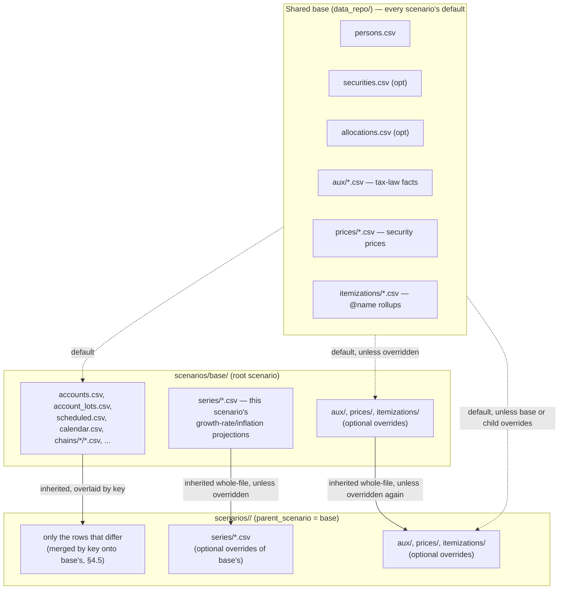
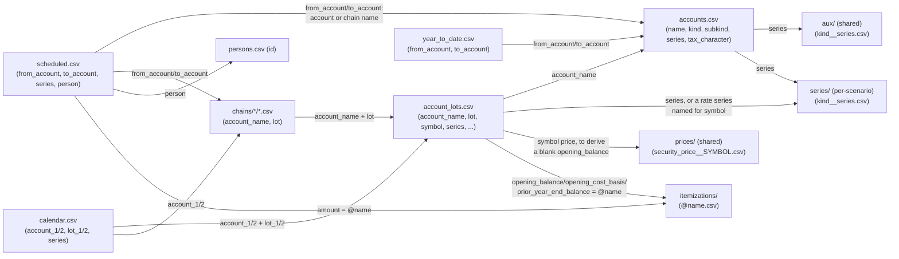

# ADR-003: Rule registry, event-kind registry, subkind vocabulary, and CSV schemas

- **Status:** Accepted
- **Date:** 2026-05-17
- **Supersedes:** —
- **Amended:** see [Amendments](#amendments) at the end.
- **Related:** [ADR-001](ADR-001-overall-architecture.md) (overall architecture), [ADR-002](ADR-002-storage-schema.md) (storage schema), [ADR-004](ADR-004-reproducibility-and-activation.md) (reproducibility).

## Context

[ADR-002](ADR-002-storage-schema.md) left four pieces of vocabulary deliberately open: the list of `account.subkind` values, the set of `amount_rule_kind` values for `scheduled_transaction`, the set of `kind` values for `calendar_event`, and the CSV column schemas the loader expects under the per-scenario folder. This ADR closes them.

Each registry is **closed in v1**: the loader rejects unknown values. New kinds enter only through this ADR (or a successor). This keeps the simulator legible — a reader can enumerate every way a rule can compute an amount and every way a calendar can patch reality.

## Decision

### 1. `account.subkind` vocabulary

CHECK-constrained at load time (the loader validates; the DDL keeps `subkind` as free TEXT so future ADRs can extend it without a schema change).

**Asset:**

| subkind | meaning |
| --- | --- |
| `cash` | bank and money-market money: checking, savings, or any cash position (by convention its lots use the symbol `CASH`). Checking and savings were once separate subkinds, but the engine never distinguished them and one account can now hold both as lots |
| `brokerage_taxable` | taxable investment account |
| `retirement` | an IRA or employer plan; each of its lots says which kind (§1a) |
| `hsa` | health savings account |
| `real_estate` | primary residence or other real property |
| `vehicle` | car, boat, etc. (depreciating asset) |
| `other_asset` | catch-all; populates `meta_json` for explanation |
| `business` | a sole proprietor's business bank account (a single-member LLC taxed as a sole proprietorship): cash like `cash`, and where its `business_income` arrives and its `business_expense` is paid from (§2.6). Its `owner` is the proprietor. `meta_json` `{"hobby": true}` marks a business not engaged in for profit (IRC §183), whose expenses aren't deductible |

#### 1a. Retirement lot subkinds

The lots of a `retirement` account, and only they, carry a `subkind` (§4.3), which sets the lot's tax treatment. One IRA is either Roth or traditional, but a 401k can hold both, so the distinction lives on the lot; the account's own `tax_treatment` is left blank.

| lot subkind | meaning | tax treatment |
| --- | --- | --- |
| `traditional_ira` | pre-tax IRA | `tax_deferred` |
| `roth_ira` | post-tax IRA | `tax_free` |
| `traditional_401k` | pre-tax employer plan (also 403b, 457b) | `tax_deferred` |
| `roth_401k` | post-tax employer plan | `tax_free` |

Money moved out of a traditional lot is `tax_deferred_out` (ordinary income), including into a Roth lot, which is how a conversion is taxed; into another traditional lot it is a rollover, `none`. An `rmd` counts and draws only traditional lots: Roth IRAs have no RMDs, and Roth 401ks none from 2024. A retirement account must have at least one lot, since an empty default lot would have no subkind.

**Roth distributions and the five-year clock.** A Roth lot tracks its basis, its contributions and conversions: `opening_cost_basis`, or the whole opening balance when that is blank, plus whatever moves into it later other than growth. A distribution, meaning money that leaves for a lot outside a `retirement` account, is *qualified* once the owner is 59½ and five tax years have passed since the clock started. Then all of it is `tax_free`. Before that its basis is still `tax_free`, and its earnings are `roth_nonqualified`, which the accumulator counts as ordinary income (the 10% additional tax under 59½ is not modeled). Since that turns on the owner's age, a `retirement` account's `owner` must be an actual person (§4.1), who has a `birthdate`, or the load fails. A Roth IRA pays out basis first; a Roth 401k pays out basis and earnings pro-rata, never more basis than the amount. Either way the lot's basis falls by the basis paid out, qualified or not.

- The clock of a Roth IRA lot is its owner's, one for all of their `roth_ira` lots; a `roth_401k` lot's is its account's. It starts on Jan 1 of the earliest year among those lots' `acquired` dates, or their account's `opened` where a lot has none. A lot with neither means the clock has run. A conversion is best given its own lot with its `acquired` date; it does not restart the owner's clock. Inherited Roth accounts from outside the household are not modeled ([#257](https://github.com/BobKerns/analysis/issues/257)).
- **At a death** ([#256](https://github.com/BobKerns/analysis/issues/256)), from the month after the owner's final month (§4.9), a distribution needs only the five years, since death replaces 59½, unless a surviving spouse takes the account as their own. The two `role = 'primary'` persons are spouses; with any other number there are none. `scenario.meta_json`'s `roth_survivor` (§4.5) is the survivor's election. With `own` (the default) the survivor treats the decedent's Roth IRAs as their own (Treas. Reg. §1.408A-6 Q&A-7(b)): from then on the decedent's Roth IRA lots and the survivor's own take the earlier of the two clocks (where a clock that has run is earliest) and the survivor's 59½, until the survivor's own death lifts the age test. With `beneficiary`, or with no spouse who outlives the owner, the decedent's lots keep the decedent's clock with no age test, and the survivor's own clock is unchanged. A Roth 401k lot always takes the beneficiary rule; a survivor who wants their own clock rolls it into their own Roth IRA. The account's `owner` doesn't change. Each person's final month is known when the run starts (one per ensemble member), so each lot's rules are worked out by date then.
- **A chain step on a Roth lot that would pay out `roth_nonqualified` earnings is skipped**, so the later steps pay instead, **unless no later step can**: the last step of a chain pays and is taxed, unless the chain is itself a step with later steps after it in a chain above. A step whose draw is all basis is not skipped.
- This applies to chain draws and to a `one_off_transfer` or `transfer_balance` with a blank `tax_character`. A scheduled rule's own `tax_character`, or a calendar row's, is used as written. Money moved from a Roth lot into another retirement lot is a rollover and keeps none of these rules. It takes its basis with it, by the same basis-first or pro-rata rule: the source's basis falls by that much, and a Roth destination gains it, or the whole amount when the draw would have been qualified (as when a qualified Roth 401k rolls into a Roth IRA). Any money out of a Roth lot spends its basis this way, whatever its `tax_character`.

**Liability:**

| subkind | meaning |
| --- | --- |
| `mortgage` | secured by `real_estate` account |
| `heloc` | home equity line of credit |
| `credit_card` | revolving consumer debt |
| `other_liability` | catch-all |

**Income** (flow accounts; balance accumulates over the run):

| subkind | meaning |
| --- | --- |
| `salary` | wage or salary income, ordinary |
| `ss_benefit` | Social Security retirement benefit |
| `pension` | defined-benefit pension |
| `interest` | interest income |
| `dividend` | dividend income |
| `capital_gain` | realized capital gains (long or short; bucket on `transfer_event.tax_character`) |
| `rental` | rental income |
| `other_income` | catch-all |

**Expense** (flow accounts):

| subkind | meaning |
| --- | --- |
| `living` | groceries, entertainment, day-to-day |
| `healthcare` | premiums, out-of-pocket medical |
| `housing` | utilities, insurance, maintenance (a broad category; the v2 ADR will likely split this) |
| `interest_expense` | mortgage interest, HELOC interest, any deductible/non-deductible interest leg |
| `taxes_federal` | federal income tax paid |
| `taxes_state` | state income tax paid |
| `taxes_property` | real estate tax |
| `business` | a business's spending, paid out of a `business` account as `business_expense` (§2.6) |
| `other_expense` | catch-all |

The expense vocabulary intentionally mixes categories (`housing`) with mechanisms (`interest_expense`); a future ADR is expected to refactor `housing` into finer-grained subkinds without disturbing the others.

The `_other` catch-alls are deliberate escape hatches; the `--check` mode ([ADR-001](ADR-001-overall-architecture.md) §CLI) flags any account using one so the author can decide whether to extend the vocabulary.

### 2. `amount_rule_kind` registry

Nine rule kinds. (Section numbers 2.4 and 2.8 are unused, so existing cross-references to the others stay valid.) Each rule's `compute(state, aux, date) → list[TransferEventSpec]` is a pure function. The columns `from_account`, `to_account`, `amount`, `base_date` on `scheduled_transaction` carry the common parameters; rule-specific parameters live in the named columns `interest_account`, `person`, `series`, `rate` (stored as `rate_micros`), `claim_age` (see §4.6). `amount` and `series` are each interpreted according to the row's `amount_rule_kind`. Rare or future extension parameters may go in the nullable `params_json` column.

**Invariant (rule-as-sole-origin):** every `transfer_event` traces to **exactly one rule** via `(reason_kind='rule', reason_id = scheduled_transaction.id)`. A once-only movement is a rule whose `cadence='one_off'`. Calendar events never write to `transfer_event` directly; money-moving calendar kinds *synthesize* one or more `cadence='one_off'` scheduled_transactions at expansion time (see §3). The only exception is the synthetic per-account `opening_balance` rule materialized at run start from the account model, which uses `reason_kind='initial'` and is its own degenerate rule. [ADR-002](ADR-002-storage-schema.md)'s `transfer_event.reason_kind` CHECK and `scheduled_transaction.created_by_event_id` (tracing a synthesized rule back to its authoring calendar event) enforce this.

**Multi-leg rules** (in v1: only `mortgage_payment`) emit more than one transfer event per fire; all legs share the same `(reason_kind, reason_id)` and are linked by `parent_event_id` for grouping. The `from_account`/`to_account` columns on the scheduled_transaction row are interpreted as the **primary leg** (cash → liability principal); the secondary leg (cash → interest expense) targets the account named by `interest_account`. This invariant — "each event traces to one rule, but a rule may emit multiple events per fire" — is the *direction* that matters: it makes audit, `explain`, and `compare` straightforward.

#### 2.1 `fixed_amount` (priority bands: 200, 300, 500)

Constant amount, optionally inflated.

- **Params:** none in JSON. Uses `amount` (required, cents in the DB), `base_date` (optional), `series` (optional inflation aux series; `fixed` means none), `inflation_cadence` (optional; `monthly` default or `annual`).
- **Compute:** `amount` as authored if `series` is NULL or `fixed`, else `amount × cumulative_inflation(base_date → date, series, cadence)`. With `cadence='monthly'` (default), the annual rate compounds every month. With `cadence='annual'`, it steps once per calendar year crossed (each January) — flat within a year, then a single jump, matching how real COLA-style adjustments actually apply.
- **Emits:** one event, `from_account → to_account`, amount as above, tax_character from the row.
- **Use:** salary, SS post-FRA (without COLA series), pensions, recurring fixed expenses, lump-sum one-offs. `inflation_cadence='annual'` in particular suits SS-like benefits modeled as `fixed_amount` rather than the dedicated `ss_benefit` rule.

#### 2.2 `percent_of_balance` (priority band: 100)

Accrue interest, dividends, appreciation against a source account's balance.

- **Params:** the row's `to_account` is the balance-bearing account; `series` names the aux rate-series. `rate_basis` defaults to `"balance"`.
- **Compute:** `amount = round(to_account_balance × monthly_rate)`. Annual rates are converted by `(1 + r)^(1/12) - 1`, computed in fixed-point micros.
- **Emits:** one event. Typical: `from_account = <income account>` (e.g. `interest_income`), `to_account = <balance-bearing account>` (interest credits to the asset). For depreciation, swap signs by routing through an expense account.
- **Use:** money-market interest, bond coupon approximations, portfolio appreciation per asset, real-estate appreciation.

**Authored on the account, not in `scheduled.csv`.** An asset account's growth is a property of the account, so it is declared by the `series` + `tax_character` columns on `accounts.csv` (§4.2) and the loader synthesizes one rule **per lot** ([ADR-005](ADR-005-lots-and-per-lot-state.md) §5; a lot's own `series`, a rate series named for its `symbol`, or the blend of its symbol's allocation slices (§4.1b) takes precedence over the account's): `cadence='monthly'`, priority 100, `start = scenario.start`, `to_account` = the account itself, and `name = growth_<abbreviated account name>` (each word trimmed to four letters, plus the lot for a non-default lot; see [ADR-005](ADR-005-lots-and-per-lot-state.md) §5). Hand-writing an equivalent `percent_of_balance` row is still legal, but the loader rejects one whose name collides with a synthesized rule.

The income side is **not** author-supplied. Each growth `tax_character` has one reserved counterparty account, created on first use so a scenario cannot mis-wire or omit it:

| `tax_character` | account | kind / subkind | `tax_treatment` | meaning |
| --- | --- | --- | --- | --- |
| `ordinary` | `interest_income` | income / `interest` | `taxable` | taxable interest and dividends |
| `gains` | `capital_gains` | income / `capital_gain` | `taxable` | unrealized gains in a taxable account |
| `deferred` | `deferred_gains` | income / `capital_gain` | `tax_deferred` | unrealized gains in a tax-deferred account |
| `tax_free` | `tax_free_gains` | income / `capital_gain` | `tax_free` | unrealized gains in a Roth/HSA account |
| `depreciation` | `depreciation` | expense / `other_expense` | `none` | value lost by a wasting asset |

A `retirement` account's lot takes its growth character from its subkind instead of from the account: `tax_free` for a Roth lot, `deferred` for a traditional one. So Roth and traditional lots in one account grow from their own counterparties, and the account's `tax_character` can stay blank. Only a lot without a subkind falls back to the account's character.

`gains` and `deferred` are tax characters in their own right (§2 registry): unlike `ltcg`, they are *unrealized*, so the retrospective tax scan ignores them until a sale or distribution converts them into `ltcg`/`tax_deferred_out`. Rules synthesized for `depreciation` record `tax_character='none'` — personal-use depreciation is not deductible.

**Negative rates (depreciation).** The rate series may be negative. `to_account` remains the balance-bearing account and `from_account` remains the counterparty, but when the computed amount is negative the two legs swap at post time, so value flows *out* of the asset and into the expense account. Declining-balance decay follows automatically from `rate_basis='balance'` (the default), and the asset asymptotically approaches — without reaching — zero, which is roughly how a vehicle's scrap value behaves.

Depreciation is a book entry, not spending. Reporting that totals cash outflows should exclude the `depreciation` account (see `notebooks/net_worth.ipynb`).

#### 2.3 `rmd` (priority band: 200 or 500)

IRS Required Minimum Distribution.

- **Params:** the row's `from_account` is the subject IRA/401k account (the one being drawn down) and `person` = person id. When the subject account has several lots ([ADR-005](ADR-005-lots-and-per-lot-state.md)), `from_account` is instead a chain listing the lots to draw from, in order, and `params_json` names the account the RMD is for: `{"subject_account": "<account>"}`; the chain may only draw from that account's lots. The amount is that account's total on the prior Dec 31 over the age factor. Aggregation across an owner's several IRAs is deliberately not modelled: a brokerage distributes per account, without regard to distributions taken elsewhere. Factor table is `rmd_factors`; start-age series is `rmd_start_age` (both fixed aux references).
- **Compute:** Fires once per year (cadence = `annual`, `month_of_year` typically 12). `amount = round(dec31_prev_year_balance / uniform_lifetime_factor(person_age_year_end))`. `dec31_prev_year_balance` comes from end-of-prior-year `account_state` (the subject account's traditional lots added together; Roth lots owe no RMD, §1a); for the partial first year it comes from `account_lot.prior_year_end_balance` (which the author must supply for any `traditional_ira` / `traditional_401k` lot whose owner reaches RMD age during the scenario's first calendar year).
- **Start semantics:** the row's `start` column is a lower bound on candidate fire dates. The actual first fire is `max(row.start, year-end of the year person reaches start_age)`. Authors typically set `start = scenario.start` and let the age gate dominate.
- **Emits:** one event, `from_account = subject_account`, `to_account = <taxable landing>` (typically `Asset_Checking`); `tax_character = 'tax_deferred_out'` (the retrospective tax scan reclassifies as ordinary income).
- **Use:** post-age-73 required distributions for either spouse.

#### 2.5 `ss_benefit` (priority band: 200)

Social Security retirement benefit with COLA.

- **Params:** `person` = person id, `claim_age` = integer claim age, `amount` = PIA at FRA in dollars, `series` = COLA aux series name (e.g. `cpi`). `tax_character` on the row should be `ss_benefit`.
- **Compute:** Fires monthly. Adjusts `base_pia_at_fra_cents` by the claim-age multiplier (a lookup based on months early/late vs. FRA, hard-coded) and applies cumulative COLA from claim date to `date`. Zero before the person reaches `claim_age`.
- **Emits:** one event, `from_account = Income_SS_<person>`, `to_account = <SS landing account>`, `tax_character = 'ss_benefit'`. The income account may have `maximum_balance = 0` and an `overflow_chain`; the chain then distributes the gross benefit into its component destinations.
- **Start semantics:** as with `rmd`, the row's `start` column is a lower bound. The rule emits zero amount in months before the person reaches `claim_age`; that age gate ANDs with the row's `start`.
- **Use:** each spouse's SS rule. Different scenarios swap `claim_age` to test claim-timing decisions.

##### 2.5.1 Benefit withholding (Medicare Part B/D)

Medicare Part B and Part D premiums are withheld from the Social Security payment: the beneficiary never receives them, but they are part of the **gross** benefit that the provisional-income test taxes. Modeling only the net deposit understates taxable income; routing the premium out of checking overstates the deposit.

Author it as an extra leg out of the *income* account:

| leg | from | to | `tax_character` |
| --- | --- | --- | --- |
| net deposit | `<SS income account>` | checking | `ss_benefit` |
| Part B premium | `<SS income account>` | `<healthcare expense account>` | `ss_benefit` |
| Part D premium | `<SS income account>` | `<healthcare expense account>` | `ss_benefit` |

`_tax_year_income_buckets` sums `ss_benefit` by tax character regardless of destination, so gross = the sum of all three legs and the deposit leg alone is what reaches cash. Both legs are gated by the same person (via the accounts' `owner`), so a lifespan end retires them together. When a rule carries `ytd_preroll`/`ytd_amount` for a partial first year, the premium legs need it too, or that year's gross is understated.

Medigap (Part G) is **not** withheld — it is billed directly, so it stays an ordinary expense funded from checking. Likewise, premiums are only withheld while a benefit is actually being paid: someone on Medicare before claiming Social Security is billed directly, and the premium becomes a withheld leg only from the claim date.

Premiums are authored flat (grown by an inflation series). The income-related surcharge (IRMAA), which keys off MAGI from two tax years prior, is an `irmaa` rule (§2.11) written beside each person's premium legs, from the same income account and with the same `ss_benefit` character while it is withheld.

For a single gross benefit with multiple destinations, use one `ss_benefit` row and a chain attached to the Social Security income account. Chain rows may specify either a fixed `amount` or a `percent` of the amount remaining after earlier rows. Once allocation fields are used, every row must specify one and the final row must specify `percent = 100`; this makes the definition stable when the benefit amount changes.

#### 2.6 `tax_accumulator` (priority band: 400)

A placeholder rule that marks "compute taxes for the prior tax year" at a specific calendar point. Fires at year-end (December) for accrual and in April for reconciliation.

- **Params:** `{ "year": "previous", "scope": "federal" | "state", "filing_status_aux": "filing_status", "bracket_aux": "federal_brackets", "standard_deduction_aux": "standard_deduction" | "state_standard_deduction", "itemized_deduction_aux": "federal_deductions" | "state_deductions", "nol_limit_percent": 80 }`.
- **Compute:** delegates to `tax.py`. Scans `transfer_event` rows for the relevant year by `tax_character`, applies brackets and deductions from aux tables, and computes net tax owed. **Filing status** is the `filing_status` aux table's row for the tax year, except that `MFJ`/`MFS` become `Single` from the year after a `role = 'primary'` person's final month from `lifespan.csv` (§4.9); the aux table needs no row for it. For `scope = federal`, if an `ltcg_brackets` aux table exists, the long-term gain is stacked on top of ordinary taxable income and taxed at that table's rates (§4.4); without it long-term gains are taxed as ordinary income, and `scope = state` always does. **Deduction** is whichever is greater of the standard deduction (`standard_deduction`, or for `scope = state` `state_standard_deduction` with the same series as its brackets, falling back to `standard_deduction`; `standard_deduction_aux` names another kind) and the itemized total from the `federal_deductions`/`state_deductions` aux table (§4.4) for that tax year; with no itemized rows for that date, the deduction is just the standard one, unchanged from before itemized deductions existed. `state_deductions` falls back to `federal_deductions`'s figure when the scenario has no `state_deductions` rows at all, so most states never need their own file. **Capital gains** (IRC §1211(b), §1212(b); [#199](https://github.com/BobKerns/analysis/issues/199)): a year's `stcg` and `ltcg` legs (a withdrawal at a loss posts a negative one) less its `capital_loss` rows (§4.7), each side less the loss carried into the year, net against each other; a net short-term gain is ordinary income and a net long-term gain is taxed as above. A net loss offsets ordinary income up to the `capital_loss_limit` aux table's amount for the year's filing status (§4.4), short-term loss first, and the rest carries into the next year keeping its character. The carryover is recomputed from every earlier year of the run, so it needs no state. Both scopes apply it. `tax_year_summary` records `<scope>_capital_loss_deduction` and `<scope>_capital_loss_carryover`. **MAGI:** a federal rule also records `federal_magi`, the MAGI an `irmaa` rule reads (§2.11): AGI plus tax-exempt interest, which the model has no tax character for yet ([#265](https://github.com/BobKerns/analysis/issues/265)), so its AGI. **A business** (Schedule C; [#231](https://github.com/BobKerns/analysis/issues/231)): the year's `business_income` legs into `business` accounts (§1) less its `business_expense` legs out of them is ordinary income, so a loss offsets the year's other income, long-term gains included, and lowers provisional income for Social Security. A business account whose `meta_json` says `"hobby": true` deducts none of its expenses; its receipts still count. The loss the year's income can't absorb is a **net operating loss** (IRC §172): the business loss less the year's other income above the deduction, since a nonbusiness deduction offsets only nonbusiness income and the capital-loss deduction doesn't count. It carries forward and offsets up to `nol_limit_percent` of a later year's taxable income (80 federal, 100 state by default; California has no 80% limit), read from the year before's `<scope>_nol_carryover`, so a year without a summary carries nothing in. The NOL comes off taxable income rather than AGI, so taxable Social Security is not recomputed for it. `tax_year_summary` records `<scope>_schedule_c_net`, `<scope>_hobby_expense_disallowed`, `<scope>_nol_used` and `<scope>_nol_carryover`. Self-employment tax and the QBI deduction on a profit are not modeled yet. **Drawdown tax** ([#251](https://github.com/BobKerns/analysis/issues/251)): each year it computes, the accumulator also prices the tax still owed on the money in the run as of that year's last step: every traditional (`tax_deferred`) asset lot's balance, plus every non-cash `taxable` lot's unrealized gain over its cost basis. It draws that money down evenly over `drawdown_years` (default 10), each year's share on top of the year's own income, as ordinary income for the traditional balances and long-term gain for the gains, using the same brackets, filing status, deduction and Social Security taxation. A carried-in net operating loss covers as much of the added income as its limit allows. The extra tax over all those years is recorded as `<scope>_drawdown_tax`, on `<scope>_drawdown_base`, the money it taxes. `scenario.meta_json`'s `after_tax` sets `drawdown_years` and `step_up` (§4.5). With `step_up` true, gains are left out, as a basis step-up at death would leave them. After-tax net worth (`RunConnection.after_tax_net_worth_frame`) takes off each month's base times its year's rate, and a finished year's unpaid balance due, from its year end until the April payment posts.
- **Emits:** one event in April: `from_account = Asset_Checking`, `to_account = Expense_Taxes_Federal` (or `_State`), amount = computed tax minus withholding already paid via `fixed_amount` rules through the year. The December firing typically emits zero (it only writes `tax_year_summary` rows for visibility) but may emit a true-up if estimated payments are part of the scenario.
- **Use:** one per (year, scope) pair, authored as `cadence = annual`.

#### 2.7 `mortgage_payment` (priority band: 300; multi-leg)

Monthly P&I against a mortgage liability account.

- **Params:** the row's `to_account` is the mortgage liability; `interest_account` names the interest-expense account; `rate` = annual rate as a percent (e.g. `6%`), stored as `rate_micros`, millionths of 1. Monthly P&I is the row's `amount`.
- **Compute:** at fire time, `interest = round(liability_balance × rate_micros / 12 / 1_000_000)`; `principal = payment_amount - interest`.
- **Emits two events:**
  1. **Interest leg:** `from_account = Asset_Checking` (the row's `from_account`), `to_account = interest_account`, amount = `interest`, tax_character = `'none'`.
  2. **Principal leg:** `from_account = Asset_Checking`, `to_account = <liability>` (the row's `to_account`, reducing the liability balance), amount = `principal`, tax_character = `'none'`, `parent_event_id` linked to the interest leg.
- **Use:** one row per active mortgage. Retired by a `retire_scheduled` calendar event when the home is sold (see §3.3).

#### 2.9 `on_death` (priority band: author's choice; recommend 900)

Fires once, automatically, the month a person dies -- for one-time death-triggered liquidations (selling a car, a life-insurance payout) where the current book value **is** the payout (no separate death-benefit computation yet).

- **Params:** the row's `person` (required) names whose final month from `lifespan.csv` (§4.9) triggers it. `from_account`/`to_account` must both be concrete accounts (not interior chains) -- "100% of value" only makes sense for one real balance. `tax_character` must be `'tax_free'` -- death-triggered liquidations/payouts (selling a car, a life-insurance death benefit) are not taxable events; the loader rejects any other value.
- **Compute:** at fire time (every month the rule's cadence allows it to be checked, recommend `cadence=monthly`), no-op unless `month_s` is exactly the month after `person`'s `final_month` (the same month other lifespan-gated rules stop -- see §4.9) and `person` has a declared lifespan at all. When it matches, transfers 100% of `from_account`'s current balance to `to_account`. A zero balance is a no-op, not an error; a `person` with no `lifespan.csv` row means the rule never fires.
- **Emits:** one event when it fires, none otherwise.
- **Use:** `from_account` = the vehicle/policy account being liquidated, `to_account` = wherever the proceeds land (e.g. the household cash account). Exempt from the general lifespan-gating in §4.9 (which would otherwise suppress the very rule that fires *because of* the lifespan ending).

#### 2.10 `fill_bracket` (no priority: runs last in its month)

A yearly Roth conversion sized to a tax target ([#252](https://github.com/BobKerns/analysis/issues/252)): the most that keeps the year's taxable income at or under the target.

- **Params:** `from_account`/`from_lot` is a traditional lot (`traditional_ira`, `traditional_401k`, §1a) and `to_account`/`to_lot` a Roth lot, both named directly, not through a chain. The target is exactly one of:
  - `rate`, a bracket's marginal rate (e.g. `22%`): the target is the top of that bracket in the year's table for the year's filing status, so it follows a new table and the switch to `Single` after a death. It is measured against **ordinary** taxable income (taxable income less the long-term gain stacked on it, §2.6), the part that sets the conversion's own rate. The bracket must have a top: the highest rate is rejected.
  - `amount`, a taxable income in today's dollars, grown by `series` (an inflation series) from `base_date` at `inflation_cadence` as a `fixed_amount` grows. It is measured against all taxable income. A `set_amount` calendar row changes it, so an ensemble can vary it (`discrete`, ADR-006).

  `params_json` takes, all optional: `scope` (`federal`, the default, or `state`), the bracket table and tax rule it measures with; `tax_rule`, the name of the `tax_accumulator` rule whose settings (brackets, deduction, filing status, Social Security taxation) it uses, needed only when the scope has more than one; `max_amount`, a cap on one year's conversion in dollars; `max_marginal_rate` (e.g. `"30%"`), which stops where the next $100 converted would cost more than that rate in tax: its ordinary rate plus the long-term gain it pushes into a higher rate plus the Social Security it makes taxable; and `irmaa_tier` (a whole number, 0 for none), which keeps the year's MAGI (§2.11) at or under the next tier's floor, so the premiums two years later stay in that tier. Both IRMAA measures use the `irmaa_tiers` table in force in the conversion year, grown to its January, not the one projected for two years later: that is what a planner knows in December, and since the floors rise it errs safe. With `max_marginal_rate` and the scenario's `irmaa` rules, crossing an IRMAA floor costs the higher tier's add-ons for each `irmaa` rule that will be charging two years later, for the months of that year its `start` and `end` allow, if its person is alive when the conversion is decided (a later death is not foreseen), each at the tier its own `filing_status_aux` table sets. `cadence` is `annual`, `month_of_year` usually `12`, and `tax_character` `tax_deferred_out`. The loader rejects a `priority`, a `tax_year` (it converts for the year it fires), a `month_of_year` before that of an RMD drawing from the same lot, a `series` other than `fixed` on a bracket target or one with no `base_date`, an unknown `params_json` key, an `irmaa_tier` with no higher tier in the table (it would cap nothing), a `tax_rule` of another scope, a scope with no tax rule, a state-scope rule watching IRMAA when more than one federal rule could measure its MAGI, and a rate its tax rule's bracket table (its `bracket_aux` and `bracket_series`) doesn't have.
- **When:** after every other rule of its month, whatever their priorities, and after the RMD rule in particular. This is a constraint, not a priority. In a year an RMD is due, the first money out of the IRA counts toward it, and an RMD can't be rolled over or converted (Treas. Reg. §1.408-8), so the year's RMD must come out first; the target also needs the year's income. A conversion lowers the next year's RMD through the Dec 31 balance it is figured from (§2.3). A `month_of_year` before December sees only the income posted so far.
- **Compute:** builds the year's tax estimate from the tax rule's settings, the same estimate the accumulator settles with (`engine._year_tax_estimate`), over the transfers posted so far. Taxable income never falls as the conversion grows, but it can grow faster than the conversion, since added income makes more Social Security taxable (and slower, while a carried-in net operating loss absorbs part of it); so the amount is found by bisection over cents, not by subtracting the year's income from the target. It is then capped by `max_amount` and the lot's balance, capped by `irmaa_tier`'s floor (bisected on MAGI, which never falls as the conversion grows), and stepped up from zero in $100 steps against `max_marginal_rate` when that is set (the marginal cost can rise and fall again, so it is not bisected). A step that would cross an IRMAA floor is not judged alone, since the surcharge charged to one $100 step would always stop the conversion at the floor: the span from the floor to where stepping would stop before the next floor is priced instead, its tax plus the surcharge, and the conversion goes on past the floor only if that span's average cost is within the rate; otherwise it stops exactly at the floor. A year already at or past the target converts nothing.
- **Emits:** one `tax_deferred_out` event from the traditional lot to the Roth lot, taxed as ordinary income and adding to the Roth lot's basis, as `sim invest` does. Its `meta_json` holds `{"fill_bracket": {"target", "measure", "reached"}}`: the target in cents, `ordinary` or `taxable`, and the measure after the conversion. The tax is paid by the `tax_accumulator` rule the next April.
- **Use:** one row per traditional lot converted. Two rows fill the bracket together, the later (by `id`) seeing the earlier's conversion as income.

#### 2.11 `irmaa` (priority band: 200)

Medicare's income-related monthly adjustment amount ([#253](https://github.com/BobKerns/analysis/issues/253)): the surcharge on the Part B and Part D premiums that a household pays when its modified adjusted gross income (MAGI) on the tax return from **two years before** the premium year is over a tier's floor (42 USC 1395r(i), 1395w-113(a)(7)). The tiers are cliffs: one dollar over a floor costs the tier's whole add-on, every month of the premium year, for each enrolled person on the return.

- **Params:** `person` (required) is the enrollee, one row each (a couple both on Medicare has two). `from_account`/`to_account` as for the premium legs (§2.5.1): the Social Security income account with `tax_character = 'ss_benefit'` while a benefit is paid and the surcharge is withheld from it, otherwise the account it is billed from, with `none` (`sim scheduled add` picks between the two by whether `from_account` is an `ss_benefit` income account). `start`/`end` are the person's Medicare months, as on the premium rows; the lifespan gate (§4.9) ends it at a death. `cadence = monthly`. No `amount`: the tier table sets it. `params_json`, both optional: `parts`, `"B+D"` (default), `"B"` (no drug coverage) or `"D"`; `filing_status_aux`, the filing-status table, `filing_status` by default.
- **Compute:** for premium year Y, the household's MAGI for Y − 2 picks the highest tier whose `magi_floor` it is more than (none: nothing to charge), in the `irmaa_tiers` table (§4.4) for the filing status on that year's return: the filing-status table's row for Y − 2, `Single` from the year after a taxpayer's death as for the tax rule (§2.6), and for a year before the table starts its first row. So the year a spouse dies is still a joint return, and two years later the survivor alone pays on that joint MAGI with joint floors (the "widow's penalty"); after that, single floors. The table is the one in force in January of Y. Each of a row's three figures grows past its `effective_date` to that January by its own optional inflation series (`floor_series`, `part_b_series`, `part_d_series`): a grown floor is rounded to $1,000, as the law rounds it, and a blank series holds the figure flat. Nothing about how the law indexes the figures is built in: the series say it, so the top tier's floor, frozen through 2027, names a series that is 0% until then, and a change in the law is a dated row in a series or a `set_rate` (§3.1) that can vary in an ensemble. MAGI for a year the run computes is the federal tax rule's `federal_magi` (§2.6), so the scenario needs exactly one federal `tax_accumulator` (the loader refuses none or several, since each would record its own `federal_magi`), and it must have computed Y − 2 by January of Y. For a year before the run's first year, it is `scenario.meta_json`'s `irmaa.magi` (§4.5); a year left out charges nothing, and the loader warns for each of the first two premium years a rule is active in that has none. The tier charged is recorded in `tax_year_summary` as `federal_irmaa_tier` under the MAGI's year (0 below the first tier), for the years the run computed.
- **Emits:** one event per month: the tier's `part_b` plus `part_d` add-ons (or the one `parts` names), grown; none below the first tier.
- **Not modeled:** an appeal with form SSA-44 to use a more recent year after a life-changing event (stopping work, a spouse's death); tax-exempt interest in MAGI ([#265](https://github.com/BobKerns/analysis/issues/265)), so MAGI is AGI.
- **Use:** with each person's Medicare premium legs; a Roth conversion's cost two years later.

### 3. `calendar_event.kind` registry

Seven kinds. Per the §2 invariant, calendar events never write to `transfer_event` directly. They fall into three classes:

- **Intent-mutating** (no money moves at expansion time; the event amends the in-memory intent — rates, schedules, aux tables): `set_rate`, `set_amount`, `retire_scheduled`, `swap_aux_table`.
- **Rule-synthesizing** (the event inserts one or more `cadence='one_off'` scheduled_transactions with `created_by_event_id = calendar_event.id`; those rules then fire on `event.date` through the normal monthly step): `one_off_transfer`, `transfer_balance`.
- **Inert** (no effect in a run; read only by ensemble resolution): `latent_factor` (§3.6).

A synthesized rule fires once, as one row in `transfer_event` (or more, when a chain splits it), traced back to its event through `created_by_event_id` on `scheduled_transaction` and `applied_calendar_event`.

**Ensemble variation ([ADR-006](ADR-006-ensemble-scenarios.md)):** a row may additionally carry `vary_distribution` (and the paired `vary_target`/`vary_low`/etc. columns, §4.8), marking its own `amount` or `date` as drawn per ensemble member rather than literal — the "vary" step resolves every such row (dates first, then amounts/rates) before handing the intent to the ordinary, unmodified run path. A row that still has `vary_distribution` set when it would fire is always a mistake (a recipe run directly, or a resolution step skipped), so the engine raises rather than using the placeholder value underneath it.

**Correlated variation ([ADR-008](ADR-008-correlated-parameters.md)):** a varying row (or a `latent_factor`) may name one parent in `vary_correlate_with`, with a correlation `vary_correlation` between their normal scores (§4.8). The rows form a forest of trees, and each row's draw is correlated with its tree while keeping exactly its own authored distribution. A tree's root may set `vary_tail_dependence` to make the tree's extremes tend to coincide (a Student-t copula).

#### 3.1 `set_rate` (primitive)

Replace one rate aux-table entry effective from this date forward.

- **Columns:** `series` = rate-series name, `amount` = new value as a percent (e.g. `4.5%`), stored in micros (`45000`). A value beyond ±100% is a load error: it is almost certainly one still in micros.
- **Expansion:** inserts a new `aux_table` row with `kind = 'rate'`, the given `series`, `effective_date = event.date`, and `payload_json = {"value_micros": amount}`. The original row is **not** deleted; aux lookups use the most-recent-by-`effective_date` row.
- **Existing series only:** a `set_rate` row adjusts a series; it doesn't create one. Its `(aux_kind, series)` must have a series, aux or prices file in the scenario or a parent, or the row is an unresolved reference (usually a typo, or the wrong `aux_kind`) and a load error. Likewise a rule that reads a series is a load error unless a file supplies it, since the run would fail once it reached that rule.
- **Unread series:** a row whose series has a file but which no scheduled rule, chain step cap, or account growth series in the scenario reads loads with a warning, not an error, and only `sim check` prints it: it has no effect there, but a mix-in or parent may set a series only the scenarios inheriting from it read.
- **Ramp ([ADR-006](ADR-006-ensemble-scenarios.md), ensemble-only):** a row with `vary_target='amount'` and `vary_ramp_months` set draws its target the same way any `amount` variation does, then the vary step expands it into that many additional ordinary `set_rate` rows, one per month, linearly interpolated from the series' current value up to the drawn target, landing on it at `date + vary_ramp_months` — an expansion, not a new way of reading `aux_table` (still latest-row-on-or-before-month, no interpolation logic added there). Modeling a sudden jump is rarely the realistic prediction, which is the whole reason the ramp exists — including for a lot's future price expectation, since the engine only ever consults `security_price` once to derive an opening balance ([ADR-005](ADR-005-lots-and-per-lot-state.md) §6), so varying it is really varying this rate assumption.
- **Process ([ADR-006](ADR-006-ensemble-scenarios.md) §4a, ensemble-only):** a row with `vary_target='amount'` and `vary_process` set draws its level the same way, then the vary step expands it into one ordinary `set_rate` row per year, same month, moving around that level, through the scenario's end or until the next authored `set_rate` row for the same series and `aux_kind`. Like a ramp, it adds nothing to how `aux_table` is read.
- **Use:** "checking account starts earning 4% in 2027".

#### 3.2 `set_amount` (primitive)

Mutate a `ScheduledTransaction.amount` going forward.

- **Columns:** `scheduled_name` = target rule name, `amount` = new base amount in dollars (stored in cents), `param_date` = new base date (optional).
- **Expansion:** updates the named row's `amount` (and `base_date` if given) in the run's in-memory intent. Persisted as an `applied_calendar_event` row; the run's snapshot of `scheduled_transaction` reflects the post-event state.
- **Use:** "discretionary spending drops to $4,500/mo on retirement".

#### 3.3 `retire_scheduled` (primitive)

End an active `ScheduledTransaction`.

- **Columns:** `scheduled_name` = name of rule to retire.
- **Expansion:** sets `end = event.date` on the named row.
- **Use:** "salary stops on retirement"; "mortgage rule retires when home is sold".

#### 3.4 `one_off_transfer` (rule-synthesizing)

A single one-shot movement, expressed as a synthesized rule so the §2 invariant holds.

- **Columns:** `account_1` = from account or chain, `account_2` = to account or chain (not both chains), `amount` = dollars (stored in cents), `tax_character` = tax character.
- **A blank `tax_character`** ([#201](https://github.com/BobKerns/analysis/issues/201)) lets the source decide, as it does for a sweep (§4.7). Money out of a lot that tracks cost basis (a taxable, non-cash lot such as `brokerage_taxable`) is a sale: each leg splits into `return_of_capital`, its pro-rata share of the lot's basis, and the gain (`ltcg`, or `stcg` for a lot held a year or less), and the lot's basis falls by the share ([ADR-005](ADR-005-lots-and-per-lot-state.md)). Money out of a traditional lot is taxed by where each leg lands, as for a sweep (§1a): `none` into another traditional lot (a rollover), `tax_deferred_out` anywhere else, a Roth lot (a conversion) or checking alike, and through a destination chain each step's leg is decided this way. From any other source it is `none`. A `tax_character` the row sets is used as written. The synthesized rule records a sale as `return_of_capital` and traditional money as `tax_deferred_out`; its legs carry the characters that are taxed.
- **Expansion:** synthesize one `scheduled_transaction` with `amount_rule_kind='fixed_amount'`, `cadence='one_off'`, `start = end = event.date`, `amount` from the payload, fields from payload, `created_by_event_id = calendar_event.id`. The engine fires it on `event.date` and routes it as it does any `fixed_amount` rule: lot to lot directly, or through a chain's sweep or draw, each `transfer_event` traced to that synthesized rule.
- **Use:** windfalls, gifts, one-time settlements that have no recurring structure.

#### 3.5 `swap_aux_table` (primitive)

Replace an aux table with another of the same kind from this date forward ([#197](https://github.com/BobKerns/analysis/issues/197)): a move to another state (`state_brackets`, which takes the new state's `state_standard_deduction` with it, and `state_deductions` if used), a tax law that changes on a known date, a switch to another inflation or rate assumption.

- **Columns:** `series` = the series being replaced, blank for a kind without one (`federal_brackets`, `standard_deduction`, ...); `params_json` = `{"aux_kind": "<kind>", "source_series": "<series>"}`, the table that takes its place. The source is an ordinary aux file, `<kind>__<source_series>.csv` in `aux/` or `series/` (§4.4), overridable per scenario like any other (§4.1d), and read only through this row. Every other column is blank, and the loader rejects a row that fills one. It checks that `aux_kind` is a registered kind (§4.4) other than `security_price`, which is read only at load to value lots, and `life_table`, read only to draw a member's lifespan, so neither can change mid-run, and that both tables exist; the run fails if the source has no row in force on `date`.
- **Expansion:** from `date` on, every lookup of (`aux_kind`, `series`) sees exactly what a lookup of the source would: the source's row (or, for brackets, row set) in force on `date` applies from then, and its later rows from their own dates. The replaced table's own later rows no longer apply. An inflation series keeps its rows before `date`, since an inflated amount compounds from its `base_date`. The run file's `aux_table` holds the swapped table, so a report read from it (CPI-constant dollars) sees what the run used.
- **Ensembles:** `vary_target='date'` draws the date; there is no amount to vary.
- **Use:** relocating; a scheduled change in tax law. `sim calendar add swap-aux-table DATE AUX_KIND SOURCE_SERIES [--series SERIES]` writes one.
- **Key:** the row's `aux_kind` is part of its merge key (§4.5), so swaps of two kinds without a series on one date are two events.

#### 3.6 `latent_factor` (inert)

A shared influence that varying rows correlate with but that isn't itself a modeled value, such as "the inflation regime" ([ADR-008](ADR-008-correlated-parameters.md) §3).

- **Columns:** `name` (required) and `description`; optionally `vary_correlate_with`/`vary_correlation`, to depend on another factor and form a hierarchy, or, on a factor with no parent, `vary_tail_dependence`. Every other column must be blank. `date` may be blank: the loader stores the scenario start as a placeholder, which nothing reads.
- **Effect:** none in a run (the engine skips it). Ensemble resolution draws its standard normal score, and its dependents' draws correlate with it.
- **A factor with no dependents** loads with a warning, not an error, and only `sim check` prints it: it may be work in progress, or meant for child scenarios to use.
#### 3.7 `transfer_balance` (rule-synthesizing)

Move one lot's whole balance, with the amount the simulated balance when the event fires rather than one written in advance: a 401(k) rolled into an IRA at a future date ([#134](https://github.com/BobKerns/analysis/issues/134)).

- **Columns:** `account_1` (+ `lot_1`) = the source, which must be an asset account's lot, not a chain: "the balance" only means something for one real balance. `account_2` (+ `lot_2`) = the destination, an account's lot or a chain, as for §3.4, but not the source lot itself. A blank `tax_character` is treated as for §3.4: the balance of a lot tracking cost basis is sold, taking all of the lot's basis; a traditional lot's balance is taxed by where it lands (a rollover into another traditional lot is untaxed); from anything else it is `none`. `amount` must be blank, so `vary_target='amount'` is refused; `vary_target='date'` draws the transfer's date per ensemble member.
- **Expansion:** calendar events apply at the start of their month, before its rules, in date order, so the amount is the source lot's balance at the previous month end plus whatever calendar events earlier in the month moved into or out of it; that month's growth accrues at the destination. A zero or negative balance is a no-op, as for `on_death` (§2). Otherwise the event synthesizes one `fixed_amount` `cadence='one_off'` rule for that amount, exactly as §3.4 does, so the transfer routes as a `one_off_transfer` of that amount would and its `transfer_event` traces to the synthesized rule. The one difference is that the source's refill look-ahead (§4.7) does not run: emptying the lot is the point, so a source with a `minimum_balance` is not topped up first. A later debit that month still refills it as usual. Basis and share quantity move with the money through the usual lot tracking ([ADR-005](ADR-005-lots-and-per-lot-state.md)).
- **Lots:** there are no implicit chains ([ADR-005](ADR-005-lots-and-per-lot-state.md) §3), so emptying an account with several lots is one row per lot.
- **Afterwards:** nothing stops the scenario moving money into the emptied lot later; end the rules that do (contributions, or an RMD rule that would otherwise draw on the old prior year-end balance) with `retire_scheduled` (§3.3) at the same date.
- **Not covered:** an in-kind transfer between taxable accounts that carries the basis over without realizing gains.
- **Use:** rolling a 401(k) or 401(a) into an IRA; closing an account into another.

### 4. CSV file layouts

See `docs/user-guide.md` for a task-based walkthrough of common edits; this section is the exact column-by-column reference.

All files: UTF-8, comma-delimited, one header row. Empty string means NULL. Boolean columns use `0`/`1`. A `YYYY-MM` date column names a month: it accepts `YYYY-MM` or `YYYY-MM-DD` and the loader pins either to that month's last day (a day within the month is ignored, #34), so a rule's `end` of `2030-06-15` still pays in June. Where the engine counts days, a full date keeps its day: a `biweekly` rule's `start` (its first payday, the 14-day anchor, so it must be a full date) and `end`, and a `retire_scheduled` event's `date` (it becomes that rule's `end`); a bare month there is still the month's end. Columns marked `YYYY-MM-DD` (`birthdate`, a lot's `acquired`, a `security_price`'s `effective_date`) are day-precise and keep the exact day. A `vary_target='date'` row's bounds are the one mixed case; see `vary_low`/`vary_high`. Money columns are decimal dollars, written `1234` or `-1234.56` and no other way (no `$`, thousands separator, single decimal digit, or bare `.99`); the loader converts them to integer cents. Every percent column (a rate, an allocation `weight`, a chain step's `percent`) takes its `%` sign, `4.5%` and never a bare `4.5`, with at least one digit before any decimal point and at most four after; a bare number in a percent column is a load error, so a percent can't be mistaken for dollars, a fraction, or micros. `rmd_factors.csv`'s `factor` is a plain number (`26.5`). The loader converts percents and factors to integer micros. Nothing past the loader sees dollars or percents. A file with a column from before this (`annual_rate_micros`, `marginal_rate_micros`, `rate_micros`, `factor_micros`) fails to load, naming the one-time conversion script `scripts/convert_units_130.py`.

JSON-typed columns hold a single JSON value as a string; the loader parses and revalidates against the rule/event kind. Multi-line JSON in CSV is supported via standard CSV quoting.

#### 4.0 Map of the data repo

High level: what's shared by every scenario by default, what belongs to one scenario, and
where a scenario can override a shared file for itself and its descendants (§4.1d).



`series/` has no shared root tier (unlike `aux/`/`prices/`): growth-rate and
inflation series are per-scenario projections, so what's "shared" for them is
just the root scenario's own `series/`, reached by ordinary inheritance.

Detailed: how one scenario's own files reference each other and the shared base, by their key
columns. An arrow is "the column on the left names a row identified by the column at the
arrowhead."



A chain's own file (`chains/<role>/<name>.csv`) is itself a list of `account_name` (+ `lot`)
rows, so it is both a target (from `scheduled.csv`/`calendar.csv`/`accounts.csv`
`refill_chain`/`overflow_chain`) and a source of the same `account_name`/`lot` references shown
above; it is folded into "chains/*/*.csv" here rather than drawn as its own layer.

#### 4.1 Shared base: `data_repo/persons.csv`

Single identity list for the household: account owners *and* operator identities (`$ANALYSIS_USER`) live in the same table. The two sets typically coincide; the `role` column distinguishes persons-who-can-act from persons-who-only-appear (e.g. deceased ancestors carried for basis, a `joint` household pseudo-row, future heirs).

| column | type | required | notes |
| --- | --- | --- | --- |
| `id` | text | ✓ | short identifier, e.g. `rwk`; matched against `$ANALYSIS_USER` |
| `display` | text | ✓ | full or display name |
| `birthdate` | YYYY-MM-DD | ✓ | for RMD and life-transition computations; may be blank only for a pseudo-person (blank `role`) |
| `sex` | `f` \| `m` | | picks a life table's column, so a person with a `life_table` lifespan (§4.9) must have one; otherwise unused. The column itself is optional: a `persons.csv` without it loads, and `sim person add` and `edit` add it |
| `role` | text | | `primary` or `secondary` marks an actual person, who must have a `birthdate` and may own a `retirement` account; NULL = person-not-operator, such as `joint` |
| `meta_json` | json | | default `{}` |

#### 4.1a Shared base: `data_repo/securities.csv` (optional)

Names for the symbols lots hold ([ADR-005](ADR-005-lots-and-per-lot-state.md)). Shared by every scenario, inside the provenance scope, and loaded into the `security` table.

| column | type | required | notes |
| --- | --- | --- | --- |
| `symbol` | text | ✓ | unique; matches a lot's `symbol` |
| `name` | text | ✓ | the security's name, shown next to the symbol in holdings views |

The file may be omitted, and a symbol with no row is simply unnamed.

#### 4.1b Shared base: `data_repo/allocations.csv` (optional)

What each symbol is made of, by asset class, for the portfolio overview (`sim allocation`, `portfolio_allocation_widget`) and for a fund's growth: a lot of a symbol with rows here grows at the blend of each class's rate series (`<symbol>.<class>`, else the class name), weighted as here, when every class it holds has one ([ADR-005](ADR-005-lots-and-per-lot-state.md) §5). Shared by every scenario, inside the provenance scope, and loaded into `security_allocation` (snapshotted into intent and run files like `security`).

| column | type | required | notes |
| --- | --- | --- | --- |
| `symbol` | text | ✓ | matches a lot's `symbol` |
| `as_of` | YYYY-MM | | the date the weights describe; blank holds at every date. A fund's composition drifts (a target-date fund glides), so give several dated sets to follow it |
| `asset_class` | enum | ✓ | `stock_us`, `stock_intl`, `stock` (stock whose US/international split is unknown: a placeholder to refine, distinct from bonds), `bond`, `cd` (certificates of deposit), `cash`, `real_estate`, `other` (`registries.ASSET_CLASSES`) |
| `weight` | percent | ✓ | `0%` to `100%`; the weights of one (`symbol`, `as_of`) set must add up to 100 |

For a date the overview uses the symbol's latest set on or before it, else its earliest. A lot with no rows for its symbol is classed by its account subkind (`cash`, `real_estate`, `vehicle`/`other_asset` as `other`; a `CASH` symbol is cash and a `CD` symbol is `cd`), and otherwise shown as `unclassified`, so a gap is visible. The weights are static per date: the model does not rebalance or let allocations drift with relative price movements, only follow the dated sets you give it, so a lot's class mix at any date is its balance times that date's weights. The file may be omitted.

#### 4.1c Shared base: `data_repo/itemizations/<name>.csv` (optional)

A rollup of dollar amounts a scenario CSV can reference in place of a literal number, via
`@<name>` (for example `opening_cost_basis` = `@home_basis`, [ADR-005](ADR-005-lots-and-per-lot-state.md) §5). The file must have a
`Value` column (decimal dollars); the loader sums it and uses the total. Any other columns
(`Item`, `Note`, ...) are for the human reader and are ignored. Resolution is per-scenario, like
`aux/`; see §4.1d.

| column | type | required | notes |
| --- | --- | --- | --- |
| `Value` | dollars | ✓ | summed across every row of the file |
| (anything else) | text | | ignored by the loader; documentation for the human reader |

#### 4.1d Per-scenario overrides for `aux/`, `series/`, `prices/` and `itemizations/`

`aux/` (§4.4), `prices/` (§4.4) and `itemizations/` (§4.1c) at the data repo root are the
shared defaults every scenario reads unless it says otherwise — tax law, security prices, and
cost-basis itemizations are the same regardless of which what-if is running. `series/` (§4.4)
is different: growth-rate and inflation assumptions are per-scenario projections, not shared
facts, so `series/` has **no** root-level tier at all; it exists only under
`scenarios/<name>/series/`, and what's "shared" across scenarios is just the ordinary
inheritance below.

A scenario may add its own `scenarios/<name>/aux/<file>.csv`, `scenarios/<name>/prices/<file>.csv`,
`scenarios/<name>/itemizations/<file>.csv`, or `scenarios/<name>/series/<file>.csv` — same
filename as an ancestor's (or the shared default, for the first three) to replace it, or a
new filename to add something that tier doesn't have (a rate series only that scenario's
lots use).

- **Resolution is whole-file, per filename, most specific first:** the scenario's own file,
  else its ancestors' in reverse load order (§4.5: following `parent_scenario` all the way
  up, mix-ins after the main parent's line, so a mix-in's file beats the main parent's), else — for
  `aux/`/`prices/`/`itemizations/` only — the shared file at the data repo root. A match
  replaces the entire file; there is no row-level merge across tiers (unlike
  `accounts.csv`/`account_lots.csv`/etc., which do merge by key, §4.5).
- **A derived scenario without its own override inherits its parent's.** Overriding a
  file only where it first needs to differ, and leaving every descendant to inherit that
  override, is the intended shape. For `series/` this is not optional: since there is no
  shared root tier, the root scenario's own `series/` *is* the thing every descendant
  inherits by default.
- **Motivating cases:** a different assumed future tax policy (an alternate `federal_brackets.csv`
  or `state_brackets__CA.csv`, both in `aux/`), a different rate assumption (`rate__*.csv`,
  in `series/`), or a different cost-basis itemization for one scenario, without touching any
  other scenario's inputs.

#### 4.1e Per-scenario `README.md` (optional)

A scenario folder may hold a plain `scenarios/<name>/README.md` — its title (the first `#`
heading) and first paragraph become `scenario.description` at load time, replacing whatever
`scenario.csv`'s own `description` column holds; `scenario.csv`'s `description` is only the
fallback for a scenario with no `README.md` at all. This is read and baked in once, at load
time (`readme_description`, `analysis.sim.readme`) — never read live off disk afterward,
since a run file is read long after the data repo it came from may have moved, changed, or
gone, and everything a reader needs has to travel inside the intent/run file itself. Not
inherited: a derived scenario with no `README.md` of its own falls straight through to its
own `scenario.csv` description, not its parent's `README.md`.
- **Provenance:** each override lives inside `scenarios/<name>/`, already in the
  `scenario_tree_id` scope for that scenario and its descendants ([ADR-004](ADR-004-reproducibility-and-activation.md) §1), so no separate
  provenance handling is needed.
- Loaded by `_merged_override_files`/`_find_override_file` in `loader.py`; the `series/` call
  passes `include_shared=False`.

#### 4.2 Per-scenario: `data_repo/scenarios/<name>/accounts.csv`

Required in a root scenario; optional in a derived one, where it overlays the parent's rows by `name` (§4.5).

| column | type | required | notes |
| --- | --- | --- | --- |
| `name` | text | ✓ | unique; referenced by other CSVs |
| `kind` | enum | ✓ | `asset`, `liability`, `income`, `expense` |
| `subkind` | enum | ✓ | per §1 |
| `owner` | text | | `person.id`; NULL for jointly-held. A `retirement` account's must be an actual person (§4.1) |
| `tax_treatment` | enum | | `taxable`, `tax_deferred`, `tax_free`, `none`; blank on a `retirement` account, whose lots' subkinds set it (§1a) |
| `series` | text | | asset accounts only: aux rate-series driving monthly growth; synthesizes a `percent_of_balance` rule (§2.2) |
| `tax_character` | enum | | required with `series` (except on a `retirement` account, whose lots' subkinds decide), and only meaningful with it: `ordinary`, `gains`, `deferred`, `tax_free` — selects the built-in income account that funds the growth (§2.2) |
| `opened` | YYYY-MM | | informational |
| `closed` | YYYY-MM | | informational |
| `meta_json` | json | | default `{}` |

#### 4.3 Per-scenario: `data_repo/scenarios/<name>/account_lots.csv`

Opening state for the accounts declared in §4.2, **one row per lot** ([ADR-005](ADR-005-lots-and-per-lot-state.md)): a position inside one account. An account that is not split has one lot named `default`, for which the `lot` column may be left blank. Required in a root scenario; optional in a derived one, where it overlays the parent's rows by (`account_name`, `lot`) (§4.5).

| column | type | required | notes |
| --- | --- | --- | --- |
| `account_name` | text | ✓ | resolves to `account.id` |
| `lot` | text | | free-form label, unique within the account, without `:`; blank means `default`. **Required for investment subkinds** (`brokerage_taxable`, `retirement`, `hsa`) |
| `subkind` | enum | on a `retirement` account | the lot's retirement subkind (§1a); required on, and only allowed on, the lots of a `retirement` account |
| `symbol` | text | | the security held; names its rate series (§2.2) and its price (§4.4) |
| `acquired` | YYYY-MM-DD | | starts the holding period: a sale within a year of it books its gain as `stcg`, later as `ltcg`; blank means long-term |
| `quantity` | number | | shares; tracked through withdrawals and purchases. Leave blank for dollar-denominated funds |
| `series` | text | | growth-rate series for this lot, overriding the symbol's and the account's |
| `opening_balance` | dollars | ✓ unless derivable | balance at the model's effective start. May be left blank when `quantity`, `symbol` and a `security_price` are given: it is then `quantity × price` on or before `scenario.start`. A given balance is used as written |
| `opening_cost_basis` | dollars | | required for lots in `tax_treatment IN ('taxable')` accounts holding appreciable assets. A taxable asset lot with a zero balance and no basis starts at basis 0. On a Roth lot, its contributions and conversions; blank means the whole balance (§1a) |
| `prior_year_end_balance` | dollars | | balance at the Dec 31 *preceding* `scenario.start`; required for `traditional_ira` / `traditional_401k` lots whose owner reaches RMD age during the scenario's first calendar year, so the partial-first-year RMD has a Dec-31 balance to divide by. Set on every lot of an account or on none, Roth lots aside: they owe no RMD, so they needn't carry it. NULL for all other accounts and for scenarios that start on Jan 1 of a year in which RMDs are computed against the *current* simulated year-end. |

**Balance management is per lot**, so the lots of one account can differ (a cash lot that refills from the fund lots beside it, next to a lot that does not). These columns are not accepted on `accounts.csv`. The chain columns follow the same lot rule as every other reference: a `refill_chain` or `overflow_chain` that names an account is completed by `refill_lot` / `overflow_lot` (required for investment subkinds, blank meaning `default` otherwise, and blank when the name is a chain).

| column | type | required | notes |
| --- | --- | --- | --- |
| `minimum_balance` | dollars | | look-ahead refill floor (§4.7): a debit that would drop the lot's balance below this triggers a draw on `refill_chain` *before* the debit posts. `0`/blank means no floor. |
| `refill_chain` | text | | account or named source chain (`chains/source/`) to draw from when `minimum_balance` would be breached; required for `refill_target`/`refill_amount` to have any effect. May name another lot of the same account. |
| `refill_lot` | text | | the lot of `refill_chain`, when it names an account |
| `refill_target` | dollars | | when set, a triggered refill draws enough to bring the balance up to this fixed level (must be >= `minimum_balance`). Mutually exclusive with `refill_amount`. |
| `refill_amount` | dollars | | when set, a triggered refill draws this fixed amount, or more if needed to reach `minimum_balance`. Mutually exclusive with `refill_target`. Neither set means refill exactly to `minimum_balance`. |
| `maximum_balance` | dollars | | month-end overflow ceiling (§4.7): after each month's rules post, any excess above this is swept into `overflow_chain`. `NULL`/blank means unbounded. |
| `overflow_chain` | text | | account or named destination chain (`chains/destination/`) to sweep excess into |
| `overflow_lot` | text | | the lot of `overflow_chain`, when it names an account |

#### 4.4 `data_repo/aux/`, `data_repo/prices/` (shared) and `scenarios/<name>/series/` (per-scenario)

One file per (kind) or (kind, series), split physically between three folders that the loader
treats identically apart from where it looks, and whether that folder has a shared root tier
(§4.1d): **`aux/`** (shared) holds the tax-law and demographic facts every scenario shares by
default (`federal_brackets.csv`, `state_brackets__<state>.csv`, `standard_deduction.csv`,
`state_standard_deduction__<state>.csv`, `federal_deductions.csv`/`state_deductions.csv`, `filing_status.csv`,
`ss_taxation_thresholds.csv`, `rmd_factors.csv`, `rmd_start_age.csv`, `ltcg_brackets.csv`,
`life_table.csv`, `irmaa_tiers.csv`, and `inflation__cpi.csv` — the one series-keyed kind kept here, rather than in `series/`, so
CPI-constant reporting always has a default); **`prices/`** (shared) holds
`security_price__<symbol>.csv`, also a fact every scenario shares by default; **`series/`**
(per-scenario only, no shared root tier — §4.1d) holds the growth-rate and non-CPI inflation
projections a scenario names by `series`/`symbol` (`rate__*.csv`, other `inflation__<series>.csv`).
The folder a kind lives in is a convention for humans and for what's most likely to need a
per-scenario override, not something the loader validates by kind — a misplaced file still
loads correctly (it just won't be found via the tier it "should" have used).

Filename pattern: `federal_brackets.csv`, `rate__Asset_Checking.csv`, `inflation__cpi.csv`. Columns vary by kind; the loader switches on filename. **The series name is the filename stem after `__`, literally -- no decoding.** So `rate__Asset_Checking.csv` has series `Asset_Checking`, and every reference to it (`series` columns in accounts.csv/scheduled.csv/calendar.csv/account_lots.csv/chains rows, `rate_series` in `amount_rule_params_json`) must use that exact literal string. Series, symbol, and chain names -- anything that becomes a `<kind>__<name>.csv`-style filename segment -- may not contain a space: it's legal on most filesystems but needs shell quoting and reads awkwardly, so the loader rejects it outright (`_validate_no_spaces`) rather than encoding/decoding around it. A symbol is also upper case, as tickers are: a lower-case spelling would be a second symbol that no price file or allocation matches, so the loader rejects one in `securities.csv`, `allocations.csv`, `account_lots.csv` or a `security_price__<symbol>.csv` filename (`_validate_symbol_case`), and the commands that write a symbol upper-case it.

- **`federal_brackets.csv`**, **`state_brackets__<state>.csv`**:
  `effective_date`, `filing_status`, `bracket_index`, `floor`, `marginal_rate` (percent)
- **`standard_deduction.csv`**, **`state_standard_deduction__<state>.csv`**:
  `effective_date`, `filing_status`, `amount`. A `scope = state` `tax_accumulator` rule (§2.6) reads `state_standard_deduction` with its brackets' series (`state_standard_deduction__CA.csv` beside `state_brackets__CA.csv`); with no such file it falls back to `standard_deduction`, and the loader warns, since that is the federal figure. A move to another state (`swap_aux_table` of `state_brackets`, §3.5) swaps this table with it, or, when the new state has none, drops to the federal fallback, and the loader warns.
- **`federal_deductions.csv`**, **`state_deductions.csv`** (both optional): `effective_date`, `amount` — a dated itemized-deduction total, no `filing_status` split. `amount` may be `@name` (§4.1c). The `tax_accumulator` rule (§2.6) uses whichever is greater of this and the standard deduction; `state_deductions` falls back to `federal_deductions` if the scenario has no `state_deductions` rows at all.
- **`ss_taxation_thresholds.csv`**:
  `effective_date`, `filing_status`, `tier1_floor`, `tier2_floor`
- **`rmd_factors.csv`**:
  `effective_date`, `age`, `factor` (the divisor, e.g. `26.5`)
- **`rate__<account_name>.csv`**:
  `effective_date`, `annual_rate` (percent)
- **`inflation__<series>.csv`**:
  `effective_date`, `annual_rate` (percent; deterministic projection; future ensembles substitute realizations)
- **`filing_status.csv`**:
  `effective_date`, `filing_status` (rows reflect transitions; one row per change)
- **`rmd_start_age.csv`**:
  `effective_date`, `start_age`
- **`ltcg_brackets.csv`** (optional): `effective_date`, `filing_status`, `bracket_index`, `floor`, `marginal_rate`. Federal long-term capital gain rates in the shape of `federal_brackets.csv`, but a band's `floor` is the taxable income, gain included, at which its rate starts (0%, 15%, 20%). See §2.6.
- **`capital_loss_limit.csv`**: `effective_date`, `filing_status`, `amount`. How much of a year's net capital loss offsets ordinary income (IRC §1211(b): $3,000, or $1,500 married filing separately); the rest carries forward (§2.6). Needed only by a run with a net capital loss; a law change is a new row or a `swap_aux_table` event (§3.5). A `home_sale_exclusion.csv` from before [#199](https://github.com/BobKerns/analysis/issues/199) fails to load, naming its replacement: the exclusion is now an `excluded_gain` chain step's `maximum` (§4.7).
- **`irmaa_tiers.csv`** (needed by an `irmaa` rule, §2.11): `effective_date`, `filing_status`, `tier` (a whole number from 1), `magi_floor` (dollars: the tier applies to MAGI more than this), `part_b`, `part_d` (each tier's monthly add-ons in dollars, not the total premium), `floor_series`, `part_b_series`, `part_d_series` (optional names of `inflation__<series>.csv` files in `series/` that grow each figure; blank holds it flat). One row per (effective_date, filing_status, tier); within those, floors rise with the tier. Married filing separately has only the two top tiers, so its rows can start at tier 4. The prototype's table is CMS's 2026 figures; CMS publishes the next year's each November.
- **`life_table.csv`** (optional): `effective_date`, `age`, `q_female`, `q_male`. A period life table: `q` is the probability that someone who has just turned `age` dies before turning `age + 1` (a plain number from 0 to 1, stored as micros). Ages run 0, 1, 2, ... with no gaps, and past the last one `q` is 1. The templates ship SSA's period table (`historical_data/ssa/life_table.csv`, extracted by `scripts/extract_ssa_life_table.py`), dated December of the table's year. A `life_table` lifespan reads the vintage in effect at `scenario.start`, or the earliest one when every vintage is later (§4.9). It is read only at load and when a member draws an age, so a `swap_aux_table` event can't name it.
- **`security_price__<symbol>.csv`**: `effective_date`, `price` (decimal dollars, up to six places; stored as `price_micros`). Used only to derive a lot's `opening_balance` from its `quantity`, never month to month.

#### 4.5 Per-scenario: `data_repo/scenarios/<name>/scenario.csv`

Exactly one data row (the loader rejects more).

| column | type | required | notes |
| --- | --- | --- | --- |
| `name` | text | ✓ | must match folder name |
| `description` | text | | |
| `start` | YYYY-MM | ✓ | first simulated month; required of the scenario or an ancestor, as below |
| `end` | YYYY-MM | ✓ | last simulated month (inclusive); likewise |
| `seed` | int | | reserved for ensembles |
| `parent_scenario` | text | | folder name of the scenario this one derives from, optionally followed by mix-ins, colon-separated (`base:current-cut:hsa_2027`); see "Derived scenarios" below |
| `created_by` | text | ✓ | `$ANALYSIS_USER` at authoring time |
| `meta_json` | json | | a JSON object, default `{}`; merged key by key down the lineage (see below) |

The calendar lives at `scenarios/<name>/calendar.csv` by filename convention — there is no `calendar` column. Calendars are the least-shared file in practice; a derived scenario overlays its parent's calendar.

##### Derived scenarios (`parent_scenario`)

A scenario naming a `parent_scenario` inherits the parent's rows and overlays its own on top; chains are followed recursively and a cycle is rejected.

`parent_scenario` may name more than one scenario, colon-separated: the main parent first, then **mix-ins**. Inheritance follows a **load order**, root first:

```text
order(S) = order(P1), then each scenario of order(P2) not already listed, ..., then S
```

The main parent's whole line comes first; each mix-in then contributes its own line down to the first scenario already listed — for the usual mix-in deriving from `base`, just the mix-in itself. The scenarios are overlaid in that order, each by the rules below, later winning. A mix-in's non-blank `scenario.csv` fields override the main parent's like any other overlay, and two mix-ins setting the same key resolve silently to the later one: composing mix-ins that make sense together is the author's responsibility. A single-parent scenario's order is just its ancestor chain, so everything below reads as "parent" for it. The loader records the scenario's own `parent_scenario` list and its load order in the intent's `scenario.parents_json` and `scenario.load_order_json` ([ADR-002](ADR-002-storage-schema.md)), so a run file can say what it inherited without the data repo; `description_view` (`analysis.sim.readme`) shows both under the description.

`scenario.csv` merges field-by-field (a blank child field inherits the parent's), except `meta_json`, which merges key by key: a scenario's own keys replace the same keys from earlier in the load order and every other key shows through, so a child's `{}` inherits everything, and a key can be overridden but not removed. The merged object is what the intent's `scenario.meta_json` holds; a `meta_json` that isn't a JSON object fails the load. The keys the code reads are `ensemble_size` ([ADR-006](ADR-006-ensemble-scenarios.md) §7: a whole number of members, 0 for not an ensemble, as a JSON integer or a string of digits; anything else fails the load) `reserve` (ADR-006 §8: CPI-constant dollars, a whole-dollar JSON integer or a dollar string like `"250000.00"`; anything else fails the load), and `after_tax` (§2.6, [#251](https://github.com/BobKerns/analysis/issues/251)): an object with optional `drawdown_years` (a JSON integer, at least 1; default 10) and `step_up` (`true` or `false`; default `false`); and `irmaa` (§2.11, [#253](https://github.com/BobKerns/analysis/issues/253)): an object whose optional `magi` maps a four-digit year to the household's MAGI that year, in dollars as for `reserve`, for the years before the run that an `irmaa` rule's first two premium years read (`{"magi": {"2024": "212000.00", "2025": 198000}}`); and `roth_survivor` (§1a, [#256](https://github.com/BobKerns/analysis/issues/256)): `"own"` (the default) or `"beneficiary"`, how a surviving spouse takes the decedent's Roth IRAs. Another key, or a value of the wrong type, fails the load. The row-bearing CSVs merge by natural key:

| file | key |
| --- | --- |
| `accounts.csv` | `name` |
| `account_lots.csv` | `account_name` |
| `scheduled.csv` | `name` |
| `chains/<role>/<name>.csv` | whole file by chain name, in either role folder |
| `calendar.csv` | a named row overrides the inherited row with the same `name`, whatever its other fields; any other row matches on (`date`, `kind`, `scheduled_name`, `account_1`, `lot_1`, `account_2`, `lot_2`, `series`, `amount`), so naming an inherited unnamed row (to vary it) still replaces it; two differently named rows sharing all those fields are an error. A `latent_factor` row's key is its `name` alone, since its other key fields are blank |
| `lifespan.csv` | `person` |
| `year_to_date.csv` | `name` |

A child row with a new key is appended; one whose key matches the parent replaces every column the child's file has, a blank cell included, so an override must repeat every column it wants to keep, not just the changed ones. A column the child's header leaves out keeps the parent's value. There is no delete operator: to suppress an inherited rule, override it with an `end` date at or before `scenario.start`; to suppress an inherited `year_to_date.csv` row, override it with `amount` 0. A child's overlay files are optional — a missing file simply inherits; only a scenario with no parent of its own must supply `accounts.csv`, `account_lots.csv`, and `scheduled.csv`. A load error about a row names the file it was authored in, by its path within the data repo, and the line its record starts on (blank lines counted), not its position among the merged rows.

`analysis sim scenario create <name> <parent> [<mixin> ...]` creates one: it writes `scenario.csv` with the parent link (and any mix-ins) header-only `accounts.csv`, `account_lots.csv`, `scheduled.csv`, and `calendar.csv` skeletons, a `series/` folder holding a `README.md` that explains what goes there (so the folder isn't empty), `chains/source/` and `chains/destination/`, each kept by an empty `.gitignore`, with a header-only `_example.csv` in `source/` that the loader skips, and a `README.md` (§4.1e) titled with the name, whose first paragraph is the description, followed by a line naming the parent and mix-ins and a placeholder section for what the scenario is for, which the command suggests editing; it verifies the result loads, and records it as the current scenario ([ADR-004](ADR-004-reproducibility-and-activation.md) §4a). Its `meta_json` is `{"ensemble_size":0}` and its `seed` blank, so it is never an ensemble, even under one ([ADR-006](ADR-006-ensemble-scenarios.md) §7). `analysis sim ensemble create <name> <parent> [<mixin> ...]` writes the same files for an ensemble, and `sim scenario list` / `sim ensemble list` show each scenario's merged `seed` and `ensemble_size` (ADR-006 §7).

`analysis sim scenario edit [<name>]` (the same command as `sim ensemble edit`) is guided, like every `edit` command: without a name it asks for one, and without options it shows the fields and asks which to change, with completion, writing when done (a seed of `new` draws a fresh one). With options, it sets `scenario.csv`'s `description`, `start`, `end`, `parent_scenario` and `seed`, and the `meta_json` keys `ensemble_size` and `reserve`; a blank value clears a column, or drops a key, so it inherits, except that a blank description restores the default one (`Derived from <parents>`; a root scenario has none, so there it is refused), since an inherited description would describe the parent. It goes through a staged edit (§7), so it is written only if the scenario and every scenario built on it still load: a cycle, or a root scenario left with no `start` or `end` anywhere in its lineage (a load error), is refused. A default description (`Derived from <parents>`) follows a change of parents, as it does a rename. In a `README.md` the command wrote, the first paragraph and the parents line follow the description and parents while they are still word for word as generated; otherwise it warns that the README is what is shown. A scenario with no `README.md` (one made before `scenario create` wrote one) gets the generated one with its first edit. `analysis sim scenario delete <name>` (also `sim ensemble delete`) removes the folder after asking (`--yes` skips the question). It is refused while any scenario names it in `parent_scenario`, listing them; nothing else can depend on it, so it doesn't validate and also takes a scenario that fails to load. It clears `.current_scenario` if that names it, keeps the runs, and lists the markdown files that still mention it.

#### 4.6 Per-scenario: `data_repo/scenarios/<name>/scheduled.csv`

| column | type | required | notes |
| --- | --- | --- | --- |
| `name` | text | ✓ | unique within scenario |
| `from_account` | text | ✓ | primary leg from: an account or a chain |
| `from_lot` | text | | the lot of `from_account`; **required for investment subkinds**, blank (meaning `default`) otherwise, and blank when `from_account` is a chain |
| `to_account` | text | ✓ | primary leg to: an account or a chain; not a chain when `from_account` is one |
| `to_lot` | text | | the lot of `to_account`, as for `from_lot` |
| `cadence` | enum | ✓ | `monthly`, `quarterly`, `annual`, `one_off` |
| `month_of_year` | int 1-12 | | required for `annual`; ignored otherwise |
| `amount_rule_kind` | enum | ✓ | one of §2 |
| `interest_account` | text | | mortgage_payment only: interest-expense account for the second leg |
| `person` | text | | person id; required for `ss_benefit`, `rmd`, `on_death` and `irmaa`. On any rule, the rule stops after that person's final month (§4.9) |
| `series` | text | | interpreted per `amount_rule_kind`: inflation series for `fixed_amount` and an `amount` target of `fill_bracket` (or `fixed` for none), rate series for `percent_of_balance`, COLA series for `ss_benefit`; rejected for any other rule kind |
| `rate` | percent | | annual rate; required for `mortgage_payment` (e.g. `6%`); for `fill_bracket`, the bracket whose top is the target (e.g. `22%`, §2.10); loader converts to integer micros |
| `claim_age` | int | | required for `ss_benefit` |
| `amount` | dollars | | interpreted per `amount_rule_kind`: base amount for `fixed_amount`, monthly P&I for `mortgage_payment`, PIA at FRA for `ss_benefit`, or the taxable-income target in today's dollars for `fill_bracket` (instead of `rate`); decimal string e.g. `1234.56`; loader converts to integer cents |
| `base_date` | YYYY-MM | | required when `series` names an inflation series |
| `inflation_cadence` | enum | | `monthly` (default) compounds every month; `annual` steps once per calendar year crossed (each January) instead of drifting smoothly — use for COLA-style adjustments (e.g. Social Security) that jump once a year rather than continuously; requires `series` to be set |
| `tax_character` | enum | ✓ | per [ADR-002](ADR-002-storage-schema.md) (`ordinary`, `ltcg`, `stcg`, `gains`, `deferred`, `ss_benefit`, `tax_free`, `tax_deferred_in`, `tax_deferred_out`, `return_of_capital`, `property_tax`, `none`, `excluded_gain`, `home_sale`, `capital_improvement`, `roth_nonqualified`, `business_income`, `business_expense`); set per-row by the author. Account `kind`/`tax_treatment` does not constrain this field, except that `business_income` must be paid into, and `business_expense` out of, a `business` account named directly (not a chain), on a `scheduled.csv`, `year_to_date.csv` or `one_off_transfer` row; a chain step can't carry either (§2.6). |
| `tax_year` | int | | optional designated tax year for the transfer; when present, tax aggregation uses this value instead of the transfer date's calendar year (for example, a 2026 IRA contribution made in early 2027) |
| `start` | YYYY-MM | ✓ | first month rule may fire (a *lower bound* — rules with internal age gates like `ss_benefit` and `rmd` AND this with their own gate; see §2.3 and §2.5) |
| `end` | YYYY-MM | | open-ended if blank |
| `priority` | int | | defaults per §2's priority band; must be blank for `fill_bracket`, which runs last in its month (§2.10) |
| `description` | text | | |
| `meta_json` | json | | default `{}` |
| `params_json` | json | | nullable; for rare or future extension parameters not covered by the named columns above |
| `ytd_amount` | dollars | | partial-first-year catch-up (§4.10); hard actual total already paid/received before `scenario.start`; valid for any rule kind; mutually exclusive with `ytd_preroll` |
| `ytd_preroll` | `0`/`1` | | if `1`, posts one catch-up amount for each time the rule would have fired in the calendar months before `scenario.start`; only valid when `amount_rule_kind` is `fixed_amount` or `mortgage_payment` |

Schema v12 merged two pairs of mutually-exclusive columns: `inflation_series` into `series`, and `base_amount` into `amount`. Each is now read per `amount_rule_kind` (see the rows above); the loader rejects a row that still carries a retired column, and rejects `series` on a rule kind that does not read it.

#### 4.7 Per-scenario: `data_repo/scenarios/<name>/chains/<role>/<name>.csv`

| column | type | required | notes |
| --- | --- | --- | --- |
| `account_name` | text | ✓ | account or another named chain to visit at this step |
| `lot` | text | | the lot of `account_name`; **required for investment subkinds**, blank (meaning `default`) otherwise, and blank when the step is another chain. Every lot has an implicit leaf chain, named internally by account and lot, in the one chain namespace |
| `maximum` | dollars | | ceiling on how much this step supplies; may be combined with `percent` |
| `percent` | percent | | share of the amount still outstanding when this step is reached, e.g. `50%`; default 100% |
| `series` | text | | optional inflation series for `maximum`; the amount is based at the scenario start month; only meaningful when `maximum` is set |
| `cadence` | enum | | `monthly` or `annual`; controls compounding for `series` and requires `series` |
| `tax_character` | enum | | destination chains only: the character of the money this step places, and of every later step's until another sets one; blank inherits. See "Tax characters and basis" below |
| `basis_of` | text | | destination chains only: the asset whose basis this step recovers (`tax_character` `return_of_capital` or `home_sale`) or adds to (`capital_improvement`) |
| `basis_of_lot` | text | | the lot of `basis_of`, as for `lot` |

Steps are scanned in file order. Each step's allocation is `percent` of whatever amount is still outstanding when the scan reaches it (default 100%, so an unallocated step consumes all of it), capped at `maximum` if set — the two may be combined, e.g. "up to $X, or Y% of what's left, whichever is smaller." Whatever a step doesn't supply — whether because its own account (after any refill_chain draw, see below) is exhausted or because the step's percent/maximum allocation was smaller than what's still needed — falls through to the next step. A cascading sequence of percentages (e.g. 50%, then 100% of what's left) distributes a draw across multiple steps in parallel rather than draining each one in turn; ordinary rows with neither field preserve the original "drain each step fully before moving on" liquidity-chain behavior. Chain names share one namespace with account names (the loader rejects a chain whose name collides with an account, since every real account already has an implicit leaf chain of its own name).

A step on a Roth lot that would pay out taxed earnings is skipped, falling through as an exhausted step does, unless it is the chain's last step (§1a).

**Tax characters and basis** ([#199](https://github.com/BobKerns/analysis/issues/199)). A destination chain can say how the money paid through it is taxed, so a sale is an ordinary transfer into a chain rather than a rule kind of its own. Only the steps where the character changes set `tax_character`; a step without one inherits the previous step's, and steps before the first take the transfer's own. Characters reach nested chains: a step naming another chain hands its character down, and that chain's own steps may change it. Money out of a basis-tracked lot (a taxable non-cash lot, split as below) keeps that split unless the chain has a basis step for the lot: without one, nothing says how much of the money is basis, so the chain's characters don't apply to it.

- **A basis step** (`basis_of` the lot being sold, `tax_character` `return_of_capital` or `home_sale`; never a `retirement` account's lot, whose basis the engine tracks by its own rules) is sized by the basis the withdrawal carries: the lot's basis, pro-rata to the share of its balance withdrawn (all of it for a whole-balance sale), as in the split above. The step takes that much or whatever is still outstanding, if less, and uses up the whole share of basis either way. Its `maximum` and `percent` must be blank, and the next step must set its own `tax_character`, or the gain would pass as basis. What the step couldn't recover is a loss: for `return_of_capital` (an investment) a `capital_loss` row ([ADR-002](ADR-002-storage-schema.md)), `stcg` or `ltcg` by holding period, which the tax accumulator nets and limits (§2.6); for `home_sale` (a personal residence) nothing, since that loss is not deductible. No money moves for the loss, so it is not a `transfer_event`. The basis step must take the sale's first money: one reached after other steps have placed some, or never reached because earlier steps took it all, fails the run, since the withdrawal's own split was bypassed. So does a sale the chain can't place in full (with nothing after the basis step, the gain would stay in the lot with its basis gone), a basis step reached by money from another lot, or one whose destinations can't take what it was sized for.
- **A `capital_improvement` step** with `basis_of` adds what it places to that lot's basis: a remodel paid through an expense chain.
- **Selling the home**: a `transfer_balance` event (§3.7) from the home into a chain like

  | account_name | maximum | tax_character | basis_of |
  | --- | --- | --- | --- |
  | `sale_proceeds` | | `home_sale` | `Asset_Home` |
  | `sale_proceeds` | `500000` | `excluded_gain` | |
  | `sale_proceeds` | | `ltcg` | |

  where `sale_proceeds` is `[Liability_Mortgage, Asset_Checking]`: a liability step takes only what is owed, so the mortgage is paid off first and the rest lands in checking. The exclusion (IRC §121) is the `excluded_gain` step's `maximum`; its eligibility tests are the author's to apply. Selling costs, if modeled, are a first step into an expense account, which lowers the gain as they should.

There is deliberately no per-step reserve column: a step's account is "exhausted" once it is at or below its own `minimum_balance` (§4.3, default 0) — checked *after* that lot's own `refill_chain` (if any) has been drawn, not before. This is why `minimum_balance`/`refill_chain` live on the lot (§4.3), not the chain step: the same floor applies no matter which chain reaches the lot, and refilling is handled once, in one place.

Refill (`minimum_balance`/`refill_chain`, optionally `refill_target`/`refill_amount`) is a **look-ahead, per-transaction** check, not a month-end reconciliation: every debit against a protected account is checked before it posts, and the chain is drawn first if the debit would breach `minimum_balance`. It is not an error for the chain to be unable to fully cover the shortfall -- the debit still posts and may leave the account negative. An asset account going negative should only happen once its own refill chain is exhausted; the engine warns once per negative transition (not every month it stays negative) via `RuntimeWarning`, and also records an entry under `simulation_run.run_args_json.$.negative_balance_warnings`. Both say what the refill look-ahead did for the debit that drove the balance negative, so a misdirected `refill_chain` reads as a chain that supplied nothing rather than as a bare shortfall. Each entry carries `month`, `account` and `balance_cents`, plus `refill_status`, `refill_chain` (the chain's name, or null), and `refill_needed_cents`/`refill_drawn_cents` (what the look-ahead asked the chain for and what it got; null unless the chain was drawn). `refill_status` is `drawn` (the chain was drawn, perhaps for less than needed: the warning reads e.g. "refill chain 'X' supplied $0.00 of $778.84"), `none_configured` (no `refill_chain`), `cycle` (skipped because the account was already being refilled further up the same draw), or `not_triggered` (the debit kept the account at or above `minimum_balance`, which can leave it negative only when that minimum is negative). A withdrawal from a basis-tracked lot posts as a `return_of_capital` leg plus a gain leg, and at a loss the first leg alone exceeds the withdrawal; the refill look-ahead, share tracking and the negative-balance check therefore apply once to the net withdrawal, not to each leg. A refill leg is posted with `reason_kind='refill'` and `reason_id` = the refilled account, and, because it posts before the debit that triggered it, is linked to that debit afterwards through `parent_event_id`; a nested refill (a refill source drawing its own refill chain) points at the refill leg that set it off. Following `parent_event_id` up from any refill leg therefore reaches the debit, and through it the rule, that caused it.

A step naming the lot being refilled (or swept) is skipped, since a lot can't fund itself, so the loader rejects a `refill_chain` or `overflow_chain` that leads back to its own lot, directly or through any depth of nested chains; the error names the path. A refill or overflow that passes through *another* lot's policy back to this one (checking overflows into savings, savings refills from checking) is legitimate and is not rejected.

Overflow (`maximum_balance`/`overflow_chain`) has no per-transaction analogue -- a balance can only exceed its ceiling from accumulated credits over a month -- so it stays a month-end sweep after all of a month's rules have posted.

**A chain's role is the folder its file is in** (`registries.CHAIN_ROLES`), and the file name is the chain name. A `source` chain is drawn from: a rule's `from_account`, a calendar transfer's `account_1`, a lot's `refill_chain`, an `rmd` rule's chain. A `destination` chain is paid into: a rule's `to_account`, a calendar transfer's `account_2`, a lot's `overflow_chain`. A step naming another chain names one of the same role. The loader rejects a chain used against its role, a chain file directly under `chains/` or in a folder that names no role, and one name in both folders of one scenario; a leaf chain (one lot) plays either part. No chain is both: money drawn through a chain and money paid through it follow different policies, so the role also says which one a reader follows. Money drawn from a source chain may first refill the lots it reaches, but never passes through their overflow; money paid into a destination chain may overflow on from the lots it reaches, but never passes through their refill chains. `sim chain show --graph` (and the Mermaid source `--mermaid` prints) draws a chain that way, every arrow pointing the way money moves.

**Withdrawing from a taxable lot.** A draw or sweep leg out of a `taxable` non-cash lot (e.g. in a `brokerage_taxable` account) splits into a `return_of_capital` leg and a gain leg (`engine._post_withdrawal`). Basis is tracked **per lot** ([ADR-005](ADR-005-lots-and-per-lot-state.md)); an account's basis is the sum over its lots (the `account_state` view). The split is pro-rata to the fraction of the lot's balance withdrawn (`basis_out = cost_basis * amount // balance`); it reduces that lot's basis, and its `quantity` when tracked. The gain leg is `stcg` if the lot was acquired a year or less before the sale, else `ltcg`. Money moved into a basis-tracked lot adds to its basis (and shares), except built-in growth, which is total return and leaves basis alone. A realized loss (basis exceeds proceeds) is a negative gain leg, the same convention as a `year_to_date.csv` loss carryforward; the tax accumulator nets and limits it (§2.6). A sweep into a destination chain with a basis step for the lot is not split this way; the chain characterizes it (below). The lot needs an `opening_cost_basis` (a zero balance starts at basis 0); an untracked basis (`NULL`) raises, telling the author to add it to `account_lots.csv`.

#### 4.8 Per-scenario: `data_repo/scenarios/<name>/calendar.csv`

| column | type | required | notes |
| --- | --- | --- | --- |
| `date` | YYYY-MM | ✓ | month-end at load |
| `kind` | enum | ✓ | one of §3 |
| `name` | text | for a row with `vary_distribution` set; optional otherwise | stable identifier, unique within the scenario ([ADR-006](ADR-006-ensemble-scenarios.md); also what calendar-event tagging keys on) |
| `scheduled_name` | text | | name of target scheduled transaction; required for `retire_scheduled`, `set_amount` |
| `account_1` | text | | first event-specific account (e.g. `from_account` for `one_off_transfer`, which may also name a chain, or the source lot of `transfer_balance`, which may not) |
| `lot_1` | text | | the lot of `account_1`, as for `from_lot` in §4.6 |
| `account_2` | text | | second event-specific account (e.g. `to_account` for `one_off_transfer` or `transfer_balance`, which may also name a chain, though not when `account_1` does) |
| `lot_2` | text | | the lot of `account_2` |
| `series` | text | | rate series name; required for `set_rate`. For `swap_aux_table`, the series being replaced (§3.5) |
| `amount` | number | | a percent for `set_rate` (`4.5%`), dollars for `one_off_transfer` and `set_amount` (`1234.56`); the loader converts to micros or cents. Blank for `transfer_balance`, which moves whatever the lot holds. A placeholder, unused, when this row's own `vary_target='amount'` |
| `param_date` | YYYY-MM | | effective date for `set_amount` new base |
| `tax_character` | enum | | tax character for `one_off_transfer` and `transfer_balance`; blank splits a sale out of a basis-tracked lot into basis and gain, taxes traditional money unless it lands in a traditional lot, and is `none` otherwise (§3.4) |
| `params_json` | json | | nullable; for rare or future extension parameters not covered by the named columns above |
| `description` | text | | shows up in `explain` output |
| `tags` | text | | see §6 |
| `vary_target` | enum (`amount`, `date`) | with `vary_distribution` | which of *this row's own* columns is drawn instead of literal; exactly one target per row ([ADR-006](ADR-006-ensemble-scenarios.md) §2) |
| `vary_distribution` | enum (`uniform`, `truncated_normal`, `triangular`, `discrete`) | to mark this row as varying | blank means an ordinary literal row, unaffected by any of the columns below |
| `vary_low`, `vary_high` | text | see notes | `uniform`'s and `triangular`'s own bounds (required), in the target column's own unit (a date for `date`; the row's own `amount` unit above for `amount`). A date bound is a draw's exact day: a full `YYYY-MM-DD` is kept as given, and a bare `YYYY-MM` covers the whole month -- its first day as `vary_low`, its last as `vary_high` (#34), so a cutoff known to fall mid-month doesn't over-sample that month. Also `truncated_normal`'s own optional clip bounds (`amount`/rate only) -- for that distribution either may be left blank and inferred (see `vary_median`/`vary_sd`) |
| `vary_median`, `vary_sd` | text | for `truncated_normal` | same unit rule as `vary_low`/`vary_high`. `vary_median` is the *truncated* distribution's median (the exact base case), strictly between the bounds; `vary_sd` the scale before clipping (the SD for the default shape; a scale factor with `vary_skew`/`vary_tailweight` set). Any one of `vary_median`/`vary_sd`/`vary_low`/`vary_high` may be inferred from the others when blank -- `vary_median` defaults to the midpoint of `vary_low`/`vary_high`; `vary_sd` to the distance from `vary_median` to whichever of `vary_low`/`vary_high` is given, divided by 3 (default shape only); a still-missing `vary_low`/`vary_high` to 3 standard-normal-score points out. `truncated_normal` is therefore never actually unbounded (`resolve_truncated_normal_bounds`, ADR-006 §3). Formerly `vary_mean` (#31), now rejected with a rename error |
| `vary_skew`, `vary_tailweight` | number | optional, `truncated_normal` only | sinh-arcsinh shape (#31): skew 0 symmetric, > 0 longer high tail; tail weight 1 normal, < 1 heavier tails. Either one requires `vary_sd` |
| `vary_mode` | text | optional, `triangular` only | the most likely value, in the target's unit (a bare `YYYY-MM` date is that month's 15th); defaults to the midpoint of the bounds |
| `vary_outcomes` | text | for `discrete` | `;`-separated outcomes, each `weight: value` or `weight: low..high` (`30%: 0; 25%: 1000..6000; 45%: 6000..20000`). Weights are percents with their `%` and add up to 100%; values and range ends are in the target's unit, as for `vary_low`/`vary_high` (a bare `YYYY-MM` is the 15th as a value, the month's first or last day as a range end). Outcomes may share a range end but not otherwise overlap. A `one_off_transfer` outcome may be exactly 0, a transfer of nothing; none may be negative ([ADR-006](ADR-006-ensemble-scenarios.md) §3) |
| `vary_ramp_months` | int | optional, `vary_target='amount'` on a `kind='set_rate'` row only | see §3.1's ramp note |
| `vary_process` | text | optional, `vary_target='amount'` on a `kind='set_rate'` row only | blank (one held draw) or `ar1`: the row's draw is a level, and the vary step expands it into one `set_rate` row per year moving around it (§3.1's process note, [ADR-006](ADR-006-ensemble-scenarios.md) §4a). Not with `vary_ramp_months`; the level's lower bound, given or inferred, must be above −100% |
| `vary_persistence` | number | with `vary_process` | φ, at least 0 and below 1: how much of one year's departure from the level carries into the next |
| `vary_innovation_sd` | percent | with `vary_process` | one year's shock, a percent like the rate (`17%`), > 0 |
| `vary_correlate_with` | text | optional, on a varying row or a `latent_factor` | this row's parent in a correlation tree: another varying row's or a `latent_factor`'s `name`, or a varying lifespan's `lifespan:<person>` (§4.9; [ADR-008](ADR-008-correlated-parameters.md)). No row's `name` may start with `lifespan:`. The parent must exist (after inheritance), and the chain of parents can't loop |
| `vary_correlation` | number | with `vary_correlate_with` | ρ in [-1, 1] between this row's and its parent's normal scores. Siblings under one parent correlate at the product of their ρ |
| `vary_tail_dependence` | number | optional, on the root of a correlation tree only (a varying row or `latent_factor` with no `vary_correlate_with`) | `ν` ≥ 1: the Student-t copula's degrees of freedom for every row in the tree, so their extremes tend to coincide; lower is stronger, about 3 to 30; blank is the Gaussian copula ([ADR-008](ADR-008-correlated-parameters.md) §1). On a row with a parent it's a load error naming the tree's root; on a root nothing depends on, a warning that only `sim check` prints |

#### 4.9 Per-scenario: `data_repo/scenarios/<name>/lifespan.csv` (optional)

Lets a scenario play with a person's lifespan without touching the shared `persons.csv` (birthdate lives there; death is a per-comparison assumption). File may be omitted entirely — no rows means no lifespan overrides.

| column | type | required | notes |
| --- | --- | --- | --- |
| `person` | text | ✓ | `person.id`; at most one row per person |
| `age_at_death` | decimal years | ✓ | age in the last month this person is alive, e.g. `84.5`; above 0, at most 130 |
| `vary_distribution` | `uniform` \| `triangular` \| `life_table` | optional | the age varies across ensemble members ([ADR-006](ADR-006-ensemble-scenarios.md) §3a) |
| `vary_low`, `vary_high` | decimal years | with `uniform` or `triangular` | the lowest and highest age a member draws; `vary_low` < `vary_high`, and `age_at_death` must lie between them. `vary_low`'s month can't fall before `scenario.start`. Blank for `life_table` |
| `vary_mode` | decimal years | optional, `triangular` only | the most likely age; blank is `age_at_death` |
| `vary_correlate_with`, `vary_correlation` | text, number | optional, together, on a varying row | a correlation parent and ρ, as in `calendar.csv` (§4.8): another lifespan's `lifespan:<person>`, a varying calendar row, or a `latent_factor` |

The **final month** is the birth month (`persons.csv` `birthdate`, which a person with a lifespan must have) plus `round(age_at_death × 12)` months, so `84` is the month of the 84th birthday and `84.5` six months after it. An age is easier to reason about, and to match to a life table, than a calendar month. A file that still has the old `final_month` column is a load error naming `age_at_death`. A varying lifespan's node in correlation trees, sensitivity sweeps and `ensemble_draw` is `lifespan:<person>`, a name no `calendar.csv` row may take; its base case (member 0) is `age_at_death` itself, not the distribution's median.

A **`life_table`** lifespan ([#222](https://github.com/BobKerns/analysis/issues/222)) draws its age from the aux `life_table.csv` (§4.4) for the person's `sex` (§4.1), conditioned on the person being alive at `scenario.start`. `age_at_death` is that distribution's median and its base case. The table is read as if the person were `s` years older (an age set-forward; negative is a set-back). The loader solves for `s` so that the median final month is `age_at_death`'s, and stores it in `person_lifespan.life_table_set_forward`. Within each year of age the death rate is constant (monthly survival `(1 − q)^(1/12)`). A fractional `s` interpolates `q` between the two whole ages it falls between, and no one lives past 130. It is a load error when the person has no `sex`, when the lineage has no `life_table.csv`, when a bound is set, or when no set-forward from −100 to +120 years gives the median (an `age_at_death` before `scenario.start` is one such case).

Writes directly into `person_lifespan` (PK `(scenario_id, person)`), with the derived `final_month`. At `date > final_month`, the engine stops firing every `scheduled_transaction` whose `person` column names that person (`ss_benefit`, `rmd`, a salary, per-person expenses). An account's `owner` doesn't stop anything ([#256](https://github.com/BobKerns/analysis/issues/256)): a survivor keeps paying from, and into, the decedent's accounts, assuming that access, if delayed in real life, is bridged with other funds. So a rule that should end at a death names its `person`. **`percent_of_balance` rows are exempt from this gating entirely, even with a `person`** — per §2.2, an asset's growth is a property of the account, not a personal service tied to the living owner. It also changes a Roth lot's five-year rules (§1a) and, for the `tax_accumulator`, switches a `MFJ`/`MFS` filing status to `Single` from the tax year after `final_month` (the survivor may still file jointly for the year of death; only `role = 'primary'` persons count, or everyone if none is marked). `filing_status.csv` needs no row for that. It does **not** merge accounts or adjust survivor SS benefits; model those with transfers and rules of their own.

#### 4.10 Partial-first-year catch-up (`ytd_amount`/`ytd_preroll` on scheduled.csv; `year_to_date.csv`)

A scenario's first simulated month is rarely January 1: the author needs the run's first (partial) calendar year to report correctly (annual totals, tax accrual) as if the elapsed months had actually been simulated. This also covers what an earlier revision called `priors.csv`/`prior_tax_activity` (tax-bucket-only YTD facts and fully-prior-year activity like loss carryforwards) — consolidated here since `year_to_date.csv`'s account-based model is strictly more general and lets these facts show up in ordinary income/expense reporting queries, not just tax computation.

Two mechanisms cover this, both posting **balance-neutral** `transfer_event` rows — visible to income/expense/tax queries exactly like any other flow, but never mutating account balances, since `account_lot.opening_balance` already reflects the true, post-receipt balance as of `scenario.start`. Both fire once, at step 0 (`step_index=0`).

**On `scheduled.csv`** (§4.6), for a single row's own catch-up, derived from that row's `amount`:

- `ytd_amount` (dollars) — hard actual total already paid/received this calendar year before `scenario.start`. Valid for any rule kind because it is an observed fact, not derived from the rule's runtime computation. Posted with `reason_kind='ytd_rule'`, `reason_id` = the row's own `scheduled_transaction.id`. Multi-leg rules keep their reporting shape: today, `mortgage_payment` splits the YTD amount into an interest-expense leg and principal-liability leg, linked by `parent_event_id`, so expense charts pick up the interest portion just like ordinary monthly mortgage payments. The split replays whole payments (then the remainder) from the loan's Jan 1 balance: the lot's `prior_year_end_balance` when it gives one, otherwise the opening balance with those payments backed out by running the amortization in reverse at the rule's fixed rate (to the cent, except that interest rounding leaves a few balances a cent apart). A `ytd_amount` of zero or less posts nothing.
- `ytd_preroll` (`0`/`1`) — auto-computed by replaying the rule's cadence for the calendar months before `scenario.start`, so it needs no update when `scenario.start` moves. A `fixed_amount` row posts its amount unadjusted for inflation (a same-order approximation, not a substitute for real records). For `monthly`, that is one amount per elapsed month. For `annual`, it posts only if `month_of_year` has already passed (e.g. April property tax is included for a May-start scenario; December property tax is not). A `mortgage_payment` row posts each elapsed month's payment at that month's end, split into interest and principal as above, from the same Jan 1 balance.
- Mutually exclusive; loader rejects `ytd_preroll` on any other kind, whose amount isn't the row's own (`YTD_PREROLL_KINDS`).
- Dated the last day of the month before `scenario.start` (degenerates to `scenario.start` itself when it falls in January).

**`data_repo/scenarios/<name>/year_to_date.csv`** (optional) — for everything else needing a partial-first-year catch-up that isn't one `fixed_amount` monthly rule's own amount (investment growth, Social Security already received, prior withholding, fully-prior-year loss carryforwards, etc.). No `cadence`/`series`/`base_date`: each row is one flat historical fact, not a recurring rule. Posted with `reason_kind='ytd'`, `reason_id` = the row's `year_to_date.id` (a distinct id space from `scheduled_transaction.id`, hence the different `reason_kind`).

| column | type | required | notes |
| --- | --- | --- | --- |
| `name` | text | ✓ | unique within scenario; identifies the row for `reason_id` provenance |
| `from_account` | text | ✓ | mirrors `one_off_transfer`'s `account_1`. For a pure tax-bucket adjustment with no natural real-world transfer (e.g. a loss carryforward), use the same account for `from_account` and `to_account` — self-canceling, contributes only to the tax_character sum |
| `from_lot` | text | | the lot of `from_account`, as for `from_lot` in §4.6 |
| `to_account` | text | ✓ | mirrors `one_off_transfer`'s `account_2` |
| `to_lot` | text | | the lot of `to_account` |
| `amount` | dollars | ✓ | decimal string; loader converts to integer cents. May be negative (e.g. a loss carryforward reducing that year's `ltcg` bucket). A negative `ltcg` or `stcg` row is a loss of its year, netted and limited like any other (§2.6), so a loss carried in from before the scenario belongs in the first scenario year |
| `tax_character` | enum | ✓ | per [ADR-002](ADR-002-storage-schema.md) |
| `year` | int | | defaults to `scenario.start`'s year (dated the month before start, as above). An explicit different year is dated that year's Dec 31 — for facts belonging to a fully-prior tax year (not the scenario's own partial first year) |
| `description` | text | | |

Writes directly into `year_to_date` (`UNIQUE (scenario_id, name)`).

`analysis sim ytd list` shows these rows with the scheduled rows' catch-ups. `sim ytd add [<name> <from> <to> <amount>]` appends a row, taking `--from-lot`, `--to-lot`, `--tax-character`, `--year` and `--description` as options and asking for whatever it needs and was not given (a lot only when a blank one would not say which, as for a transfer, §7); a negative amount follows `--` on the command line. `sim ytd edit [<name>]` is guided: options set those fields and write at once, and with none it shows the fields and asks which to change. `sim ytd delete [<name>]` removes a row (`--yes` skips the question). Each goes through a staged edit (§7). As for scheduled rules, editing an inherited row writes an override of the whole row, and deleting an override brings back the inherited row. An inherited row can't be removed (§4.5), so deleting one writes an override with `amount` 0, which posts nothing.

### 5. Default priorities

When `scheduled.csv` leaves `priority` blank, the loader fills it from the rule kind's band:

| rule kind | default priority |
| --- | --- |
| `percent_of_balance` | 100 |
| `ss_benefit` | 200 |
| `fixed_amount` | 200 |
| `mortgage_payment` | 300 |
| `tax_accumulator` | 400 |
| `rmd` | 500 |
| `on_death` | 900 |

A kind not listed falls back to 500. `fill_bracket` takes no priority: it always runs after every other rule of its month (§2.10). `fixed_amount` is a flat 200 whatever its
direction; an author who wants an expense to settle after income sets `priority`
explicitly.

Authors can override by setting `priority` explicitly.

### 6. Ad-hoc tags (`tags` column)

`accounts.csv`, `scheduled.csv`, and `calendar.csv` carry an optional **`tags`** column
that holds a whitespace-separated list of `<role>:<name>` tokens. Tags are an
**open** registry — `role` is not validated against a fixed vocabulary — and are
intended for low-friction ad-hoc grouping (e.g. `expense:discretionary
household:rwk`, `tax:itemized`, `notebook:net_worth`).

Token shape: `^[a-z0-9_]+:[a-z0-9_]+$`. Both halves are required; the loader
rejects malformed tokens.

**Reserved-by-convention roles.** Two roles carry meaning beyond grouping:

- `estimate:<subject>` — the row holds a value that is a guess rather than a
  recorded fact (e.g. `estimate:pia` on a Social Security row whose PIA has not
  been read off an SSA statement). The row's `meta_json` should carry the
  derivation; the tag is what makes the guess *findable*.
- `generated:<producer>` — the row is machine-written and will be overwritten
  (e.g. `generated:expense_baseline`); hand edits to those rows do not survive.

Selectors accept `role:*` to match an entire role, so a review pass is
`rc.items("scheduled", tags="estimate:*")` — no need to know each subject.

The loader normalizes tags into three join tables in the intent (and snapshotted
run) DB:

- `tag(id, role, name)` with `UNIQUE(role, name)`,
- `account_tag(account_id, tag_id)`,
- `scheduled_transaction_tag(scheduled_transaction_id, tag_id)`,
- `calendar_event_tag(calendar_event_id, tag_id)`.

CLI helpers (`analysis sim tag add|rm|list|items`) read/write the underlying
CSV row's `tags` cell via pandas, preserving the existing header-validation
contract. Calendar events are tagged via CSV directly (no stable CLI key yet).
Tags are scenario-scoped today; when scenario inheritance lands they will be
inherited along the parent chain.

### 7. CLI edits are validated before they are written

The CSVs are the source of truth and the loader is their only validator, so
every `analysis sim` command that edits scenario CSVs or the shared
`persons.csv` (`calendar add|edit|delete`, `person add|edit`, `person lifespan set|clear`,
`transfer add`, `scheduled add|edit|delete`/`import-baseline`, `account
add|edit|rename|delete|sync|import-quicken`, `account lot add|edit|rename|delete`, `invest`,
the `tag` commands, `chain` and `series` edits, the other `rename` commands,
`scenario create|rename`, `ensemble create|rename`) goes through one staged edit
(`analysis.sim.staging.staged_edit`):

1. **Preflight.** The scenario being edited (or a new scenario's parent) is
   loaded as it stands. If it already fails, the command stops before any
   prompt, saying the scenario is already broken -- the failure is not
   pinned on the row being added.
2. **Stage.** The command writes its changes to a private copy of
   `scenarios/` (and the data repo's top-level files), never in place.
3. **Validate.** Every scenario whose folder changed, and every scenario
   inheriting from one, is loaded from the copy; every scenario, when a
   shared top-level file such as `persons.csv` changed. Any failure -- a load issue
   or a loader crash -- rejects the edit with nothing written. An inheriting
   scenario that already failed before the edit is reported as a warning,
   not blamed on it. The edited scenario's own errors come first; each
   inheriting scenario that would fail gets a line saying it builds on the
   edited one and that every such scenario is checked, then its errors, so
   they don't read as errors in the scenario the command named.
4. **Commit.** Only then are the changed files copied back, each by an
   atomic rename. If a file the edit would write changed on disk since it was
   staged (another edit got there first), the edit is refused rather than
   overwrite it. If a rename fails or is interrupted, the ones already done
   are rolled back from backups.

A rejected edit, a crash midway through a multi-file edit (`account rename`,
`account delete`), or an interrupt at a prompt therefore leaves the data
repo exactly as it was. Only a hard kill during the final renames can leave
some files new and some old. `account delete` also removes `calendar.csv`
`set_rate` rows for the account's own growth series when nothing else reads
that series, since the loader would otherwise warn about them as dead (§3.1).

**Renames reach every scenario sharing the name.** `account`, `chain`,
`scheduled`, `calendar` (a row's `name`), `series` and `account lot` each have
a `rename` that rewrites the name and every column naming it (an account's
also an RMD rule's `params_json` `subject_account`), not only in the
scenario given but in every scenario that shares it
(`analysis.sim.rename.scope`): each scenario in its load order that defines
the name, every scenario inheriting from one of those, and again for any
mix-in of those that defines the same name. Run from a child, a rename of an
inherited name therefore starts at the parent that defines it. A new name
that already applies in any of those scenarios is refused, as is an
account or chain named for a built-in growth account (`interest_income`
...). Renaming an account or lot also renames the calendar rows naming a
growth rule the loader generates for it: each affected scenario is loaded
before and after, so the names are the ones the loader actually gives
(widened where they collide), and a row naming an authored rule is left
alone. A series with a file in the shared `aux/` (`cpi`), an asset class's
series, and one named for a symbol or `<symbol>.<class>` (read by lots by
name, ADR-005 §5) are not renamed; only `rate__`/`inflation__` files are a
series' files. `scenario rename` (the same command as `ensemble rename`)
moves the folder and rewrites its `scenario.csv` name, its README's title when that is the old name (as `scenario create` writes it), every `parent_scenario` naming
it, `.current_scenario`, and the links to it in the data repo's markdown
files (`scenarios/**` and the top level); runs already made keep the old
name.

`calendar edit` chooses its row before its prompts, which can stay open a
long time, and stages only when the answer is submitted. So inside the staged
edit it first confirms the file still has the chosen row at that position,
and refuses if not: the commit check above cannot see a change made before
staging began.

`account lot add|edit|delete` work on one lot, one `account_lots.csv` row
(§4.3), named by its account and its label as two arguments; `account lot
list` shows an account's lots and where each comes from. Without them,
`add` asks only what applies to the account (a cost basis for a taxable
account, a prior Dec 31 balance for a traditional IRA or 401k, balance
management only if wanted), and `edit` lists the lots to choose from and
then works field by field as `calendar edit` does.

Renaming a lot renames its references (`from_lot`/`to_lot`, `lot_1`/`lot_2`,
chain steps, other lots' `refill_lot`/`overflow_lot`), and deleting one
deletes the rows that move money through it and clears the refill and
overflow settings that name it, with the amounts that need them, after
listing them. Both reach the scenarios that inherit from this one too,
including their overrides of the lot, since the staged edit loads them. A
chain left with no steps is an error, so deleting a chain's only step is
refused. An account left with no lots loads with an empty `default` lot,
as an account with no `account_lots.csv` row always has; `lot edit ACCOUNT`
treats that lot as one to change, writing its row with a zero opening
balance and the fields given.

A lot the scenario inherits is edited by writing an override of the whole
row into the scenario's own file (§4.5); `lot edit` won't rename it, and
`lot rename` renames it where it is defined (below). Since an
overlay can't remove a row, deleting an inherited lot writes an override
with a zero balance, shares and basis and no balance management. The
commands treat an inherited lot overridden that way, empty in all of those,
as deleted, there and in the scenarios below until one overrides it again: `list` marks it so, `delete` lists the rows across the
scenario's lineage that still name it, and `add` may add the lot again in
its place. A lot that only opens at zero, or that the scenario defines
itself, is an ordinary lot, and the loader drops no lot for being empty,
since one that opens empty and is funded later is common.

An account or calendar row the scenario inherits is edited the same way
(#202): `account edit` and `calendar edit` find it down the scenario's load
order and write the whole edited row into the scenario's own file, so the
override doesn't depend on how the loader merges a blank cell (§4.5). An
`account edit` that only renames writes no override; the rename reaches the
scenario that defines the account, as every rename does. `calendar edit`
lists the scenario's own rows first, numbered as in its file, then the rows
it inherits, each marked with where it comes from. The loader matches a
named calendar row to its override by name and an unnamed one by its key
columns, so the override keeps the row's name (`calendar rename` renames
it), and one of an unnamed row may not change a key column: that would add
a second event beside the inherited one, so it is refused. An override that
changes nothing is not written. `account delete` refuses an inherited
account: an overlay can't remove a row, and the inherited chains, rules and
lots would still name it. It deletes a scenario's own override of an
inherited account, which brings back the inherited row and leaves what uses
the account alone.

Scheduled rules and calendar rows follow the same rule (#183, #184).
`scheduled edit` changes a rule in place, or overrides an inherited one
with the whole edited row; its fields are those of §4.6 that the rule's
`amount_rule_kind` reads (§2), so changing the kind asks for the new kind's
columns and blanks those it doesn't read, while a column the kind doesn't
read and the edit doesn't touch keeps its cell. `scheduled add --kind`
writes any rule kind, with each kind's columns as options and those it
requires asked for when left out. Either one refuses an option the rule's
kind doesn't read, rather than dropping it. `scheduled delete` removes the
scenario's own rule with the scenario's calendar rows that name it, after
listing them; deletes an override, bringing back the inherited rule; and,
since an overlay can't remove an inherited rule (§4.5), ends one instead:
an override whose `end` is the month before `scenario.start`, with
`ytd_amount` and `ytd_preroll` cleared so no catch-up posts.
`calendar delete` picks its row as `calendar edit` does; it refuses a row
another row's `vary_correlate_with` names and an inherited row, and deletes
an override, bringing back the inherited row. `calendar tag add|rm` changes
a row's tags, writing an override of the whole row for an inherited one.

The commands that add a transfer (`transfer add`, `calendar add transfer`,
the guided `calendar add`, `scheduled add`) pick each side the same way,
whether a value is typed at a prompt or given on the command line: an
account or a chain (a source chain on the from side, a destination chain on
the to side), then the account's lot. The lot is asked whenever a
blank one would not say which lot is meant -- for an investment account, or
any account with more than one lot or none named `default` -- and a chain
takes none. A
value given on the command line that isn't one of the choices fails; one
typed at a prompt is asked again. `calendar add transfer-balance` picks its
destination the same way, but its source only among asset accounts, and
always a lot, never a chain (§3.7); `transfer list` shows its amount as
`balance`.

`chain add|step add|step edit|step move|step rm|rename|delete` edit one
chain file (§4.7). Editing an inherited chain writes the scenario's own
copy of the whole file, as for a lot. A rename, run from any scenario,
renames the file and every reference (`from_account`/`to_account`,
`account_1`/`account_2`, `refill_chain`/`overflow_chain`, other chains'
steps) in every scenario sharing the chain, as for every rename (above). `delete` is
refused while anything in the scenario uses the chain, and deleting a
scenario's copy of an inherited chain lets the parent's apply again. The
guided `chain add` asks whether the chain is a source or a destination
(`--role`, asked when left out, and it decides the folder the file is
written in) and whether to drain its steps in order, split the total by shares, or cap each
step, and writes the matching `percent` and `maximum` cells: shares of the
total become shares of what is left, with the last step left plain. The
other commands ask for whatever is left out: the chain, the step, the new
name, and, for a guided `step add` or `step edit`, each of the step's
columns. A step's `series` and `cadence` are asked only once it has a
`maximum` for them to grow, and a guided `delete` asks to confirm.

## Consequences

### Positive

- The full vocabulary of the simulator is in one file. A new reader can enumerate every kind of rule and every kind of event in a single pass; the loader's CHECKs guarantee the code agrees.
- **One-rule-per-event invariant** makes `explain`, `compare`, and audit trivial: a `transfer_event` always has exactly one `scheduled_transaction` as its origin; group-by `reason_id` is the canonical aggregation. Calendar events route through synthesized rules, so the calendar never short-circuits the rule audit trail.
- Multi-leg rules are an explicit, named concept (currently only `mortgage_payment`). The "rule emits a list" interface generalizes cleanly when refinancing or escrow accounts are added later.
- Subkind vocabulary is locked but extensible — adding a new subkind is one row in this ADR plus a code change in the loader's validator, no schema change.

### Negative / accepted

- Free-text `kind`/`subkind` in the DDL with loader-side validation means a hand-written SQL `INSERT` could bypass the registry. The loader is the only sanctioned writer; ad-hoc edits to `state/intent/*.sqlite3` are out of scope (and would be overwritten on next reload anyway).
- Account-level state at the scenario start lives as columns on `account_lot` (`opening_balance`, `opening_cost_basis`, `prior_year_end_balance`), so "what's in the accounts at scenario start" is one file (`account_lots.csv`, §4.3), and prior tax-year activity is a thin feed in `year_to_date.csv` (§4.10).

## Amendments applied to [ADR-002](ADR-002-storage-schema.md) alongside this ADR

These amendments to [ADR-002](ADR-002-storage-schema.md) fall out of the §2 invariant, §1 vocabulary, and the priors-vs-account-state split; all have been rolled into [ADR-002](ADR-002-storage-schema.md):

1. Tightened `transfer_event.reason_kind` CHECK from `('scheduled','calendar','expansion_child','initial')` to `('rule','initial')`.
2. Updated `transfer_event.reason_id` comment: "scheduled_transaction.id when 'rule'; opaque per-account id when 'initial'."
3. Added `created_by_event_id INTEGER REFERENCES calendar_event(id)` to `scheduled_transaction` (NULL for rows authored in `scheduled.csv`; populated for rules synthesized by calendar-event expansion) plus its supporting index.
4. Added the `account.subkind` CHECK enforcing the §1 vocabulary as a single compound constraint keyed off `kind`.
5. Added `interest_expense` to the expense subkind vocabulary (in the §1 table and the `account` CHECK).
6. Dropped the `prior_account_fact` table entirely; added `prior_year_end_balance INTEGER` (nullable) to `account_model_member` to carry the one fact `prior_account_fact` actually drove (partial-first-year RMD's `dec31_prev_year_balance`).
7. Added `role TEXT` (nullable) to `person`, unifying the former standalone `users.toml` operator list with the persons table. `$ANALYSIS_USER` is now validated against `persons.csv`; `users.toml` is removed from the data-repo layout.

## Open questions deferred

- Vocabulary of `tax_year_summary.bucket` is referenced by `prior_tax_activity` and `tax_accumulator`. Locked when ADR on tax computation lands.

## Amendments

Each entry changed this ADR's design. The sections it names were rewritten in place to describe the current design; git history has the earlier text.

- [ADR-005](ADR-005-lots-and-per-lot-state.md) (lots): a `lot` column beside every account column, `securities.csv`, the `security_price` and `ltcg_brackets` aux kinds, the `stcg` tax character, and the RMD subject account; and `minimum_balance`, refill and overflow moved from `accounts.csv` to a per-lot home in `account_lots.csv` (§4.3).
- 2026-09-27: `aux/` (shared tax-law facts, including `state_brackets__*`) split off `prices/` (shared security prices) and `series/` (growth-rate and non-CPI inflation series, per-scenario only — no shared root tier), and `itemizations/` made overridable per scenario too; the default root scenario name is now `base` (was `current`) (§4.1c, §4.1d).
- [ADR-006](ADR-006-ensemble-scenarios.md) (ensemble scenarios): `calendar.csv` gains `name` and the `vary_*` columns (§4.8); §3 notes the ensemble resolution requirement and §3.1 documents the ramp-as-expansion behavior.
- After acceptance: liquidity chains replaced the `waterfall_fill`/`refill_transfer` rules; per-scenario `accounts.csv`/`account_lots.csv` with dollar money columns; chain allocation (`maximum`/`percent`) and the `income` chain kind; per-lot taxable withdrawals (§4.7).
- [#31](https://github.com/BobKerns/analysis/issues/31) (`vary_median`, the shape columns and `triangular`, §4.8).
- [ADR-008](ADR-008-correlated-parameters.md): the `latent_factor` kind (§3.6), the correlation columns (§4.8), and factors merged by name (§4.5).
- [#34](https://github.com/BobKerns/analysis/issues/34): month date columns accept `YYYY-MM` or `YYYY-MM-DD`, pinned to month-end; day-precise columns are named, a biweekly rule's dates and a `retire_scheduled` date keep a full date's day, and a date-varying row's bare-month bounds span the month (§4, §4.8).
- [#44](https://github.com/BobKerns/analysis/issues/44): CLI edits are validated on a staged copy before anything is written (§7).
- [#56](https://github.com/BobKerns/analysis/issues/56): `calendar edit` replaces a row in place under the same staged edit, after confirming it is still the row that was chosen (§7).
- [#59](https://github.com/BobKerns/analysis/issues/59): `parent_scenario` may list mix-ins after the main parent, colon-separated, and inheritance follows a load order (§4.1d, §4.5).
- [#68](https://github.com/BobKerns/analysis/issues/68): `calendar.csv`'s `vary_tail_dependence` column (§4.8).
- [#74](https://github.com/BobKerns/analysis/issues/74): `scenario.csv`'s `meta_json` merges key by key down the load order (§4.5).
- [#78](https://github.com/BobKerns/analysis/issues/78): a fund lot grows at the blend of its allocation's slice rates (§2.2, §4.1b).
- [#92](https://github.com/BobKerns/analysis/issues/92): a `set_rate` row nothing in its scenario reads is a warning, not an error (§3.1).
- [#91](https://github.com/BobKerns/analysis/issues/91): `scenario create` also writes `series/README.md` (§4.5).
- [#98](https://github.com/BobKerns/analysis/issues/98): a `one_off_transfer` may name a chain on either side, but no transfer names one on both (§3.4, §4.6, §4.8), and the CLI asks for a lot wherever a blank one would not say which (§7).
- [#101](https://github.com/BobKerns/analysis/issues/101): a `refill_chain` or `overflow_chain` that leads back to its own lot is a load error, and a withdrawal split into basis and gain legs is refilled and checked on its net amount (§4.7).
- [#104](https://github.com/BobKerns/analysis/issues/104): a refill leg records the debit that triggered it as its `parent_event_id` (§4.7).
- [#105](https://github.com/BobKerns/analysis/issues/105): a negative-balance warning names the refill chain it tried and what that chain supplied, and `negative_balance_warnings` records the same (§4.7).
- [#115](https://github.com/BobKerns/analysis/issues/115): `calendar.csv`'s `vary_process`, `vary_persistence` and `vary_innovation_sd` columns (§3.1, §4.8).
- [#124](https://github.com/BobKerns/analysis/issues/124): `account lot add|edit|delete|list`, which edit an inherited lot by override and delete one by zeroing it (§7).
- [#131](https://github.com/BobKerns/analysis/issues/131): `home_sale_exclusion.csv` is a registered aux kind, so the shipped template loads (§4.4).
- [#130](https://github.com/BobKerns/analysis/issues/130): rates are written as percents and factors as plain numbers, and calendar amounts as percents or dollars; every percent takes its `%` sign and dollars take one strict form; the micros columns are renamed and refused (§2, §2.7, §3.1, §3.2, §3.4, §4, §4.1b, §4.4, §4.6, §4.7, §4.8).
- [#134](https://github.com/BobKerns/analysis/issues/134): the `transfer_balance` kind moves one lot's whole balance on a date, with `calendar add transfer-balance` (§3, new §3.7, §4.8, §7).
- [#136](https://github.com/BobKerns/analysis/issues/136): a child's named `calendar.csv` row overrides the inherited row of that name whatever its other fields; an override keeps the columns its file leaves out; load errors name a row's file and line (§4.5).
- [#129](https://github.com/BobKerns/analysis/issues/129): `chain add|step|rename|delete` edit chain files, each guided when its arguments are left out (§7).
- [#143](https://github.com/BobKerns/analysis/issues/143): a chain's role, `source` or `destination`, is the folder its file is in, replacing the `asset`/`income` kind prefix; the loader rejects a chain used against its role (§4.3, §4.5, §4.7, §7).
- [#151](https://github.com/BobKerns/analysis/issues/151): symbols must be upper case (§4.4).
- [#160](https://github.com/BobKerns/analysis/issues/160): `scenario.csv` loses the never-read `account_model` column; a file that still has it loads, the column ignored (§4.3, §4.5).
- [#163](https://github.com/BobKerns/analysis/issues/163): `scenario.meta_json` may carry a `reserve`, checked as dollars at load (§4.5).
- [#165](https://github.com/BobKerns/analysis/issues/165): `calendar.csv` gains `vary_outcomes` for the new `discrete` distribution (§4.8).
- [#168](https://github.com/BobKerns/analysis/issues/168), [#169](https://github.com/BobKerns/analysis/issues/169): `scenario create` writes `ensemble_size` 0, so it never makes an ensemble; `ensemble create` takes mix-ins; `ensemble_size` is checked at load (§4.5).
- [#177](https://github.com/BobKerns/analysis/issues/177): renames reach every scenario sharing the name; `scenario|ensemble rename`, and `rename` for scheduled rules, calendar rows, series and lots (§7).
- [#197](https://github.com/BobKerns/analysis/issues/197): `add_scheduled`, `sell_asset`, `buy_asset` and `life_transition`, never built, are dropped from the registry, and `swap_aux_table` is implemented, with `calendar add swap-aux-table`; §3 renumbered (§3, §3.1, §3.3–§3.7, §4.8, §4.9).
- [#202](https://github.com/BobKerns/analysis/issues/202): `account edit` and `calendar edit` write an override of an inherited row; `account delete` refuses an inherited account and deletes an override (§7).
- [#201](https://github.com/BobKerns/analysis/issues/201): a blank `tax_character` on `one_off_transfer` or `transfer_balance` splits money out of a basis-tracked lot into basis and gain, instead of posting it as `none` (§3.4, §3.7, §4.8).
- [#204](https://github.com/BobKerns/analysis/issues/204): a `set_rate` row on a series with no file is a load error; warnings about an unread `set_rate` series, an unused factor, or `vary_tail_dependence` with nothing under it are printed only by `sim check` (§3.1, §3.6, §4.8).
- [#199](https://github.com/BobKerns/analysis/issues/199): destination chain steps gain `tax_character`, `basis_of` and `basis_of_lot`, so a sale goes through a chain; tax characters `home_sale` and `capital_improvement`; the tax accumulator nets capital gains and limits and carries a net loss, with the new `capital_loss_limit` aux table replacing `home_sale_exclusion` (§2.6, §4.4, §4.6, §4.7, §4.10).
- [#183](https://github.com/BobKerns/analysis/issues/183), [#184](https://github.com/BobKerns/analysis/issues/184): `scheduled add --kind` writes every rule kind; `scheduled edit|delete` and `calendar delete`, `calendar tag add|rm`; deleting an inherited rule ends it before the scenario starts (§7).
- [#192](https://github.com/BobKerns/analysis/issues/192): `person add|edit` change the shared `persons.csv`, validated against every scenario; `person lifespan set|clear` edit the scenario's `lifespan.csv`, and clearing refuses an inherited lifespan (§7).
- [#190](https://github.com/BobKerns/analysis/issues/190): `scenario create` writes a `README.md`; `scenario|ensemble edit` and `delete`; a `start` or `end` blank down the whole lineage is a load error (§4.5).
- [#217](https://github.com/BobKerns/analysis/issues/217): `account_values.csv` is renamed `account_lots.csv`; the Roth and traditional IRA/401k account subkinds become `retirement`, with the old names as lot subkinds that set each lot's tax treatment; traditional-to-traditional moves are untaxed rollovers; RMDs count only traditional lots (§1, §1a, §2.3, §4.2, §4.3).
- [#217](https://github.com/BobKerns/analysis/issues/217): Roth lots track basis and follow the five-year rule: earnings before a qualified distribution are the new `roth_nonqualified` character, and a chain skips such a Roth step unless it is the last (§1a, §4.3, §4.6, §4.7).
- [#217](https://github.com/BobKerns/analysis/issues/217): `sim invest` writes a new lot, its account if new, and the `one_off_transfer` that buys it, as one staged edit (§7).
- [#217](https://github.com/BobKerns/analysis/issues/217): a blank `tax_character` on a `one_off_transfer` or `transfer_balance` out of a traditional lot is taxed by where each leg lands, through a destination chain too, instead of posting as `none` (§3.4, §3.7, §4.8).
- [#217](https://github.com/BobKerns/analysis/issues/217): a `primary` or `secondary` person must have a `birthdate`, and a `retirement` account's owner must be such a person (§1a, §4.1, §4.2).
- [#221](https://github.com/BobKerns/analysis/issues/221): `lifespan.csv`'s `final_month` is replaced by `age_at_death`, which can vary across ensemble members (`uniform` or `triangular` bounds in years) and join correlation trees as `lifespan:<person>`, a name calendar rows can no longer take; the tax accumulator and `on_death` read the derived final month (§2.6, §2.9, §4.8, §4.9).
- [#222](https://github.com/BobKerns/analysis/issues/222): a lifespan can vary as `life_table`, drawn from the new aux `life_table.csv` around `age_at_death` as its median by a solved age set-forward; `persons.csv` gains an optional `sex` (§3.5, §4.1, §4.4, §4.9).
- [#224](https://github.com/BobKerns/analysis/issues/224): a `retirement` lot's growth counterparty follows its subkind (`tax_free` for Roth, `deferred` for traditional), not the account's `tax_character` (§2.2, §4.2).
- [#231](https://github.com/BobKerns/analysis/issues/231): asset and expense subkinds `business` and tax characters `business_income`/`business_expense`; the tax accumulator nets a Schedule C result into ordinary income, carries a net operating loss forward, and disallows a hobby's expenses (§1, §2.6, §4.6).
- [#233](https://github.com/BobKerns/analysis/issues/233): a rejected edit says which errors belong to a scenario built on the edited one, and `lot edit` changes an account's implicit empty `default` lot by adding its row (§7).
- [#248](https://github.com/BobKerns/analysis/issues/248): aux kind `state_standard_deduction`, keyed by state like `state_brackets`, read by a state `tax_accumulator` rule, falling back to `standard_deduction` with a load warning (§2.6, §4.4).
- [#251](https://github.com/BobKerns/analysis/issues/251): the tax accumulator records each year's drawdown tax for after-tax net worth; `scenario.meta_json` takes `after_tax` (`drawdown_years`, `step_up`) (§2.6, §4.5).
- [#252](https://github.com/BobKerns/analysis/issues/252): rule kind `fill_bracket`, a yearly Roth conversion up to a bracket's top or a taxable-income target, run last in its month with no priority (§2, §2.10, §4.6, §5).
- [#267](https://github.com/BobKerns/analysis/issues/267): `ytd_preroll` on `mortgage_payment` rows; a mortgage's YTD split runs from its Jan 1 balance; `scheduled add|edit` refuse an option the kind doesn't read (§4.6, §4.10, §7).
- [#193](https://github.com/BobKerns/analysis/issues/193): `sim ytd add|edit|delete`; an inherited `year_to_date.csv` row is suppressed by an override with amount 0 (§4.5, §4.10).
- [#253](https://github.com/BobKerns/analysis/issues/253): rule kind `irmaa`, the Medicare surcharge from MAGI two years earlier; aux kind `irmaa_tiers` with a growth series per figure; the tax accumulator records `federal_magi`; `scenario.meta_json` takes `irmaa.magi`; `fill_bracket` takes `irmaa_tier` and prices IRMAA cliffs in `max_marginal_rate` (§2, §2.5.1, §2.10, §2.11, §4.4, §4.5).
- [#256](https://github.com/BobKerns/analysis/issues/256): at a death a Roth lot's rules change: no age test, or with a surviving spouse's `roth_survivor` election `own` the earlier of the two clocks and the survivor's 59½; only a rule's own `person` stops it at a death, not its accounts' owner, and any rule kind may carry one (§1a, §4.5, §4.6, §4.9).
