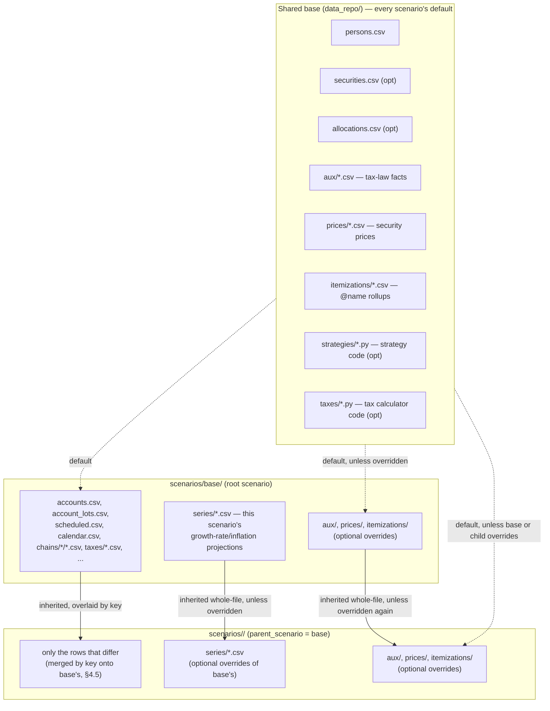
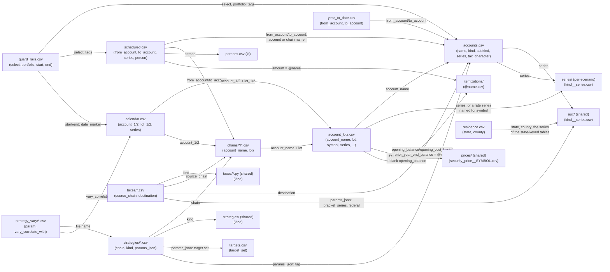

# ADR-003: Rule registry, event-kind registry, subkind vocabulary, and CSV schemas

- **Status:** Accepted
- **Date:** 2026-05-17
- **Supersedes:** —
- **Amended:** see [Amendments](#amendments) at the end.
- **Related:** [ADR-001](ADR-001-overall-architecture.md) (overall architecture), [ADR-002](ADR-002-storage-schema.md) (storage schema), [ADR-004](ADR-004-reproducibility-and-activation.md) (reproducibility).

## Context

[ADR-002](ADR-002-storage-schema.md) left four pieces of vocabulary deliberately open: the list of `account.subkind` values, the set of `amount_rule_kind` values for `scheduled_transaction`, the set of `kind` values for `calendar_event`, and the CSV column schemas the loader expects under the per-scenario folder. This ADR closes them.

Each registry is **closed in v1**: the loader rejects unknown values. New kinds enter only through this ADR (or a successor). This keeps the simulator legible — a reader can enumerate every way a rule can compute an amount and every way a calendar can patch reality.

## Decision

### 1. `account.subkind` vocabulary

CHECK-constrained at load time (the loader validates; the DDL keeps `subkind` as free TEXT so future ADRs can extend it without a schema change).

**Asset:**

| subkind | meaning |
| --- | --- |
| `cash` | bank and money-market money: checking, savings, or any cash position (by convention its lots use the symbol `CASH`). Checking and savings were once separate subkinds, but the engine never distinguished them and one account can now hold both as lots |
| `brokerage_taxable` | taxable investment account |
| `retirement` | an IRA or employer plan; each of its lots says which kind (§1a) |
| `hsa` | health savings account |
| `real_estate` | primary residence or other real property |
| `vehicle` | car, boat, etc. (depreciating asset) |
| `other_asset` | catch-all; populates `meta_json` for explanation |
| `business` | a sole proprietor's business bank account (a single-member LLC taxed as a sole proprietorship): cash like `cash`, and where its `business_income` arrives and its `business_expense` is paid from (§2.6). Its `owner` is the proprietor. `meta_json` `{"hobby": true}` marks a business not engaged in for profit (IRC §183), whose expenses aren't deductible |

#### 1a. Retirement lot subkinds

The lots of a `retirement` account, and only they, carry a `subkind` (§4.3), which sets the lot's tax treatment. One IRA is either Roth or traditional, but a 401k can hold both, so the distinction lives on the lot; the account's own `tax_treatment` is left blank.

| lot subkind | meaning | tax treatment |
| --- | --- | --- |
| `traditional_ira` | pre-tax IRA | `tax_deferred` |
| `roth_ira` | post-tax IRA | `tax_free` |
| `traditional_401k` | pre-tax employer plan (also 403b, 457b) | `tax_deferred` |
| `roth_401k` | post-tax employer plan | `tax_free` |

Money moved out of a traditional lot is `tax_deferred_out` (ordinary income), including into a Roth lot, which is how a conversion is taxed; into another traditional lot it is a rollover, `none`. An `rmd` counts and draws only traditional lots: Roth IRAs have no RMDs, and Roth 401ks none from 2024. A retirement account must have at least one lot, since an empty default lot would have no subkind.

**Roth distributions and the five-year clock.** A Roth lot tracks its basis, its contributions and conversions: `opening_cost_basis`, or the whole opening balance when that is blank, plus whatever moves into it later other than growth. A distribution, meaning money that leaves for a lot outside a `retirement` account, is *qualified* once the owner is 59½ and five tax years have passed since the clock started. Then all of it is `tax_free`. Before that its basis is still `tax_free`, and its earnings are `roth_nonqualified`, which the accumulator counts as ordinary income (the 10% additional tax under 59½ is not modeled). Since that turns on the owner's age, a `retirement` account's `owner` must be an actual person (§4.1), who has a `birthdate`, or the load fails. A Roth IRA pays out basis first; a Roth 401k pays out basis and earnings pro-rata, never more basis than the amount. Either way the lot's basis falls by the basis paid out, qualified or not.

- The clock of a Roth IRA lot is its owner's, one for all of their `roth_ira` lots; a `roth_401k` lot's is its account's. It starts on Jan 1 of the earliest year among those lots' `acquired` dates, or their account's `opened` where a lot has none. A lot with neither means the clock has run. A conversion is best given its own lot with its `acquired` date; it does not restart the owner's clock. Inherited Roth accounts from outside the household are not modeled ([#257](https://github.com/BobKerns/analysis/issues/257)).
- **At a death** ([#256](https://github.com/BobKerns/analysis/issues/256)), from the month after the owner's final month (§4.9), a distribution needs only the five years, since death replaces 59½, unless a surviving spouse takes the account as their own. The two `role = 'primary'` persons are spouses; with any other number there are none. `scenario.meta_json`'s `roth_survivor` (§4.5) is the survivor's election. With `own` (the default) the survivor treats the decedent's Roth IRAs as their own (Treas. Reg. §1.408A-6 Q&A-7(b)): from then on the decedent's Roth IRA lots and the survivor's own take the earlier of the two clocks (where a clock that has run is earliest) and the survivor's 59½, until the survivor's own death lifts the age test. With `beneficiary`, or with no spouse who outlives the owner, the decedent's lots keep the decedent's clock with no age test, and the survivor's own clock is unchanged. A Roth 401k lot always takes the beneficiary rule; a survivor who wants their own clock rolls it into their own Roth IRA. The account's `owner` doesn't change. Each person's final month is known when the run starts (one per ensemble member), so each lot's rules are worked out by date then.
- **A chain step on a Roth lot that would pay out `roth_nonqualified` earnings is skipped**, so the later steps pay instead, **unless no later step can**: the last step of a chain pays and is taxed, unless the chain is itself a step with later steps after it in a chain above. A step whose draw is all basis is not skipped.
- This applies to chain draws and to a `one_off_transfer` or `transfer_balance` with a blank `tax_character`. A scheduled rule's own `tax_character`, or a calendar row's, is used as written. Money moved from a Roth lot into another retirement lot is a rollover and keeps none of these rules. It takes its basis with it, by the same basis-first or pro-rata rule: the source's basis falls by that much, and a Roth destination gains it, or the whole amount when the draw would have been qualified (as when a qualified Roth 401k rolls into a Roth IRA). Any money out of a Roth lot spends its basis this way, whatever its `tax_character`.

**Liability:**

| subkind | meaning |
| --- | --- |
| `mortgage` | secured by `real_estate` account |
| `heloc` | home equity line of credit |
| `credit_card` | revolving consumer debt |
| `other_liability` | catch-all |

**Income** (flow accounts; balance accumulates over the run):

| subkind | meaning |
| --- | --- |
| `salary` | wage or salary income, ordinary |
| `ss_benefit` | Social Security retirement benefit |
| `pension` | defined-benefit pension |
| `interest` | interest income |
| `dividend` | dividend income |
| `capital_gain` | realized capital gains (long or short; bucket on `transfer_event.tax_character`) |
| `rental` | rental income |
| `other_income` | catch-all |

**Expense** (flow accounts):

| subkind | meaning |
| --- | --- |
| `living` | groceries, entertainment, day-to-day |
| `healthcare` | premiums, out-of-pocket medical |
| `housing` | utilities, insurance, maintenance (a broad category; the v2 ADR will likely split this) |
| `interest_expense` | mortgage interest, HELOC interest, any deductible/non-deductible interest leg |
| `taxes_federal` | federal income tax paid: the `federal` tax's destination (§4.15) |
| `taxes_state` | state income tax paid: the `state` tax's destination |
| `taxes_local` | local income tax paid: the `local` tax's destination |
| `taxes_property` | real estate tax: spending into one is property tax for the itemized SALT line (§2.6), with no tag |

An income-tax account (`taxes_federal`, `taxes_state`, `taxes_local`, [#586](https://github.com/BobKerns/analysis/issues/586)) takes only income tax payments: its jurisdiction's settlements, withholding, estimated payments. The loader refuses a scheduled rule, `year_to_date.csv` row or `one_off_transfer`/`transfer_balance` paying into one, directly or through a destination chain whose steps reach it (§4.7), with the `property_tax` or `business_expense` character, an itemizing tag (`tax:property`, `tax:mortgage_interest`, `tax:charity`, `tax:medical`, `tax:rental`), or a rule kind that implies one as the engine reads it (an `irmaa` rule, a `mortgage_payment` on a `mortgage` liability); any `mortgage_payment` whose `interest_account` is one, since interest isn't tax; a destination chain step of the `property_tax` or `business_expense` character that reaches one; and an income-tax account carrying an itemizing tag. Everything else paid into one is taken as a tax payment.
| `business` | a business's spending, paid out of a `business` account as `business_expense` (§2.6) |
| `gift` | gifts out of the household, to family or charity; reports group them as `gifts` ([ADR-010](ADR-010-responsive-strategies.md) §6.3's `gift` gives into one) |
| `other_expense` | catch-all |

The expense vocabulary intentionally mixes categories (`housing`) with mechanisms (`interest_expense`); a future ADR is expected to refactor `housing` into finer-grained subkinds without disturbing the others.

The `_other` catch-alls are deliberate escape hatches; the `--check` mode ([ADR-001](ADR-001-overall-architecture.md) §CLI) flags any account using one so the author can decide whether to extend the vocabulary.

### 2. `amount_rule_kind` registry

Nine rule kinds. (Section numbers 2.4 and 2.8 are unused, so existing cross-references to the others stay valid.) Each rule's `compute(state, aux, date) → list[TransferEventSpec]` is a pure function. The columns `from_account`, `to_account`, `amount`, `base_date` on `scheduled_transaction` carry the common parameters; rule-specific parameters live in the named columns `interest_account`, `person`, `series`, `rate` (stored as `rate_micros`), `claim_age` (see §4.6). `amount` and `series` are each interpreted according to the row's `amount_rule_kind`. Rare or future extension parameters may go in the nullable `params_json` column.

**Invariant (rule-as-sole-origin):** every `transfer_event` traces to **exactly one rule** via `(reason_kind='rule', reason_id = scheduled_transaction.id)`. A once-only movement is a rule whose `cadence='one_off'`. Calendar events never write to `transfer_event` directly; money-moving calendar kinds *synthesize* one or more `cadence='one_off'` scheduled_transactions at expansion time (see §3). The only exception is the synthetic per-account `opening_balance` rule materialized at run start from the account model, which uses `reason_kind='initial'` and is its own degenerate rule. [ADR-002](ADR-002-storage-schema.md)'s `transfer_event.reason_kind` CHECK and `scheduled_transaction.created_by_event_id` (tracing a synthesized rule back to its authoring calendar event) enforce this.

**Multi-leg rules** (in v1: only `mortgage_payment`) emit more than one transfer event per fire; all legs share the same `(reason_kind, reason_id)` and are linked by `parent_event_id` for grouping. The `from_account`/`to_account` columns on the scheduled_transaction row are interpreted as the **primary leg** (cash → liability principal); the secondary leg (cash → interest expense) targets the account named by `interest_account`. This invariant — "each event traces to one rule, but a rule may emit multiple events per fire" — is the *direction* that matters: it makes audit, `explain`, and `compare` straightforward.

#### 2.1 `fixed_amount` (priority bands: 200, 300, 500)

Constant amount, optionally inflated.

- **Params:** none in JSON. Uses `amount` (required, cents in the DB), `base_date` (optional), `series` (optional inflation aux series; `fixed` means none), `inflation_cadence` (optional; `monthly` default or `annual`).
- **Compute:** `amount` as authored if `series` is NULL or `fixed`, else `amount × cumulative_inflation(base_date → date, series, cadence)`. With `cadence='monthly'` (default), the annual rate compounds every month. With `cadence='annual'`, it steps once per calendar year crossed (each January) — flat within a year, then a single jump, matching how real COLA-style adjustments actually apply.
- **Emits:** one event, `from_account → to_account`, amount as above, tax_character from the row.
- **Use:** salary, SS post-FRA (without COLA series), pensions, recurring fixed expenses, lump-sum one-offs. `inflation_cadence='annual'` in particular suits SS-like benefits modeled as `fixed_amount` rather than the dedicated `ss_benefit` rule.

#### 2.2 `percent_of_balance` (priority band: 100)

Accrue interest, dividends, appreciation against a source account's balance.

- **Params:** the row's `to_account` is the balance-bearing account; `series` names the aux rate-series. `rate_basis` defaults to `"balance"`.
- **Compute:** `amount = round(to_account_balance × monthly_rate)`. Annual rates are converted by `(1 + r)^(1/12) - 1`, computed in fixed-point micros.
- **Emits:** one event. Typical: `from_account = <income account>` (e.g. `interest_income`), `to_account = <balance-bearing account>` (interest credits to the asset). For depreciation, swap signs by routing through an expense account.
- **Use:** money-market interest, bond coupon approximations, portfolio appreciation per asset, real-estate appreciation.

**Authored on the account, not in `scheduled.csv`.** An asset account's growth is a property of the account, so it is declared by the `series` + `tax_character` columns on `accounts.csv` (§4.2) and the loader synthesizes one rule **per lot** ([ADR-005](ADR-005-lots-and-per-lot-state.md) §5; a lot's own `series`, a rate series named for its `symbol`, or the blend of its symbol's allocation slices (§4.1b) takes precedence over the account's): `cadence='monthly'`, priority 100, `start = scenario.start`, `to_account` = the account itself, and `name = growth_<abbreviated account name>` (each word trimmed to four letters, plus the lot for a non-default lot; see [ADR-005](ADR-005-lots-and-per-lot-state.md) §5). Hand-writing an equivalent `percent_of_balance` row is still legal, but the loader rejects one whose name collides with a synthesized rule.

The income side is **not** author-supplied. Each growth `tax_character` has one reserved counterparty account, created on first use so a scenario cannot mis-wire or omit it:

| `tax_character` | account | kind / subkind | `tax_treatment` | meaning |
| --- | --- | --- | --- | --- |
| `ordinary` | `interest_income` | income / `interest` | `taxable` | taxable interest and dividends |
| `gains` | `capital_gains` | income / `capital_gain` | `taxable` | unrealized gains in a taxable account |
| `deferred` | `deferred_gains` | income / `capital_gain` | `tax_deferred` | unrealized gains in a tax-deferred account |
| `tax_free` | `tax_free_gains` | income / `capital_gain` | `tax_free` | unrealized gains in a Roth/HSA account |
| `depreciation` | `depreciation` | expense / `other_expense` | `none` | value lost by a wasting asset |

A `retirement` account's lot takes its growth character from its subkind instead of from the account: `tax_free` for a Roth lot, `deferred` for a traditional one. So Roth and traditional lots in one account grow from their own counterparties, and the account's `tax_character` can stay blank. Only a lot without a subkind falls back to the account's character.

**Yearly payouts** ([#468](https://github.com/BobKerns/analysis/issues/468), [#547](https://github.com/BobKerns/analysis/issues/547)). A `gains` lot in a `brokerage_taxable` account also pays out the part of its return that is dividends, interest or capital-gain distributions, from series named `<series>_yield`, `<series>_cg_yield` and `<series>_stcg_yield` (§4.4), and its growth rule takes those out of the total ([ADR-005](ADR-005-lots-and-per-lot-state.md) §5). Each payout has its own reserved account, created on first use like the growth counterparties:

| `tax_character` | account | kind / subkind | `tax_treatment` | rule | meaning |
| --- | --- | --- | --- | --- | --- |
| `qualified_dividend` | `dividends` | income / `dividend` | `taxable` | `dividends_<account/lot>` | stock dividends, taxed at long-term gain rates |
| `ordinary` | `investment_interest` | income / `interest` | `taxable` | `interest_<account/lot>` | interest on a bond or cash held directly (a lot with no symbol) |
| `ordinary` | `ordinary_dividends` | income / `dividend` | `taxable` | `ordinary_dividends_<account/lot>`, `st_distributions_<account/lot>` | a fund's non-qualified dividends and short-term gain distributions: a `dividend` to a state's exclusions (§2.6) |
| `ltcg` | `gain_distributions` | income / `dividend` | `taxable` | `lt_distributions_<account/lot>` | long-term gain distributions |
| `tax_exempt` | `muni_interest` | income / `interest` | `tax_free` | `tax_exempt_<account/lot>` | interest on many states' municipal bonds (`muni`, [#265](https://github.com/BobKerns/analysis/issues/265)): out of federal AGI, in provisional income and MAGI; every state taxes it |
| `tax_exempt` | `muni_interest__<ST>` | income / `interest` | `tax_free` | `tax_exempt_<st>_<account/lot>` | interest on one state's municipal bonds (`muni_<ST>`): as above, but that state doesn't tax it |
| `deferred` | `deferred_payouts` | income / `capital_gain` | `tax_deferred` | any of the above | a traditional lot's payouts, untaxed |
| `tax_free` | `tax_free_payouts` | income / `capital_gain` | `tax_free` | any of the above | a Roth lot's payouts, untaxed |
| the lot's | `hsa_dividends` | income / `dividend` | `tax_free` | as for a taxable lot, but `ordinary_dividends_`, `st_distributions_` and `interest_` | an HSA lot's dividends, interest and short-term distributions: untaxed federally, ordinary income to a state that taxes an HSA |
| the lot's | `hsa_gain_distributions` | income / `dividend` | `tax_free` | `lt_distributions_<account/lot>` | an HSA lot's long-term gain distributions: untaxed federally, gain to a state that taxes an HSA |

`deferred_payouts` and `tax_free_payouts` pay only a `deferred` or `tax_free` lot that has a `quantity` (#547): they buy it shares but, like growth, add no basis, and their `meta_json` marks them `"builtin": "sheltered_payout"` (the taxable ones and the HSA two are `"payout"`, the growth counterparties `"growth"`). Money from any of the taxable ones (municipal bond interest included) into a lot is a purchase, so a reinvested payout adds to the lot's basis. An `hsa` account's lots ([#497](https://github.com/BobKerns/analysis/issues/497)) are paid from the HSA two instead, whether or not they hold shares, at the lot's own growth character (`deferred` or `tax_free`), so the federal return passes them by; their payouts are purchases too, adding to the basis a state that doesn't recognize HSAs taxes a withdrawal over (§4.4). A payout rule's `params_json` carries `"payout": true`, which keeps its amount from going below zero; a negative return falls through to the growth rule.

`gains` and `deferred` are tax characters in their own right (§2 registry): unlike `ltcg`, they are *unrealized*, so the retrospective tax scan ignores them until a sale or distribution converts them into `ltcg`/`tax_deferred_out`. Rules synthesized for `depreciation` record `tax_character='none'` — personal-use depreciation is not deductible.

**Negative rates (depreciation).** The rate series may be negative. `to_account` remains the balance-bearing account and `from_account` remains the counterparty, but when the computed amount is negative the two legs swap at post time, so value flows *out* of the asset and into the expense account. Declining-balance decay follows automatically from `rate_basis='balance'` (the default), and the asset asymptotically approaches — without reaching — zero, which is roughly how a vehicle's scrap value behaves. A swapped leg is a loss of value, not a withdrawal: it sells none of the lot's shares and spends none of its basis, and the gains report counts a swapped leg into a growth counterparty as a negative unrealized gain.

Depreciation is a book entry, not spending. Reporting that totals cash outflows should exclude the `depreciation` account (see `notebooks/net_worth.ipynb`).

#### 2.3 `rmd` (priority band: 200 or 500)

IRS Required Minimum Distribution.

- **Params:** the row's `from_account` is the subject IRA/401k account (the one being drawn down) and `person` = person id. When the subject account has several lots ([ADR-005](ADR-005-lots-and-per-lot-state.md)), `from_account` is instead a chain listing the lots to draw from, in order, and `params_json` names the account the RMD is for: `{"subject_account": "<account>"}`; the chain may only draw from that account's lots. The amount is that account's total on the prior Dec 31 over the age factor. Aggregation across an owner's several IRAs is deliberately not modelled: a brokerage distributes per account, without regard to distributions taken elsewhere. Factor table is `rmd_factors`; start-age series is `rmd_start_age` (both fixed aux references).
- **Compute:** Fires once per year (cadence = `annual`, `month_of_year` typically 12). `amount = round(dec31_prev_year_balance / uniform_lifetime_factor(person_age_year_end))`. `dec31_prev_year_balance` comes from end-of-prior-year `account_state` (the subject account's traditional lots added together; Roth lots owe no RMD, §1a); for the partial first year it comes from `account_lot.prior_year_end_balance` (which the author must supply for any `traditional_ira` / `traditional_401k` lot whose owner reaches RMD age during the scenario's first calendar year).
- **Start semantics:** the row's `start` column is a lower bound on candidate fire dates. The actual first fire is `max(row.start, year-end of the year person reaches start_age)`. Authors typically set `start = scenario.start` and let the age gate dominate.
- **Emits:** one event, `from_account = subject_account`, `to_account = <taxable landing>` (typically `Asset_Checking`); `tax_character = 'tax_deferred_out'` (the retrospective tax scan reclassifies as ordinary income).
- **Use:** post-age-73 required distributions for either spouse.

#### 2.5 `ss_benefit` (priority band: 200)

Social Security retirement benefit with COLA.

- **Params:** `person` = person id, `claim_age` = integer claim age, `amount` = PIA at FRA in dollars, `series` = COLA aux series name (e.g. `cpi`). `tax_character` on the row should be `ss_benefit`.
- **Compute:** Fires monthly. Adjusts `base_pia_at_fra_cents` by the claim-age multiplier (a lookup based on months early/late vs. FRA, hard-coded) and applies cumulative COLA from claim date to `date`. Zero before the person reaches `claim_age`.
- **Emits:** one event, `from_account = Income_SS_<person>`, `to_account = <SS landing account>`, `tax_character = 'ss_benefit'`. The income account may have `maximum_balance = 0` and an `overflow_chain`; the chain then distributes the gross benefit into its component destinations.
- **Start semantics:** as with `rmd`, the row's `start` column is a lower bound. The rule emits zero amount in months before the person reaches `claim_age`; that age gate ANDs with the row's `start`.
- **Use:** each spouse's SS rule. Different scenarios swap `claim_age` to test claim-timing decisions.

##### 2.5.1 Benefit withholding (Medicare Part B/D)

Medicare Part B and Part D premiums are withheld from the Social Security payment: the beneficiary never receives them, but they are part of the **gross** benefit that the provisional-income test taxes. Modeling only the net deposit understates taxable income; routing the premium out of checking overstates the deposit.

Author it as an extra leg out of the *income* account:

| leg | from | to | `tax_character` |
| --- | --- | --- | --- |
| net deposit | `<SS income account>` | checking | `ss_benefit` |
| Part B premium | `<SS income account>` | `<healthcare expense account>` | `ss_benefit` |
| Part D premium | `<SS income account>` | `<healthcare expense account>` | `ss_benefit` |

The tax calculators' `income_buckets` (`analysis.sim.taxes.common`) sums `ss_benefit` by tax character regardless of destination, so gross = the sum of all three legs and the deposit leg alone is what reaches cash. Both legs are gated by the same person (via the accounts' `owner`), so a lifespan end retires them together. When a rule carries `ytd_preroll`/`ytd_amount` for a partial first year, the premium legs need it too, or that year's gross is understated.

Medigap (Part G) is **not** withheld — it is billed directly, so it stays an ordinary expense funded from checking. Likewise, premiums are only withheld while a benefit is actually being paid: someone on Medicare before claiming Social Security is billed directly, and the premium becomes a withheld leg only from the claim date.

Premiums are authored flat (grown by an inflation series). The income-related surcharge (IRMAA), which keys off MAGI from two tax years prior, is an `irmaa` rule (§2.11) written beside each person's premium legs, from the same income account and with the same `ss_benefit` character while it is withheld.

For a single gross benefit with multiple destinations, use one `ss_benefit` row and a chain attached to the Social Security income account. Chain rows may specify either a fixed `amount` or a `percent` of the amount remaining after earlier rows. Once allocation fields are used, every row must specify one and the final row must specify `percent = 100`; this makes the definition stable when the benefit amount changes.

#### 2.6 Income tax: the tax jurisdictions (not a rule kind; settles after the month's rules)

Income tax is not a `scheduled.csv` rule ([#507](https://github.com/BobKerns/analysis/issues/507)): each jurisdiction is a file, `taxes/federal.csv`, `taxes/state.csv` or `taxes/local.csv` (§4.15), that computes the year before's tax each April and pays what is due. This section is what a jurisdiction computes; its *scope* is its name (`federal`, `state` or `local`), and the `<scope>_*` buckets of `tax_year_summary` are its results. A jurisdiction can build on another's return ([#508](https://github.com/BobKerns/analysis/issues/508)): the state starts from the federal return, the local tax from the state's.

- **Params** (the file's `params_json`, all optional): `{ "filing_status_aux": "filing_status", "bracket_aux": "federal_brackets", "bracket_series": "<series>", "standard_deduction_aux": "standard_deduction" | "state_standard_deduction", "itemized_deduction_aux": "federal_deductions" | "state_deductions", "itemized_limits_aux": "itemized_limits" | "state_itemized_limits", "retirement_exclusion_aux": "state_retirement_exclusion", "adjustments_aux": "state_adjustments", "gains_tax_aux": "state_gains_tax", "gains_deduction_aux": "state_gains_deduction", "nol_limit_percent": 80, "ltcg_bracket_aux": "ltcg_brackets" | "state_ltcg_brackets", "stcg_bracket_aux": "state_stcg_brackets", "ltcg_exclusion_aux": "state_ltcg_exclusion" }`. `bracket_series` names the series of the federal tables only; a state's tables are those of the state the household lives in (`residence.csv`, §4.16, [#509](https://github.com/BobKerns/analysis/issues/509)), so `state.csv` and `local.csv` refuse it. A state's `state_surcharge` and `state_hsa` tables have no `_aux` param: each state has one of each. The local jurisdiction takes no params.
- **Compute:** the jurisdiction's tax calculator, the one its `kind` names (§4.15; the built-in `federal`, `state_tables` and `local_bands`, in `analysis.sim.taxes`, or a household's own, [ADR-011](ADR-011-tax-calculators.md)), computes it through the tax calculator API (`analysis.sim.tax_api`). The engine hands it the tax year: its income items (each one tax character's transfers from one account to another, summed; the years before it come too, for carryovers), its `capital_loss` rows, the persons, last year's return, and the aux tables as of the year's end. The calculator reads no database and keeps nothing between years. It prepares the year once, and the prepared year computes a return as often as asked, with more ordinary income or long-term gain on top for a what-if: the after-tax drawdown, `fill_bracket`, IRMAA's MAGI and a strategy's `ctx.tax` all ask it, so none can disagree with the settlement. A return's lines are written to `tax_year_summary` as `<scope>_<line>`. Every calculator returns `agi`, `taxable_income`, `ordinary_taxable` (taxable income less the long-term gain stacked on top and a state's separately taxed short-term gain: what the ordinary brackets tax), `tax`, `nol_carryover` and `capital_loss_carryover`; the built-in ones also return `ordinary_income`, `ltcg_taxed`, `ss_benefits`, `ss_taxable`, `standard_deduction`, `itemized_deduction` (and its lines, below), `deduction`, `nol_used`, `business_net`, `hobby_disallowed`, `ltcg_exclusion`, `capital_loss_used`, for the federal `magi`, and for the state its adjustments (below) and `credits`. The built-in calculators take each income item by its `tax_character`, apply brackets and deductions from aux tables, and compute the tax. **Filing status** is the `filing_status` aux table's row for the tax year, except that `MFJ`/`MFS` become `Single` from the year after a `role = 'primary'` person's final month from `lifespan.csv` (§4.9); the aux table needs no row for it. **The state starts from federal AGI** ([#508](https://github.com/BobKerns/analysis/issues/508)), as California's Schedule CA does: the federal return's ordinary income, long-term gain (with qualified dividends) and taxable Social Security, computed with the same extra income in a what-if, so more federal income moves the state too. It then adds and subtracts named lines, each recorded as `state_<line>`: `dividends_as_ordinary` (qualified dividends moved from gain to ordinary income; AGI unchanged), `hsa_addback` (an HSA's contributions less its withdrawals, when the state taxes it), `hsa_dividends` (the dividends and interest reinvested in an HSA, when the state taxes it, [#497](https://github.com/BobKerns/analysis/issues/497)), `muni_interest` (municipal bond interest, but for the bonds of the state the household lives in on December 31, `muni_interest__<ST>` of its own state, and a territory's, which federal law exempts in every state, [#265](https://github.com/BobKerns/analysis/issues/265); as California's Schedule CA adds it back; the District of Columbia adds back none), `capital_gain_difference` (the state's own netting of gains and losses, with a taxed HSA's withdrawal gains and gain distributions, less the federal result), `ltcg_exclusion`, `retirement_exclusion` and `ss_difference` (the federally taxable Social Security the state doesn't tax), described below. State AGI is the start plus the additions less the subtractions; then the deduction and the table's deductions, the NOL, the brackets, and `credits`; its own subtractions, deductions and credits are rows of its `state_adjustments` table (§4.4), each a named line. The federal return's memo, which is not written to `tax_year_summary`, holds what its AGI leaves out or deducts, for a state to add back by name: `hsa_contributed`, `hsa_withdrawn`, `ss_untaxed`, `excluded_gain` (§121), `roth_qualified` (`tax_free` money out of retirement accounts), and `tax_exempt_interest` with `tax_exempt_interest__<ST>`, each issuing state's part of it ([#265](https://github.com/BobKerns/analysis/issues/265)), and the parts of AGI (`net_stcg`, `net_ltcg`, `qualified_dividends`). The state jurisdiction adds the state's `state_surcharge` bands, if it has any, to the brackets' tax, and treats an HSA as its `state_hsa` table says (§4.4). A calculator class for another state builds on `StateFromFederal`, or `StateFromIncome` for one that builds its own income (Pennsylvania's classes), in `analysis.sim.taxes.state_base`. **The local tax** ([#487](https://github.com/BobKerns/analysis/issues/487), its own jurisdiction since [#508](https://github.com/BobKerns/analysis/issues/508)): kind `local_bands` taxes the state's taxable income at the `state_local_tax` bands of the county the household lives in that year (§4.16), or of its state where the residence names no county, recording `local_tax`, `local_taxable_income` and its own drawdown lines; `state_tax` doesn't include it. The loader refuses a `state_local_tax` table in a scenario without `taxes/local.csv`, naming `sim tax add local`. **Social Security** ([#484](https://github.com/BobKerns/analysis/issues/484)): the federal jurisdiction taxes the provisional-income share from `ss_taxation_thresholds` (§4.4). The state jurisdiction taxes none of it unless its state has a `state_social_security` table (keyed by state like its brackets, §4.4): then it starts from the federal return's taxable amount and leaves out the table's exclusion for the year's filing status, phased out by the federal return's AGI. For the federal jurisdiction, if an `ltcg_brackets` aux table exists, the long-term gain and the year's `qualified_dividend` legs (§2.2) are stacked on top of ordinary taxable income and taxed at that table's rates (§4.4); a capital loss offsets the gain, not the dividends; without it long-term gains are taxed as ordinary income. **A state's gains** ([#485](https://github.com/BobKerns/analysis/issues/485)): the state jurisdiction taxes qualified dividends as ordinary income, and reads three optional tables keyed by state, as its standard deduction is; without them it taxes gains as ordinary income too. `state_ltcg_exclusion` leaves part of the net long-term gain out of the state's income, and so out of its AGI (§4.4); `tax_year_summary` records it as `state_ltcg_exclusion`, and `state_ltcg_taxed` is what remains. `state_ltcg_brackets` taxes the remaining long-term gain stacked on top of taxable income, as `ltcg_brackets` does federally, and `state_stcg_brackets` taxes the net short-term gain in the slice just below it, above the rest of ordinary income; with only one of the two, the other gain keeps its place and is taxed at the state's ordinary rates. The deduction comes off ordinary income first, then short-term gain, then long-term gain. Each table's name can be changed with `ltcg_exclusion_aux`, `ltcg_bracket_aux` and `stcg_bracket_aux`. What more income would cost (the after-tax drawdown, `fill_bracket`) applies the exclusion to the gain it adds. **Deduction** is whichever is greater of the standard deduction (`standard_deduction`, or for the state `state_standard_deduction` of the same state as its brackets, falling back to `standard_deduction`; `standard_deduction_aux` names another kind) and the itemized total. **Itemized deductions** ([#542](https://github.com/BobKerns/analysis/issues/542)) are figured from the household's own spending of the year (`TaxYear.spent`, [ADR-011](ADR-011-tax-calculators.md) §2; never a business's, of the `business_expense` character, which Schedule C deducts (personal spending paid from a `business` account still counts), nor a rental's, tagged `tax:rental`, which Schedule E does) under the limits of the `itemized_limits` table for the year's filing status (§4.4), each a line of the return (an expense account's itemizing tag stays when the rule paying into it has only a report tag, `tax:itemized` say, `tax_api.spending_tags`): `itemized_salt`, state and local taxes: property tax (spending tagged `tax:property`, or of the `property_tax` character or into a `taxes_property` account with no other itemized tag; a rule paying it by that character pays from an account named directly, as the loader checks, since a chain's legs carry their source's character) and, federally, the state and local income tax paid that calendar year (a cash-basis taxpayer's: everything paid into each state or local jurisdiction's destination account dated in the year, the April settlement of the year before included, whatever the account's tags; that account is the jurisdiction's own and takes only its income tax payments (§1), so nothing there needs telling apart; not its refunds (a settlement out of its destination account, [#568](https://github.com/BobKerns/analysis/issues/568), posted the April after for the year before, which under the tax-benefit rule is income of the year received, to the extent the deduction saved tax: not modeled)), up to `salt_cap`, which falls by `salt_phaseout_rate` of AGI over `salt_phaseout_start` but not below `salt_floor` (federal MAGI for it adds only foreign income, which the model has none of); `itemized_mortgage_interest`, spending tagged `tax:mortgage_interest`, where a `mortgage_payment` rule's interest leg carries that tag when the liability it pays is of the `mortgage` subkind, unless the rule or its interest account has another itemized tag or `tax:rental` (a tag of the role for a report, `tax:itemized` say, doesn't stop it) or the leg is a `business_expense`, and each month (the month of the tax year the interest counts in, as spending does) the interest of those rules is cut to `mortgage_limit` over that month's summed balance of their debts when that is more, so debts held one after another in a year don't add up, and a business's debt (of the `business_expense` character) isn't among them (a month's balance is the one its interest was figured on, which the run records in `mortgage_balance`, [ADR-002](ADR-002-storage-schema.md); two rules paying one debt in a month share it; a `ytd_amount` catch-up, several months' interest in one transfer, is spread over the months it replays (from January, or the rule's start that year), each on its own balance, and a `ytd_preroll` catch-up posts month by month, as the rule does; a `year_to_date` row into the rule's interest account, which no rule figured, counts as the rule's own (its tags and person too), spread evenly over the months to its own from the rule's start that year, each month's balance all such interest of the debt over the monthly rate (the loader refuses one into an interest account two home mortgages share); a payment drawn as several legs (lots or characters) is one payment on the debt); `itemized_charity`, spending tagged `tax:charity` up to `charity_limit` of AGI, less `charity_floor` of AGI (the floor comes off what the limit allows, §170(b)(1)(I); one cap, no carryforward); `itemized_medical`, spending tagged `tax:medical` (an `irmaa` rule's surcharges carry it, as a mortgage's interest carries its tag), less what an HSA paid (but for a state that taxes the HSA, which never excluded that money) and less `medical_floor` of AGI; and `itemized_other`, the hand-typed total from the `federal_deductions`/`state_deductions` aux table (§4.4) dated in that tax year (a row counts only for its own year, never the years after). `itemized_deduction` is their sum. The floors, caps and phase-down move with AGI, so a what-if figures them again. Without an `itemized_limits` table at all, the itemized total is just the hand-typed one, for the state too, whatever its own table; a data repo turns the lines off with an `itemized_limits.csv` that has only its header. A state takes the limits of its `state_itemized_limits` table, keyed by the state like its brackets (California's: no SALT cap, $1 million of mortgage debt, half of AGI for charity); a state without one figures no lines, since the federal limits may not match its law (North Carolina caps mortgage interest and property tax together at $20,000), unless `itemized_limits_aux` names `itemized_limits` to take the federal ones. A calculator subclass whose `deductions` figures its own itemized total turns the lines off by overriding `itemized_lines` ([ADR-011](ADR-011-tax-calculators.md) §5). A state never deducts an income tax. `state_deductions` falls back to `federal_deductions`'s figure when the scenario has no `state_deductions` rows at all, so most states never need their own file. OBBBA's limit on the value of itemized deductions in the 37% bracket, its charity deduction for those who don't itemize, and California's phase-out of itemized deductions at high incomes are not modeled. **Retirement income exclusions** ([#486](https://github.com/BobKerns/analysis/issues/486)): for the state, the `state_retirement_exclusion` table of its state (§4.4; `retirement_exclusion_aux` names another kind), when there is one, takes some of each filer's income off ordinary income and long-term gain before AGI, as the states' own subtractions do. The filers are the `primary` and `secondary` persons (or every person with a birthdate, if none is). A leg's income is its paying account's owner's, or, paid out of an account that holds nothing for anyone (an income account), its receiving account's; one from a joint account (`joint`, no owner), or that neither account's owner holds alone, is split evenly between the filers. Income falls into the kinds `pension`, `interest` and `dividend` (`ordinary` legs out of an income account of that subkind, and `qualified_dividend` legs), `retirement_account` (`tax_deferred_out`, `roth_nonqualified`; an HSA's are `other`, or none when the state taxes the HSA, which makes its dividends its owner's `dividend` and its withdrawal gains and gain distributions their `capital_gain`), `capital_gain` (`stcg`, `ltcg`, less the `capital_loss` rows of the person's lots), and `other` (every other ordinary leg, less `tax_deferred_in` and business expenses other than a hobby's), each a person's year total, never below zero. Each exclusion (the rows sharing a `name`, in file order) gives each filer the age tier with the highest `min_age` they have reached by December 31 (whole months since the birth month): it covers their income of the kinds it lists, in its order, up to its `amount` (all of it when blank), less their Social Security benefits for the year when `less_ss`. The household's income test applies to each in turn: the state's income before the exclusions (ordinary plus long-term gain, so no Social Security) above `income_limit` takes it away, at once with no `phaseout`, or in a straight line to nothing over `phaseout` dollars. An exclusion uses up only the income it leaves out, so a later one can cover what an earlier one's test denied. A state's taxable Social Security (`state_social_security`) doesn't depend on the exclusions, since it starts from the federal return. Gain beyond the year's net capital gain (what losses and carryovers left, or an estimate with less gain leaves) isn't excluded. The exclusions together never exceed the income; gains come off the long-term gain first, the rest off ordinary income. When a what-if adds income (the prepared year computed with more ordinary income or long-term gain), the income tests and the allocation are worked out again, but each person's income by kind stays that of the income posted. `tax_year_summary` records `state_retirement_exclusion`, which `<scope>_ordinary_income` and `<scope>_agi` already leave out. Pennsylvania's separate income classes, credits in place of exclusions, and an exclusion that ends at a death are not modeled. **Capital gains** (IRC §1211(b), §1212(b); [#199](https://github.com/BobKerns/analysis/issues/199)): a year's `stcg` and `ltcg` legs (a withdrawal at a loss posts a negative one) less its `capital_loss` rows (§4.7), each side less the loss carried into the year, net against each other; a net short-term gain is ordinary income and a net long-term gain is taxed as above. A net loss offsets ordinary income up to the `capital_loss_limit` aux table's amount for the year's filing status (§4.4), short-term loss first, and the rest carries into the next year keeping its character. The carryover is recomputed from every earlier year of the run, so it needs no state. Both jurisdictions apply it. **A carryover ends with the taxpayer whose losses made it** ([#277](https://github.com/BobKerns/analysis/issues/277); Rev. Rul. 74-175): a person's share can be used on the return for the year of their final month (§4.9) and then lapses. A loss is its paying account's `owner`'s (a joint account's the household's), or, paid out of an account that holds nothing for anyone (an income account), its receiving account's; an HSA withdrawal's loss over its basis (where the state taxes an HSA) is the HSA owner's. Each owner's losses of a year are netted against their gains of that year first. It is all theirs from their own account, or from one they inherited from a spouse who died before them; half theirs from a joint account (`owner` blank or `joint`) while another of the household lives on, as a joint tenancy or community property splits, and all theirs once no one does. The basis step-up decides whose a lot is by the same rule (`ownership.Household.decedent_part`), except that under `community_property` both halves step up. Their share of the carryover out of the year is their part of the losses since the carryover was last empty, less what earlier deaths already ended; which year's losses the deductions used first is more than a household plan needs. A loss belongs to its tax year, so one taken from the decedent's account after the death, in the same year, still counts as theirs. `tax_year_summary` records `<scope>_capital_loss_used` and `<scope>_capital_loss_carryover`, and in a year one ends `<scope>_capital_loss_lapsed`. **Tax-exempt interest** ([#265](https://github.com/BobKerns/analysis/issues/265)): the `tax_exempt` legs, municipal bond interest (§2.2), are left out of federal AGI (Form 1040 line 2a), but provisional income counts them (IRC §86(b)(2)(B)), so they can make more Social Security taxable. The federal jurisdiction records them as `federal_tax_exempt_interest` in a year that has any. **MAGI:** it also records `federal_magi`, the MAGI an `irmaa` rule reads (§2.11): AGI plus tax-exempt interest. `fill_bracket`'s `irmaa_tier` and its cliff pricing (§2.10) read the same MAGI. **A business** (Schedule C; [#231](https://github.com/BobKerns/analysis/issues/231)): the year's `business_income` legs into `business` accounts (§1) less its `business_expense` legs out of them is ordinary income, so a loss offsets the year's other income, long-term gains included, and lowers provisional income for Social Security. A business account whose `meta_json` says `"hobby": true` deducts none of its expenses; its receipts still count. The loss the year's income can't absorb is a **net operating loss** (IRC §172): the business loss less the year's other income above the deduction, since a nonbusiness deduction offsets only nonbusiness income and the capital-loss deduction doesn't count. It carries forward and offsets up to `nol_limit_percent` of a later year's taxable income (80 federal, 100 state by default; California has no 80% limit), read from the year before's `<scope>_nol_carryover`, so a year without a summary carries nothing in. A business's loss is its proprietor's, the `business` account's `owner` (joint as for a capital loss), and their share of the NOL carried out of the year of their final month lapses ([#277](https://github.com/BobKerns/analysis/issues/277); Treas. Reg. §1.172-7): their part of the business losses (each owner's businesses netted together as above, a hobby's receipts counted and its expenses not) since the last year that carried none out, less what earlier deaths ended, (`line_in`, [ADR-011](ADR-011-tax-calculators.md) §2), so with one business all of it once its proprietor dies; `<scope>_nol_lapsed` records it. The NOL comes off taxable income rather than AGI, so taxable Social Security is not recomputed for it. `tax_year_summary` records `<scope>_business_net`, `<scope>_hobby_disallowed`, `<scope>_nol_used` and `<scope>_nol_carryover`. Self-employment tax and the QBI deduction on a profit are not modeled yet. **Drawdown tax** ([#251](https://github.com/BobKerns/analysis/issues/251)): each year it computes, the jurisdiction also prices the tax still owed on the money in the run as of that year's last step: every traditional (`tax_deferred`) asset lot's balance, plus every non-cash `taxable` lot's unrealized gain over its cost basis. For a jurisdiction whose return says it taxes an HSA as a brokerage account (its memo's `hsa_taxed`, [#497](https://github.com/BobKerns/analysis/issues/497)), an HSA lot's unrealized gain over its basis is in the gains instead of its balance in the traditional money. It draws that money down evenly over the `drawdown_years` (default 10) after the year, skipping any year with a transfer out of a `salary` income account (savings aren't drawn while still earning), as ordinary income for the traditional balances and long-term gain for the gains ([#404](https://github.com/BobKerns/analysis/issues/404)): each share is priced on top of the income the run has in the year it would be drawn, with that year's brackets, filing status, deduction and Social Security taxation, less that year's own `tax_deferred_out` and net long-term gain (draws from the same money the share replaces, which would otherwise be taxed twice). A share past the run's last computed year is priced with that last year. Since later years are needed, every year's drawdown is priced once the run, and its trailing tax year, are done. A carried-in net operating loss covers as much of the added income as its limit allows. The extra tax over all those years is recorded as `<scope>_drawdown_tax`, on `<scope>_drawdown_base`, the money it taxes. `scenario.meta_json`'s `after_tax` sets `drawdown_years` and `step_up` (§4.5). A lot's gain is over its real basis, which a death steps up (§4.9), so the gains that go with a decedent's lots leave the base by themselves. With `step_up` true, all gains are left out, as if everything had just stepped up. After-tax net worth (`RunConnection.after_tax_net_worth_frame`) takes off each month's base times its year's rate, and a finished year's unpaid balance due, from its year end until the April payment posts; a year owed a refund adds it back over the same months, and the run's last year, which never settles, until the run ends.
- **When:** each April, for the tax year before, after every scheduled rule of the month and before any `fill_bracket` (§2.10). A month posts in three phases, each whole before the next (`registries.MONTH_PHASES`): its rules, in priority order among themselves; the tax settlement; then `fill_bracket`. The settlement has no priority, so no rule's priority places a rule before or after it. Jurisdictions settle in the order `federal`, then `state`. The tax year the run ends in is settled after the run (the tail), with no transfer posted.
- **Emits:** one event, `reason_kind = 'tax'` and `reason_id` the `tax_jurisdiction` row's id, from the file's `source_chain` to its `destination`, amount = the computed tax less what the year's transfers into the destination already paid (withholding, estimates). When more was paid than the tax (withholding past it, or a refundable credit taking the tax below zero, [ADR-011](ADR-011-tax-calculators.md) §5), the same kind of event pays the difference back, from the `destination` to the account the file pays from (the first cash account its `source_chain` draws from, depth first through its steps: a deposit into a retirement, HSA or brokerage lot would be a contribution nobody made; a source with no cash account is an error), recorded as `<scope>_tax_overpaid` ([#568](https://github.com/BobKerns/analysis/issues/568)). Nothing when the two are equal.
- **State:** the state jurisdiction reads the tables of the state the household lives in on the tax year's December 31 (`residence.csv`, §4.16; [#498](https://github.com/BobKerns/analysis/issues/498)), whenever the year is settled: its `state_brackets__<state>` table and the companion tables of that state (§4.4), a gains tax among them (`state_gains_tax`, Washington's, added to the state's tax after its credits). A state with no income tax and no tables of its own reads `none`, the shipped 0% tables, and so does a territory whose income tax copies the federal one (Guam, the Northern Mariana Islands, the U.S. Virgin Islands; status "Federal rule", [#491](https://github.com/BobKerns/analysis/issues/491)), whose residents pay the federal tax to the territory: the federal jurisdiction stands in for its tax. So a February move leaves the year before, settled that April, in the old state, and the year of the move is the new state's. The loader refuses a state jurisdiction with no residence. `sim tax state` writes the residence's first row, adding a state tax modeled on the federal one if there is none and the state taxes income, and `sim tax move` a later row; the states and their statuses are `sim/states.py`, kept in step with the README's table by a test.

#### 2.7 `mortgage_payment` (priority band: 300; multi-leg)

Monthly P&I against a mortgage liability account.

- **Params:** the row's `to_account` is the mortgage liability; `interest_account` names the interest-expense account; `rate` = annual rate as a percent (e.g. `6%`), stored as `rate_micros`, millionths of 1. Monthly P&I is the row's `amount`.
- **Compute:** at fire time, `interest = round(liability_balance × rate_micros / 12 / 1_000_000)`; `principal = payment_amount - interest`.
- **Emits two events:**
  1. **Interest leg:** `from_account = Asset_Checking` (the row's `from_account`), `to_account = interest_account`, amount = `interest`, tax_character = `'none'`.
  2. **Principal leg:** `from_account = Asset_Checking`, `to_account = <liability>` (the row's `to_account`, reducing the liability balance), amount = `principal`, tax_character = `'none'`, `parent_event_id` linked to the interest leg.
- **Use:** one row per active mortgage. Retired by a `retire_scheduled` calendar event when the home is sold (see §3.3).

#### 2.9 `on_death` (priority band: author's choice; recommend 900)

Fires once, automatically, the month a person dies -- for one-time death-triggered liquidations (selling a car, a life-insurance payout) where the current book value **is** the payout (no separate death-benefit computation yet).

- **Params:** the row's `person` (required) names whose final month from `lifespan.csv` (§4.9) triggers it. `from_account`/`to_account` must both be concrete accounts (not interior chains) -- "100% of value" only makes sense for one real balance. `tax_character` must be `'tax_free'` -- death-triggered liquidations/payouts (selling a car, a life-insurance death benefit) are not taxable events; the loader rejects any other value.
- **Compute:** at fire time (every month the rule's cadence allows it to be checked, recommend `cadence=monthly`), no-op unless `month_s` is exactly the month after `person`'s `final_month` (the same month other lifespan-gated rules stop -- see §4.9) and `person` has a declared lifespan at all. When it matches, transfers 100% of `from_account`'s current balance to `to_account`. A zero balance is a no-op, not an error; a `person` with no `lifespan.csv` row means the rule never fires.
- **Emits:** one event when it fires, none otherwise.
- **Use:** `from_account` = the vehicle/policy account being liquidated, `to_account` = wherever the proceeds land (e.g. the household cash account). Exempt from the general lifespan-gating in §4.9 (which would otherwise suppress the very rule that fires *because of* the lifespan ending).

#### 2.10 `fill_bracket` (no priority: runs last in its month, after the tax settlement)

A yearly Roth conversion sized to a tax target ([#252](https://github.com/BobKerns/analysis/issues/252)): the most that keeps the year's taxable income at or under the target.

- **Params:** `from_account`/`from_lot` is a traditional lot (`traditional_ira`, `traditional_401k`, §1a) and `to_account`/`to_lot` a Roth lot, both named directly, not through a chain. The target is exactly one of:
  - `rate`, a bracket's marginal rate (e.g. `22%`): the target is the top of that bracket in the year's table for the year's filing status, so it follows a new table and the switch to `Single` after a death. It is measured against **ordinary** taxable income (taxable income less the long-term gain stacked on it, §2.6), the part that sets the conversion's own rate. The bracket must have a top: the highest rate is rejected.
  - `amount`, a taxable income in today's dollars, grown by `series` (an inflation series) from `base_date` at `inflation_cadence` as a `fixed_amount` grows. It is measured against all taxable income. A `set_amount` calendar row changes it, so an ensemble can vary it (`discrete`, ADR-006).

  `params_json` takes, all optional: `scope` (`federal`, the default, `state` or `local`), the tax jurisdiction (§2.6, §4.15) whose settings (brackets, deduction, filing status, Social Security taxation) it measures with; `max_amount`, a cap on one year's conversion in dollars; `max_marginal_rate` (e.g. `"30%"`), which stops where the next $100 converted would cost more than that rate in tax: its ordinary rate plus the long-term gain it pushes into a higher rate plus the Social Security it makes taxable, and in the `state` scope the local tax built on the state's return ([#508](https://github.com/BobKerns/analysis/issues/508)), since the same dollar pays it (a `federal` rate stays the federal tax's); and `irmaa_tier` (a whole number, 0 for none), which keeps the year's MAGI (§2.11) at or under the next tier's floor, so the premiums two years later stay in that tier. Both IRMAA measures use the `irmaa_tiers` table in force in the conversion year, grown to its January, not the one projected for two years later: that is what a planner knows in December, and since the floors rise it errs safe. With `max_marginal_rate` and the scenario's `irmaa` rules, crossing an IRMAA floor costs the higher tier's add-ons for each `irmaa` rule that will be charging two years later, for the months of that year its `start` and `end` allow, if its person is alive when the conversion is decided (a later death is not foreseen), each at the tier its own `filing_status_aux` table sets. `cadence` is `annual`, `month_of_year` usually `12`, and `tax_character` `tax_deferred_out`. The loader rejects a `priority`, a `tax_year` (it converts for the year it fires), a `month_of_year` before that of an RMD drawing from the same lot, a `series` other than `fixed` on a bracket target or one with no `base_date`, an unknown `params_json` key, an `irmaa_tier` with no higher tier in the table (it would cap nothing), a `tax_rule` (#507: the scope names the jurisdiction), a scope with no jurisdiction file, an `irmaa_tier` with no federal jurisdiction to measure MAGI, and a rate its jurisdiction's bracket table (its `bracket_aux`; for the state, that of each state the household lives in during a year the rule converts, §4.16) doesn't have.
- **When:** after the tax settlement (§2.6) and every other rule of its month, whatever their priorities, the RMD rule in particular. This is a constraint, not a priority. In a year an RMD is due, the first money out of the IRA counts toward it, and an RMD can't be rolled over or converted (Treas. Reg. §1.408-8), so the year's RMD must come out first; the target also needs the year's income. A conversion lowers the next year's RMD through the Dec 31 balance it is figured from (§2.3). A `month_of_year` before December sees only the income posted so far.
- **Compute:** builds the year's tax estimate from the jurisdiction's settings, the same prepared year it settles with (its calculator's `Prepared.compute`, `analysis.sim.tax_api`), over the transfers posted so far. Taxable income never falls as the conversion grows, but it can grow faster than the conversion, since added income makes more Social Security taxable (and slower, while a carried-in net operating loss absorbs part of it); so the amount is found by bisection over cents, not by subtracting the year's income from the target. It is then capped by `max_amount` and the lot's balance, capped by `irmaa_tier`'s floor (bisected on MAGI, which never falls as the conversion grows), and stepped up from zero in $100 steps against `max_marginal_rate` when that is set (the marginal cost can rise and fall again, so it is not bisected). The stepping gallops: a span is taken whole when its last step is within the rate and each of its four quarters costs what as many first steps would, give or take the first step's headroom under the rate (exactly, at the rate), so a step that costs more, a jump in the tax (a state exclusion lost at an income limit) or a higher rate, shows in its quarter however long the span; the span doubles while that holds and halves back when not. It stops where $100 steps would, with a few hundred tax computations instead of thousands. A step that would cross an IRMAA floor is not judged alone, since the surcharge charged to one $100 step would always stop the conversion at the floor: the span from the floor to where stepping would stop before the next floor is priced instead, its tax plus the surcharge, and the conversion goes on past the floor only if that span's average cost is within the rate; otherwise it stops exactly at the floor. A year already at or past the target converts nothing.
- **Emits:** one `tax_deferred_out` event from the traditional lot to the Roth lot, taxed as ordinary income and adding to the Roth lot's basis, as `sim invest` does. Its `meta_json` holds `{"fill_bracket": {"target", "measure", "reached"}}`: the target in cents, `ordinary` or `taxable`, and the measure after the conversion. The tax is paid by the jurisdiction the next April.
- **Use:** one row per traditional lot converted. Two rows fill the bracket together, the later (by `id`) seeing the earlier's conversion as income.

#### 2.11 `irmaa` (priority band: 200)

Medicare's income-related monthly adjustment amount ([#253](https://github.com/BobKerns/analysis/issues/253)): the surcharge on the Part B and Part D premiums that a household pays when its modified adjusted gross income (MAGI) on the tax return from **two years before** the premium year is over a tier's floor (42 USC 1395r(i), 1395w-113(a)(7)). The tiers are cliffs: one dollar over a floor costs the tier's whole add-on, every month of the premium year, for each enrolled person on the return.

- **Params:** `person` (required) is the enrollee, one row each (a couple both on Medicare has two). `from_account`/`to_account` as for the premium legs (§2.5.1): the Social Security income account with `tax_character = 'ss_benefit'` while a benefit is paid and the surcharge is withheld from it, otherwise the account it is billed from, with `none` (`sim scheduled add` picks between the two by whether `from_account` is an `ss_benefit` income account). `start`/`end` are the person's Medicare months, as on the premium rows; the lifespan gate (§4.9) ends it at a death. `cadence = monthly`. No `amount`: the tier table sets it. `params_json`, both optional: `parts`, `"B+D"` (default), `"B"` (no drug coverage) or `"D"`; `filing_status_aux`, the filing-status table, `filing_status` by default.
- **Compute:** for premium year Y, the household's MAGI for Y − 2 picks the highest tier whose `magi_floor` it is more than (none: nothing to charge), in the `irmaa_tiers` table (§4.4) for the filing status on that year's return: the filing-status table's row for Y − 2, `Single` from the year after a taxpayer's death as for income tax (§2.6), and for a year before the table starts its first row. So the year a spouse dies is still a joint return, and two years later the survivor alone pays on that joint MAGI with joint floors (the "widow's penalty"); after that, single floors. The table is the one in force in January of Y. Each of a row's three figures grows past its `effective_date` to that January by its own optional inflation series (`floor_series`, `part_b_series`, `part_d_series`): a grown floor is rounded to $1,000, as the law rounds it, and a blank series holds the figure flat. Nothing about how the law indexes the figures is built in: the series say it, so the top tier's floor, frozen through 2027, names a series that is 0% until then, and a change in the law is a dated row in a series or a `set_rate` (§3.1) that can vary in an ensemble. MAGI for a year the run computes is the federal jurisdiction's `federal_magi` (§2.6), so the scenario needs `taxes/federal.csv` (§4.15; the loader refuses a scenario without one), and it must have computed Y − 2 by January of Y. For a year before the run's first year, it is `scenario.meta_json`'s `irmaa.magi` (§4.5), else the run's own `federal_magi` for it when year-to-date rows settle that year (the year before a rolled plan's start, from its projected rows, §7); a year with neither charges nothing, and the loader warns for each of the first two premium years a rule is active in that has none (the second not when projected rows settle its MAGI year). The tier charged is recorded in `tax_year_summary` as `federal_irmaa_tier` under the MAGI's year (0 below the first tier), for the years the run computed.
- **Emits:** one event per month: the tier's `part_b` plus `part_d` add-ons (or the one `parts` names), grown; none below the first tier.
- **Not modeled:** an appeal with form SSA-44 to use a more recent year after a life-changing event (stopping work, a spouse's death).
- **Use:** with each person's Medicare premium legs; a Roth conversion's cost two years later.

### 3. `calendar_event.kind` registry

Eight kinds. Per the §2 invariant, calendar events never write to `transfer_event` directly. They fall into three classes:

- **Intent-mutating** (no money moves at expansion time; the event amends the in-memory intent — rates, schedules, aux tables): `set_rate`, `set_amount`, `retire_scheduled`, `swap_aux_table`.
- **Rule-synthesizing** (the event inserts one or more `cadence='one_off'` scheduled_transactions with `created_by_event_id = calendar_event.id`; those rules then fire on `event.date` through the normal monthly step): `one_off_transfer`, `transfer_balance`.
- **Inert** (no effect in a run; read only by the loader and ensemble resolution): `latent_factor` (§3.6), `date_marker` (§3.8).

A synthesized rule fires once, as one row in `transfer_event` (or more, when a chain splits it), traced back to its event through `created_by_event_id` on `scheduled_transaction` and `applied_calendar_event`.

**Ensemble variation ([ADR-006](ADR-006-ensemble-scenarios.md)):** a row may additionally carry `vary_distribution` (and the paired `vary_target`/`vary_low`/etc. columns, §4.8), marking its own `amount` or `date` as drawn per ensemble member rather than literal — the "vary" step resolves every such row (dates first, then amounts/rates) before handing the intent to the ordinary, unmodified run path. A row that still has `vary_distribution` set when it would fire is always a mistake (a recipe run directly, or a resolution step skipped), so the engine raises rather than using the placeholder value underneath it.

**Correlated variation ([ADR-008](ADR-008-correlated-parameters.md)):** a varying row (or a `latent_factor`) may name one parent in `vary_correlate_with`, with a correlation `vary_correlation` between their normal scores (§4.8). The rows form a forest of trees, and each row's draw is correlated with its tree while keeping exactly its own authored distribution. A tree's root may set `vary_tail_dependence` to make the tree's extremes tend to coincide (a Student-t copula).

#### 3.1 `set_rate` (primitive)

Replace one rate aux-table entry effective from this date forward.

- **Columns:** `series` = rate-series name, `amount` = new value as a percent (e.g. `4.5%`), stored in micros (`45000`). A value beyond ±100% is a load error: it is almost certainly one still in micros.
- **Expansion:** inserts a new `aux_table` row with `kind = 'rate'`, the given `series`, `effective_date = event.date`, and `payload_json = {"value_micros": amount}`. The original row is **not** deleted; aux lookups use the most-recent-by-`effective_date` row.
- **Existing series only:** a `set_rate` row adjusts a series; it doesn't create one. Its `(aux_kind, series)` must have a series, aux or prices file in the scenario or a parent, or the row is an unresolved reference (usually a typo, or the wrong `aux_kind`) and a load error. Likewise a rule that reads a series is a load error unless a file supplies it, since the run would fail once it reached that rule.
- **Unread series:** a row whose series has a file but which no scheduled rule, chain step cap, or account growth series in the scenario reads loads with a warning, not an error, and only `sim check` prints it: it has no effect there, but a mix-in or parent may set a series only the scenarios inheriting from it read.
- **Ramp ([ADR-006](ADR-006-ensemble-scenarios.md), ensemble-only):** a row with `vary_target='amount'` and `vary_ramp_months` set draws its target the same way any `amount` variation does, then the vary step expands it into that many additional ordinary `set_rate` rows, one per month, linearly interpolated from the series' current value up to the drawn target, landing on it at `date + vary_ramp_months` — an expansion, not a new way of reading `aux_table` (still latest-row-on-or-before-month, no interpolation logic added there). Modeling a sudden jump is rarely the realistic prediction, which is the whole reason the ramp exists — including for a lot's future price expectation, since the engine only ever consults `security_price` once to derive an opening balance ([ADR-005](ADR-005-lots-and-per-lot-state.md) §6), so varying it is really varying this rate assumption.
- **Process ([ADR-006](ADR-006-ensemble-scenarios.md) §4a, ensemble-only):** a row with `vary_target='amount'` and `vary_process` set draws its level the same way, then the vary step expands it into one ordinary `set_rate` row per year, same month, moving around that level, through the scenario's end or until the next authored `set_rate` row for the same series and `aux_kind`. With `vary_process_start = current` the path starts at the rate in effect just before the row's date and reverts to the level. Like a ramp, it adds nothing to how `aux_table` is read.
- **Resume ([ADR-006](ADR-006-ensemble-scenarios.md) §4b):** a row with `vary_resume` set and no `amount` puts its series back to whatever governed it the day before that date, usually an episode's start marker (`vary_resume = great_inflation_start`). A process that was running resumes with its own level, persistence and yearly shocks, starting from the rate in effect; a fixed rate comes back at once. The vary step resolves it, so a scenario with one runs through its base case even when nothing varies.
- **Use:** "checking account starts earning 4% in 2027".

#### 3.2 `set_amount` (primitive)

Mutate a `ScheduledTransaction.amount` going forward.

- **Columns:** `scheduled_name` = target rule name, `amount` = new base amount in dollars (stored in cents), `param_date` = new base date (optional).
- **Expansion:** updates the named row's `amount` (and `base_date` if given) in the run's in-memory intent. Persisted as an `applied_calendar_event` row; the run's snapshot of `scheduled_transaction` reflects the post-event state.
- **Use:** "discretionary spending drops to $4,500/mo on retirement".

#### 3.3 `retire_scheduled` (primitive)

End an active `ScheduledTransaction`.

- **Columns:** `scheduled_name` = name of rule to retire.
- **Expansion:** sets `end = event.date` on the named row.
- **Use:** "salary stops on retirement"; "mortgage rule retires when home is sold".

#### 3.4 `one_off_transfer` (rule-synthesizing)

A single one-shot movement, expressed as a synthesized rule so the §2 invariant holds.

- **Columns:** `account_1` = from account or chain, `account_2` = to account or chain (not both chains), `amount` = dollars (stored in cents), `tax_character` = tax character.
- **A blank `tax_character`** ([#201](https://github.com/BobKerns/analysis/issues/201)) lets the source decide, as it does for a sweep (§4.7). Money out of a lot that tracks cost basis (a taxable, non-cash lot such as `brokerage_taxable`) is a sale: each leg splits into `return_of_capital`, its pro-rata share of the lot's basis, and the gain (`ltcg`, or `stcg` for a lot held a year or less), and the lot's basis falls by the share ([ADR-005](ADR-005-lots-and-per-lot-state.md)). Money out of a traditional lot is taxed by where each leg lands, as for a sweep (§1a): `none` into another traditional lot (a rollover), `tax_deferred_out` anywhere else, a Roth lot (a conversion) or checking alike, and through a destination chain each step's leg is decided this way. From any other source it is `none`. A `tax_character` the row sets is used as written. The synthesized rule records a sale as `return_of_capital` and traditional money as `tax_deferred_out`; its legs carry the characters that are taxed.
- **Expansion:** synthesize one `scheduled_transaction` with `amount_rule_kind='fixed_amount'`, `cadence='one_off'`, `start = end = event.date`, `amount` from the payload, fields from payload, `created_by_event_id = calendar_event.id`. The engine fires it on `event.date` and routes it as it does any `fixed_amount` rule: lot to lot directly, or through a chain's sweep or draw, each `transfer_event` traced to that synthesized rule.
- **Use:** windfalls, gifts, one-time settlements that have no recurring structure.

#### 3.5 `swap_aux_table` (primitive)

Replace an aux table with another of the same kind from this date forward ([#197](https://github.com/BobKerns/analysis/issues/197)): a tax law that changes on a known date, a switch to another inflation or rate assumption. A state's tables (`state_brackets` and the other kinds keyed by state, `registries.STATE_KEYED_AUX_KINDS`) are not swapped: they follow where the household lives (`residence.csv`, §4.16, [#509](https://github.com/BobKerns/analysis/issues/509)), so the loader refuses a swap of one, naming `sim tax move`.

- **Columns:** `series` = the series being replaced, blank for a kind without one (`federal_brackets`, `standard_deduction`, ...); `params_json` = `{"aux_kind": "<kind>", "source_series": "<series>"}`, the table that takes its place. The source is an ordinary aux file, `<kind>__<source_series>.csv` in `aux/` or `series/` (§4.4), overridable per scenario like any other (§4.1d), and read only through this row. Every other column is blank, and the loader rejects a row that fills one. It checks that `aux_kind` is a registered kind (§4.4) other than `security_price`, which is read only at load to value lots, and `life_table`, read only to draw a member's lifespan, so neither can change mid-run, and that both tables exist; the run fails if the source has no row in force on `date`.
- **Expansion:** from `date` on, every lookup of (`aux_kind`, `series`) sees exactly what a lookup of the source would: the source's row (or, for brackets, row set) in force on `date` applies from then, and its later rows from their own dates. The replaced table's own later rows no longer apply. An inflation series keeps its rows before `date`, since an inflated amount compounds from its `base_date`. The run file's `aux_table` holds the swapped table, so a report read from it (CPI-constant dollars) sees what the run used.
- **Ensembles:** `vary_target='date'` draws the date; there is no amount to vary.
- **Use:** a scheduled change in tax law; another assumption from a date. `sim calendar add swap-aux-table DATE AUX_KIND SOURCE_SERIES [--series SERIES]` writes one.
- **Key:** the row's `aux_kind` is part of its merge key (§4.5), so swaps of two kinds without a series on one date are two events.

#### 3.6 `latent_factor` (inert)

A shared influence that varying rows correlate with but that isn't itself a modeled value, such as "the inflation regime" ([ADR-008](ADR-008-correlated-parameters.md) §3).

- **Columns:** `name` (required) and `description`; optionally `vary_correlate_with`/`vary_correlation`, to depend on another factor and form a hierarchy, or, on a factor with no parent, `vary_tail_dependence`. Every other column must be blank. `date` may be blank: the loader stores the scenario start as a placeholder, which nothing reads.
- **Effect:** none in a run (the engine skips it). Ensemble resolution draws its standard normal score, and its dependents' draws correlate with it.
- **A factor with no dependents** loads with a warning, not an error, and only `sim check` prints it: it may be work in progress, or meant for child scenarios to use.
#### 3.7 `transfer_balance` (rule-synthesizing)

Move one lot's whole balance, with the amount the simulated balance when the event fires rather than one written in advance: a 401(k) rolled into an IRA at a future date ([#134](https://github.com/BobKerns/analysis/issues/134)).

- **Columns:** `account_1` (+ `lot_1`) = the source, which must be an asset account's lot, not a chain: "the balance" only means something for one real balance. `account_2` (+ `lot_2`) = the destination, an account's lot or a chain, as for §3.4, but not the source lot itself. A blank `tax_character` is treated as for §3.4: the balance of a lot tracking cost basis is sold, taking all of the lot's basis; a traditional lot's balance is taxed by where it lands (a rollover into another traditional lot is untaxed); from anything else it is `none`. `amount` must be blank, so `vary_target='amount'` is refused; `vary_target='date'` draws the transfer's date per ensemble member.
- **Expansion:** calendar events apply at the start of their month, before its rules, in date order, so the amount is the source lot's balance at the previous month end plus whatever calendar events earlier in the month moved into or out of it; that month's growth accrues at the destination. A zero or negative balance is a no-op, as for `on_death` (§2). Otherwise the event synthesizes one `fixed_amount` `cadence='one_off'` rule for that amount, exactly as §3.4 does, so the transfer routes as a `one_off_transfer` of that amount would and its `transfer_event` traces to the synthesized rule. The one difference is that the source's refill look-ahead (§4.7) does not run: emptying the lot is the point, so a source with a `minimum_balance` is not topped up first. A later debit that month still refills it as usual. Basis and share quantity move with the money through the usual lot tracking ([ADR-005](ADR-005-lots-and-per-lot-state.md)).
- **Lots:** there are no implicit chains ([ADR-005](ADR-005-lots-and-per-lot-state.md) §3), so emptying an account with several lots is one row per lot.
- **Afterwards:** nothing stops the scenario moving money into the emptied lot later; end the rules that do (contributions, or an RMD rule that would otherwise draw on the old prior year-end balance) with `retire_scheduled` (§3.3) at the same date.
- **Not covered:** an in-kind transfer between taxable accounts that carries the basis over without realizing gains.
- **Use:** rolling a 401(k) or 401(a) into an IRA; closing an account into another.

#### 3.8 `date_marker` (inert)

A named date that other rows' dates are written relative to, such as the start of an episode ([#281](https://github.com/BobKerns/analysis/issues/281)). Moving the marker moves every row dated from it, so an episode's internal timing stays fixed while its start varies.

- **Columns:** `name` and `date` (required); `description`, `tags`; and the date-varying columns (`vary_target='date'`, `vary_distribution` other than `truncated_normal`, `vary_low`/`vary_high`/`vary_mode`/`vary_outcomes`) and the correlation columns, as on any date row. Every other column must be blank.
- **Relative dates:** any row's `date`, and a date-varying row's `vary_low`, `vary_high` and `vary_mode`, may be `NAME`, `NAME+Nm`, `NAME-Nm`, `NAME+Ny` or `NAME-Ny`: the marker's month moved by whole months or years, placed as a bare `YYYY-MM` is in that column (month-end for `date`). A marker may itself be relative to another marker. A name that is no `date_marker`, or a cycle of markers, is a load error. A marker's name must read back as itself in a date: a letter or `_` first, then letters, digits, `_`, `.` and `-`, not ending in what reads as an offset (`ep-6m`); any other name is a load error. The loader writes a relative `date` in one spelling (`NAME+1y` for `NAME+12m`, `NAME` for `NAME+0m`) before the lineage merge, so two spellings of one date key the same row. `vary_outcomes` and every other date column stay literal.
- **Resolution:** the loader writes each relative date against the markers' base case (a varying marker's central value, member 0's draw) and records the reference in `calendar_event.date_refs_json`, so a plain run and every report read literal dates. Ensemble resolution draws the markers first, then rewrites every relative date from them ([ADR-006](ADR-006-ensemble-scenarios.md) §5).
- **Effect:** none in a run (the engine skips it). A row whose resolved date is after the scenario's end does nothing, so a marker drawn there drops every row dated on or after it. A row dated before it (`NAME-6m`) still runs when that date is inside the scenario: what comes before an event happens first, whether or not the event itself falls inside the scenario.
- **A marker no row refers to** loads with a warning that only `sim check` prints, as for a factor with no dependents.
- **CLI:** `sim calendar add date-marker NAME DATE [--vary-…]`. Every `calendar add` date takes the relative forms, and TAB offers marker names. `calendar delete` refuses to delete a marker that rows are dated from; `calendar rename` rewrites the dates that refer to it.

### 4. CSV file layouts

See `docs/user-guide.md` for a task-based walkthrough of common edits; this section is the exact column-by-column reference.

All files: UTF-8, comma-delimited, one header row. Empty string means NULL. Boolean columns use `0`/`1`. A `YYYY-MM` date column names a month: it accepts `YYYY-MM` or `YYYY-MM-DD` and the loader pins either to that month's last day (a day within the month is ignored, #34), so a rule's `end` of `2030-06-15` still pays in June. Where the engine counts days, a full date keeps its day: a `biweekly` rule's `start` (its first payday, the 14-day anchor, so it must be a full date) and `end`, and a `retire_scheduled` event's `date` (it becomes that rule's `end`); a bare month there is still the month's end. Columns marked `YYYY-MM-DD` (`birthdate`, a lot's `acquired`, a `security_price`'s `effective_date`) are day-precise and keep the exact day. A `vary_target='date'` row's bounds are the one mixed case; see `vary_low`/`vary_high`. Money columns are decimal dollars, written `1234` or `-1234.56` and no other way (no `$`, thousands separator, single decimal digit, or bare `.99`); the loader converts them to integer cents. Every percent column (a rate, an allocation `weight`, a chain step's `percent`) takes its `%` sign, `4.5%` and never a bare `4.5`, with at least one digit before any decimal point and at most four after; a bare number in a percent column is a load error, so a percent can't be mistaken for dollars, a fraction, or micros. `rmd_factors.csv`'s `factor` is a plain number (`26.5`). The loader converts percents and factors to integer micros. Nothing past the loader sees dollars or percents. A file with a column from before this (`annual_rate_micros`, `marginal_rate_micros`, `rate_micros`, `factor_micros`) fails to load.

JSON-typed columns hold a single JSON value as a string; the loader parses and revalidates against the rule/event kind. Multi-line JSON in CSV is supported via standard CSV quoting.

#### 4.0 Map of the data repo

High level: what's shared by every scenario by default, what belongs to one scenario, and
where a scenario can override a shared file for itself and its descendants (§4.1d).



`series/` has no shared root tier (unlike `aux/`/`prices/`): growth-rate and
inflation series are per-scenario projections, so what's "shared" for them is
just the root scenario's own `series/`, reached by ordinary inheritance.

Detailed: how one scenario's own files reference each other and the shared base, by their key
columns. An arrow is "the column on the left names a row identified by the column at the
arrowhead."



A chain's own file (`chains/<role>/<name>.csv`) is itself a list of `account_name` (+ `lot`)
rows, so it is both a target (from `scheduled.csv`/`calendar.csv`/`accounts.csv`
`refill_chain`/`overflow_chain`) and a source of the same `account_name`/`lot` references shown
above; it is folded into "chains/*/*.csv" here rather than drawn as its own layer.

#### 4.1 Shared base: `data_repo/persons.csv`

Single identity list for the household: account owners *and* operator identities (`$ANALYSIS_USER`) live in the same table. The two sets typically coincide; the `role` column distinguishes persons-who-can-act from persons-who-only-appear (e.g. deceased ancestors carried for basis, a `joint` household pseudo-row, future heirs). The household's `joint` pseudo-person, which owns what no one person does, needs no row: when `persons.csv` has none, the loader supplies one (blank birthdate and role, `meta_json` `{"household": true}`), so a repo `sim init` made, which lists only real people, still takes an account owned by `joint`.

| column | type | required | notes |
| --- | --- | --- | --- |
| `id` | text | ✓ | short identifier, e.g. `alice`; matched against `$ANALYSIS_USER` |
| `display` | text | ✓ | full or display name |
| `birthdate` | YYYY-MM-DD | ✓ | for RMD and life-transition computations; may be blank only for a pseudo-person (blank `role`) |
| `sex` | `f` \| `m` | | picks a life table's column, so a person with a `life_table` lifespan (§4.9) must have one; otherwise unused. The column itself is optional: a `persons.csv` without it loads, and `sim person add` and `edit` add it |
| `role` | text | | `primary` or `secondary` marks an actual person, who must have a `birthdate` and may own a `retirement` account; NULL = person-not-operator, such as `joint` |
| `meta_json` | json | | default `{}` |

#### 4.1a Shared base: `data_repo/securities.csv` (optional)

Names for the symbols lots hold ([ADR-005](ADR-005-lots-and-per-lot-state.md)). Shared by every scenario, inside the provenance scope, and loaded into the `security` table.

| column | type | required | notes |
| --- | --- | --- | --- |
| `symbol` | text | ✓ | unique; matches a lot's `symbol` |
| `name` | text | ✓ | the security's name, shown next to the symbol in holdings views |

The file may be omitted, and a symbol with no row is simply unnamed.

#### 4.1b Shared base: `data_repo/allocations.csv` (optional)

What each symbol is made of, by asset class, for the portfolio overview (`sim allocation`, `portfolio_allocation_widget`) and for a fund's growth: a lot of a symbol with rows here grows at the blend of each class's rate series (`<symbol>.<class>`, else the class name), weighted as here, when every class it holds has one ([ADR-005](ADR-005-lots-and-per-lot-state.md) §5). Shared by every scenario, inside the provenance scope, and loaded into `security_allocation` (snapshotted into intent and run files like `security`).

| column | type | required | notes |
| --- | --- | --- | --- |
| `symbol` | text | ✓ | matches a lot's `symbol` |
| `as_of` | YYYY-MM | | the date the weights describe; blank holds at every date. A fund's composition drifts (a target-date fund glides), so give several dated sets to follow it |
| `asset_class` | enum | ✓ | `stock_us`, `stock_intl`, `stock` (stock whose US/international split is unknown: a placeholder to refine, distinct from bonds), `bond` (every bond but a municipal bond), `muni` (many states' municipal bonds, [#265](https://github.com/BobKerns/analysis/issues/265)), `muni_<ST>` (one state's municipal bonds, by its postal code: `muni_CA`), `cd` (certificates of deposit), `cash`, `real_estate`, `other` (`registries.ASSET_CLASSES`). A municipal bond class pays its `_yield` as tax-exempt interest (§2.2) |
| `weight` | percent | ✓ | `0%` to `100%`; the weights of one (`symbol`, `as_of`) set must add up to 100 |

For a date the overview uses the symbol's latest set on or before it, else its earliest. A lot with no rows for its symbol is classed by the asset class its growth series is named for (a lot growing at `stock_us` is `stock_us`), else by its account subkind (`cash`, `real_estate`, `vehicle`/`other_asset` as `other`; a `CASH` symbol is cash and a `CD` symbol is `cd`), and otherwise shown as `unclassified`, so a gap is visible. The weights are static per date: the model does not rebalance or let allocations drift with relative price movements, only follow the dated sets you give it, so a lot's class mix at any date is its balance times that date's weights. The file may be omitted.

A lot with no symbol (one that grows at a rate series) is classed by a row whose `symbol` is the lot's `<account>:<lot>` key, e.g. `Asset_IRA_Alice:stable`, used when the lot's symbol (if any) has no rows. A ticker never holds a colon, so the upper-case rule for symbols doesn't apply to a key, and `sim prices fetch`, symbol completion and the symbol listings skip keys. A key naming an account a scenario has, but a lot it doesn't, is reported by `sim check` (the file is shared, so another scenario may have the lot). Renaming the account or the lot rewrites its keys, keeping the old one as well while a scenario the rename doesn't reach still has the old name. A responsive strategy's portfolio (§4.12) must have every asset lot classed, by its symbol, its key, its growth series or its subkind: an `unclassified` one is a load error naming the row to add.

#### 4.1c Shared base: `data_repo/itemizations/<name>.csv` (optional)

A rollup of dollar amounts a scenario CSV can reference in place of a literal number, via
`@<name>` (for example `opening_cost_basis` = `@home_basis`, [ADR-005](ADR-005-lots-and-per-lot-state.md) §5). The file must have a
`Value` column (decimal dollars); the loader sums it and uses the total. Any other columns
(`Item`, `Note`, ...) are for the human reader and are ignored. Resolution is per-scenario, like
`aux/`; see §4.1d.

| column | type | required | notes |
| --- | --- | --- | --- |
| `Value` | dollars | ✓ | summed across every row of the file |
| (anything else) | text | | ignored by the loader; documentation for the human reader |

#### 4.1d Per-scenario overrides for `aux/`, `series/`, `prices/` and `itemizations/`

`aux/` (§4.4), `prices/` (§4.4) and `itemizations/` (§4.1c) at the data repo root are the
shared defaults every scenario reads unless it says otherwise — tax law, security prices, and
cost-basis itemizations are the same regardless of which what-if is running. `series/` (§4.4)
is different: growth-rate and inflation assumptions are per-scenario projections, not shared
facts, so `series/` has **no** root-level tier at all; it exists only under
`scenarios/<name>/series/`, and what's "shared" across scenarios is just the ordinary
inheritance below.

Beneath the data repo's `aux/` sits one more tier, the analysis code repository's own
`templates/aux/` ([#317](https://github.com/BobKerns/analysis/issues/317)): the tax-law and
demographic tables it ships, read like a template scenario (§4.5a) without a copy in the data
repo. A data repo's `aux/<file>.csv` of the same name replaces it, so a data repo keeps only
what it changes, and above all its `filing_status.csv`, which the templates ship with no rows:
the household's status is its own. `sim check -v` names the data repo's `aux/` files that
match the template's byte for byte, since each can go, and while it stays it hides the
template's later updates.

A scenario may add its own `scenarios/<name>/aux/<file>.csv`, `scenarios/<name>/prices/<file>.csv`,
`scenarios/<name>/itemizations/<file>.csv`, or `scenarios/<name>/series/<file>.csv` — same
filename as an ancestor's (or the shared default, for the first three) to replace it, or a
new filename to add something that tier doesn't have (a rate series only that scenario's
lots use).

- **Resolution is whole-file, per filename, most specific first:** the scenario's own file,
  else its ancestors' in reverse load order (§4.5: following `parent_scenario` all the way
  up, mix-ins after the main parent's line, so a mix-in's file beats the main parent's), else — for
  `aux/`/`prices/`/`itemizations/` only — the shared file at the data repo root, else — for
  `aux/` only — the code repository's `templates/aux/`. A match
  replaces the entire file; there is no row-level merge across tiers (unlike
  `accounts.csv`/`account_lots.csv`/etc., which do merge by key, §4.5).
- **An empty file is an empty series.** A file with only its header supplies no rows, so the
  scenario has none of that series, exactly as if there were no file, except that it also hides
  the ancestor's file of the same name: a scenario built on it that reads the series has to
  supply its own, and the ancestor's rates are never used by mistake. `sim series delete`
  writes one when the scenario inherits the series; `sim series revert` removes the scenario's
  own file so the inherited one applies again ([#471](https://github.com/BobKerns/analysis/issues/471)).
- **A derived scenario without its own override inherits its parent's.** Overriding a
  file only where it first needs to differ, and leaving every descendant to inherit that
  override, is the intended shape. For `series/` this is not optional: since there is no
  shared root tier, the root scenario's own `series/` *is* the thing every descendant
  inherits by default.
- **Motivating cases:** a different assumed future tax policy (an alternate `federal_brackets.csv`
  or `state_brackets__CA.csv`, both in `aux/`), a different rate assumption (`rate__*.csv`,
  in `series/`), or a different cost-basis itemization for one scenario, without touching any
  other scenario's inputs.

#### 4.1e Per-scenario `README.md` (optional)

A scenario folder may hold a plain `scenarios/<name>/README.md` — its title (the first `#`
heading) and first paragraph become `scenario.description` at load time, replacing whatever
`scenario.csv`'s own `description` column holds; `scenario.csv`'s `description` is only the
fallback for a scenario with no `README.md` at all. This is read and baked in once, at load
time (`readme_description`, `analysis.sim.readme`) — never read live off disk afterward,
since a run file is read long after the data repo it came from may have moved, changed, or
gone, and everything a reader needs has to travel inside the intent/run file itself. Not
inherited: a derived scenario with no `README.md` of its own falls straight through to its
own `scenario.csv` description, not its parent's `README.md`.
- **Provenance:** each override lives inside `scenarios/<name>/`, already in the
  `scenario_tree_id` scope for that scenario and its descendants ([ADR-004](ADR-004-reproducibility-and-activation.md) §1), so no separate
  provenance handling is needed.
- Loaded by `_merged_override_files`/`_find_override_file` in `loader.py`; the `series/` call
  passes `include_shared=False`.

#### 4.1f Per-scenario `.disable` (optional)

A `scenarios/<name>/.disable` file (any content; `sim scenario|ensemble disable` writes one,
`enable` removes it) marks a scenario that is built only when named: a mix-in, or a base that
only exists to be built on. `sim all` ([ADR-004](ADR-004-reproducibility-and-activation.md)
§11) and the background builder (ADR-004 §12) leave it out, as do the notebooks' scenario and
recipe pickers; `sim run`/`sim load` of it by name, its use as a parent or mix-in, and
`sim check` are unaffected. It is committed like the rest of the folder, so a rename, copy or
delete carries it along. Not inherited, and not read by the loader: it is left out of
`scenario_tree_id` and the dirty check (ADR-004 §1), so disabling a base changes none of its
descendants' data.

#### 4.2 Per-scenario: `data_repo/scenarios/<name>/accounts.csv`

Required in a root scenario; optional in a derived one, where it overlays the parent's rows by `name` (§4.5).

| column | type | required | notes |
| --- | --- | --- | --- |
| `name` | text | ✓ | unique; referenced by other CSVs |
| `kind` | enum | ✓ | `asset`, `liability`, `income`, `expense` |
| `subkind` | enum | ✓ | per §1 |
| `owner` | text | | `person.id`; NULL for jointly-held. A `retirement` account's must be an actual person (§4.1) |
| `tax_treatment` | enum | | `taxable`, `tax_deferred`, `tax_free`, `none`; blank on a `retirement` account, whose lots' subkinds set it (§1a) |
| `series` | text | | asset accounts only: aux rate-series driving monthly growth; synthesizes a `percent_of_balance` rule (§2.2) |
| `tax_character` | enum | | required with `series` (except on a `retirement` account, whose lots' subkinds decide), and only meaningful with it: `ordinary`, `gains`, `deferred`, `tax_free` — selects the built-in income account that funds the growth (§2.2) |
| `opened` | YYYY-MM | | informational |
| `closed` | YYYY-MM | | informational |
| `meta_json` | json | | default `{}` |

#### 4.3 Per-scenario: `data_repo/scenarios/<name>/account_lots.csv`

Opening state for the accounts declared in §4.2, **one row per lot** ([ADR-005](ADR-005-lots-and-per-lot-state.md)): a position inside one account. An account that is not split has one lot named `default`, for which the `lot` column may be left blank. Required in a root scenario; optional in a derived one, where it overlays the parent's rows by (`account_name`, `lot`) (§4.5).

| column | type | required | notes |
| --- | --- | --- | --- |
| `account_name` | text | ✓ | resolves to `account.id` |
| `lot` | text | | free-form label, unique within the account, without `:`; blank means `default`. **Required for investment subkinds** (`brokerage_taxable`, `retirement`, `hsa`) |
| `subkind` | enum | on a `retirement` account | the lot's retirement subkind (§1a); required on, and only allowed on, the lots of a `retirement` account |
| `symbol` | text | | the security held; names its rate series (§2.2) and its price (§4.4) |
| `acquired` | YYYY-MM-DD | | starts the holding period: a sale within a year of it books its gain as `stcg`, later as `ltcg`; blank means long-term |
| `quantity` | number | | shares; tracked through withdrawals and purchases. Leave blank for dollar-denominated funds |
| `series` | text | | growth-rate series for this lot, overriding the symbol's and the account's |
| `opening_balance` | dollars | ✓ unless derivable | balance at the model's effective start. May be left blank when `quantity`, `symbol` and a `security_price` are given: it is then `quantity × price` on or before `scenario.start`. A given balance is used as written |
| `opening_cost_basis` | dollars | | required for lots in `tax_treatment IN ('taxable')` accounts holding appreciable assets. A taxable asset lot with a zero balance and no basis starts at basis 0. On a Roth lot, its contributions and conversions; blank means the whole balance (§1a) |
| `prior_year_end_balance` | dollars | | balance at the Dec 31 *preceding* `scenario.start`; required for `traditional_ira` / `traditional_401k` lots whose owner reaches RMD age during the scenario's first calendar year, so the partial-first-year RMD has a Dec-31 balance to divide by. Set on every lot of an account or on none, Roth lots aside: they owe no RMD, so they needn't carry it. NULL for all other accounts and for scenarios that start on Jan 1 of a year in which RMDs are computed against the *current* simulated year-end. |

**Balance management is per lot**, so the lots of one account can differ (a cash lot that refills from the fund lots beside it, next to a lot that does not). These columns are not accepted on `accounts.csv`. The chain columns follow the same lot rule as every other reference: a `refill_chain` or `overflow_chain` that names an account is completed by `refill_lot` / `overflow_lot` (required for investment subkinds, blank meaning `default` otherwise, and blank when the name is a chain).

| column | type | required | notes |
| --- | --- | --- | --- |
| `minimum_balance` | dollars | | look-ahead refill floor (§4.7): a debit that would drop the lot's balance below this triggers a draw on `refill_chain` *before* the debit posts. `0`/blank means no floor. |
| `refill_chain` | text | | account or named source chain (`chains/source/`) to draw from when `minimum_balance` would be breached; required for `refill_target`/`refill_amount` to have any effect. May name another lot of the same account. |
| `refill_lot` | text | | the lot of `refill_chain`, when it names an account |
| `refill_target` | dollars | | when set, a triggered refill draws enough to bring the balance up to this fixed level (must be >= `minimum_balance`). Mutually exclusive with `refill_amount`. |
| `refill_amount` | dollars | | when set, a triggered refill draws this fixed amount, or more if needed to reach `minimum_balance`. Mutually exclusive with `refill_target`. Neither set means refill exactly to `minimum_balance`. |
| `maximum_balance` | dollars | | month-end overflow ceiling (§4.7): after each month's rules post, any excess above this is swept into `overflow_chain`. `NULL`/blank means unbounded. |
| `overflow_chain` | text | | account or named destination chain (`chains/destination/`) to sweep excess into |
| `overflow_lot` | text | | the lot of `overflow_chain`, when it names an account |

#### 4.4 `data_repo/aux/`, `data_repo/prices/` (shared) and `scenarios/<name>/series/` (per-scenario)

One file per (kind) or (kind, series), split physically between three folders that the loader
treats identically apart from where it looks, and whether that folder has a shared root tier
(§4.1d): **`aux/`** (shared) holds the tax-law and demographic facts every scenario shares by
default (`federal_brackets.csv`, `state_brackets__<state>.csv`, `standard_deduction.csv`,
`state_standard_deduction__<state>.csv`, `state_social_security__<state>.csv`, `state_retirement_exclusion__<state>.csv`, `state_adjustments__<state>.csv`, `federal_deductions.csv`/`state_deductions.csv`, `itemized_limits.csv`, `state_itemized_limits__<state>.csv`, `filing_status.csv`,
`ss_taxation_thresholds.csv`, `rmd_factors.csv`, `rmd_start_age.csv`, `ltcg_brackets.csv`,
`life_table.csv`, `irmaa_tiers.csv`, and `inflation__cpi.csv` — the one series-keyed kind kept here, rather than in `series/`, so
CPI-constant reporting always has a default); **`prices/`** (shared) holds
`security_price__<symbol>.csv`, also a fact every scenario shares by default; **`series/`**
(per-scenario only, no shared root tier — §4.1d) holds the growth-rate and non-CPI inflation
projections a scenario names by `series`/`symbol` (`rate__*.csv`, other `inflation__<series>.csv`).
The folder a kind lives in is a convention for humans and for what's most likely to need a
per-scenario override, not something the loader validates by kind — a misplaced file still
loads correctly (it just won't be found via the tier it "should" have used).

A series a `percent_of_balance` rule reads, whatever its `rate_kind`, needs a rate in force by
the first month the rule reads it ([#475](https://github.com/BobKerns/analysis/issues/475)), or
the load fails, naming the series, its first row and the first reader. Each lot's growth rule
(ADR-005 §5) reads from `scenario.start`; a hand-written rule from the first month it posts, its
`start` or the scenario's, whichever is later, then its cadence, unless its `end` or the scenario's
comes first. A `retire_scheduled` row (§3.1) replaces the rule's `end` on its date, even with a
later date, so a rule's one fixed retirement in the run is its end, except that one after the
rule's own `end` reopens it only in the retirement's month; with more than one, or one whose date
can move, the rule counts as posting until the scenario ends. A blend slice reads from the month
its allocation set applies, while the rule still posts. A `set_rate` row on the same
`(aux_kind, series)` supplies a rate from its month, and so does a `swap_aux_table` row (§3.5) of
that series once its source has a rate. Calendar rows count only when dated in the run and fixed:
one whose date varies or follows a `date_marker` could land later.

Filename pattern: `federal_brackets.csv`, `rate__Asset_Checking.csv`, `inflation__cpi.csv`. Columns vary by kind; the loader switches on filename. **The series name is the filename stem after `__`, literally -- no decoding.** So `rate__Asset_Checking.csv` has series `Asset_Checking`, and every reference to it (`series` columns in accounts.csv/scheduled.csv/calendar.csv/account_lots.csv/chains rows, `rate_series` in `amount_rule_params_json`) must use that exact literal string. Series, symbol, and chain names -- anything that becomes a `<kind>__<name>.csv`-style filename segment -- may not contain a space: it's legal on most filesystems but needs shell quoting and reads awkwardly, so the loader rejects it outright (`_validate_no_spaces`) rather than encoding/decoding around it. A symbol is also upper case, as tickers are: a lower-case spelling would be a second symbol that no price file or allocation matches, so the loader rejects one in `securities.csv`, `allocations.csv`, `account_lots.csv` or a `security_price__<symbol>.csv` filename (`_validate_symbol_case`), and the commands that write a symbol upper-case it.

- **`federal_brackets.csv`**, **`state_brackets__<state>.csv`**:
  `effective_date`, `filing_status`, `bracket_index`, `floor`, `marginal_rate` (percent), `floor_series` (optional; see indexing below)
- **`standard_deduction.csv`**, **`state_standard_deduction__<state>.csv`**:
  `effective_date`, `filing_status`, `amount`, `amount_series` (optional). Indexing ([#467](https://github.com/BobKerns/analysis/issues/467)): the law raises the brackets, the standard deduction and the long-term gain bands each year with inflation, so each row may name an inflation series, `floor_series` on a bracket or band row and `amount_series` on a standard deduction row (optional columns; blank or missing holds the figure flat). For a tax year after the table's effective date, a tax jurisdiction (§2.6) grows the figure by that series from the effective date to the tax year's January and rounds it down to a multiple of $50 (IRC §1(f)(7)); a later dated row, such as a law change, restarts from its own date. The templates name `cpi` (the law uses chained CPI, which runs a little lower), so an ensemble member's tables follow its own CPI path. The loader rejects a series no `inflation__<series>.csv` supplies when the scenario has a tax jurisdiction. `ss_taxation_thresholds`, `capital_loss_limit` and itemized deductions are fixed in law and have no such column. The state jurisdiction (§2.6) reads `state_standard_deduction` with its brackets' series (`state_standard_deduction__CA.csv` beside `state_brackets__CA.csv`); with no such file it falls back to `standard_deduction`, and the loader warns, since that is the federal figure. After a move (§4.16) the new state's table applies, or, when it has none, the federal fallback, and the loader warns. A state's own table may also shrink the deduction with income ([#578](https://github.com/BobKerns/analysis/issues/578)), with the optional columns `phaseout_start`, `phaseout_end`, `floor`, `phaseout_step` (dollars), `phaseout_rate` (percent), `phaseout_steps` (a count), `phaseout_agi` (`state`, the default when blank, or `federal`), and the indexing columns `phaseout_start_series`, `phaseout_end_series` and `floor_series` (the rate, the steps and `phaseout_step` are not indexed). Above `phaseout_start` of the AGI `phaseout_agi` names (Minnesota, Rhode Island and South Carolina test the federal) the deduction falls evenly to nothing at `phaseout_end` (equal to `phaseout_start` for a cliff), or by `phaseout_rate` of each dollar over, but not below `floor`. With a rate, `phaseout_step` counts the income over in whole steps, a started step in full (Alabama's $500 rows); with an end, `phaseout_steps` splits the span into that many equal steps, a started one taking its share (Rhode Island's five 20% steps), which stay equal as the start and end are indexed. What is left rounds down, as `state_social_security`'s exclusion does (one helper, `common.phase_out`, serves both). The loader (one check for both tables) requires one of `phaseout_end` and `phaseout_rate` with `phaseout_start`, none of the others without it, a positive rate, a positive `phaseout_step` only with a rate, a whole `phaseout_steps` of 1 or more only with an end, a `floor` no more than `amount`, and the same series (or none) on `phaseout_start` and `phaseout_end`, which indexed apart could cross. The cut comes off the standard deduction the jurisdiction's calculator gives, so a household calculator's own additions to it stay, and applies whether or not it overrides `deductions`. The deduction taken is the larger of the phased deduction and the itemized one. A phase-out by two rates (Minnesota's 3% then 10%) is one rate, approximately.
- **`state_social_security__<state>.csv`** ([#484](https://github.com/BobKerns/analysis/issues/484)): how a state taxes Social Security, keyed by state like its brackets. `effective_date`, `filing_status`, `exclusion_percent` (percent), and optional `phaseout_start`, `phaseout_end` (dollars), `phaseout_rate` (percent), `phaseout_start_series`, `phaseout_end_series` (indexing, as above). The state jurisdiction (§2.6) with one starts from the federally taxable Social Security (`ss_taxation_thresholds`) and leaves out `exclusion_percent` of it: 0% for a state that follows the federal amount, 100% for one that exempts it below an income limit. Above `phaseout_start` of federal AGI the exclusion falls, either evenly to nothing at `phaseout_end` (equal to `phaseout_start` for a cliff), or by `phaseout_rate` of each dollar over (a credit in a flat-rate state: the credit's phase-out rate over the state's tax rate). The loader requires one of the two with `phaseout_start` and neither without it. Without the file the state taxes none of it, which is right for most states, California among them. An exclusion that depends on age (Colorado, Rhode Island) or caps the benefit taxed (Connecticut above its limit) isn't modeled. After a move (§4.16) the new state's table applies; a state without one taxes none.
- **`state_surcharge__<state>.csv`** (optional, [#490](https://github.com/BobKerns/analysis/issues/490)): the columns of `state_brackets`, but its bands' rates add to the brackets' rates: a surcharge on high taxable income. The state jurisdiction (§2.6) reads the table of the state whose brackets it reads (§4.16); a state without one, or a year before its first row, has no surcharge. It is a table of its own, rather than more bracket rows, because its floor needn't be indexed or fall between the same two brackets for every filing status. The templates ship California's Behavioral Health Services Tax (Proposition 63): 1% of taxable income over $1 million, for every filing status, with a blank `floor_series`.
- **`state_local_tax__<state>.csv`** (optional, [#487](https://github.com/BobKerns/analysis/issues/487)): a local income tax (a county's, a city's, a school district's) on the state's taxable income, in the columns of `state_brackets`. The local jurisdiction (`taxes/local.csv`, calculator `local_bands`, §2.6, [#508](https://github.com/BobKerns/analysis/issues/508)) reads the table of the household's county (`residence.csv`, §4.16), or of its state where the residence names no county, and taxes the state's taxable income at these bands; `tax_year_summary` records it as `local_tax`, apart from `state_tax`, and it is paid into an account of its own, of subkind `taxes_local` (§4.15), though most such taxes (a Maryland county's, New York City's, an Indiana county's) are filed with the state's return. A county the residence names needs its table, and a table and no `taxes/local.csv` is a load error, since nothing would read it. A flat county rate is one band; a tax only above a threshold (Portland's Metro and Multnomah County taxes) has a 0% band below it; two taxes on the same base go in one table, their rates added. Like `state_surcharge`, it needs a row for every filing status any `state_brackets` table has at each of its effective dates (load error otherwise), since a year filed under a missing one, such as the survivor's `Single`, would tax nothing. Its series is a county's (any name, such as `MD-county`) or a state's (one table for the whole state): a move to another county is a `residence.csv` row naming it, and a county or state without a table pays no local tax. None ships. Not modeled: a local tax on wages only, one with a base of its own (Philadelphia's on investment income, Michigan's city taxes), and Yonkers's surcharge, a share of the state's tax.
- **`state_gains_tax__<state>.csv`**, **`state_gains_deduction__<state>.csv`** (optional, [#489](https://github.com/BobKerns/analysis/issues/489)): a state's tax on long-term capital gains apart from its income tax. `state_gains_tax` has the columns of `state_brackets` and is taxed as brackets on its own base; `state_gains_deduction` the columns of `state_standard_deduction`. The state jurisdiction (§2.6) reads the tables of the state the household lives in (§4.16); without `state_gains_tax` (or before its first row) there is no gains tax, and without a deduction row the deduction is zero. The base is the year's long-term gains less its long-term losses and the long-term loss carried in, before a short-term loss offsets it (Schedule D line 15), less the long-term gain on items from a `real_estate` account (§1), never below zero; a what-if's long-term gain adds to it, less its real estate part (the after-tax drawdown passes a home's unrealized gain apart). After its deduction, its bands give the tax, which is added to `state_tax` after the state's credits, and the return carries `state_gains_base`, `state_gains_deduction` and `state_gains_tax`. A state with a gains tax also taxes that base, before its deduction, in place of its net long-term gain in its income (`state_ltcg_for_gains_base`, a subtraction; negative, an addition, when a short-term loss had offset the gain), as Washington's income tax does (ESSB 6346), so a home's gain stays out of both. A `state_adjustments` credit with base `gains_tax` credits it against the income tax. Like `state_surcharge`, `state_gains_tax` needs a row for every filing status the brackets have. The templates ship Washington's (RCW 82.87): 7%, and from 2025 9.9% over $1 million, not indexed, on the gain over its deduction ($278,000 in 2025, indexed by `cpi` from 2026; half of each for `MFS`, since a couple shares them). Not modeled: the charitable and family-owned small business deductions, other states' credits, and the domicile-at-sale rule (a year is taxed by its December 31 state, §4.16).
- **`state_hsa__<state>.csv`** (optional, [#490](https://github.com/BobKerns/analysis/issues/490)): `effective_date`, `treatment`: how the state taxes an `hsa` account (§1), `federal` (the default, with no table) or `taxable`. Keyed by state like `state_surcharge`: each year by the state it is filed in, `federal` where that state has no row. Under `taxable` the state taxes an HSA like a brokerage account ([#497](https://github.com/BobKerns/analysis/issues/497)). The state jurisdiction (§2.6) adds back a year's `tax_deferred_in` legs into an HSA, taxes the dividends and interest paid into one (from `hsa_dividends`, §2.2) as ordinary income the year they're paid (`state_hsa_dividends`), and counts its long-term gain distributions (from `hsa_gain_distributions`) as long-term gain. It leaves out the HSA's `tax_deferred_out` legs (that money was taxed already) but for each withdrawal's gain over the lot's basis, which it counts as a capital gain of the withdrawal's term (by the lot's `acquired` date), a loss as a capital loss, limited and carried forward as one; growth left in the HSA is not income. Every HSA lot tracks that basis, whatever the state: its `opening_cost_basis` (the opening balance when blank), plus money put in other than growth (contributions, reinvested payouts), less each withdrawal's pro-rata share. A withdrawal's gain is a run's `hsa_gain` row ([ADR-002](ADR-002-storage-schema.md)), not a leg, so the federal return never sees it whatever the withdrawal's character: a qualified medical withdrawal (`none`) is still taxed on its gain. Money moved into another HSA lot carries its basis and realizes nothing. An HSA never steps up at a death (§4.9). Since the basis is tracked from the start, a household that moves into a state that taxes HSAs carries the basis it had, as such a state's own rules do (no step-up on becoming a resident). The after-tax drawdown (§2.6) prices a state's HSA as its gain over basis, where the state taxes it, and as traditional money elsewhere. The templates ship California's, which doesn't recognize HSAs. Not modeled: sales and rebalancing inside the HSA, which the state would tax as they happen; the model realizes gains only at a withdrawal.
- **`state_retirement_exclusion__<state>.csv`** (optional; [#486](https://github.com/BobKerns/analysis/issues/486)): `effective_date`, `name`, `income`, `min_age`, `amount`, `filing_status`, `income_limit`, `phaseout`, `less_ss`, and `amount_series` (optional, indexing as above). A state's retirement income exclusions, read by the state jurisdiction (§2.6) for the state whose brackets it reads (§4.16). The rows of one date are the set in force. Rows sharing a `name` are the age tiers of one exclusion. `income` lists the kinds it covers, separated by `;`, from `pension`, `retirement_account`, `interest`, `dividend`, `capital_gain`, `other`, or `all` for all six (`registries.STATE_EXCLUSION_INCOME`). `min_age` is a decimal age (`59.5`), blank for any. `amount` is per person, blank for all of the income. A blank `filing_status` applies to every status. `income_limit` and `phaseout` (dollars, both optional; a phaseout needs a limit) are the household income test. `less_ss` is `yes` to reduce the amount by the person's Social Security benefits (it needs an amount). The loader rejects a file without a state, an unknown income kind, a blank name, an age that isn't a number, an unknown filing status, a negative figure, and two rows for the same exclusion, status and age.
- **`state_adjustments__<state>.csv`** (optional; [#511](https://github.com/BobKerns/analysis/issues/511), [#488](https://github.com/BobKerns/analysis/issues/488)): `effective_date`, `name`, `step`, `base`, `tag`, `rate`, `amount`, `per_person`, `min_age`, `filing_status`, `income_limit`, `phaseout`, `phaseout_rate`, `less_ss`, `refundable`, and `amount_series`/`income_limit_series` (optional, indexing as above, but to the dollar rather than $50, as states round these). A state's own deductions and credits, read by the state jurisdiction (§2.6) for the state the household lives in (§4.16). The rows of one date are the set in force; each `name` is a line of the return, written as `state_<name>`, and may not be one the state return or its settlement already has (`tax_due`, ...). For the year's filing status, a row naming it wins over a blank one. `step` is `subtraction` (off ordinary income before state AGI, never below zero), `deduction` (off state AGI after the standard or itemized deduction; not counted toward a new NOL) or `credit` (off the tax: each line takes, in file order, only what tax is left, and the lines add up to `state_credits`; a `refundable` credit, `yes` ([#579](https://github.com/BobKerns/analysis/issues/579)), is instead written in full and taken off after them and after the state's excise, by the `refundable_credits` step ([ADR-011](ADR-011-tax-calculators.md)), so the tax can end below zero and the state pays it out: Idaho's grocery credit). `base` is what the line is figured from: `spending` (the year's spending carrying `tag`, `TaxYear.spent`), `income` (the year's `ordinary`, `tax_deferred_out`, `roth_nonqualified` and `business_income` income carrying `tag`), `filers` (`amount` for each filer: two when filing jointly, else one, counting only those who have reached `min_age` by December 31), `federal_tax` (the federal return's `tax` for the same what-if: a deduction for federal tax paid), `federal_deduction` (its `deduction`, less the state and local income tax it deducted, the federal memo's `income_tax_deducted`, that tax's share of the capped SALT when the federal return itemizes: Utah's taxpayer credit) or `gains_tax` (the state's own gains tax for the same what-if, `state_gains_tax`: Washington's credit for it against its income tax). Every base but `filers` is multiplied by `rate` (blank: all of it) and capped at `amount` (blank: no cap; with `per_person`, the cap is each eligible filer's, and for `income` each filer living in the year (none whose final month was in an earlier one) who has reached `min_age` gets their own income up to their own cap, an item being whose a `state_retirement_exclusion`'s is, a joint one split evenly among them). `less_ss` `yes`, only on an `income` row with an `amount` ([#579](https://github.com/BobKerns/analysis/issues/579)), takes the Social Security benefits received in the year off the cap: with `per_person` each filer's own (as `state_retirement_exclusion`'s `less_ss` counts them) off their own cap (Maryland's pension exclusion), without it the household's off the one cap (Idaho's retirement benefits deduction). A line with `min_age` is zero until a filer reaches it. The household income test is on state AGI (for a subtraction, the income before it): above `income_limit` the line ends at once, falls in a straight line to nothing over `phaseout` dollars, or loses `phaseout_rate` of each dollar over (for `filers`, of each filer's), the same three shapes as `state_social_security`. The loader refuses an unknown step or base, a spending or income row without a well-formed tag (or another base with one), `filers` without an `amount` or with a `rate`, both phase-out columns, a phase-out without its limit, `refundable` on a line that isn't a credit, `less_ss` on a base other than `income` or without an `amount`, and two rows of one line and filing status; a tag nothing in the scenario carries, in a state it lives in, is a `sim check` note rather than an error, since a household that doesn't rent rightly has no renter's credit. The code repository's `templates/aux/state_adjustments__CA.csv` ships California's personal and senior exemption credits and its renter's credit (2025's figures), `state_adjustments__WA.csv` Washington's credit for its gains tax from 2028, `__NE` Nebraska's personal exemption credit, `__KS` Kansas's personal exemption and extra deduction at 65, `__DC` the District's extra deduction at 65, and `__ID` Idaho's refundable grocery credit ([#582](https://github.com/BobKerns/analysis/issues/582)). California's exemption credits phase out by federal AGI, and the model tests state AGI; the renter's credit's half-year rule isn't checked. Benefits figured from property value or tax as a share of income (circuit breakers) need a household calculator ([ADR-011](ADR-011-tax-calculators.md)).
- **`federal_deductions.csv`**, **`state_deductions.csv`** (both optional): `effective_date`, `amount` — one tax year's itemized-deduction total, no `filing_status` split, counted only in the year it's dated in ([#370](https://github.com/BobKerns/analysis/issues/370)), so a year takes one row (a load error otherwise). `amount` may be `@name` (§4.1c). `sim deduction add|list|edit|delete [--state]` writes them, in the current scenario's own `aux/` (starting from the rows it inherits, since its file replaces the inherited one whole, §4.1d), with a year's listed expenses in its own `itemizations/deductions_<year>.csv` (`state_deductions_<year>`). A tax jurisdiction (§2.6) uses whichever is greater of this and the standard deduction; `state_deductions` falls back to `federal_deductions` if the scenario has no `state_deductions` rows at all.
- **`itemized_limits.csv`**, **`state_itemized_limits__<state>.csv`** (optional; [#542](https://github.com/BobKerns/analysis/issues/542)): `effective_date`, `filing_status`, `salt_cap`, `salt_floor`, `salt_phaseout_start`, `salt_phaseout_rate`, `mortgage_limit`, `charity_floor`, `charity_limit`, `medical_floor`. The limits on the itemized lines a tax jurisdiction figures from the year's spending (§2.6): dollars for the SALT cap, its floor and the phase-down's start and for the mortgage debt limit, percents of AGI for the rest. A blank cell, or a column left out, is no limit. The state's table is keyed by the state like its brackets (§4.16); without one, the state figures no lines from spending. A federal table of another series (`itemized_limits__extended.csv`) is a `swap_aux_table` row's source, checked like the table; one named for a state is refused. A year before a table's first date itemizes only the hand-typed total. The loader refuses a negative figure, a rate outside 0% to 100%, a `salt_floor` above the `salt_cap` (it would raise the cap), a `salt_floor` or phase-down without a `salt_cap` (it would be ignored), a phase-down with only one of its start and rate, a federal table keyed by state, and a date without a row for each filing status the standard deduction has. From the table's first date, it warns, once for all of them, of the nonzero `federal_deductions` rows (and `state_deductions` rows for a year the state lived in has a table of its own, or its tax takes the federal one) for a year a home mortgage's `mortgage_payment` rule or an `irmaa` rule runs in (by its dates and the first `retire_scheduled` row naming it), in a scenario with spending tagged for an itemized line, or, for `federal_deductions`, in a scenario with a state or local income tax, whose payments the federal SALT line counts: a total written as a whole Schedule A would count those twice. It warns too of the nonzero `federal_deductions` rows a state that figures no lines of its own would take, when the scenario has no `state_deductions` rows and something is figured federally: that total leaves out what the federal lines figure. The code repository's `templates/aux/itemized_limits.csv` ships the federal limits from 2026 under the 2025 law (OBBBA): a $40,400 SALT cap, 1% more each year through 2029 (from 2028 the statute's unrounded figures, until the IRS publishes them), less 30% of MAGI over $505,000 (likewise), never below $10,000, and $10,000 from 2030 with no phase-down; married filing separately half of each; $750,000 of mortgage debt ($375,000); charity over 0.5% of AGI up to 60%; medical over 7.5%. `state_itemized_limits__CA.csv` ships California's.
- **`ss_taxation_thresholds.csv`**:
  `effective_date`, `filing_status`, `tier1_floor`, `tier2_floor`
- **`rmd_factors.csv`**:
  `effective_date`, `age`, `factor` (the divisor, e.g. `26.5`)
- **`rate__<account_name>.csv`**:
  `effective_date`, `annual_rate` (percent)
- **`rate__<series>_yield.csv`** (optional, [#468](https://github.com/BobKerns/analysis/issues/468)): a rate series' yield, the part of its return a taxable lot is paid each year as dividends or interest (§2.2): `rate__stock_us_yield.csv` for `stock_us`, `rate__<SYMBOL>_yield.csv` for a symbol. Same columns, varied by `set_rate` rows like any rate. **`rate__<series>_cg_yield.csv`** and **`rate__<series>_stcg_yield.csv`** (optional, [#547](https://github.com/BobKerns/analysis/issues/547)) are found the same way and pay long-term and short-term capital-gain distributions (§2.2). So a lot can't grow at a series named `<x>_cg` or `<x>_stcg` that has a yield: `rate__<x>_cg_yield.csv` would also be `<x>`'s distributions, and the load refuses it. The `t_market_series` template ships the stock and bond classes' yields; the `t_market_ensemble` template varies the bond yield with the bond factor and holds the stock yields.
- **`inflation__<series>.csv`**:
  `effective_date`, `annual_rate` (percent; deterministic projection; future ensembles substitute realizations). Every inflation series needs a row on or before the scenario's `start`, read or not: the run grows each one's index from the first month, so the loader rejects one whose first row is later, unless a calendar row with `aux_kind` `inflation` sets it in the first month (a `set_rate`, or a `swap_aux_table` whose source has a rate in force then), since the run applies that month's calendar before it grows the indexes.
- **`filing_status.csv`**:
  `effective_date`, `filing_status`: the household's status, one row per change, so one row per date. The templates ship it with only its header. A scenario with a tax jurisdiction or an `irmaa` rule (§2.6, §2.11) needs a row in force by the end of its first year, and a date with two rows is a load error. A taxpayer's death still makes MFJ or MFS Single from the next year without a row (§4.9).
- **`rmd_start_age.csv`**:
  `effective_date`, `start_age`
- **`ltcg_brackets.csv`** (optional): `effective_date`, `filing_status`, `bracket_index`, `floor`, `marginal_rate`, `floor_series` (optional, indexed as the brackets are). Federal long-term capital gain rates in the shape of `federal_brackets.csv`, but a band's `floor` is the taxable income, gain included, at which its rate starts (0%, 15%, 20%). See §2.6.
- **`state_ltcg_exclusion__<state>.csv`** (optional, [#485](https://github.com/BobKerns/analysis/issues/485)): `effective_date`, `exclusion` (a percent, 0% to 100%), `min_exclusion`, `max_exclusion` (dollars, blank for none). The part of a year's net long-term gain the state leaves out of its income: `exclusion` of the gain, raised to `min_exclusion`, capped at `max_exclusion`, and never more than the gain (§2.6). A flat amount is `0%` with a `min_exclusion`. Fixed in law, so not indexed. The loader rejects a file not named for a state, an `exclusion` outside 0% to 100%, a negative figure, and a minimum over the cap.
- **`state_ltcg_brackets__<state>.csv`**, **`state_stcg_brackets__<state>.csv`** (optional, #485): in the shape of `ltcg_brackets.csv`, `floor_series` included: a state's own rates on long-term and on net short-term gain, each band's `floor` the taxable income, gain included, at which its rate starts (§2.6). A rate cap is the state's brackets with the higher rates written as the cap; a surtax on high income is a top row in the state's brackets and in each of these. The loader rejects a file not named for a state.
- **`capital_loss_limit.csv`**: `effective_date`, `filing_status`, `amount`. How much of a year's net capital loss offsets ordinary income (IRC §1211(b): $3,000, or $1,500 married filing separately); the rest carries forward (§2.6). Needed only by a run with a net capital loss; a law change is a new row or a `swap_aux_table` event (§3.5). A `home_sale_exclusion.csv` from before [#199](https://github.com/BobKerns/analysis/issues/199) fails to load, naming its replacement: the exclusion is now an `excluded_gain` chain step's `maximum` (§4.7).
- **`irmaa_tiers.csv`** (needed by an `irmaa` rule, §2.11): `effective_date`, `filing_status`, `tier` (a whole number from 1), `magi_floor` (dollars: the tier applies to MAGI more than this), `part_b`, `part_d` (each tier's monthly add-ons in dollars, not the total premium), `floor_series`, `part_b_series`, `part_d_series` (optional names of `inflation__<series>.csv` files in `series/` that grow each figure; blank holds it flat). One row per (effective_date, filing_status, tier); within those, floors rise with the tier. Married filing separately has only the two top tiers, so its rows can start at tier 4. The prototype's table is CMS's 2026 figures; CMS publishes the next year's each November.
- **`life_table.csv`** (optional): `effective_date`, `age`, `q_female`, `q_male`. A period life table: `q` is the probability that someone who has just turned `age` dies before turning `age + 1` (a plain number from 0 to 1, stored as micros). Ages run 0, 1, 2, ... with no gaps, and past the last one `q` is 1. The templates ship SSA's period table (`historical_data/ssa/life_table.csv`, extracted by `scripts/extract_ssa_life_table.py`), dated December of the table's year. A `life_table` lifespan reads the vintage in effect at `scenario.start`, or the earliest one when every vintage is later (§4.9). It is read only at load and when a member draws an age, so a `swap_aux_table` event can't name it. **`life_table__<name>.csv`** (optional, [#315](https://github.com/BobKerns/analysis/issues/315)): another population's table in the same columns, for a lifespan whose `life_table` names it (§4.9). Overridden and dated like `life_table.csv`; the templates ship `__jp`, Japan's 2023 table from the Human Life-Table Database (`historical_data/hld/`, extracted by `scripts/extract_hld_life_table.py`), whose open "105 and over" group is extrapolated to 108 by a quadratic in log hazard fitted to ages 90–104, which gives back that group's remaining life expectancy, and `q` is 1 at 109. A country's own table is better than shifting another one: a set-forward keeps the source table's spread, and its tail.
- **`security_price__<symbol>.csv`**: `effective_date`, `price` (decimal dollars, up to six places; stored as `price_micros`). Used only to derive a lot's `opening_balance` from its `quantity`, never month to month.

#### 4.5 Per-scenario: `data_repo/scenarios/<name>/scenario.csv`

Exactly one data row (the loader rejects more).

| column | type | required | notes |
| --- | --- | --- | --- |
| `name` | text | ✓ | must match folder name |
| `description` | text | | |
| `start` | YYYY-MM | ✓ | first simulated month; required of the scenario or an ancestor, as below |
| `end` | YYYY-MM | ✓ | last simulated month (inclusive); likewise |
| `seed` | int | | reserved for ensembles |
| `parent_scenario` | text | | folder name of the scenario this one derives from, optionally followed by mix-ins, colon-separated (`base:current-cut:hsa_2027`); see "Derived scenarios" below |
| `created_by` | text | ✓ | `$ANALYSIS_USER` at authoring time |
| `meta_json` | json | | a JSON object, default `{}`; merged key by key down the lineage (see below) |

`meta_json`'s `roll` ([#564](https://github.com/BobKerns/analysis/issues/564)), `monthly` or `off` (the default), has the background builder roll the scenario forward a month each night its start month is over ([ADR-004](ADR-004-reproducibility-and-activation.md) §12). It merges down the lineage like any other key, so marking `base` marks what is built on it; `off` opts a scenario out of its parent's mark. `sim scenario edit --roll` sets it (`''` inherits).

The calendar lives at `scenarios/<name>/calendar.csv` by filename convention — there is no `calendar` column. Calendars are the least-shared file in practice; a derived scenario overlays its parent's calendar.

##### Derived scenarios (`parent_scenario`)

A scenario naming a `parent_scenario` inherits the parent's rows and overlays its own on top; chains are followed recursively and a cycle is rejected.

`parent_scenario` may name more than one scenario, colon-separated: the main parent first, then **mix-ins**. Inheritance follows a **load order**, root first:

```text
order(S) = order(P1), then each scenario of order(P2) not already listed, ..., then S
```

The main parent's whole line comes first; each mix-in then contributes its own line down to the first scenario already listed — for the usual mix-in deriving from `base`, just the mix-in itself. The scenarios are overlaid in that order, each by the rules below, later winning. A mix-in's non-blank `scenario.csv` fields override the main parent's like any other overlay, and two mix-ins setting the same key resolve silently to the later one: composing mix-ins that make sense together is the author's responsibility. A single-parent scenario's order is just its ancestor chain, so everything below reads as "parent" for it. The loader records the scenario's own `parent_scenario` list and its load order in the intent's `scenario.parents_json` and `scenario.load_order_json` ([ADR-002](ADR-002-storage-schema.md)), so a run file can say what it inherited without the data repo; `description_view` (`analysis.sim.readme`) shows both under the description.

`scenario.csv` merges field-by-field (a blank child field inherits the parent's), except `meta_json`, which merges key by key: a scenario's own keys replace the same keys from earlier in the load order and every other key shows through, so a child's `{}` inherits everything, and a key can be overridden but not removed. The merged object is what the intent's `scenario.meta_json` holds; a `meta_json` that isn't a JSON object fails the load. The keys the code reads are `ensemble_size` ([ADR-006](ADR-006-ensemble-scenarios.md) §7: a whole number of members, 0 for not an ensemble, as a JSON integer or a string of digits; anything else fails the load) `reserve` (ADR-006 §8: CPI-constant dollars, a whole-dollar JSON integer or a dollar string like `"250000.00"`; anything else fails the load), and `after_tax` (§2.6, [#251](https://github.com/BobKerns/analysis/issues/251)): an object with optional `drawdown_years` (a JSON integer, at least 1; default 10) and `step_up` (`true` or `false`; default `false`); and `irmaa` (§2.11, [#253](https://github.com/BobKerns/analysis/issues/253)): an object whose optional `magi` maps a four-digit year to the household's MAGI that year, in dollars as for `reserve`, for the years before the run that an `irmaa` rule's first two premium years read (`{"magi": {"2024": "212000.00", "2025": 198000}}`); and `roth_survivor` (§1a, [#256](https://github.com/BobKerns/analysis/issues/256)): `"own"` (the default) or `"beneficiary"`, how a surviving spouse takes the decedent's Roth IRAs; and `community_property` (§4.9, [#255](https://github.com/BobKerns/analysis/issues/255)): `true` or `false` (the default), whether the household's joint property is community property, which steps up in full at the first death. It is a household fact, so no default assumes a state. A pool's own `pool` key is read only of a pool, which nothing loads (below). Another key, or a value of the wrong type, fails the load. The row-bearing CSVs merge by natural key:

| file | key |
| --- | --- |
| `accounts.csv` | `name` |
| `account_lots.csv` | `account_name` |
| `scheduled.csv` | `name` |
| `chains/<role>/<name>.csv` | whole file by chain name, in either role folder |
| `calendar.csv` | a named row overrides the inherited row with the same `name`, whatever its other fields; any other row matches on (`date`, `kind`, `scheduled_name`, `account_1`, `lot_1`, `account_2`, `lot_2`, `series`, `amount`), so naming an inherited unnamed row (to vary it) still replaces it; two differently named rows sharing all those fields are an error. A `latent_factor` or `date_marker` row's key is its `name` alone |
| `lifespan.csv` | `person` |
| `year_to_date.csv` | `name` |

A child row with a new key is appended; one whose key matches the parent replaces every column the child's file has, a blank cell included, so an override must repeat every column it wants to keep, not just the changed ones. A column the child's header leaves out keeps the parent's value. There is no delete operator: to suppress an inherited rule, override it with an `end` date at or before `scenario.start`; to suppress an inherited `year_to_date.csv` row, override it with `amount` 0. A child's overlay files are optional — a missing file simply inherits; only a scenario with no parent of its own must supply `accounts.csv`, `account_lots.csv`, and `scheduled.csv`. A load error about a row names the file it was authored in, by its path within the data repo, and the line its record starts on (blank lines counted), not its position among the merged rows.

##### Mix-in only scenarios

A data repo scenario whose lineage has no dates at all is **mix-in only** ([#259](https://github.com/BobKerns/analysis/issues/259), [#324](https://github.com/BobKerns/analysis/issues/324); `lineage.is_mixin_only`): no scenario it builds on, nor itself, sets `start` or `end`, and none is a template (each template sits on `t_empty`'s dates, §4.5a). So it has no parent, or builds only on other mix-in only scenarios. It is meant to be mixed into others. Its dates are blank because a mix-in's would replace the span of the scenario it's mixed into (only a template's are fallbacks, §4.5a), so it can't run by itself. Loaded by itself, as `sim check` and a staged edit's validation (§7) load it, its load order is `t_empty`'s, then its own lineage, so its own rows are checked and its span and seed are the template's fallbacks; as another scenario's parent or mix-in, it contributes only its own lineage. The loader records it in `scenario.mixin_only` ([ADR-002](ADR-002-storage-schema.md)). `sim run` refuses it, naming the scenarios built on it, also from an intent without the data repo, `sim all` skips it, saying so, and `sim scenario list --verbose` marks it `(mix-in only)` after its parents, if any, with its own lineage's values rather than `t_empty`'s; `scenario create` on mix-in only parents says the new scenario is one too. Given a `start` and `end` anywhere in its lineage, it is an ordinary scenario. Since a blank cell inherits, the loader's "blank here and in every scenario it builds on" error is then left for a lineage that sets only one of the two.

##### Pools

A scenario whose own `meta_json` has a `pool` key is a **pool** ([ADR-009](ADR-009-pooled-ensembles.md), [#292](https://github.com/BobKerns/analysis/issues/292); `lineage.is_pool`): one result set drawn from the member runs of several ensembles. Its folder holds only `scenario.csv`, `README.md` and, optionally, its own `guard_rails.csv` (added to its base component's, ADR-009 §6); its `scenario.csv` leaves `start`, `end`, `seed` and `parent_scenario` blank, and its `meta_json` takes only `pool` (`{"components": {"<ensemble>": "<pct>%", ...}, "base": "<ensemble>"}`, or a list of names for equal shares), `ensemble_size` and `reserve`. Nothing loads it: the loader refuses it, and a scenario naming it as a parent or a mix-in. `sim check` checks its definition and components instead (ADR-009 §1), as does a staged edit (§7).

`analysis sim scenario create <name> <parent> [<mixin> ...]` creates one: it writes `scenario.csv` with the parent link (and any mix-ins) header-only `accounts.csv`, `account_lots.csv`, `scheduled.csv`, and `calendar.csv` skeletons, a `series/` folder holding a `README.md` that explains what goes there (so the folder isn't empty), `chains/source/` and `chains/destination/`, each kept by an empty `.gitignore`, with a header-only `_example.csv` in `source/` that the loader skips, and a `README.md` (§4.1e) titled with the name, whose first paragraph is the description, followed by a line naming the parent and mix-ins and a placeholder section for what the scenario is for, which the command suggests editing; it verifies the result loads, and records it as the current scenario ([ADR-004](ADR-004-reproducibility-and-activation.md) §4a). Its `meta_json` is `{}` and its `seed` blank, so it inherits both: it is an ensemble only when its parents make one, and mixed into an ensemble it leaves it one; `sim ensemble edit <name> --size 0` makes an ensemble's child a single run ([ADR-006](ADR-006-ensemble-scenarios.md) §7). The parent and mix-ins may be templates (§4.5a). Without a parent, the command asks for the parents one at a time, with completion over the scenarios and templates: the parent, then mix-ins until a blank answer. A scenario with no parent is made only on purpose, since leaving one off by mistake is easy: `--no-parent` (refused with a parent or mix-ins), or a blank answer to the parent question, confirmed. It is mix-in only, its description `A mix-in: it builds on no other scenario.`, and it is validated on `t_empty`. `analysis sim ensemble create <name> <parent> [<mixin> ...]` writes the same files for an ensemble (also with `--no-parent`, keeping its own seed and member count), and `sim scenario list` / `sim ensemble list` show each scenario's merged `seed` and `ensemble_size` (ADR-006 §7).

`analysis sim scenario edit [<name>]` (the same command as `sim ensemble edit`, except that the latter completes, and asks for, only ensembles) is guided, like every `edit` command: without a name it asks for one, and without options it shows the fields and asks which to change, with completion, writing when done (a seed of `new` draws a fresh one). With options, it sets `scenario.csv`'s `description`, `start`, `end`, `parent_scenario` and `seed`, and the `meta_json` keys `ensemble_size` and `reserve`; a blank value (or `none`, which reads more plainly on a command line) clears a column, or drops a key, so it inherits (unlike an `ensemble_size` of 0, which is a value of its own and overrides the parents' and mix-ins'), except that a blank description restores the default one (`Derived from <parents>`; a root scenario has none, so there it is refused), since an inherited description would describe the parent. A parent named in `--parents` may be a template, and TAB completes each colon-separated name. In the guided edit, `parents` is asked one name at a time, each offering the current entry: Enter keeps it, `-` removes it, `+NAME` inserts NAME before it, and another name replaces it; then mix-ins are added until a blank answer. An unknown or repeated name, or the scenario itself, is asked again, and removing every parent must be confirmed. It goes through a staged edit (§7), so it is written only if the scenario and every scenario built on it still load: a cycle, or a lineage left with a `start` but no `end` or the reverse (a load error), is refused. An edit that leaves an ordinary scenario, this one or one built on it, with neither makes it mix-in only ([#324](https://github.com/BobKerns/analysis/issues/324)); that is allowed, since it may be the point, but the command names each scenario it made mix-in only, since they stop running by themselves. A default description (`Derived from <parents>`) follows a change of parents, as it does a rename. In a `README.md` the command wrote, the first paragraph and the parents line follow the description and parents while they are still word for word as generated; otherwise it warns that the README is what is shown. A scenario with no `README.md` (one made before `scenario create` wrote one) gets the generated one with its first edit. `analysis sim scenario delete <name>` (also `sim ensemble delete`) removes the folder after asking (`--yes` skips the question). It is refused while any scenario names it in `parent_scenario`, or a pool names it as a component (ADR-009 §8), listing them; nothing else can depend on it, so it doesn't validate and also takes a scenario that fails to load. It clears `.current_scenario` if that names it, keeps the runs, and lists the markdown files that still mention it.

#### 4.5a Template scenarios (`t_` names)

A scenario name starting `t_` is a **template**. The analysis code repository ships a set in its own `templates/scenarios/` ([#282](https://github.com/BobKerns/analysis/issues/282)): the inflation and market factor trees, their long-run series, the ensembles that vary them, and today's rates. When a data repo's `scenarios/` has no folder of that name, the loader reads the code repository's folder instead, everywhere a scenario folder is read (`lineage.scenario_dir`): a scenario, a parent or a mix-in, and every per-scenario override search (§4.1d). So every data repo builds on the same vetted templates without a copy to keep up to date. Only a `t_` name falls back; any other missing scenario is still an error.

- **Replacing one:** a data repo folder with a template's name replaces the template whole, like any folder, not row by row. To change one row, derive a scenario from the template and override the row there (§4.5).
- **Read-only:** an edit command whose scenario is a template, or a rename whose scope reaches one, is refused, naming the template and both ways round it. Nothing writes to the code repository from a data repo.
- **Fallback dates and seed:** a template's `start`, `end` and `seed` apply only where no data repo scenario in the load order sets them. Without that, a template mixed in after a scenario that doesn't build on the templates would replace that scenario's span and seed, since a mix-in loads after the parent's line (§4.5). Only `t_empty`, the root, sets them, so every template loads alone; `meta_json` (an ensemble template's `ensemble_size`) merges as usual.
- **Listings:** `sim scenario list`, `sim all` and `sim check --all` cover the data repo's own scenarios only (`sim all` skipping a mix-in only one, §4.5); `sim scenario list --all` and `sim ensemble list --all` add the templates. Name completion offers the templates too, since they can be named as parents or run.
- **Provenance:** a template's files aren't in the data repo, so they're outside `scenario_tree_id`'s scope; the code version covers them ([ADR-004](ADR-004-reproducibility-and-activation.md) §2).
- **Copying `templates/`:** `sim init` ([ADR-004](ADR-004-reproducibility-and-activation.md) §4) and `scripts/link-data.sh --template` copy `templates/` into a new data repo without its `t_` folders or its aux tables but `filing_status.csv`, which would otherwise replace the templates and go stale.

The templates, their layers and their numbers are described in the historical calibration guide, under "Template scenarios".

#### 4.6 Per-scenario: `data_repo/scenarios/<name>/scheduled.csv`

| column | type | required | notes |
| --- | --- | --- | --- |
| `name` | text | ✓ | unique within scenario |
| `from_account` | text | ✓ | primary leg from: an account or a chain |
| `from_lot` | text | | the lot of `from_account`; **required for investment subkinds**, blank (meaning `default`) otherwise, and blank when `from_account` is a chain |
| `to_account` | text | ✓ | primary leg to: an account or a chain; not a chain when `from_account` is one |
| `to_lot` | text | | the lot of `to_account`, as for `from_lot` |
| `cadence` | enum | ✓ | `monthly`, `quarterly`, `annual`, `one_off` |
| `month_of_year` | int 1-12 | | required for `annual`; ignored otherwise |
| `amount_rule_kind` | enum | ✓ | one of §2 |
| `interest_account` | text | | mortgage_payment only: interest-expense account for the second leg |
| `person` | text | | person id; required for `ss_benefit`, `rmd`, `on_death` and `irmaa`. On any rule, the rule stops after that person's final month; `joint` stops it after the household's last (§4.9) |
| `series` | text | | interpreted per `amount_rule_kind`: inflation series for `fixed_amount` and an `amount` target of `fill_bracket` (or `fixed` for none), rate series for `percent_of_balance`, COLA series for `ss_benefit`; rejected for any other rule kind |
| `rate` | percent | | annual rate; required for `mortgage_payment` (e.g. `6%`); for `fill_bracket`, the bracket whose top is the target (e.g. `22%`, §2.10); loader converts to integer micros |
| `claim_age` | int | | required for `ss_benefit` |
| `amount` | dollars | | interpreted per `amount_rule_kind`: base amount for `fixed_amount`, monthly P&I for `mortgage_payment`, PIA at FRA for `ss_benefit`, or the taxable-income target in today's dollars for `fill_bracket` (instead of `rate`); decimal string e.g. `1234.56`; loader converts to integer cents |
| `base_date` | YYYY-MM | | required when `series` names an inflation series |
| `inflation_cadence` | enum | | `monthly` (default) compounds every month; `annual` steps once per calendar year crossed (each January) instead of drifting smoothly — use for COLA-style adjustments (e.g. Social Security) that jump once a year rather than continuously; requires `series` to be set |
| `tax_character` | enum | ✓ | per [ADR-002](ADR-002-storage-schema.md) (`ordinary`, `ltcg`, `stcg`, `gains`, `deferred`, `ss_benefit`, `tax_free`, `tax_deferred_in`, `tax_deferred_out`, `return_of_capital`, `property_tax`, `none`, `excluded_gain`, `home_sale`, `capital_improvement`, `roth_nonqualified`, `qualified_dividend`, `tax_exempt`, `business_income`, `business_expense`); set per-row by the author. Account `kind`/`tax_treatment` does not constrain this field, except that `business_income` must be paid into, and `business_expense` out of, a `business` account named directly (not a chain), on a `scheduled.csv`, `year_to_date.csv` or `one_off_transfer` row; a chain step can't carry either (§2.6). |
| `tax_year` | int | | optional designated tax year for the transfer; when present, tax aggregation uses this value instead of the transfer date's calendar year (for example, a 2026 IRA contribution made in early 2027) |
| `start` | YYYY-MM | ✓ | first month rule may fire (a *lower bound* — rules with internal age gates like `ss_benefit` and `rmd` AND this with their own gate; see §2.3 and §2.5) |
| `end` | YYYY-MM | | open-ended if blank |
| `priority` | int | | defaults per §2's priority band; must be blank for `fill_bracket`, which runs last in its month (§2.10) |
| `description` | text | | |
| `meta_json` | json | | default `{}` |
| `params_json` | json | | nullable; for rare or future extension parameters not covered by the named columns above |
| `ytd_amount` | dollars | | partial-first-year catch-up (§4.10); hard actual total already paid/received before `scenario.start`; valid for any rule kind; mutually exclusive with `ytd_preroll` |
| `ytd_preroll` | `0`/`1` | | if `1`, posts one catch-up amount for each time the rule would have fired in the calendar months before `scenario.start`; only valid when `amount_rule_kind` is `fixed_amount` or `mortgage_payment` |

Schema v12 merged two pairs of mutually-exclusive columns: `inflation_series` into `series`, and `base_amount` into `amount`. Each is now read per `amount_rule_kind` (see the rows above); the loader rejects a row that still carries a retired column, and rejects `series` on a rule kind that does not read it.

#### 4.7 Per-scenario: `data_repo/scenarios/<name>/chains/<role>/<name>.csv`

| column | type | required | notes |
| --- | --- | --- | --- |
| `account_name` | text | ✓ | account or another named chain to visit at this step |
| `lot` | text | | the lot of `account_name`; **required for investment subkinds**, blank (meaning `default`) otherwise, and blank when the step is another chain. Every lot has an implicit leaf chain, named internally by account and lot, in the one chain namespace |
| `maximum` | dollars | | ceiling on how much this step supplies; may be combined with `percent` |
| `percent` | percent | | share of the amount still outstanding when this step is reached, e.g. `50%`; default 100% |
| `series` | text | | optional inflation series for `maximum`; the amount is based at the scenario start month; only meaningful when `maximum` is set |
| `cadence` | enum | | `monthly` or `annual`; controls compounding for `series` and requires `series` |
| `tax_character` | enum | | destination chains only: the character of the money this step places, and of every later step's until another sets one; blank inherits. See "Tax characters and basis" below |
| `basis_of` | text | | destination chains only: the asset whose basis this step recovers (`tax_character` `return_of_capital` or `home_sale`) or adds to (`capital_improvement`) |
| `basis_of_lot` | text | | the lot of `basis_of`, as for `lot` |

Steps are scanned in file order. Each step's allocation is `percent` of whatever amount is still outstanding when the scan reaches it (default 100%, so an unallocated step consumes all of it), capped at `maximum` if set — the two may be combined, e.g. "up to $X, or Y% of what's left, whichever is smaller." Whatever a step doesn't supply — whether because its own account (after any refill_chain draw, see below) is exhausted or because the step's percent/maximum allocation was smaller than what's still needed — falls through to the next step. A cascading sequence of percentages (e.g. 50%, then 100% of what's left) distributes a draw across multiple steps in parallel rather than draining each one in turn; ordinary rows with neither field preserve the original "drain each step fully before moving on" liquidity-chain behavior. Chain names share one namespace with account names (the loader rejects a chain whose name collides with an account, since every real account already has an implicit leaf chain of its own name).

A step on a Roth lot that would pay out taxed earnings is skipped, falling through as an exhausted step does, unless it is the chain's last step (§1a).

**Tax characters and basis** ([#199](https://github.com/BobKerns/analysis/issues/199)). A destination chain can say how the money paid through it is taxed, so a sale is an ordinary transfer into a chain rather than a rule kind of its own. Only the steps where the character changes set `tax_character`; a step without one inherits the previous step's, and steps before the first take the transfer's own. Characters reach nested chains: a step naming another chain hands its character down, and that chain's own steps may change it. Money out of a basis-tracked lot (a taxable non-cash lot, split as below) keeps that split unless the chain has a basis step for the lot: without one, nothing says how much of the money is basis, so the chain's characters don't apply to it.

- **A basis step** (`basis_of` the lot being sold, `tax_character` `return_of_capital` or `home_sale`; never a `retirement` account's lot, whose basis the engine tracks by its own rules) is sized by the basis the withdrawal carries: the lot's basis, pro-rata to the share of its balance withdrawn (all of it for a whole-balance sale), as in the split above. The step takes that much or whatever is still outstanding, if less, and uses up the whole share of basis either way. Its `maximum` and `percent` must be blank, and the next step must set its own `tax_character`, or the gain would pass as basis. What the step couldn't recover is a loss: for `return_of_capital` (an investment) a `capital_loss` row ([ADR-002](ADR-002-storage-schema.md)), `stcg` or `ltcg` by holding period, which the tax accumulator nets and limits (§2.6); for `home_sale` (a personal residence) nothing, since that loss is not deductible. No money moves for the loss, so it is not a `transfer_event`. The basis step must take the sale's first money: one reached after other steps have placed some, or never reached because earlier steps took it all, fails the run, since the withdrawal's own split was bypassed. So does a sale the chain can't place in full (with nothing after the basis step, the gain would stay in the lot with its basis gone), a basis step reached by money from another lot, or one whose destinations can't take what it was sized for.
- **A `capital_improvement` step** with `basis_of` adds what it places to that lot's basis: a remodel paid through an expense chain.
- **Selling the home**: a `transfer_balance` event (§3.7) from the home into a chain like

  | account_name | maximum | tax_character | basis_of |
  | --- | --- | --- | --- |
  | `sale_proceeds` | | `home_sale` | `Asset_Home` |
  | `sale_proceeds` | `500000` | `excluded_gain` | |
  | `sale_proceeds` | | `ltcg` | |

  where `sale_proceeds` is `[Liability_Mortgage, Asset_Checking]`: a liability step takes only what is owed, so the mortgage is paid off first and the rest lands in checking. The exclusion (IRC §121) is the `excluded_gain` step's `maximum`; its eligibility tests are the author's to apply. Selling costs, if modeled, are a first step into an expense account, which lowers the gain as they should.

There is deliberately no per-step reserve column: a step's account is "exhausted" once it is at or below its own `minimum_balance` (§4.3, default 0) — checked *after* that lot's own `refill_chain` (if any) has been drawn, not before. This is why `minimum_balance`/`refill_chain` live on the lot (§4.3), not the chain step: the same floor applies no matter which chain reaches the lot, and refilling is handled once, in one place.

Refill (`minimum_balance`/`refill_chain`, optionally `refill_target`/`refill_amount`) is a **look-ahead, per-transaction** check, not a month-end reconciliation: every debit against a protected account is checked before it posts, and the chain is drawn first if the debit would breach `minimum_balance`. It is not an error for the chain to be unable to fully cover the shortfall -- the debit still posts and may leave the account negative. An asset account going negative should only happen once its own refill chain is exhausted; the engine warns once per negative transition (not every month it stays negative) via `RuntimeWarning`, and also records an entry under `simulation_run.run_args_json.$.negative_balance_warnings`. Both say what the refill look-ahead did for the debit that drove the balance negative, so a misdirected `refill_chain` reads as a chain that supplied nothing rather than as a bare shortfall. Each entry carries `month`, `account` and `balance_cents`, plus `refill_status`, `refill_chain` (the chain's name, or null), and `refill_needed_cents`/`refill_drawn_cents` (what the look-ahead asked the chain for and what it got; null unless the chain was drawn). `refill_status` is `drawn` (the chain was drawn, perhaps for less than needed: the warning reads e.g. "refill chain 'X' supplied $0.00 of $778.84"), `none_configured` (no `refill_chain`), `cycle` (skipped because the account was already being refilled further up the same draw), or `not_triggered` (the debit kept the account at or above `minimum_balance`, which can leave it negative only when that minimum is negative). `sim explain` and every notebook that opens a run read these entries back through one helper (`sim/shortfalls.py`), adding the lowest balance the account reached, at a month end or the debit itself, before its next entry or the run's end; an ensemble notebook counts the members with any. A withdrawal from a basis-tracked lot posts as a `return_of_capital` leg plus a gain leg, and at a loss the first leg alone exceeds the withdrawal; the refill look-ahead, share tracking and the negative-balance check therefore apply once to the net withdrawal, not to each leg. A refill leg is posted with `reason_kind='refill'` and `reason_id` = the refilled account, and, because it posts before the debit that triggered it, is linked to that debit afterwards through `parent_event_id`; a nested refill (a refill source drawing its own refill chain) points at the refill leg that set it off. Following `parent_event_id` up from any refill leg therefore reaches the debit, and through it the rule, that caused it.

A step naming the lot being refilled (or swept) is skipped, since a lot can't fund itself, so the loader rejects a `refill_chain` or `overflow_chain` that leads back to its own lot, directly or through any depth of nested chains; the error names the path. A refill or overflow that passes through *another* lot's policy back to this one (checking overflows into savings, savings refills from checking) is legitimate and is not rejected.

Overflow (`maximum_balance`/`overflow_chain`) has no per-transaction analogue -- a balance can only exceed its ceiling from accumulated credits over a month -- so it stays a month-end sweep after all of a month's rules have posted.

**A chain's role is the folder its file is in** (`registries.CHAIN_ROLES`), and the file name is the chain name. A `source` chain is drawn from: a rule's `from_account`, a calendar transfer's `account_1`, a lot's `refill_chain`, an `rmd` rule's chain. A `destination` chain is paid into: a rule's `to_account`, a calendar transfer's `account_2`, a lot's `overflow_chain`. A step naming another chain names one of the same role. The loader rejects a chain used against its role, a chain file directly under `chains/` or in a folder that names no role, and one name in both folders of one scenario; a leaf chain (one lot) plays either part. No chain is both: money drawn through a chain and money paid through it follow different policies, so the role also says which one a reader follows. Money drawn from a source chain may first refill the lots it reaches, but never passes through their overflow; money paid into a destination chain may overflow on from the lots it reaches, but never passes through their refill chains. `sim chain show --graph` (and the Mermaid source `--mermaid` prints) draws a chain that way, every arrow pointing the way money moves.

**A chain a strategy owns** ([ADR-010](ADR-010-responsive-strategies.md), §4.12). When a strategy owns an interior chain, each draw through it (or sweep into it) first asks the strategy which leaves pay (or receive); its moves post through the same leaf paths a step uses, and whatever it leaves outstanding falls through to the steps above as usual. A step's `maximum` and `percent` bind those steps, not the strategy's moves. A strategy can't own a destination chain with `tax_character` or `basis_of` steps, its own or a nested chain's, whose meaning depends on the step order.

**Withdrawing from a taxable lot.** A draw or sweep leg out of a `taxable` non-cash lot (e.g. in a `brokerage_taxable` account) splits into a `return_of_capital` leg and a gain leg (`engine._post_withdrawal`). Basis is tracked **per lot** ([ADR-005](ADR-005-lots-and-per-lot-state.md)); an account's basis is the sum over its lots (the `account_state` view). The split is pro-rata to the fraction of the lot's balance withdrawn (`basis_out = cost_basis * amount // balance`); it reduces that lot's basis, and its `quantity` when tracked. The gain leg is `stcg` if the lot was acquired a year or less before the sale, else `ltcg`. Money moved into a basis-tracked lot adds to its basis (and shares), except built-in growth, which is total return and leaves basis alone. A realized loss (basis exceeds proceeds) is a negative gain leg, the same convention as a `year_to_date.csv` loss carryforward; the tax accumulator nets and limits it (§2.6). A sweep into a destination chain with a basis step for the lot is not split this way; the chain characterizes it (below). The lot needs an `opening_cost_basis` (a zero balance starts at basis 0); an untracked basis (`NULL`) raises, telling the author to add it to `account_lots.csv`.

#### 4.8 Per-scenario: `data_repo/scenarios/<name>/calendar.csv`

| column | type | required | notes |
| --- | --- | --- | --- |
| `date` | YYYY-MM | ✓ | month-end at load; or relative to a `date_marker` (§3.8): `NAME`, `NAME+Nm`, `NAME-Ny` |
| `kind` | enum | ✓ | one of §3 |
| `name` | text | for a row with `vary_distribution` set; optional otherwise | stable identifier, unique within the scenario ([ADR-006](ADR-006-ensemble-scenarios.md); also what calendar-event tagging keys on) |
| `scheduled_name` | text | | name of target scheduled transaction; required for `retire_scheduled`, `set_amount` |
| `account_1` | text | | first event-specific account (e.g. `from_account` for `one_off_transfer`, which may also name a chain, or the source lot of `transfer_balance`, which may not) |
| `lot_1` | text | | the lot of `account_1`, as for `from_lot` in §4.6 |
| `account_2` | text | | second event-specific account (e.g. `to_account` for `one_off_transfer` or `transfer_balance`, which may also name a chain, though not when `account_1` does) |
| `lot_2` | text | | the lot of `account_2` |
| `series` | text | | rate series name; required for `set_rate`. For `swap_aux_table`, the series being replaced (§3.5) |
| `amount` | number | | a percent for `set_rate` (`4.5%`), dollars for `one_off_transfer` and `set_amount` (`1234.56`); the loader converts to micros or cents. Blank for `transfer_balance`, which moves whatever the lot holds. A placeholder, unused, when this row's own `vary_target='amount'` |
| `param_date` | YYYY-MM | | effective date for `set_amount` new base |
| `tax_character` | enum | | tax character for `one_off_transfer` and `transfer_balance`; blank splits a sale out of a basis-tracked lot into basis and gain, taxes traditional money unless it lands in a traditional lot, and is `none` otherwise (§3.4) |
| `params_json` | json | | nullable; for rare or future extension parameters not covered by the named columns above |
| `description` | text | | shows up in `explain` output |
| `tags` | text | | see §6 |
| `vary_target` | enum (`amount`, `date`) | with `vary_distribution` | which of *this row's own* columns is drawn instead of literal; exactly one target per row ([ADR-006](ADR-006-ensemble-scenarios.md) §2) |
| `vary_distribution` | enum (`uniform`, `truncated_normal`, `triangular`, `discrete`) | to mark this row as varying | blank means an ordinary literal row, unaffected by any of the columns below |
| `vary_low`, `vary_high` | text | see notes | `uniform`'s and `triangular`'s own bounds (required), in the target column's own unit (a date for `date`; the row's own `amount` unit above for `amount`). A date bound is a draw's exact day: a full `YYYY-MM-DD` is kept as given, and a bare `YYYY-MM` covers the whole month -- its first day as `vary_low`, its last as `vary_high` (#34), so a cutoff known to fall mid-month doesn't over-sample that month. A date bound, or `vary_mode`, may also be relative to a `date_marker` (§3.8), a month placed as a bare `YYYY-MM` would be. Also `truncated_normal`'s own optional clip bounds (`amount`/rate only) -- for that distribution either may be left blank and inferred (see `vary_median`/`vary_sd`) |
| `vary_median`, `vary_sd` | text | for `truncated_normal` | same unit rule as `vary_low`/`vary_high`. `vary_median` is the *truncated* distribution's median (the exact base case), strictly between the bounds; `vary_sd` the scale before clipping (the SD for the default shape; a scale factor with `vary_skew`/`vary_tailweight` set). Any one of `vary_median`/`vary_sd`/`vary_low`/`vary_high` may be inferred from the others when blank -- `vary_median` defaults to the midpoint of `vary_low`/`vary_high`; `vary_sd` to the distance from `vary_median` to whichever of `vary_low`/`vary_high` is given, divided by 3 (default shape only); a still-missing `vary_low`/`vary_high` to 3 standard-normal-score points out. `truncated_normal` is therefore never actually unbounded (`resolve_truncated_normal_bounds`, ADR-006 §3). Formerly `vary_mean` (#31), now rejected with a rename error |
| `vary_skew`, `vary_tailweight` | number | optional, `truncated_normal` only | sinh-arcsinh shape (#31): skew 0 symmetric, > 0 longer high tail; tail weight 1 normal, < 1 heavier tails. Either one requires `vary_sd` |
| `vary_mode` | text | optional, `triangular` only | the most likely value, in the target's unit (a bare `YYYY-MM` date is that month's 15th); defaults to the midpoint of the bounds |
| `vary_outcomes` | text | for `discrete` | `;`-separated outcomes, each `weight: value` or `weight: low..high` (`30%: 0; 25%: 1000..6000; 45%: 6000..20000`). Weights are percents with their `%` and add up to 100%; values and range ends are in the target's unit, as for `vary_low`/`vary_high` (a bare `YYYY-MM` is the 15th as a value, the month's first or last day as a range end). Outcomes may share a range end but not otherwise overlap. A `one_off_transfer` outcome may be exactly 0, a transfer of nothing; none may be negative ([ADR-006](ADR-006-ensemble-scenarios.md) §3) |
| `vary_ramp_months` | int | optional, `vary_target='amount'` on a `kind='set_rate'` row only | see §3.1's ramp note |
| `vary_process` | text | optional, `vary_target='amount'` on a `kind='set_rate'` row only | blank (one held draw) or `ar1`: the row's draw is a level, and the vary step expands it into one `set_rate` row per year moving around it (§3.1's process note, [ADR-006](ADR-006-ensemble-scenarios.md) §4a). Not with `vary_ramp_months`; the level's lower bound, given or inferred, must be above −100% |
| `vary_persistence` | number | with `vary_process` | φ, at least 0 and below 1: how much of one year's departure from the level carries into the next |
| `vary_shock_sd` | percent | with `vary_process` | one year's shock, a percent like the rate (`17%`), > 0. Formerly `vary_innovation_sd` (#284), now rejected with a rename error |
| `vary_process_start` | text | optional, with `vary_process` | blank (year 0 already drawn around the level) or `current`: year 0 is the rate in effect the day before the row's date, from the series file or an earlier `set_rate` row, and the path reverts from it at the persistence. A `current` start with no series-file entry and no fixed-date `set_rate` row before it is a load error |
| `vary_resume` | date | optional, `kind='set_rate'` only | a date, literal or relative to a `date_marker` (`great_inflation_start`), before the row's own date: the row puts back what governed its `(aux_kind, series)` the day before it (§3.1's resume note). The row has no `amount` and no other `vary_*` value. The series needs a rate in effect before the date (a series-file entry, or a fixed-date `set_rate` row), and in every ensemble member the date must stay before the row's own, or the load (base case) or the vary step (a member) fails |
| `vary_correlate_with` | text | optional, on a varying row or a `latent_factor` | this row's parent in a correlation tree: another varying row's or a `latent_factor`'s `name`, or a varying lifespan's `lifespan:<person>` (§4.9; [ADR-008](ADR-008-correlated-parameters.md)). No row's `name` may start with `lifespan:`. The parent must exist (after inheritance), and the chain of parents can't loop |
| `vary_correlation` | number | with `vary_correlate_with` | ρ in [-1, 1] between this row's and its parent's normal scores. Siblings under one parent correlate at the product of their ρ |
| `vary_tail_dependence` | number | optional, on the root of a correlation tree only (a varying row or `latent_factor` with no `vary_correlate_with`) | `ν` ≥ 1: the Student-t copula's degrees of freedom for every row in the tree, so their extremes tend to coincide; lower is stronger, about 3 to 30; blank is the Gaussian copula ([ADR-008](ADR-008-correlated-parameters.md) §1). On a row with a parent it's a load error naming the tree's root; on a root nothing depends on, a warning that only `sim check` prints |

#### 4.9 Per-scenario: `data_repo/scenarios/<name>/lifespan.csv` (optional)

Lets a scenario play with a person's lifespan without touching the shared `persons.csv` (birthdate lives there; death is a per-comparison assumption). File may be omitted entirely — no rows means no lifespan overrides.

| column | type | required | notes |
| --- | --- | --- | --- |
| `person` | text | ✓ | `person.id`; at most one row per person |
| `age_at_death` | decimal years | ✓ | age in the last month this person is alive, e.g. `84.5`; above 0, at most 130 |
| `vary_distribution` | `uniform` \| `triangular` \| `life_table` | optional | the age varies across ensemble members ([ADR-006](ADR-006-ensemble-scenarios.md) §3a) |
| `vary_low`, `vary_high` | decimal years | with `uniform` or `triangular` | the lowest and highest age a member draws; `vary_low` < `vary_high`, and `age_at_death` must lie between them. `vary_low`'s month can't fall before `scenario.start`. Blank for `life_table` |
| `vary_mode` | decimal years | optional, `triangular` only | the most likely age; blank is `age_at_death` |
| `vary_correlate_with`, `vary_correlation` | text, number | optional, together, on a varying row | a correlation parent and ρ, as in `calendar.csv` (§4.8): another lifespan's `lifespan:<person>`, a varying calendar row, or a `latent_factor` |
| `life_table` | `[a-z0-9_]+` | optional | the life table this scenario reads the person's age against ([#315](https://github.com/BobKerns/analysis/issues/315)): `jp` reads `aux/life_table__jp.csv` (§4.4), blank `life_table.csv`. Per scenario, so scenarios (or a mix-in) can compare tables; `sim person show` reads it for a fixed age too. A name with no file in the lineage is a load error. The column is optional, and `sim person lifespan set --life-table` adds it |

The **final month** is the birth month (`persons.csv` `birthdate`, which a person with a lifespan must have) plus `round(age_at_death × 12)` months, so `84` is the month of the 84th birthday and `84.5` six months after it. An age is easier to reason about, and to match to a life table, than a calendar month. A file that still has the old `final_month` column is a load error naming `age_at_death`. A varying lifespan's node in correlation trees, sensitivity sweeps and `ensemble_draw` is `lifespan:<person>`, a name no `calendar.csv` row may take; its base case (member 0) is `age_at_death` itself, not the distribution's median.

A **`life_table`** lifespan ([#222](https://github.com/BobKerns/analysis/issues/222)) draws its age from the person's life table (§4.4: `life_table__<name>.csv` when the row's `life_table` names one, else `life_table.csv`) for the person's `sex` (§4.1), conditioned on the person being alive at `scenario.start`. `age_at_death` is that distribution's median and its base case. The table is read as if the person were `s` years older (an age set-forward; negative is a set-back). The loader solves for `s` so that the median final month is `age_at_death`'s, and stores it in `person_lifespan.life_table_set_forward`. Within each year of age the death rate is constant (monthly survival `(1 − q)^(1/12)`). A fractional `s` interpolates `q` between the two whole ages it falls between, and no one lives past 130. It is a load error when the person has no `sex`, when the lineage has no file for the person's table, when a bound is set, or when no set-forward from −100 to +120 years gives the median (an `age_at_death` before `scenario.start` is one such case).

Writes directly into `person_lifespan` (PK `(scenario_id, person)`), with the derived `final_month`. At `date > final_month`, the engine stops firing every `scheduled_transaction` whose `person` column names that person (`ss_benefit`, `rmd`, a salary, per-person expenses). An account's `owner` doesn't stop anything ([#256](https://github.com/BobKerns/analysis/issues/256)): a survivor keeps paying from, and into, the decedent's accounts, assuming that access, if delayed in real life, is bridged with other funds. So a rule that should end at a death names its `person`. A rule whose `person` is `joint` (shared costs such as the household's living expenses) stops after the household's last death: the latest final month of the `primary` persons, or of everyone with a role if none is marked. While any of them has no lifespan, a `joint` rule runs on to the end, and an `on_death` row naming `joint` fires the month after that last death. **`percent_of_balance` rows are exempt from this gating entirely, even with a `person`** — per §2.2, an asset's growth is a property of the account, not a personal service tied to the living owner. It also changes a Roth lot's five-year rules (§1a) and, for income tax, switches a `MFJ`/`MFS` filing status to `Single` from the tax year after `final_month` (the survivor may still file jointly for the year of death; only `role = 'primary'` persons count, or everyone if none is marked). `filing_status.csv` needs no row for that. It does **not** merge accounts or adjust survivor SS benefits; model those with transfers and rules of their own.

**Basis step-up** ([#255](https://github.com/BobKerns/analysis/issues/255), IRC §1014). At the end of a person's final month, after the month's flows, each lot they held resets its cost basis to its balance then, down as well as up: every non-cash asset lot that tracks a basis (an investment, a home), never a `retirement` lot or an HSA, whose money is taxed by its own rules. Whose lot it is comes from its account's `owner`. A lot a person owns alone steps up in full at their death, and again at the death of the spouse who inherited it (the two `role = 'primary'` persons are spouses, as in §1a). A joint lot (`owner` blank or `joint`) belongs to the household: the `primary` persons, or everyone with a role if none is marked. At a death it steps up in full when no one else in the household is left alive, or when `scenario.meta_json`'s `community_property` (§4.5) is true (§1014(b)(6): both halves of community property step up); otherwise the decedent's half of the gain or loss does (§2040(b): half of a spouses' joint tenancy is in the estate). So at the survivor's death every lot steps up in full. Under `community_property`, a person as an account's `owner` means that person's separate property (owned before the marriage, inherited, a gift), whatever the account's title says. A stepped-up lot is long-term from then on (§1223(9)), even when it was bought within the year; in the half case the survivor's half strictly keeps its own date. Each step-up is a `basis_step_up` row in the run ([ADR-002](ADR-002-storage-schema.md)) with the rule that decided it: `owner` (the decedent's own lot), `inherited` (a lot the decedent inherited from the spouse who died first), `joint_half`, `community_property`, or `last_survivor` (a joint lot with no one in the household left alive). `sim explain` lists them, and `accounts.ipynb` shows them in a table when the run has any ([#434](https://github.com/BobKerns/analysis/issues/434)); an ensemble's is member 0's, as its death lines are. Charts mark each death with a dashed red line (dashed: the date is an assumption), left out of the legend; an ensemble's charts mark member 0's, a comparison's every scenario's. The decedent's own capital-loss and NOL carryovers end after the return for the year of the death (§2.6, [#277](https://github.com/BobKerns/analysis/issues/277)). Not modeled: the alternate valuation date (§2032, for an estate owing estate tax).

#### 4.10 Partial-first-year catch-up (`ytd_amount`/`ytd_preroll` on scheduled.csv; `year_to_date.csv`)

A scenario's first simulated month is rarely January 1: the author needs the run's first (partial) calendar year to report correctly (annual totals, tax accrual) as if the elapsed months had actually been simulated. This also covers what an earlier revision called `priors.csv`/`prior_tax_activity` (tax-bucket-only YTD facts and fully-prior-year activity like loss carryforwards) — consolidated here since `year_to_date.csv`'s account-based model is strictly more general and lets these facts show up in ordinary income/expense reporting queries, not just tax computation.

Two mechanisms cover this, both posting **balance-neutral** `transfer_event` rows — visible to income/expense/tax queries exactly like any other flow, but never mutating account balances, since `account_lot.opening_balance` already reflects the true, post-receipt balance as of `scenario.start`. Both fire once, at step 0 (`step_index=0`).

**On `scheduled.csv`** (§4.6), for a single row's own catch-up, derived from that row's `amount`:

- `ytd_amount` (dollars) — hard actual total already paid/received this calendar year before `scenario.start`. Valid for any rule kind because it is an observed fact, not derived from the rule's runtime computation. Posted with `reason_kind='ytd_rule'`, `reason_id` = the row's own `scheduled_transaction.id`. Multi-leg rules keep their reporting shape: today, `mortgage_payment` splits the YTD amount into an interest-expense leg and principal-liability leg, linked by `parent_event_id`, so expense charts pick up the interest portion just like ordinary monthly mortgage payments. The split replays whole payments (then the remainder) from the loan's Jan 1 balance: the lot's `prior_year_end_balance` when it gives one, otherwise the opening balance with those payments backed out by running the amortization in reverse at the rule's fixed rate (to the cent, except that interest rounding leaves a few balances a cent apart). A `ytd_amount` of zero or less posts nothing.
- `ytd_preroll` (`0`/`1`) — auto-computed by replaying the rule's cadence for the calendar months before `scenario.start`, so it needs no update when `scenario.start` moves. A `fixed_amount` row posts its amount unadjusted for inflation (a same-order approximation, not a substitute for real records). For `monthly`, that is one amount per elapsed month. For `annual`, it posts only if `month_of_year` has already passed (e.g. April property tax is included for a May-start scenario; December property tax is not). A `mortgage_payment` row posts each elapsed month's payment at that month's end, split into interest and principal as above, from the same Jan 1 balance.
- Mutually exclusive; loader rejects `ytd_preroll` on any other kind, whose amount isn't the row's own (`YTD_PREROLL_KINDS`).
- Dated the last day of the month before `scenario.start` (degenerates to `scenario.start` itself when it falls in January).

**`data_repo/scenarios/<name>/year_to_date.csv`** (optional) — for everything else needing a partial-first-year catch-up that isn't one `fixed_amount` monthly rule's own amount (investment growth, Social Security already received, prior withholding, fully-prior-year loss carryforwards, etc.). No `cadence`/`series`/`base_date`: each row is one flat historical fact, not a recurring rule. Posted with `reason_kind='ytd'`, `reason_id` = the row's `year_to_date.id` (a distinct id space from `scheduled_transaction.id`, hence the different `reason_kind`).

| column | type | required | notes |
| --- | --- | --- | --- |
| `name` | text | ✓ | unique within scenario; identifies the row for `reason_id` provenance |
| `from_account` | text | ✓ | mirrors `one_off_transfer`'s `account_1`. For a pure tax-bucket adjustment with no natural real-world transfer (e.g. a loss carryforward), use the same account for `from_account` and `to_account` — self-canceling, contributes only to the tax_character sum |
| `from_lot` | text | | the lot of `from_account`, as for `from_lot` in §4.6 |
| `to_account` | text | ✓ | mirrors `one_off_transfer`'s `account_2` |
| `to_lot` | text | | the lot of `to_account` |
| `amount` | dollars | ✓ | decimal string; loader converts to integer cents. May be negative (e.g. a loss carryforward reducing that year's `ltcg` bucket). A negative `ltcg` or `stcg` row is a loss of its year, netted and limited like any other (§2.6), so a loss carried in from before the scenario belongs in the first scenario year |
| `tax_character` | enum | ✓ | per [ADR-002](ADR-002-storage-schema.md) |
| `year` | int | | defaults to `scenario.start`'s year (dated the month before start, as above). An explicit different year is dated that year's Dec 31 — for facts belonging to a fully-prior tax year (not the scenario's own partial first year) |
| `description` | text | | |

Writes directly into `year_to_date` (`UNIQUE (scenario_id, name)`).

`analysis sim ytd list` shows these rows with the scheduled rows' catch-ups. `sim ytd add [<name> <from> <to> <amount>]` appends a row, taking `--from-lot`, `--to-lot`, `--tax-character`, `--year` and `--description` as options and asking for whatever it needs and was not given (a lot only when a blank one would not say which, as for a transfer, §7); a negative amount follows `--` on the command line. `sim ytd edit [<name>]` is guided: options set those fields and write at once, and with none it shows the fields and asks which to change. `sim ytd delete [<name>]` removes a row (`--yes` skips the question). Each goes through a staged edit (§7). As for scheduled rules, editing an inherited row writes an override of the whole row, and deleting an override brings back the inherited row. An inherited row can't be removed (§4.5), so deleting one writes an override with `amount` 0, which posts nothing.

#### 4.11 Per-scenario: `data_repo/scenarios/<name>/guard_rails.csv` (optional)

A guard rail ([#305](https://github.com/BobKerns/analysis/issues/305)) is a line a scenario's spending, or its withdrawals from the portfolio, should stay on one side of: Bengen's 4% rule, Guyton-Klinger's upper and lower rails, a budget. Rails are a **lens on results**: unless a strategy triggers on one, nothing in a run reads them. Reports read them from the data repo when they compare a finished run with them, so the file is left out of `scenario_tree_id` and the dirty check ([ADR-004](ADR-004-reproducibility-and-activation.md) §1), and editing a rail reruns nothing. The loader still checks every rail, so a bad one fails `sim check` and the edit commands (§7). A rail a strategy's `trigger` names (§4.12, [ADR-010](ADR-010-responsive-strategies.md) §3.3) goes into the intent with the strategy and is evaluated each January during the run; then every `guard_rails.csv` in that scenario's lineage is in its tree and its dirty check.

A pool (§4.5, [ADR-009](ADR-009-pooled-ensembles.md) §6) reads its base component's rails, then its own file, and its check checks them against the names every component's lineage defines (each member is judged against its own component's run).

| column | type | required | notes |
| --- | --- | --- | --- |
| `name` | text | ✓ | `[A-Za-z_][A-Za-z0-9_.-]*`; the key, unique in the scenario's merged rails |
| `measure` | `spending` \| `withdrawals` | ✓ | what the rail limits (below) |
| `select` | tag filter | | `spending` only: the expenses counted, by tag (below). Blank counts them all |
| `portfolio` | tag filter | | the asset accounts that are the portfolio, for `withdrawals` and the percent bases. Blank is the default portfolio |
| `side` | `above` \| `below` | ✓ | `above`: the threshold is a ceiling, past it when the measure is above it. `below`: a floor |
| `threshold` | dollars or percent | ✓ | more than zero: a percent (`4%`) for `portfolio` and `initial_portfolio`, dollars a year for the others |
| `basis` | `nominal` \| `cpi_constant` \| `portfolio` \| `initial_portfolio` | ✓ | `nominal`: that many dollars a year. `cpi_constant`: that many of the scenario start's dollars a year, growing with the run's CPI. `portfolio`: that share of the portfolio's value at the start of each year. `initial_portfolio`: that share of its value the month before the rail starts, growing with CPI from then (the 4% rule) |
| `sense` | `negative` \| `positive` | | blank is `negative`: past the rail is trouble. `positive`: past it is good news, such as room to spend more (Guyton-Klinger's lower rail). Reports show the two differently |
| `start`, `end` | month, date or date_marker | | the first and last month the rail covers: `YYYY-MM`, `YYYY-MM-DD`, or relative to a `date_marker` (`NAME`, `NAME+Nm`, `NAME-Ny`, §3.8). Blank: the scenario's start or end |
| `description` | text | | |

**Measures.** `spending` is the income report's spending (the `spending` column of `sim report income`): every expense except income tax, business expenses and depreciation. With `select`, an expense's tags in a role are its scheduled rule's when the rule has one in that role, else its expense account's, as `sim report expenses --by tag:ROLE` reads them. `withdrawals` is the portfolio's net payout: money leaving a portfolio account for anything outside the portfolio but an income account, less money arriving in one from outside other than the portfolio's own returns (income of subkind `interest`, `dividend` or `capital_gain`). A move between two portfolio accounts is neither, and Social Security or a salary landing in checking pays part of the spending. The **default portfolio** is every asset account but those of subkind `real_estate`, `vehicle` and `other_asset`: cash, investments, retirement, HSA and business accounts. Including cash is what makes withdrawals the gap the investments fill.

**Tag filters.** Space-separated `role:name` tags (§6). Something carrying any of the plain tags is picked (everything, when there are none), less anything carrying a tag written `-role:name`. `role:*` matches any tag in the role. So `portfolio:core` narrows the portfolio to accounts tagged so, and `-exclude:emergency` takes the emergency fund out of the default one. A tag the scenario's expense accounts and scheduled rules (for `select`) or asset accounts (for `portfolio`) don't carry is a load error, as is a `date_marker` no row defines.

**Years.** A rail is evaluated by calendar year. Each month's threshold is a twelfth of the year's: for `portfolio`, of the share of the portfolio's balance at the previous Dec 31 (the scenario's opening, in its first year). So a year the rail covers only part of, its first or last or the scenario's, compares the months it covers with that part of the threshold. Every rail stops after the household's last death (the `primary` persons', or everyone's with a role, §4.9) when each of them has a lifespan: a household that has died spends nothing, which would cross every floor.

**Margins.** A year's margin is `threshold − measure` for a rail `above`, `measure − threshold` for one `below`, in the report's dollars (each month deflated by that month's CPI factor for CPI-constant dollars). So a negative margin is always past the rail, whichever way it faces. The **cumulative margin** is the sum of the margins since the rail began: room banked, or overdrawn. It answers whether a year past the rail is spending room left from earlier years, which the year's margin doesn't. It ignores that money spent past a rail would have kept growing; the **carried** margin grows the cumulative one at the portfolio's own yearly return (modified Dietz, the payout counted mid-year), `C = C_prior × (1 + r) + margin`. Both are guides, not a re-run: spending differently would have changed the path itself.

**Inheritance.** Rows merge down the lineage by `name`, as `scheduled.csv` rows do (§4.5): a child's row with a rail's name replaces the cells its file has. A name may appear only once in one file; a second row is a load error, not a merge.

`sim guard-rail list` shows the merged rails. `sim guard-rail add [<name>]` appends one, asking for every field when given no options, or for only the required ones its options leave out. `sim guard-rail edit [<name>]` is guided: options set those fields and write at once, and with none it shows the fields and asks which to change. `sim guard-rail delete [<name>]` removes one (`--yes` skips the question). Each goes through a staged edit (§7). Editing an inherited rail writes an override of the whole row, and deleting an override brings back the inherited rail. An inherited rail can't be removed (§4.5), so deleting one writes an override whose `end` is the month before the scenario starts, so it covers nothing.

`sim report guard-rails` prints each rail's margins by year, annual and cumulative side by side (`--carried` adds the carried ones, `--rail NAME` one rail's measure and threshold), past cells red for a `negative` rail and blue for a `positive` one, then per rail and form the years past, the worst margin and its year, the margin at the end, and the RMS overshoot (the root mean square of the margins past the rail, years inside counting as zero). `sim explain` lists each run of years past a rail, `sim compare --section guard-rails` each scenario's margins with each variant's change (rails matched by name), `net_worth.ipynb` charts them, and `scenario_compare.ipynb` charts and tables them across scenarios as `sim compare` does. On an ensemble, `sim ensemble guard-rails` and `ensemble.ipynb` give each rail's share of members past it, share ever past and RMS overshoot, and `sim ensemble compare` their changes (ADR-006 §8).

#### 4.12 Per-scenario: `data_repo/scenarios/<name>/strategies/<strategy>.csv` (optional), and `data_repo/strategies/`

Which responsive strategies the scenario runs ([ADR-010](ADR-010-responsive-strategies.md)): one file per strategy, holding one row. The file name is the strategy's name, so the file has no `name` column; a name is one word without `:`, `/`, `\` or `.`, and a file whose name starts with `_` is a template the loader skips. Like chains (§4.7), the files merge down the lineage whole: a later scenario's file for a strategy replaces the earlier one's. The scenario folder's `strategies/` holds these definitions; the data repo's top-level `strategies/` holds the code. The code is a built-in kind (`analysis.sim.strategies`) or a module in the data repo's shared `strategies/` folder (`*.py`; a module whose name starts with `_` is a helper and registers nothing), which is inside the provenance scope and snapshotted into the intent when a data-repo kind is in use.

| column | type | required | notes |
| --- | --- | --- | --- |
| `kind` | text | ✓ | a registered kind (`sim strategy kinds`) |
| `chain` | text | | the interior chain it owns (§4.7): not an account's own leaf chain. A source chain needs a kind with a `draw` hook, a destination chain one with `place`. One enabled strategy per chain |
| `rules` | tag | | a scheduled-rule tag (`role:name`, §4.6): the strategy owns every rule carrying it, and its `scale` hook decides what each posting spends ([ADR-010](ADR-010-responsive-strategies.md) §6.2). Only `fixed_amount` rules, each owned by one enabled strategy. A kind with a `draw`, `place` or `scale` hook needs `chain`, `rules` or both; a kind with only a `year_end` hook owns neither, and acts on the lots its parameters name |
| `trigger` | text | | guard rails (§4.11) whose margins the strategy answers, space-separated: `<rail>:annual` (the year's margin) or `<rail>:cumulative` (since the rail began). Each a rail of the scenario's merged rails, named once; the kind needs an `on_breach` hook. Blank: none ([ADR-010](ADR-010-responsive-strategies.md) §3.3) |
| `start` | YYYY-MM | | first month it decides; blank is the scenario's start |
| `end` | YYYY-MM | | last month it decides; blank is the end. Outside `start`/`end` the chain's steps decide alone |
| `enabled` | bool | | `true` (blank) or `false`. A disabled row is still checked; a child sets it `false` to run a parent's scenario without the strategy |
| `params_json` | json | | an object of the kind's parameters, with percents (`"5%"`) and dollars (`"1200.00"`) written as in CSV cells; checked against the kind and stored in cents and millionths |
| `description` | text | | |

A kind that fails to import, an unknown kind, a chain that doesn't fit, a `rules` tag no rule carries or one carried by a rule of another kind, a parameter the kind rejects (a tag no account carries, a target set `targets.csv` lacks, an account the scenario doesn't define, or what the kind's own `check` rejects, such as a `harvest` of gains with no `taxes/federal.csv`), a `trigger` that isn't `<rail>:annual` or `<rail>:cumulative`, names a rail the scenario lacks or names one twice, or is on a kind without `on_breach`, or an unclassified lot in a tagged portfolio (§4.1b) is a load error naming the file, and so is a file with other than one row. `sim strategy add|edit|delete` edit the files through a staged edit (§7); editing an inherited strategy writes an override of the whole file, and deleting an inherited one is refused in favor of `--disable`. Deleting a strategy the scenario defines removes its `strategy_vary/` file too (§4.14). A chain rename (`sim chain rename`) rewrites `chain` in each strategy file.

#### 4.13 Per-scenario: `data_repo/scenarios/<name>/targets.csv` (optional)

Named sets of asset-class target weights a strategy steers by ([ADR-010](ADR-010-responsive-strategies.md) §5). Merged down the lineage by (`target_set`, `as_of`, `asset_class`).

| column | type | required | notes |
| --- | --- | --- | --- |
| `target_set` | text | ✓ | the set's name, as a strategy's `targets` parameter names it |
| `as_of` | YYYY-MM | | the month these weights start; blank holds at every date. The set in force is the latest on or before the month, else the earliest, so a glide path is more rows |
| `asset_class` | enum | ✓ | as in §4.1b |
| `weight` | percent | ✓ | `0%` to `100%`; one (`target_set`, `as_of`) must add up to 100%. A class a set leaves out has target 0% |

`sim target set SET CLASS=PERCENT ... [--as-of]` writes one set (a class the scenario inherits in that set and the command leaves out is written as `0%`, since a child can't remove a parent's row), `sim target delete` removes the scenario's own rows, and `sim target list` shows the merged sets.

#### 4.14 Per-scenario: `data_repo/scenarios/<name>/strategy_vary/<strategy>.csv` (optional)

The parameters of a strategy that an ensemble varies ([ADR-006](ADR-006-ensemble-scenarios.md) §3b), one row per parameter. The file is named for its strategy, and merges down the lineage whole, like the strategy's own file: a later scenario's file for a strategy replaces every row of the earlier one's.

| column | type | required | notes |
| --- | --- | --- | --- |
| `param` | text | ✓ | a parameter of the strategy's kind written as a percent, dollars or a plain number (`sim strategy kinds KIND`); a tag, target set or flag can't vary. Once per file |
| `vary_distribution` | enum | ✓ | `uniform`, `truncated_normal`, `triangular` or `discrete`, as for a calendar row (ADR-006 §3) |
| `vary_low`, `vary_high`, `vary_mode`, `vary_median`, `vary_sd`, `vary_skew`, `vary_tailweight`, `vary_outcomes` | | | the distribution's own columns, as for a calendar amount (ADR-006 §2), written in the parameter's unit: `"5%"` for a percent, `1200.00` for dollars, a number otherwise. A blank `vary_mode` (triangular) or `vary_median` (truncated_normal) is the authored value |
| `vary_correlate_with`, `vary_correlation` | node, number | | a correlation parent (ADR-008): a varying calendar row, a latent factor, a lifespan (`lifespan:<person>`) or another parameter (`strategy:<name>.<param>`), and rho in [-1, 1], given together |

The authored value (the strategy's `params_json`, else its kind's default) is the base case, member 0's, and must lie within the range the row varies over; a parameter taking whole numbers needs a whole number in it. A file for an undefined strategy is a load error; one for a disabled strategy is checked no further and noted by `sim check`. A calendar row's `name` can't start with `strategy:`.

#### 4.15 Per-scenario: `data_repo/scenarios/<name>/taxes/<jurisdiction>.csv` (optional)

The scenario's income taxes ([#507](https://github.com/BobKerns/analysis/issues/507)): one file per jurisdiction, holding one row, its definition. The file name is the jurisdiction, `federal`, `state` or `local`, so the file has no `name` column; a file whose name starts with `_` is a template the loader skips. Like strategies (§4.12), the files merge by whole file down the lineage: a later scenario's file for a jurisdiction replaces an earlier one's. A scenario with no file pays no income tax. What each computes is §2.6.

| column | type | required | notes |
| --- | --- | --- | --- |
| `kind` | text | ✓ | the calculator, any kind that computes the file's jurisdiction ([#510](https://github.com/BobKerns/analysis/issues/510), [ADR-011](ADR-011-tax-calculators.md)): a built-in, `federal` for `federal.csv`, `state_tables` (a state's tables, §4.4) for `state.csv`, `local_bands` for `local.csv`, or a household's own from the data repo's shared `taxes/*.py` (a module whose name starts with `_` is a helper and registers nothing), which is inside the provenance scope and snapshotted into the intent (`tax_source`) when a household kind is in use |
| `upstream` | text | | the jurisdictions this one builds on ([#508](https://github.com/BobKerns/analysis/issues/508)), space-separated; blank is its calculator's own (`federal` for the state, `state` for the local tax), and a value must be exactly that. Each must have a file in the scenario and settle earlier (`federal`, then `state`, then `local`) |
| `source_chain` | text | ✓ | the account or source chain (§4.7) the tax is paid from |
| `destination` | text | ✓ | the expense account it is paid into, named directly, of the jurisdiction's own subkind (§1, [#586](https://github.com/BobKerns/analysis/issues/586)): `taxes_federal`, `taxes_state` or `taxes_local`. No two jurisdictions share one. What the year's transfers into it already paid counts against the tax |
| `schedule` | enum | | `april` (blank): each April, the year before |
| `start` | YYYY-MM | | first month it settles in; blank is the scenario's start |
| `end` | YYYY-MM | | last month it settles in; blank is the end |
| `params_json` | json | | the calculator's parameters (§2.6), checked against its `Params` with their units (ADR-011 §6): an unknown key, a wrong type or a bad unit is a load error, and a `Tag` parameter, given or by default, must be carried by an account, scheduled rule or calendar row; `scope` (the file's name) and `year` (the schedule) are refused, and so is `bracket_series` in `state.csv` and `local.csv`, since where the household lives is `residence.csv`'s (§4.16) |
| `description` | text | | |

The loader stores each as a `tax_jurisdiction` row (ADR-002), with its chains resolved to ids. A `scheduled.csv` rule of the retired kind `tax_accumulator` is a load error that names these files. `sim tax list|add|edit|delete` read and write the files (`add` and `edit` take `--kind`, blank for the built-in; `list` shows what each builds on; `add local` asks nothing the state's file sets; `edit` is guided, an inherited file is overridden whole, `delete` refuses an inherited one), `sim tax state` and `sim tax move` write `residence.csv` (§4.16), and renames of an account or chain follow `source_chain` and `destination`.

#### 4.16 Per-scenario: `data_repo/scenarios/<name>/residence.csv` (optional)

Where the household lives ([#509](https://github.com/BobKerns/analysis/issues/509)): dated rows of a state and, optionally, a county. A tax year is filed where the household lives on its December 31 ([#498](https://github.com/BobKerns/analysis/issues/498)), whenever it is settled, so the state and local jurisdictions (§2.6) read that state's tables (§4.4) and that county's local tax. The first row covers the years before it too.

| column | type | required | notes |
| --- | --- | --- | --- |
| `effective_date` | YYYY-MM | ✓ | from this month on; one row per month |
| `state` | text | ✓ | a state's or territory's postal code (`sim/states.py`) |
| `county` | text | | the series of a `state_local_tax__<county>.csv` table (§4.4); blank is the state's own table, if it has one |
| `description` | text | | |

Rows merge by `effective_date` down the lineage (§4.5): a child adds a move without restating where the household starts, and a row of the same month replaces its parent's. The loader stores them in the `residence` table (ADR-002), which the run file keeps. It refuses an unknown state, a missing or repeated date, a county without its table, a state tax with no residence, a territory with a tax code of its own (Puerto Rico, American Samoa; [#570](https://github.com/BobKerns/analysis/issues/570)), and a `state_brackets__<code>.csv` of a territory the federal tax stands in for, which would tax the same income twice; with a state tax, a state that taxes income needs its `state_brackets__<state>.csv`, a state with no income tax and no tables of its own reads the shipped 0% `none` tables, and one without its own standard deduction loads with a warning (§4.4). `sim tax state [STATE] [--county COUNTY] [--here]` writes the first row, where it is defined, and `sim tax move DATE STATE [--county COUNTY]` adds a later one to the current scenario (with a state tax, modeled on the federal one, when it moves into a state with income tax and the scenario has none). A row of a later scenario replaces an earlier one's whole: a column its file leaves out is blank. Rows have no `vary_*` columns, so an ensemble can't vary when a move happens.

#### 4.17 Shared: `data_repo/imports/` (optional): saved import mappings and source profiles

`sim import` ([#527](https://github.com/BobKerns/analysis/issues/527)) reads an outside file with a *source* (one outside layout; `sim import sources` lists them), into one of two common forms: *holdings*, a snapshot of what each outside account holds, or *flows*, a period's transactions. Which of a scenario's names each outside name means is saved here, once, for every scenario: the outside world's names don't change from one scenario to the next, and a target is checked against the scenario being written. The loader never reads this folder.

```text
imports/
  expense_accounts.csv     category -> expense account
  <source>/
    profile.yaml           the source itself, when the household describes its own
    accounts.csv           (outside account, asset) -> (account, lot), or skip
    categories.csv         outside category -> category
    splits.csv             a category divided by the outside account that paid
    excluded_payees.csv    payees whose expenses the scenario models itself
```

**A source is code or a profile.** One that reads more than a table is code (`quicken`, whose report is an indented tree). One whose file is a plain table is a *profile*: a YAML file saying which column means what, so a household can add a source without code. The built-in profiles (`vanguard`, `fidelity`) are `src/analysis/sim/imports/source_profiles/<source>.yaml`; a household's own is `imports/<source>/profile.yaml`, which replaces a built-in profile of its name and may not take a coded source's. `sim import sources` lists every source and where it is defined.

```yaml
description: Fidelity positions download (CSV)
holdings:
  layout: 'Positions: "Download"'       # what to export, in the outside program's words
  columns:
    account: Account number
    account_name: Account name
    asset: Symbol
    name: Description
    value: Current value
    quantity: Quantity
    cost_basis: Cost basis total
  as_of: {last_lines: 'Date downloaded (\w{3}-\d{2}-\d{4})', format: '%b-%d-%Y'}
  strip_asset: '*'
```

| `holdings` key | required | notes |
| --- | --- | --- |
| `columns` | ✓ | column headings, by what they hold: `asset` and `value` are required; `account`, `account_name`, `name`, `quantity`, `price` (a row with no quantity has the value over it, to three places), `cost_basis`, `unrealized_gain` (the basis is then the value less it), `acquired`, `type`. A file is the profile's when a row near its top has every heading named, whatever their capitals, and that row is its header |
| `account` | unless `columns` has `account` | `{file_name: PATTERN}`: the outside account is the pattern's first group (or its whole match) in the file's name (the built-in `vanguard` profile takes the account's number, the name's one run of digits). `--outside-account` names it instead, and a file whose name the pattern isn't in is asked about at a terminal: a name the source's mapping has, or a new one |
| `as_of` | | where the snapshot's date is: one of `heading` (a column heading), `last_lines` (after the holdings) or `file_name`, each a pattern whose first group is the date, and `format` (a `strptime` format, default `%m/%d/%Y`) |
| `blank` | | cells that mean nothing, such as a dash |
| `strip_asset` | | characters taken off both ends of a symbol |
| `acquired_format` | | the `acquired` column's date format (default `%m/%d/%Y`) |
| `layout` | | shown by `sim import sources` |

The holdings stop at the first empty row; a row with no value is left out. Money may have a `$`, commas, a sign before or after the `$`, or parentheses, and anything after it (`-$16,423.62 (-6.68%)`). A profile with a key or column it doesn't know, or a cell that isn't money, a number or a date, is an error naming the profile or the file's line: a file is never read "mostly". A household profile that can't be used stops only an import that names its source, or of a file no other source recognizes; `sim import sources` warns of it.

`<source>/accounts.csv`, read by `sim import holdings`:

| column | type | required | notes |
| --- | --- | --- | --- |
| `outside_account` | text | ✓ | the account as the source spells it |
| `asset` | text | | a symbol or asset name within the outside account; blank covers everything in it that has no row of its own. Unique with `outside_account`. A row with a symbol says which lot that one holding is added into, or that it is skipped |
| `action` | `map` \| `skip` | ✓ | `skip`: acknowledged, deliberately not imported |
| `account` | text | for `map` | the scenario account |
| `lot` | text | | the lot of `account`. Blank: a holding with a symbol goes to the account's lot of that symbol, and one without to its only lot (an account with several is skipped, with a warning) |
| `note` | text | | |

Every outside account in a file must have a row: a new or renamed one is an error naming it, never a balance quietly left out. At a terminal the command asks instead (completing the scenario's accounts that hold a balance, plus `skip`) and saves the answer. A row whose account or lot the scenario doesn't have is asked about too, but the row may be right for another scenario: the answer is used for that import, and replaces the saved row only if the user says so. Answers are saved once the scenario's own files are written, so an import that is refused saves none, and a scenario that doesn't load is asked nothing. Two outside accounts mapped to one lot are added together, as the source signs them, before a liability's total is turned into a debt. An outside account that appears in two of a run's files is refused, as are two transaction files that cover the same days of one outside account.

**Lots by symbol.** A source that lists what an account holds gives each holding a symbol. Its outside account's row names the account and no lot, and each holding goes to the account's lot with that `symbol` (§4.5): the lot's `quantity` is set if it has one (and cleared when the file gives that holding no share count, so the lot doesn't keep an old count beside a new balance; see *Share counts from a price*), its `opening_balance` unless it is kept in shares (a quantity and a symbol, and no balance), and its `opening_cost_basis` when the account is `brokerage_taxable` and the file has a basis for all that lands in the lot. A retirement or HSA lot's basis is never set: a broker's cost basis is what the holdings cost, and a Roth lot's basis is what was contributed, so an import that sets a Roth lot with no basis says so and names the command that sets it. A row that names a lot adds everything it covers into that lot, whatever the symbols, and sets a quantity only when all of it is the lot's own symbol.

**Share counts from a price.** When a file gives a lot a balance and no share count, the lot has a `quantity`, all that lands in it is its own symbol or has none, and a `security_price` (§4.4) for the lot's symbol is dated within the seven days up to the snapshot's date (the scenario's start when the file has none), the count can be worked out: the balance over the latest such price, to three places. That is an estimate of what the outside program would say, which follows reinvested dividends where the old count doesn't, so it is offered, lot by lot, at a terminal, and only said to be possible away from one. Declined or not asked, the lot is treated as with no price.

A holding whose symbol the account has no lot of is asked about at a terminal: a new lot (named for the symbol unless another name is typed), a lot the account has (saved as an `asset` row), or `skip` (saved likewise). When the account has just one lot, with no symbol, the first question is whether the holdings are added together into it (saved by naming the lot in the account's row) or each gets a lot, which empties the one lot (as `--prune` would), since the new lots hold its total. `--new-lots` adds a lot for each without asking, named for the symbol, or `<symbol>-2` and so on when a lot has that name. A new lot takes its symbol, shares and balance from the file, its `subkind` from the account's other lots when they agree (asked otherwise), and sets the account's `tax_character` when it is the account's first lot to grow, as `sim account lot add` does. Away from a terminal, without `--new-lots`, such holdings are an error listing them. A lot of a listed account that the file doesn't have keeps what it holds, with a warning: it may have been sold. `--prune` empties it instead: its balance, shares and basis are set to zero, and its `prior_year_end_balance` stays, since it held that on December 31 whatever became of it since; for that reason the lots made from a one-lot account start their own at zero when the account keeps one, and the lot they were split from keeps the account's. An account that another outside account of the source is mapped to as well, one the file doesn't have, is not judged this way: the file doesn't say all it holds, so its other lots are left, without a warning, and `--prune` says that it left them. A holding with no symbol (cash, or activity not yet settled) under a row that names no lot goes to the account's lot with no symbol when there is one. Two holdings of one symbol with no lot get one new lot between them. `--new-lots` can't name a lot for a symbol that isn't one (words, as for pending activity), so that holding is asked about at a terminal and is an error away from one. `--year-end` adds no lots and prunes none.

**The date.** The balances are written as the scenario's opening ones (with `--year-end`, as of the December 31 before it starts) whatever the file's date. When the source gives one and it is more than seven days from that day, the import warns, naming both dates; it still writes.

A target can be any lot the scenario has, its own or inherited (§4.5): a changed lot that is inherited is written as an override of the whole lot in the scenario's own `account_lots.csv`, as `sim account lot edit` writes one. A lot in the scenario's own file has only its balance cells set. Balances are compared as money, so `20000` beside an imported 20,000.00 is no change. A prior-year balance is seeded, or set by `--year-end`, only when the account's other lots (Roth lots aside) have one or get one in the same run, since the loader wants it on every lot or on none.

`<source>/categories.csv` (required by `sim import transactions`), `splits.csv` and `excluded_payees.csv` (both optional):

| file | columns | meaning |
| --- | --- | --- |
| `categories.csv` | `outside_category`, `category` | merges an outside category into `category`; a blank or `-` `category` excludes it. A category with no row becomes `Other` |
| `splits.csv` | `category`, `outside_account`, `target_category` | sends `category` expenses paid from `outside_account` to `target_category`; a blank `outside_account` is the category's default |
| `excluded_payees.csv` | `payee_pattern` | a case-insensitive regular expression; a matching payee's expenses are left out, the scenario modeling them itself |

`expense_accounts.csv` (`category`, `account`) names the expense account each category's generated rule pays into, or `-` for no rule. It belongs to no source, since a budget and a year of transactions name the same categories. A category with the name of one of the scenario's accounts needs no row. A category with no account gets no rule and a warning, or at a terminal a question whose answer is saved. An account the scenario doesn't have is handled like an account mapping's: asked about, and replaced only if the user says so. So is a category with no row when another scenario has an account of its name, which a saved row would override. A transaction with no category at all gets no rule and a warning, never a question: no row could name it.

The import's before-and-after compares against every generated rule the scenario loads. It replaces only the scenario's own rows, so a rule a parent scenario generated that the rerun no longer produces is listed as `kept`, with a warning naming `sim scheduled delete`.

`sim account rename` and `sim account lot rename` follow an account or a lot into these files once no scenario still has the old name; a category that found a renamed account by its name gets a row. A mapping file that doesn't read leaves them all unchanged, with a warning, after the rename itself is written. Generated rules carry the tag `generated:expense_baseline` (§6) and, in `meta_json`, `source` and a hash of the imported files.

### 5. Default priorities

When `scheduled.csv` leaves `priority` blank, the loader fills it from the rule kind's band:

| rule kind | default priority |
| --- | --- |
| `percent_of_balance` | 100 |
| `ss_benefit` | 200 |
| `fixed_amount` | 200 |
| `mortgage_payment` | 300 |
| `rmd` | 500 |
| `on_death` | 900 |

A kind not listed falls back to 500. A tax jurisdiction's settlement (§2.6) has no priority: it runs after every rule of its month. `fill_bracket` takes no priority either: it runs after the settlement (§2.10). `fixed_amount` is a flat 200 whatever its
direction; an author who wants an expense to settle after income sets `priority`
explicitly.

Authors can override by setting `priority` explicitly.

### 6. Ad-hoc tags (`tags` column)

`accounts.csv`, `scheduled.csv`, and `calendar.csv` carry an optional **`tags`** column
that holds a whitespace-separated list of `<role>:<name>` tokens. Tags are an
**open** registry — `role` is not validated against a fixed vocabulary — and are
intended for low-friction ad-hoc grouping (e.g. `expense:discretionary
household:alice`, `tax:itemized`, `notebook:net_worth`).

Token shape: `^[a-z0-9_]+:[a-z0-9_]+$`. Both halves are required; the loader
rejects malformed tokens.

**Reserved-by-convention roles.** Two roles carry meaning beyond grouping:

- `estimate:<subject>` — the row holds a value that is a guess rather than a
  recorded fact (e.g. `estimate:pia` on a Social Security row whose PIA has not
  been read off an SSA statement). The row's `meta_json` should carry the
  derivation; the tag is what makes the guess *findable*.
- `generated:<producer>` — the row is machine-written and will be overwritten
  (e.g. `generated:expense_baseline`); hand edits to those rows do not survive.

Selectors accept `role:*` to match an entire role, so a review pass is
`rc.items("scheduled", tags="estimate:*")` — no need to know each subject.

The loader normalizes tags into three join tables in the intent (and snapshotted
run) DB:

- `tag(id, role, name)` with `UNIQUE(role, name)`,
- `account_tag(account_id, tag_id)`,
- `scheduled_transaction_tag(scheduled_transaction_id, tag_id)`,
- `calendar_event_tag(calendar_event_id, tag_id)`.

CLI helpers (`analysis sim tag add|rm|list|items`) read/write the underlying
CSV row's `tags` cell via pandas, preserving the existing header-validation
contract. Calendar events are tagged via CSV directly (no stable CLI key yet).
Tags are scenario-scoped today; when scenario inheritance lands they will be
inherited along the parent chain.

### 7. CLI edits are validated before they are written

The CSVs are the source of truth and the loader is their only validator, so
every `analysis sim` command that edits scenario CSVs or the shared
`persons.csv` (`calendar add|edit|delete`, `person add|edit`, `person lifespan set|clear`,
`transfer add`, `scheduled add|edit|delete`, `import holdings|transactions`, `account
add|edit|rename|delete|sync`, `account lot add|edit|rename|delete`, `invest`,
the `tag` commands, `chain` and `series` edits, the other `rename` commands,
`scenario create|rename`, `ensemble create|rename`) goes through one staged edit
(`analysis.sim.staging.staged_edit`):

1. **Preflight.** The scenario being edited (or a new scenario's parent) is
   loaded as it stands. If it already fails, the command stops before any
   prompt, saying the scenario is already broken -- the failure is not
   pinned on the row being added.
2. **Stage.** The command writes its changes to a private copy of
   `scenarios/` (and the data repo's top-level files), never in place.
3. **Validate.** Every scenario whose folder changed, and every scenario
   inheriting from one, is loaded from the copy; every scenario, when a
   shared top-level file such as `persons.csv` changed. Any failure -- a load issue
   or a loader crash -- rejects the edit with nothing written. An inheriting
   scenario that already failed before the edit is reported as a warning,
   not blamed on it. The edited scenario's own errors come first; each
   inheriting scenario that would fail gets a line saying it builds on the
   edited one and that every such scenario is checked, then its errors, so
   they don't read as errors in the scenario the command named.
4. **Commit.** Only then are the changed files copied back, each by an
   atomic rename. If a file the edit would write changed on disk since it was
   staged (another edit got there first), the edit is refused rather than
   overwrite it. If a rename fails or is interrupted, the ones already done
   are rolled back from backups.

A rejected edit, a crash midway through a multi-file edit (`account rename`,
`account delete`), or an interrupt at a prompt therefore leaves the data
repo exactly as it was. Only a hard kill during the final renames can leave
some files new and some old. `account delete` also removes `calendar.csv`
`set_rate` rows for the account's own growth series when nothing else reads
that series, since the loader would otherwise warn about them as dead (§3.1).

**Renames reach every scenario sharing the name.** `account`, `chain`,
`scheduled`, `calendar` (a row's `name`), `series` and `account lot` each have
a `rename` that rewrites the name and every column naming it (an account's
also an RMD rule's `params_json` `subject_account`), not only in the
scenario given but in every scenario that shares it
(`analysis.sim.rename.scope`): each scenario in its load order that defines
the name, every scenario inheriting from one of those, and again for any
mix-in of those that defines the same name. Run from a child, a rename of an
inherited name therefore starts at the parent that defines it. A new name
that already applies in any of those scenarios is refused, as is an
account or chain named for a built-in growth or payout account (`interest_income`,
`dividends` ...). Renaming an account or lot also renames the calendar rows naming a
growth or payout rule the loader generates for it: each affected scenario is loaded
before and after, so the names are the ones the loader actually gives
(widened where they collide), and a row naming an authored rule is left
alone. A series with a file in the shared `aux/` (`cpi`), an asset class's
series, and one named for a symbol or `<symbol>.<class>` (read by lots by
name, ADR-005 §5) are not renamed; only `rate__`/`inflation__` files are a
series' files. A series' yields (`<series>_yield`, `_cg_yield` and
`_stcg_yield`, §4.4) are renamed with it, and a yield of a series, class or
symbol can't be renamed alone. `scenario rename` (the same command as `ensemble rename`)
moves the folder and rewrites its `scenario.csv` name, its README's title when that is the old name (as `scenario create` writes it), every `parent_scenario` naming
it, `.current_scenario`, and the links to it in the data repo's markdown
files (`scenarios/**` and the top level); runs already made keep the old
name.
`scenario copy` (the same as `ensemble copy`, which takes only an
ensemble) copies a scenario's folder, a template's included, to a new
sibling: the copy's `scenario.csv` name and `created_by`, its README title
(as above) and its own markdown's links to itself change; nothing else in the
data repo does, and the seed and ensemble size carry over.
`scenario roll [NAME] [START]` ([#502](https://github.com/BobKerns/analysis/issues/502))
starts a scenario again at a later month, opening with what its accounts
hold then. It first offers to keep the scenario as it stands (`--keep`, as
`scenario copy` would; default `NAME-<old start's year>`), then asks, for
every asset and liability lot of the lineage, its balance (or its shares,
for a lot valued by them: a symbol and quantity, a blank balance and a price
known by START, the balance left to be derived, §4.3) and, where the lot
keeps one, its cost basis, offering what the newest run reaching it
projected for the month before START (`--yes` takes those). An inherited
lot gets an override; a lot no file has (an account's implicit default)
gets a row, named `default` in an investment account. A lot's
`prior_year_end_balance`, when set, becomes the opening balance for a
January start and is asked for otherwise, offering the run's Dec 31. When START is in a later year,
each `year_to_date.csv` row with no `year` (§4.10) is offered to be pinned
to the old start's year, and each rule's `ytd_amount` to become a
year-to-date row of that year with the rule's accounts and character (the
rule's `ytd_amount` cleared); a rule through a chain, or with no character,
is listed to record by hand instead. A rule with no `start` whose schedule
counts from it (quarterly, biweekly, `ytd_preroll`) is offered the old
start, so its months don't move with the scenario's. It lists the calendar rows dated before START
(not latent factors or date markers), and the rules whose `ytd_preroll` now
counts the new year's months. The months from the old start to START leave
the run, and their income would leave its tax year with them
([#564](https://github.com/BobKerns/analysis/issues/564)): the same run's
flows in those months (not its opening balances, tax settlements or
year-to-date catch-ups, and for START's year not a `ytd_preroll` rule's,
which posts those months itself), summed by tax year (a flow's own, else
its date's), lots and character, are offered as `year_to_date.csv` rows of
their year, for START's year and the one before (whose tax is settled the
April after), named `projected_<year>_<n>`, each described as projected by the roll
with the months it covers (`2026-05 to 2026-12`); `--yes` takes them. A
row an earlier roll projected for the same year, lots and character is
added to rather than repeated (its months then run from the earlier
roll's first), and one of a year before that is dropped. So the
rolled run taxes those years as the old one did; the rows are a projection,
to be replaced with the actual figures (`sim ytd edit`), and carry no rule's
tags or person. An HSA withdrawal's gain (`hsa_gain`, which only a state that
taxes an HSA taxes) is not among them: no year-to-date row can carry one yet,
so in such a state those months' HSA gains are missing from its tax of the
year. Without them (no run reaches the month, or declined), it
lists, within the same year, the year-to-date rows and `ytd_amount`s that
now cover too few months, and for a start in a later year by April, what
the prior year's April tax needs. A projected row stays the roll's only
while it is named so, described with its months and holds plain dollars:
one edited to the actual figures (or an `@itemization`) is left alone, and
the roll adds to a new row instead. The scenarios that take the
scenario's start (built on it, with no start of their own or after it in
their load order) move with it: the same questions are asked about their
own year-to-date rows, `ytd_amount`s and anchored rules, with the same old
start, in the same edit. Their own lots are left, and the roll lists the
scenarios built on it that have lot rows of their own, to roll with
`--own`, which rolls only what is the scenario's own: its own lot rows (and
lots of accounts it defines), and with a start of its own, that start and
its own start-dependent rows. An inherited start must already be START,
which must be given (its parent rolled first; otherwise it refuses), and
then only its lots reopen, from its newest run reaching the month before
START (so doing it again changes nothing). `--own` writes no projected
rows: the months skipped are the household's past, the same in every plan
built on the parent, whose rows it inherits. `--yes`
fails, rather than asks, at a question with no default (an
`@itemization` balance and no run). A lot deleted in the scenario isn't
brought back by an older run's projection. The whole edit is one staged edit, the kept copy
included.

`calendar edit` chooses its row before its prompts, which can stay open a
long time, and stages only when the answer is submitted. So inside the staged
edit it first confirms the file still has the chosen row at that position,
and refuses if not: the commit check above cannot see a change made before
staging began.

`account lot add|edit|delete` work on one lot, one `account_lots.csv` row
(§4.3), named by its account and its label as two arguments; `account lot
list` shows an account's lots and where each comes from. Without them,
`add` asks only what applies to the account (a cost basis for a taxable
account, a prior Dec 31 balance for a traditional IRA or 401k, balance
management only if wanted), and `edit` lists the lots to choose from and
then works field by field as `calendar edit` does.

Renaming a lot renames its references (`from_lot`/`to_lot`, `lot_1`/`lot_2`,
chain steps, other lots' `refill_lot`/`overflow_lot`), and deleting one
deletes the rows that move money through it and clears the refill and
overflow settings that name it, with the amounts that need them, after
listing them. Both reach the scenarios that inherit from this one too,
including their overrides of the lot, since the staged edit loads them. A
chain left with no steps is an error, so deleting a chain's only step is
refused. An account left with no lots loads with an empty `default` lot,
as an account with no `account_lots.csv` row always has; `lot edit ACCOUNT`
treats that lot as one to change, writing its row with a zero opening
balance and the fields given.

A lot the scenario inherits is edited by writing an override of the whole
row into the scenario's own file (§4.5); `lot edit` won't rename it, and
`lot rename` renames it where it is defined (below). Since an
overlay can't remove a row, deleting an inherited lot writes an override
with a zero balance, shares and basis and no balance management. The
commands treat an inherited lot overridden that way, empty in all of those,
as deleted, there and in the scenarios below until one overrides it again: `list` marks it so, `delete` lists the rows across the
scenario's lineage that still name it, and `add` may add the lot again in
its place. A lot that only opens at zero, or that the scenario defines
itself, is an ordinary lot, and the loader drops no lot for being empty,
since one that opens empty and is funded later is common.

An account or calendar row the scenario inherits is edited the same way
(#202): `account edit` and `calendar edit` find it down the scenario's load
order and write the whole edited row into the scenario's own file, so the
override doesn't depend on how the loader merges a blank cell (§4.5). An
`account edit` that only renames writes no override; the rename reaches the
scenario that defines the account, as every rename does. `calendar edit`
lists the scenario's own rows first, numbered as in its file, then the rows
it inherits, each marked with where it comes from. The loader matches a
named calendar row to its override by name and an unnamed one by its key
columns, so the override keeps the row's name (`calendar rename` renames
it), and one of an unnamed row may not change a key column: that would add
a second event beside the inherited one, so it is refused. The guided edit
then offers to name the row in the scenario that defines it, as its own
staged edit, and writes the override with that name; with options, the
refusal names the command that does it. Every event row offers `name` at the
review, though only a varying row is asked for one. Options set fields and
write at once, as `scheduled edit`'s do: those of the `calendar add` kinds,
an argument there an option here, and one the row's kind doesn't read is
refused. An override that changes nothing is not written. `account delete` refuses an inherited
account: an overlay can't remove a row, and the inherited chains, rules and
lots would still name it. It deletes a scenario's own override of an
inherited account, which brings back the inherited row and leaves what uses
the account alone.

Scheduled rules and calendar rows follow the same rule (#183, #184).
`scheduled edit` changes a rule in place, or overrides an inherited one
with the whole edited row; its fields are those of §4.6 that the rule's
`amount_rule_kind` reads (§2), so changing the kind asks for the new kind's
columns and blanks those it doesn't read, while a column the kind doesn't
read and the edit doesn't touch keeps its cell. `scheduled add --kind`
writes any rule kind, with each kind's columns as options and those it
requires asked for when left out. Either one refuses an option the rule's
kind doesn't read, rather than dropping it. `scheduled delete` removes the
scenario's own rule with the scenario's calendar rows that name it, after
listing them; deletes an override, bringing back the inherited rule; and,
since an overlay can't remove an inherited rule (§4.5), ends one instead:
an override whose `end` is the month before `scenario.start`, with
`ytd_amount` and `ytd_preroll` cleared so no catch-up posts.
`calendar delete` picks its row as `calendar edit` does; it refuses a row
another row's `vary_correlate_with` names and an inherited row, and deletes
an override, bringing back the inherited row. `calendar tag add|rm` changes
a row's tags, writing an override of the whole row for an inherited one, as
`account tag add|rm` and `scheduled tag add|rm` do for an inherited account or rule.

The commands that add a transfer (`transfer add`, `calendar add transfer`,
the guided `calendar add`, `scheduled add`) pick each side the same way,
whether a value is typed at a prompt or given on the command line: an
account or a chain (a source chain on the from side, a destination chain on
the to side), then the account's lot. The lot is asked whenever a
blank one would not say which lot is meant -- for an investment account, or
any account with more than one lot or none named `default` -- and a chain
takes none. A
value given on the command line that isn't one of the choices fails; one
typed at a prompt is asked again. `calendar add transfer-balance` picks its
destination the same way, but its source only among asset accounts, and
always a lot, never a chain (§3.7); `transfer list` shows its amount as
`balance`.

`chain add|step add|step edit|step move|step rm|rename|delete` edit one
chain file (§4.7). Editing an inherited chain writes the scenario's own
copy of the whole file, as for a lot. A rename, run from any scenario,
renames the file and every reference (`from_account`/`to_account`,
`account_1`/`account_2`, `refill_chain`/`overflow_chain`, other chains'
steps) in every scenario sharing the chain, as for every rename (above). `delete` is
refused while anything in the scenario uses the chain, and deleting a
scenario's copy of an inherited chain lets the parent's apply again. The
guided `chain add` asks whether the chain is a source or a destination
(`--role`, asked when left out, and it decides the folder the file is
written in) and whether to drain its steps in order, split the total by shares, or cap each
step, and writes the matching `percent` and `maximum` cells: shares of the
total become shares of what is left, with the last step left plain. The
other commands ask for whatever is left out: the chain, the step, the new
name, and, for a guided `step add` or `step edit`, each of the step's
columns. A step's `series` and `cadence` are asked only once it has a
`maximum` for them to grow, and a guided `delete` asks to confirm.

## Consequences

### Positive

- The full vocabulary of the simulator is in one file. A new reader can enumerate every kind of rule and every kind of event in a single pass; the loader's CHECKs guarantee the code agrees.
- **One-rule-per-event invariant** makes `explain`, `compare`, and audit trivial: a `transfer_event` always has exactly one `scheduled_transaction` as its origin; group-by `reason_id` is the canonical aggregation. Calendar events route through synthesized rules, so the calendar never short-circuits the rule audit trail.
- Multi-leg rules are an explicit, named concept (currently only `mortgage_payment`). The "rule emits a list" interface generalizes cleanly when refinancing or escrow accounts are added later.
- Subkind vocabulary is locked but extensible — adding a new subkind is one row in this ADR plus a code change in the loader's validator, no schema change.

### Negative / accepted

- Free-text `kind`/`subkind` in the DDL with loader-side validation means a hand-written SQL `INSERT` could bypass the registry. The loader is the only sanctioned writer; ad-hoc edits to `state/intent/*.sqlite3` are out of scope (and would be overwritten on next reload anyway).
- Account-level state at the scenario start lives as columns on `account_lot` (`opening_balance`, `opening_cost_basis`, `prior_year_end_balance`), so "what's in the accounts at scenario start" is one file (`account_lots.csv`, §4.3), and prior tax-year activity is a thin feed in `year_to_date.csv` (§4.10).

## Amendments applied to [ADR-002](ADR-002-storage-schema.md) alongside this ADR

These amendments to [ADR-002](ADR-002-storage-schema.md) fall out of the §2 invariant, §1 vocabulary, and the priors-vs-account-state split; all have been rolled into [ADR-002](ADR-002-storage-schema.md):

1. Tightened `transfer_event.reason_kind` CHECK from `('scheduled','calendar','expansion_child','initial')` to `('rule','initial')`.
2. Updated `transfer_event.reason_id` comment: "scheduled_transaction.id when 'rule'; opaque per-account id when 'initial'."
3. Added `created_by_event_id INTEGER REFERENCES calendar_event(id)` to `scheduled_transaction` (NULL for rows authored in `scheduled.csv`; populated for rules synthesized by calendar-event expansion) plus its supporting index.
4. Added the `account.subkind` CHECK enforcing the §1 vocabulary as a single compound constraint keyed off `kind`.
5. Added `interest_expense` to the expense subkind vocabulary (in the §1 table and the `account` CHECK).
6. Dropped the `prior_account_fact` table entirely; added `prior_year_end_balance INTEGER` (nullable) to `account_model_member` to carry the one fact `prior_account_fact` actually drove (partial-first-year RMD's `dec31_prev_year_balance`).
7. Added `role TEXT` (nullable) to `person`, unifying the former standalone `users.toml` operator list with the persons table. `$ANALYSIS_USER` is now validated against `persons.csv`; `users.toml` is removed from the data-repo layout.

## Open questions deferred

- Vocabulary of `tax_year_summary.bucket` is referenced by `prior_tax_activity` and the tax jurisdictions (§2.6). Locked when ADR on tax computation lands.

## Amendments

Each entry changed this ADR's design. The sections it names were rewritten in place to describe the current design; git history has the earlier text.

- [ADR-005](ADR-005-lots-and-per-lot-state.md) (lots): a `lot` column beside every account column, `securities.csv`, the `security_price` and `ltcg_brackets` aux kinds, the `stcg` tax character, and the RMD subject account; and `minimum_balance`, refill and overflow moved from `accounts.csv` to a per-lot home in `account_lots.csv` (§4.3).
- 2026-09-27: `aux/` (shared tax-law facts, including `state_brackets__*`) split off `prices/` (shared security prices) and `series/` (growth-rate and non-CPI inflation series, per-scenario only — no shared root tier), and `itemizations/` made overridable per scenario too; the default root scenario name is now `base` (was `current`) (§4.1c, §4.1d).
- [ADR-006](ADR-006-ensemble-scenarios.md) (ensemble scenarios): `calendar.csv` gains `name` and the `vary_*` columns (§4.8); §3 notes the ensemble resolution requirement and §3.1 documents the ramp-as-expansion behavior.
- After acceptance: liquidity chains replaced the `waterfall_fill`/`refill_transfer` rules; per-scenario `accounts.csv`/`account_lots.csv` with dollar money columns; chain allocation (`maximum`/`percent`) and the `income` chain kind; per-lot taxable withdrawals (§4.7).
- [#31](https://github.com/BobKerns/analysis/issues/31) (`vary_median`, the shape columns and `triangular`, §4.8).
- [ADR-008](ADR-008-correlated-parameters.md): the `latent_factor` kind (§3.6), the correlation columns (§4.8), and factors merged by name (§4.5).
- [#34](https://github.com/BobKerns/analysis/issues/34): month date columns accept `YYYY-MM` or `YYYY-MM-DD`, pinned to month-end; day-precise columns are named, a biweekly rule's dates and a `retire_scheduled` date keep a full date's day, and a date-varying row's bare-month bounds span the month (§4, §4.8).
- [#44](https://github.com/BobKerns/analysis/issues/44): CLI edits are validated on a staged copy before anything is written (§7).
- [#56](https://github.com/BobKerns/analysis/issues/56): `calendar edit` replaces a row in place under the same staged edit, after confirming it is still the row that was chosen (§7).
- [#59](https://github.com/BobKerns/analysis/issues/59): `parent_scenario` may list mix-ins after the main parent, colon-separated, and inheritance follows a load order (§4.1d, §4.5).
- [#68](https://github.com/BobKerns/analysis/issues/68): `calendar.csv`'s `vary_tail_dependence` column (§4.8).
- [#74](https://github.com/BobKerns/analysis/issues/74): `scenario.csv`'s `meta_json` merges key by key down the load order (§4.5).
- [#78](https://github.com/BobKerns/analysis/issues/78): a fund lot grows at the blend of its allocation's slice rates (§2.2, §4.1b).
- [#92](https://github.com/BobKerns/analysis/issues/92): a `set_rate` row nothing in its scenario reads is a warning, not an error (§3.1).
- [#91](https://github.com/BobKerns/analysis/issues/91): `scenario create` also writes `series/README.md` (§4.5).
- [#98](https://github.com/BobKerns/analysis/issues/98): a `one_off_transfer` may name a chain on either side, but no transfer names one on both (§3.4, §4.6, §4.8), and the CLI asks for a lot wherever a blank one would not say which (§7).
- [#101](https://github.com/BobKerns/analysis/issues/101): a `refill_chain` or `overflow_chain` that leads back to its own lot is a load error, and a withdrawal split into basis and gain legs is refilled and checked on its net amount (§4.7).
- [#104](https://github.com/BobKerns/analysis/issues/104): a refill leg records the debit that triggered it as its `parent_event_id` (§4.7).
- [#105](https://github.com/BobKerns/analysis/issues/105): a negative-balance warning names the refill chain it tried and what that chain supplied, and `negative_balance_warnings` records the same (§4.7).
- [#115](https://github.com/BobKerns/analysis/issues/115): `calendar.csv`'s `vary_process`, `vary_persistence` and `vary_innovation_sd` columns (§3.1, §4.8).
- [#124](https://github.com/BobKerns/analysis/issues/124): `account lot add|edit|delete|list`, which edit an inherited lot by override and delete one by zeroing it (§7).
- [#131](https://github.com/BobKerns/analysis/issues/131): `home_sale_exclusion.csv` is a registered aux kind, so the shipped template loads (§4.4).
- [#130](https://github.com/BobKerns/analysis/issues/130): rates are written as percents and factors as plain numbers, and calendar amounts as percents or dollars; every percent takes its `%` sign and dollars take one strict form; the micros columns are renamed and refused (§2, §2.7, §3.1, §3.2, §3.4, §4, §4.1b, §4.4, §4.6, §4.7, §4.8).
- [#134](https://github.com/BobKerns/analysis/issues/134): the `transfer_balance` kind moves one lot's whole balance on a date, with `calendar add transfer-balance` (§3, new §3.7, §4.8, §7).
- [#136](https://github.com/BobKerns/analysis/issues/136): a child's named `calendar.csv` row overrides the inherited row of that name whatever its other fields; an override keeps the columns its file leaves out; load errors name a row's file and line (§4.5).
- [#129](https://github.com/BobKerns/analysis/issues/129): `chain add|step|rename|delete` edit chain files, each guided when its arguments are left out (§7).
- [#143](https://github.com/BobKerns/analysis/issues/143): a chain's role, `source` or `destination`, is the folder its file is in, replacing the `asset`/`income` kind prefix; the loader rejects a chain used against its role (§4.3, §4.5, §4.7, §7).
- [#151](https://github.com/BobKerns/analysis/issues/151): symbols must be upper case (§4.4).
- [#160](https://github.com/BobKerns/analysis/issues/160): `scenario.csv` loses the never-read `account_model` column; a file that still has it loads, the column ignored (§4.3, §4.5).
- [#163](https://github.com/BobKerns/analysis/issues/163): `scenario.meta_json` may carry a `reserve`, checked as dollars at load (§4.5).
- [#165](https://github.com/BobKerns/analysis/issues/165): `calendar.csv` gains `vary_outcomes` for the new `discrete` distribution (§4.8).
- [#168](https://github.com/BobKerns/analysis/issues/168), [#169](https://github.com/BobKerns/analysis/issues/169): `scenario create` writes `ensemble_size` 0, so it never makes an ensemble; `ensemble create` takes mix-ins; `ensemble_size` is checked at load (§4.5).
- [#177](https://github.com/BobKerns/analysis/issues/177): renames reach every scenario sharing the name; `scenario|ensemble rename`, and `rename` for scheduled rules, calendar rows, series and lots (§7).
- [#197](https://github.com/BobKerns/analysis/issues/197): `add_scheduled`, `sell_asset`, `buy_asset` and `life_transition`, never built, are dropped from the registry, and `swap_aux_table` is implemented, with `calendar add swap-aux-table`; §3 renumbered (§3, §3.1, §3.3–§3.7, §4.8, §4.9).
- [#202](https://github.com/BobKerns/analysis/issues/202): `account edit` and `calendar edit` write an override of an inherited row; `account delete` refuses an inherited account and deletes an override (§7).
- [#201](https://github.com/BobKerns/analysis/issues/201): a blank `tax_character` on `one_off_transfer` or `transfer_balance` splits money out of a basis-tracked lot into basis and gain, instead of posting it as `none` (§3.4, §3.7, §4.8).
- [#204](https://github.com/BobKerns/analysis/issues/204): a `set_rate` row on a series with no file is a load error; warnings about an unread `set_rate` series, an unused factor, or `vary_tail_dependence` with nothing under it are printed only by `sim check` (§3.1, §3.6, §4.8).
- [#199](https://github.com/BobKerns/analysis/issues/199): destination chain steps gain `tax_character`, `basis_of` and `basis_of_lot`, so a sale goes through a chain; tax characters `home_sale` and `capital_improvement`; the tax accumulator nets capital gains and limits and carries a net loss, with the new `capital_loss_limit` aux table replacing `home_sale_exclusion` (§2.6, §4.4, §4.6, §4.7, §4.10).
- [#183](https://github.com/BobKerns/analysis/issues/183), [#184](https://github.com/BobKerns/analysis/issues/184): `scheduled add --kind` writes every rule kind; `scheduled edit|delete` and `calendar delete`, `calendar tag add|rm`; deleting an inherited rule ends it before the scenario starts (§7).
- [#192](https://github.com/BobKerns/analysis/issues/192): `person add|edit` change the shared `persons.csv`, validated against every scenario; `person lifespan set|clear` edit the scenario's `lifespan.csv`, and clearing refuses an inherited lifespan (§7).
- [#190](https://github.com/BobKerns/analysis/issues/190): `scenario create` writes a `README.md`; `scenario|ensemble edit` and `delete`; a `start` or `end` blank down the whole lineage is a load error (§4.5).
- [#217](https://github.com/BobKerns/analysis/issues/217): `account_values.csv` is renamed `account_lots.csv`; the Roth and traditional IRA/401k account subkinds become `retirement`, with the old names as lot subkinds that set each lot's tax treatment; traditional-to-traditional moves are untaxed rollovers; RMDs count only traditional lots (§1, §1a, §2.3, §4.2, §4.3).
- [#217](https://github.com/BobKerns/analysis/issues/217): Roth lots track basis and follow the five-year rule: earnings before a qualified distribution are the new `roth_nonqualified` character, and a chain skips such a Roth step unless it is the last (§1a, §4.3, §4.6, §4.7).
- [#217](https://github.com/BobKerns/analysis/issues/217): `sim invest` writes a new lot, its account if new, and the `one_off_transfer` that buys it, as one staged edit (§7).
- [#217](https://github.com/BobKerns/analysis/issues/217): a blank `tax_character` on a `one_off_transfer` or `transfer_balance` out of a traditional lot is taxed by where each leg lands, through a destination chain too, instead of posting as `none` (§3.4, §3.7, §4.8).
- [#217](https://github.com/BobKerns/analysis/issues/217): a `primary` or `secondary` person must have a `birthdate`, and a `retirement` account's owner must be such a person (§1a, §4.1, §4.2).
- [#221](https://github.com/BobKerns/analysis/issues/221): `lifespan.csv`'s `final_month` is replaced by `age_at_death`, which can vary across ensemble members (`uniform` or `triangular` bounds in years) and join correlation trees as `lifespan:<person>`, a name calendar rows can no longer take; the tax accumulator and `on_death` read the derived final month (§2.6, §2.9, §4.8, §4.9).
- [#222](https://github.com/BobKerns/analysis/issues/222): a lifespan can vary as `life_table`, drawn from the new aux `life_table.csv` around `age_at_death` as its median by a solved age set-forward; `persons.csv` gains an optional `sex` (§3.5, §4.1, §4.4, §4.9).
- [#224](https://github.com/BobKerns/analysis/issues/224): a `retirement` lot's growth counterparty follows its subkind (`tax_free` for Roth, `deferred` for traditional), not the account's `tax_character` (§2.2, §4.2).
- [#231](https://github.com/BobKerns/analysis/issues/231): asset and expense subkinds `business` and tax characters `business_income`/`business_expense`; the tax accumulator nets a Schedule C result into ordinary income, carries a net operating loss forward, and disallows a hobby's expenses (§1, §2.6, §4.6).
- [#233](https://github.com/BobKerns/analysis/issues/233): a rejected edit says which errors belong to a scenario built on the edited one, and `lot edit` changes an account's implicit empty `default` lot by adding its row (§7).
- [#248](https://github.com/BobKerns/analysis/issues/248): aux kind `state_standard_deduction`, keyed by state like `state_brackets`, read by a state `tax_accumulator` rule, falling back to `standard_deduction` with a load warning (§2.6, §4.4).
- [#251](https://github.com/BobKerns/analysis/issues/251): the tax accumulator records each year's drawdown tax for after-tax net worth; `scenario.meta_json` takes `after_tax` (`drawdown_years`, `step_up`) (§2.6, §4.5).
- [#252](https://github.com/BobKerns/analysis/issues/252): rule kind `fill_bracket`, a yearly Roth conversion up to a bracket's top or a taxable-income target, run last in its month with no priority (§2, §2.10, §4.6, §5).
- [#267](https://github.com/BobKerns/analysis/issues/267): `ytd_preroll` on `mortgage_payment` rows; a mortgage's YTD split runs from its Jan 1 balance; `scheduled add|edit` refuse an option the kind doesn't read (§4.6, §4.10, §7).
- [#193](https://github.com/BobKerns/analysis/issues/193): `sim ytd add|edit|delete`; an inherited `year_to_date.csv` row is suppressed by an override with amount 0 (§4.5, §4.10).
- [#253](https://github.com/BobKerns/analysis/issues/253): rule kind `irmaa`, the Medicare surcharge from MAGI two years earlier; aux kind `irmaa_tiers` with a growth series per figure; the tax accumulator records `federal_magi`; `scenario.meta_json` takes `irmaa.magi`; `fill_bracket` takes `irmaa_tier` and prices IRMAA cliffs in `max_marginal_rate` (§2, §2.5.1, §2.10, §2.11, §4.4, §4.5).
- [#256](https://github.com/BobKerns/analysis/issues/256): at a death a Roth lot's rules change: no age test, or with a surviving spouse's `roth_survivor` election `own` the earlier of the two clocks and the survivor's 59½; only a rule's own `person` stops it at a death, not its accounts' owner, and any rule kind may carry one (§1a, §4.5, §4.6, §4.9).
- [#255](https://github.com/BobKerns/analysis/issues/255): a lot's basis steps up at a death, by its owner and `scenario.meta_json`'s new `community_property`; the drawdown tax follows the real basis; a rule whose `person` is `joint` stops after the household's last death (§2.6, §4.5, §4.6, §4.9).
- [#284](https://github.com/BobKerns/analysis/issues/284): `calendar.csv`'s `vary_innovation_sd` renamed `vary_shock_sd`; the old name is a load error naming the new one (§4.8).
- [#280](https://github.com/BobKerns/analysis/issues/280): `calendar.csv`'s `vary_process_start` column; `current` starts a process at the rate in effect and reverts to the level (§3.1, §4.8).
- [#282](https://github.com/BobKerns/analysis/issues/282): template scenarios: a missing `t_` scenario is read from the code repository's `templates/scenarios/`, read-only (§4.5a).
- [#281](https://github.com/BobKerns/analysis/issues/281): the `date_marker` kind, and calendar dates written relative to one (`NAME+2y`); markers merge by name (§3, new §3.8, §4.5, §4.8).
- [#291](https://github.com/BobKerns/analysis/issues/291): `calendar.csv`'s `vary_resume` column, a `set_rate` row that puts back what governed its series before a date (§3.1, §4.8).
- [#295](https://github.com/BobKerns/analysis/issues/295): `scenario|ensemble copy`, a sibling copy under a new name (§7).
- [#300](https://github.com/BobKerns/analysis/issues/300): a scenario folder's `.disable` file, built only when named (new §4.1f).
- [#259](https://github.com/BobKerns/analysis/issues/259): templates as parents in `scenario edit`, parents asked one at a time, and mix-in only scenarios with no parent or dates, made by `create --no-parent` (§4.5, §4.5a).
- [#315](https://github.com/BobKerns/analysis/issues/315): `lifespan.csv` gains an optional `life_table` naming an aux `life_table__<name>.csv`, read for that person in that scenario instead of `life_table.csv`; the templates ship Japan's (§4.4, §4.9).
- [#317](https://github.com/BobKerns/analysis/issues/317): the code repository's `templates/aux/` is the lowest `aux/` tier; `filing_status.csv` is the household's, one row per date, checked at load (§4.1d, §4.4).
- [#324](https://github.com/BobKerns/analysis/issues/324): a scenario built only on mix-in only scenarios, with no dates of its own, is mix-in only too, recorded in `scenario.mixin_only`; `scenario edit` names each scenario it makes one (§4.5).
- [#305](https://github.com/BobKerns/analysis/issues/305): a scenario's optional `guard_rails.csv`, rails reports compare a run with, outside the run (new §4.11, §4.0).
- [#339](https://github.com/BobKerns/analysis/issues/339): responsive strategies: `<account>:<lot>` keys in `allocations.csv` (§4.1b), a chain a strategy owns (§4.7), new `strategies.csv` and `strategies/` (§4.12) and `targets.csv` (§4.13), and the data repo map (§4.0).
- [#292](https://github.com/BobKerns/analysis/issues/292) ([ADR-009](ADR-009-pooled-ensembles.md)): a scenario whose own `meta_json` has a `pool` key is a pool, which nothing loads; deleting a pool's component is refused (§4.5); a pool's rails are its base component's plus its own (§4.11).
- [#305](https://github.com/BobKerns/analysis/issues/305): `scenario_compare.ipynb` shows each rail's margins across scenarios (§4.11).
- [#356](https://github.com/BobKerns/analysis/issues/356): `calendar edit` offers `name` on every event row, offers to name an unnamed inherited row where it is defined before changing its key, and takes its changes as options (§7).
- [#289](https://github.com/BobKerns/analysis/issues/289): `sim init` copies `templates/` into a new data repo the way `link-data.sh --template` does (§4.5a).
- [#387](https://github.com/BobKerns/analysis/issues/387): `strategies.csv` gains `rules`, the scheduled-rule tag a spending strategy owns; `chain` is no longer required (§4.12).
- [#368](https://github.com/BobKerns/analysis/issues/368): the loader supplies the `joint` pseudo-person when `persons.csv` has no row for it (§4.1).
- [#404](https://github.com/BobKerns/analysis/issues/404): the drawdown tax prices each share in the year it would be drawn, on that year's income less its own draws from the same money, not on the tax year's, and skips years with salary (§2.6).
- [#408](https://github.com/BobKerns/analysis/issues/408): a strategy is one file, `strategies/<name>.csv`, replacing `strategies.csv`, and new `strategy_vary/<name>.csv` varies its parameters (§4.12, §4.14, §4.0).
- [#421](https://github.com/BobKerns/analysis/issues/421): the expense subkind `gift` (§1); a strategy whose kind acts only at year end owns no chain or rules, an account parameter must name an account, and a kind may check its parameters against the scenario (§4.12).
- [#369](https://github.com/BobKerns/analysis/issues/369): `scenario create` no longer writes `ensemble_size` 0, so a plain scenario mixed into an ensemble keeps it one; `ensemble edit --size 0` turns one off (§4.5).
- [#431](https://github.com/BobKerns/analysis/issues/431): `negative_balance_warnings` are read back, with each account's lowest balance, by `sim explain` and the notebooks alike (§4.7).
- [#441](https://github.com/BobKerns/analysis/issues/441): a strategy file's `trigger` column names guard rails it answers; a triggered rail is read by the run, and puts the lineage's `guard_rails.csv` in its tree (§4.11, §4.12).
- [#468](https://github.com/BobKerns/analysis/issues/468): a taxable brokerage lot pays dividends and interest each year from `<series>_yield` rate series, through the built-in `dividends` and `investment_interest` accounts; the new `qualified_dividend` character is taxed at long-term gain rates (§2.2, §2.6, §4.4, §4.6); negative growth sells no shares and is an unrealized loss (§2.2); a series' yield is renamed with it (§7).
- [#467](https://github.com/BobKerns/analysis/issues/467): tax brackets, standard deductions and long-term gain bands are indexed for inflation by an optional `floor_series`/`amount_series` per row, `cpi` in the templates (§4.4).
- [#434](https://github.com/BobKerns/analysis/issues/434): each basis step-up records the rule that decided it, and `accounts.ipynb` shows the run's step-ups (§4.9).
- [#371](https://github.com/BobKerns/analysis/issues/371): a lot with no allocation is classed by the asset class its growth series is named for, before its subkind (§4.1b).
- [#475](https://github.com/BobKerns/analysis/issues/475): the loader refuses a series a `percent_of_balance` rule reads before its first rate (§4.4).
- [#485](https://github.com/BobKerns/analysis/issues/485): a state's capital gains: aux kinds `state_ltcg_exclusion`, `state_ltcg_brackets` and `state_stcg_brackets`, keyed by state and swapped with its brackets; `tax_year_summary` bucket `<scope>_ltcg_exclusion` (§2.6, §3.5, §4.4).
- [#484](https://github.com/BobKerns/analysis/issues/484): aux kind `state_social_security`, keyed by state like `state_brackets`: a state rule with one taxes the federally taxable Social Security less an income-limited exclusion; without one, none (§2.6, §3.5, §4.4).
- [#490](https://github.com/BobKerns/analysis/issues/490): aux kinds `state_surcharge` (bands whose rates add to a state's brackets) and `state_hsa` (a state that taxes an HSA), each keyed by state and swapped with `state_brackets` (§2.6, §3.5, §4.4).
- [#486](https://github.com/BobKerns/analysis/issues/486): aux kind `state_retirement_exclusion`, keyed by state, read by a state `tax_accumulator` rule to exclude retirement income by person, kind, age and household income, and swapped with `state_brackets` (§2.6, §3.5, §4.4).
- [#370](https://github.com/BobKerns/analysis/issues/370): an itemized-deduction row counts only for its own tax year, one row per year (§2.6, §4.4); `sim deduction` writes them; `account|scheduled tag add|rm` on an inherited item writes an override (§7).
- [#471](https://github.com/BobKerns/analysis/issues/471): a header-only `series/` (or `aux/`) file empties the inherited series, which a scenario reading it must then supply; `sim series` adds, edits, deletes and reverts series (§4.1d); an inflation series needs a rate at the scenario's start (§4.4).
- [#487](https://github.com/BobKerns/analysis/issues/487): aux kind `state_local_tax`, a local income tax's bands on the state's taxable income, keyed by state and swapped with `state_brackets`; recorded as `state_local_tax` within the state's liability (§2.6, §3.5, §4.4).
- [#483](https://github.com/BobKerns/analysis/issues/483): `templates/aux/` ships the District of Columbia's, Idaho's, Kansas's, Nebraska's and North Carolina's brackets and standard deductions beside California's, and a 0% `none` table for a state with no income tax, so a state `tax_accumulator` rule must name its state in `bracket_series`, which `sim tax state` sets; `sim tax move` writes a move (§2.6, §3, §4.4).
- [#507](https://github.com/BobKerns/analysis/issues/507): income tax moves from the `tax_accumulator` rule kind (retired) to tax jurisdiction files, `taxes/federal.csv` and `taxes/state.csv`, settling each April after the month's rules and before `fill_bracket` (the month's phases, `MONTH_PHASES`), in place of the rule's priority; `fill_bracket` loses `tax_rule`; `sim tax list|add|edit|delete` (§2.6, §2.10, §2.11, §4.0, §4.4, §4.15, §5).
- [#507](https://github.com/BobKerns/analysis/issues/507): a jurisdiction's tax is computed by its calculator through the tax calculator API (`analysis.sim.tax_api`); `tax_year_summary` lines renamed (`agi`, `tax`, `deduction`, `ss_benefits`, `ss_taxable`, `ltcg_taxed`, `capital_loss_used`, `business_net`, `hobby_disallowed`) and `ordinary_taxable` added (§2.5, §2.6).
- [#508](https://github.com/BobKerns/analysis/issues/508): a jurisdiction builds on another's return (`upstream`): the state starts from federal AGI with named adjustments (`StateFromFederal`, `StateFromIncome`), the federal return keeps memo lines of what its AGI leaves out, and the local tax is its own jurisdiction (`taxes/local.csv`, kind `local_bands`, paid with the state's; `state_local_tax` summary line gone); a state-scope `fill_bracket` rate counts it (§2.6, §2.10, §4.15).
- [#508](https://github.com/BobKerns/analysis/issues/508): `fill_bracket`'s `max_marginal_rate` gallops over spans of one rate instead of stepping $100 at a time, to the same amount (§2.10).
- [#508](https://github.com/BobKerns/analysis/issues/508): §4.4 `state_local_tax` is read by the local jurisdiction and recorded as `local_tax`; a local `bracket_series` of its own is refused with a move.
- [#527](https://github.com/BobKerns/analysis/issues/527): the importers move to `sim import`: `account import-quicken` becomes `import holdings`, `scheduled import-baseline` becomes `import transactions` (§7).
- [#296](https://github.com/BobKerns/analysis/issues/296): `sim ensemble edit` completes, and asks for, only ensembles, like `sim ensemble rename`; `none` clears a seed, size or reserve as a blank does (§4.5).
- [#509](https://github.com/BobKerns/analysis/issues/509): where the household lives is `residence.csv` (new §4.16), dated rows of a state and a county; a tax year reads the tables of the state it lives in on its December 31 ([#498](https://github.com/BobKerns/analysis/issues/498)); a swap of a state-keyed table, and `bracket_series` in the state or local file, are refused (§2.6, §2.10, §3.5, §4.4, §4.15).
- [#510](https://github.com/BobKerns/analysis/issues/510): a jurisdiction's `kind` may be a household calculator from the data repo's `taxes/*.py`, and every calculator's `params_json` is checked against its typed `Params`, tags included; `sim tax add|edit --kind` (§2.6, §4.15, §4.0).
- [#511](https://github.com/BobKerns/analysis/issues/511), [#488](https://github.com/BobKerns/analysis/issues/488): aux kind `state_adjustments`, a state's own deductions and credits as named lines from tagged spending or income, the filers or the federal return; param `adjustments_aux`; its indexed figures round to the dollar (§2.6, §4.4).
- [#277](https://github.com/BobKerns/analysis/issues/277): a decedent's share of a capital-loss or NOL carryover ends after the return for the year of their death, recorded as `<scope>_capital_loss_lapsed` and `<scope>_nol_lapsed` (§2.6, §4.9).
- [#547](https://github.com/BobKerns/analysis/issues/547): capital-gain distribution series `<series>_cg_yield` and `<series>_stcg_yield`, paid through the new built-in `gain_distributions` (`ltcg`) and `ordinary_dividends`, which also pays a fund's non-qualified `_yield` dividends (only a lot with no symbol is paid interest); untaxed lots holding shares get payouts from the new `deferred_payouts` and `tax_free_payouts`, which count as an HSA's growth under `state_hsa`; a series named `<x>_cg` or `<x>_stcg` can't have a yield (§2.2, §4.4, §7).
- [#502](https://github.com/BobKerns/analysis/issues/502): `scenario roll` starts a scenario again later, with the old plan's projections as defaults, pinning the old first year's year-to-date rows and `ytd_amount`s to it (§7).
- [#497](https://github.com/BobKerns/analysis/issues/497): a state that taxes an HSA taxes it like a brokerage account: HSA lots get payouts from the new built-in `hsa_dividends` and `hsa_gain_distributions`, every HSA lot tracks a basis, a withdrawal's gain over it is a run's `hsa_gain` row, the state taxes payouts and withdrawal gains (`state_hsa_dividends`) instead of the yearly growth, and the after-tax drawdown prices the HSA's gain over basis for that state (§2.2, §2.6, §4.4).
- [#265](https://github.com/BobKerns/analysis/issues/265): asset classes `muni` and `muni_<ST>`; their interest is the new `tax_exempt` character from built-in `muni_interest`/`muni_interest__<ST>`, out of federal AGI but in provisional income and `federal_magi` (recorded as `federal_tax_exempt_interest`), which `fill_bracket` reads; a state adds back other states' bonds' interest as `state_muni_interest` (§2.2, §2.6, §2.11, §4.1b, §4.6).
- [#489](https://github.com/BobKerns/analysis/issues/489): aux kinds `state_gains_tax` and `state_gains_deduction`, a state's tax on long-term gains apart from its income tax, whose base replaces the net long-term gain in its income; `state_adjustments` base `gains_tax`; Washington's tables ship (§4.4).
- [#491](https://github.com/BobKerns/analysis/issues/491): the mirror-code territories (Guam, the Northern Mariana Islands, the U.S. Virgin Islands) always read the `none` tables; the loader refuses a residence in Puerto Rico or American Samoa, and a mirror territory's own `state_brackets` table (§2.6, §4.16).
- [#568](https://github.com/BobKerns/analysis/issues/568): a tax settlement pays an overpayment back, and after-tax net worth counts a refund owed (§2.6).
- [#542](https://github.com/BobKerns/analysis/issues/542): itemized deductions figured from the year's spending (SALT with its cap and phase-down, mortgage interest under the debt limit, charity, medical) beside the hand-typed total, under the new `itemized_limits`/`state_itemized_limits` aux kinds; `mortgage_payment` interest and `irmaa` surcharges carry implied `tax:` tags (§2.6, §4.4).
- [#527](https://github.com/BobKerns/analysis/issues/527): import mappings move to the shared `imports/` folder, one subfolder per source, replacing each scenario's `quicken_account_map.csv` and the data repo's `quicken/expense_*.csv`; an account mapping can name a lot (§4.17).
- [#578](https://github.com/BobKerns/analysis/issues/578): optional phase-out columns on `state_standard_deduction` (`phaseout_start`, `phaseout_end`, `phaseout_rate`, `phaseout_step`, `phaseout_steps`, `floor`, `phaseout_agi`, with indexing series), tested against state or federal AGI (§4.4).
- [#586](https://github.com/BobKerns/analysis/issues/586): each tax jurisdiction pays into an account of its own subkind (new `taxes_local`), none shared and `local` no longer paid with the state's; only income tax payments go into an income-tax account; spending into a `taxes_property` account is property tax; the income tax paid is what went into the jurisdiction's account (§1, §2.6, §4.15).
- [#564](https://github.com/BobKerns/analysis/issues/564): `scenario roll` offers the skipped months' flows as projected year-to-date rows, moves the start-dependent rows of the scenarios that take its start, and `--own` rolls a derived scenario's own lots; `scenario.meta_json` takes an inherited `roll`; IRMAA reads the year before the start's MAGI from the run when projected rows settle it (§2.11, §4.5, §7).
- [#579](https://github.com/BobKerns/analysis/issues/579): `state_adjustments` columns `refundable` (a credit paid past the tax) and `less_ss` (an income row's cap less Social Security, per filer with `per_person`); a `per_person` income row caps each filer's own income (§4.4).
- [#527](https://github.com/BobKerns/analysis/issues/527): a source can be a YAML profile, built in or the household's own `imports/<source>/profile.yaml`; holdings with a symbol go to the account's lot of that symbol, with quantity and a taxable lot's basis, and an import can add lots, empty those a file no longer has (`--prune`), warns of a file dated far from the scenario's start, and works out a share count a file doesn't give from its price, or offers to from a stored one (§4.17).
- [#582](https://github.com/BobKerns/analysis/issues/582): `templates/aux/` ships `state_adjustments` for Nebraska, Kansas, the District of Columbia and Idaho, and Kansas's standard deduction no longer folds in its personal exemption (§4.4).
