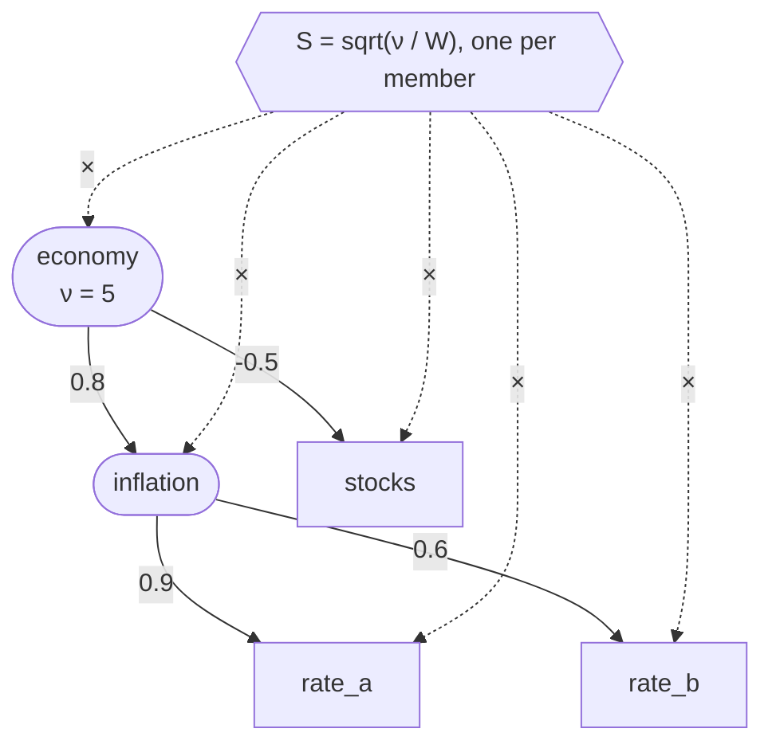
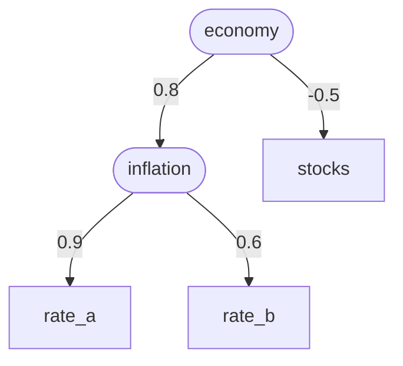

# ADR-008: Correlated parameters in ensembles

- **Status:** Accepted
- **Date:** 2026-10-03
- **Supersedes:** —
- **Amended:** see [Amendments](#amendments) at the end.
- **Related:** [ADR-006](ADR-006-ensemble-scenarios.md) (ensemble scenarios: `vary_*` rows, keyed RNG streams, member 0), [ADR-007](ADR-007-sensitivity-analysis.md) (sensitivity analysis, which assumes independent draws), [ADR-003](ADR-003-registries-and-csv-schemas.md) §4.8 (`calendar.csv`), issues [#30](https://github.com/BobKerns/analysis/issues/30) (this design; decisions recorded there) and [#31](https://github.com/BobKerns/analysis/issues/31) (`quantile()` on every family, the median as center).

## Context

ADR-006 draws every varying row independently. Reality isn't like that:
- inflation and interest rates move together;
- stocks and bonds are correlated, sometimes negatively;
- the same series in 2030 and 2040 isn't two unrelated guesses.

Independent draws make the ensemble's spread wrong: they understate it when uncertainties compound (two rates that are both high in bad years), and overstate it when they offset.

Two things this design must not lose:
- **Each row's authored distribution.** A row's range is the author's belief about that value *over all futures* ("inflation is 2–4%"). That belief is what can be checked against history. Correlation should change how rows move *together*, not what any one of them looks like.
- **ADR-006's stability properties:** keyed RNG streams (adding a row never changes other rows' draws), bounds that a draw can't escape, and a deterministic member 0.

## Decision

### 1. Gaussian copula, or Student-t per tree

For each member, every row in a correlation tree (§2) gets a **standard normal score** `z`. The scores are correlated as specified. Each row's value is then its own distribution's quantile at `u = Φ(z)`:

```text
value = dist.value_at(Φ(z))
```

Because `u` is uniform on its own, **each row's distribution, taken alone, is exactly what was authored**: same median, spread, shape and bounds. Only the joint behavior changes. Given a parent's value, a child's distribution shifts toward the parent's side, narrows, and is skewed against its bounds as a consequence. All of that is sized so the authored distribution holds overall.

**Bounds never move.** A correlated draw can't leave its row's authored range, so none of the edge cases that moving bounds would bring can arise: negative transfer amounts, dates outside the scenario, a distribution centered off its peak.

**ρ means the same thing for every family, as long as values don't tie.** The copula correlation ρ between two normal scores gives a rank (Spearman) correlation between the two rows' *values* of `(6/π)·asin(ρ/2)`, whatever their continuous distributions are. That's within 0.02 of ρ everywhere, so "ρ = 0.6" predictably means "rank correlation about 0.58" for a long date range and a skewed rate alike. Kendall's τ between them is `(2/π)·asin(ρ)`, exactly, under this copula and the t copula below alike (it holds for every elliptical copula). **Ties break this.** Amounts rounded to cents or micros over a realistic spread have negligible ties. A date range of only a few days doesn't: a two-day uniform date at ρ = 0.6 has a value rank correlation of about 0.41, not 0.58. So checks and reports (§6, and the plan's tests) compare the **recorded scores** (`z`), which never tie. A value-level rank correlation is shown only as a description.

**A tree can opt into a Student-t copula** ([#68](https://github.com/BobKerns/analysis/issues/68)). A Gaussian copula has no tail dependence: extremes in correlated rows rarely coincide, so a stretch where every inflation rate runs hot at once comes out rarer than it happens. A tree whose root sets `vary_tail_dependence` (degrees of freedom `ν`, §4) keeps the tree math (§2) and then multiplies every score in the tree by one shared scale per member:

```text
S = sqrt(ν / W),   W ~ χ²(ν)
value = dist.value_at(t_ν(S · z))
```

With `ν` on the root of §2's example tree, one `S` per member multiplies every score in it:



`t_ν` is the Student-t CDF with `ν` degrees of freedom (`scipy.stats.t`). `S · z` is t-distributed with `ν` degrees of freedom, so `u` is still uniform and **each row's authored distribution is still exact**; only the joint tails thicken. `S` is how turbulent that member's future is: usually near 1, sometimes large, and when it's large every row in the tree is far from center at once. `ν` sets how tightly `S` stays near 1 (statistically, as if a future's volatility were estimated from `ν` independent normal draws). Lower `ν` means more tail dependence; about 3 to 30 is a sensible range, and a blank `ν` is the Gaussian copula.

Because `S` scales the whole tree, the tree's depth and shape don't change it, and ρ keeps its meaning along every link: paths multiply ρ as before (§2), and the tree's one `ν` applies to the resulting implied ρ. The upper (and lower) tail dependence of two rows at implied ρ is `λ = 2·t_{ν+1}(−sqrt((ν+1)(1−ρ)/(1+ρ)))`; the Gaussian copula's is 0:

| ν | ρ = 0 | 0.3 | 0.6 | 0.9 |
| --- | --- | --- | --- | --- |
| 3 | 0.12 | 0.22 | 0.37 | 0.67 |
| 5 | 0.05 | 0.12 | 0.27 | 0.59 |
| 10 | 0.01 | 0.03 | 0.13 | 0.46 |
| 30 | 0.00 | 0.00 | 0.01 | 0.21 |

So tail dependence fades more slowly with distance in the tree than ρ does, and rows in one tree with ρ = 0 between them are still tail-dependent, since they share `S`. Rows in different trees stay independent.

`ν` belongs to a tree, not a row, which is why it sits on the root: it has to sit above everything it scales. On a lone row it would only stretch that row's score, which `t_ν` maps straight back to the authored marginal, so it would do nothing.

### 2. Structure: one parent per row, no cycles

Each row (or factor, §3) may name **at most one** parent, with a correlation ρ ∈ [-1, 1]:

```text
z_child = ρ · z_parent + √(1 − ρ²) · ε_child
```

`ε_child` is the child's own standard normal noise. For example, a factor `economy` over a sub-factor `inflation` with two rates, and a stock return anti-correlated with the economy (rounded boxes are latent factors, square boxes varying rows, and each arrow carries the child's ρ):



`rate_a` and `rate_b` correlate at 0.9 · 0.6 = 0.54, and `rate_a` with `stocks` at 0.9 · 0.8 · −0.5 = −0.36. The result is a forest of trees, which:
- **can't specify an impossible correlation matrix.** Every tree gives a valid joint distribution, so authors never meet a "not positive semi-definite" error;
- **multiplies correlations along paths.** Two children of one parent, at ρ₁ and ρ₂, correlate at ρ₁·ρ₂. To make two siblings correlate at 0.6, give each about 0.77;
- **handles anti-correlation** with negative ρ;
- **covers correlation over time:** a 2040 growth-rate row depending on the 2030 row of the same series.

**Several parents per row, or a full correlation matrix, are deferred.** One parent plus latent factors is the standard factor model, and it covers every case raised so far. Anything richer needs more economic insight than is usually available: stock-bond correlation has even changed sign across decades. Coarse values (±0.3, ±0.6, ±0.9) are about what anyone can justify.

### 3. Latent factors: a `latent_factor` calendar kind

A shared influence that isn't itself a modeled value ("the inflation regime", "the market") is a **latent factor**: a `calendar.csv` row of kind `latent_factor`, with a `name` and an optional `description`. It has no date, amount or series meaning. Its value is a standard normal score, and its dependents correlate with it. A factor may itself depend on another factor, which gives a hierarchy.

This keeps "variation is authored in `calendar.csv`", and gets calendar reporting for free. It's not a separate `factors.csv` with its own unobvious usage. And a factor is never created implicitly from an unknown name, where a typo would silently create one.

### 4. Authoring and validation

Three `calendar.csv` columns, valid on a varying row and on a `latent_factor` row:

| column | notes |
| --- | --- |
| `vary_correlate_with` | the parent: another varying row's or a factor's `name`, or a varying lifespan's `lifespan:<person>` |
| `vary_correlation` | ρ, in [-1, 1]; required with `vary_correlate_with` and only with it |
| `vary_tail_dependence` | `ν` ≥ 1, the Student-t copula's degrees of freedom for the whole tree (§1); only on a tree's root; blank is the Gaussian copula |

A varying lifespan ([ADR-006](ADR-006-ensemble-scenarios.md) §3a) is a node too, named `lifespan:<person>`: `lifespan.csv` has its own `vary_correlate_with`/`vary_correlation` (not `vary_tail_dependence`), so two spouses' ages can move together, and a calendar row or factor can be its parent or its child. A `life_table` lifespan ([#222](https://github.com/BobKerns/analysis/issues/222)) maps its score through its life table's inverse distribution, as any row maps its score through its own. No calendar row may take a name starting `lifespan:`.

`vary_tail_dependence` is a separate column from `vary_tailweight` on purpose: `vary_tailweight` shapes one row's own marginal (sinh-arcsinh, ADR-006), a different quantity on a different scale. The two compose: tail weight makes a rate's extremes bigger; `ν` makes extremes coincide.

A `latent_factor` row's `date` may be blank. The loader stores the scenario start as a placeholder, because the `calendar_event.date` column is required and nothing reads it.

**Factors are merged across scenario inheritance by name.** The calendar overlay key (ADR-003 §4.5) is an event's fields, `date`, `kind`, `scheduled_name`, accounts, `series` and `amount`, and deliberately not `name`. A factor leaves all of those blank, so on that key two factors would collide, and a parent scenario's factor couldn't be overridden reliably. A `latent_factor` row's overlay key is therefore its `name` alone: a child scenario's factor of the same name replaces the parent's.

The loader rejects:
- a parent that names no varying row or factor in the scenario, after inheritance merges the calendar (ADR-003 §4.5);
- a cycle;
- |ρ| > 1;
- a `latent_factor` row with `vary_distribution` or any other `vary_*` parameter (the correlation columns aside);
- `vary_tail_dependence` that isn't a finite number of at least 1, or that sits on a row with a parent. The error names the tree's root, where `ν` belongs. `ν = 1` is the Cauchy copula, already far more tail dependence than any data supports; below it the `χ²` draw behind `S` underflows to 0 for ordinary draws (its median is about 10⁻⁶ at `ν = 0.1`).

**A factor with no dependents is a warning, not an error.** It may be work in progress, or defined in a parent scenario for its child scenarios to use, in which case it has no dependents in the parent itself. Since such a factor is usually deliberate, only `sim check` mentions it (and `sim check --all` only with `--verbose`, ADR-004 §6): the loader puts it in `LoadResult.unused`, apart from `LoadResult.warnings`, and `sim check` prints both as `WARN:` lines (ADR-004 §6's format), while `sim load`, `sim run` and the editing commands' validating loads print only `warnings`. A warning doesn't stop the load or change the exit status. Several unused factors are one warning naming them all, not one each, since a scenario that defines a factor structure ahead of time for its children (the prototype's root does) has many. An unused factor resolves to its own draw and affects nothing. `vary_tail_dependence` on a varying row nothing depends on is the same kind of warning.

`sim calendar add latent-factor NAME [--description …] [--vary-correlate-with … --vary-correlation …] [--vary-tail-dependence …]` adds a factor. Every other `add` subcommand gains `--vary-correlate-with`, `--vary-correlation` and `--vary-tail-dependence`. The guided form asks a factor without a parent for `ν`; it asks a varying row only when the row already has one, since most varying rows without a parent are lone rows.

### 5. Resolution (`resolve_member`)

1. **Scores first.** Compute `z` for every factor and every row in a tree, in topological order (parents first). A root's `z` is its own noise. Each `ε` is drawn on that name's own keyed stream, `member_rng(seed, member, name)` (ADR-006 §3), as `Φ⁻¹(rng.random())`, so a change to one tree never shifts another's draws. A t-copula tree (§1) then multiplies all its scores by its `S`, with `W = χ²_ν⁻¹(rng.random())` on its own stream, `tail_rng(seed, member, root)`. That stream hashes a string beginning `tail:`, which no `member_rng` key (beginning with the integer seed) can equal, so it never reuses the root's own noise and shifts no existing draw.
2. **Yearly scores, for a tree holding a process row** (ADR-006 §4a, [#115](https://github.com/BobKerns/analysis/issues/115)). These are computed after the date pass (step 3), since a path stops at the next authored `set_rate` for its series, whose date may be drawn; they don't change any level score. For each calendar year `Y` in which any process row in the tree has a step, compute a year-`Y` score for every node the same way as step 1, from year-`Y` noise drawn on `path_rng(seed, member, name, Y)`, which hashes `path:{seed}:{member}:{Y}:{name}` (a string beginning `path:`, which no level stream's key can equal, with the year before the name so no name can alias another year), and, in a t-copula tree, a year-`Y` scale `S_Y` on `path_tail_rng(seed, member, root, Y)`, keyed the same way under `path-tail:`. A process row takes the score for its step's calendar year as that step's shock: `z` in a Gaussian tree, `S_Y · z` in a t-copula tree, which therefore requires `ν > 2` (ADR-006 §4a). Every other node's yearly scores only carry correlation down the tree. Keying by calendar year, not step number, makes two process rows' shocks for the same year correlate even when their paths start in different years. A process row in no tree draws its shocks from the same `path_rng` streams, independently. Level scores (step 1) don't change, so a recipe without process rows resolves exactly as before.
3. **Then the existing passes**, dates first and then amounts. A row in a tree takes its value from `value_at(Φ(z))`, or `value_at(t_ν(z))` in a t-copula tree; ramps expand from that value as before.
4. **Rows outside every tree draw exactly as today** (`draw()` / `draw_int()`), so existing recipes resolve byte-for-byte as before. So do trees without `ν`. (For every family except a `uniform` date, `draw` already equals `value_at(rng.random())`. Keeping the old call for untouched rows makes that exact for uniform dates too.)
5. **Member 0** sets every score to 0, yearly scores included, so `u = 0.5`, the median, which is `central()` (#31), under either copula. It's unchanged.

`value_at(u)` is the family's quantile, with dates in whole days as drawn. For a `uniform` date that means each day is equally likely, `low + floor(u · days)`, matching `draw_int`. For other families it's `round(quantile(u))`.

**One-at-a-time sensitivity (ADR-007 §2)** still moves an overridden row alone, with every other row at its center: a well-defined "effect of this row alone", even for a row with dependents. A **latent factor** can be overridden too. Its score is set to Φ⁻¹(q), and each descendant takes its conditional median given the factor, `z = (product of ρ along the path) · z_factor`, mapped through `value_at`. Intermediate nodes are averaged over, not held at their medians: a grandchild's conditional median given its grandparent uses ρ₁·ρ₂, which is what the tree implies (§2). In a t-copula tree the factor's score is `t_ν⁻¹(q)` and descendants map through `t_ν`; the rule is otherwise the same, since the t copula is elliptical too, so a descendant's conditional median is still the ρ product times the factor's score. OAT draws nothing, so no `S` is drawn.

### 6. Provenance and reporting

- `ensemble_draw` gains **`z REAL`**: each row's score (in a t-copula tree, the scaled score `S·z` that `t_ν` maps). It's NULL for a row outside every tree, Φ⁻¹(q) for an OAT override, the conditional score for a descendant of an overridden factor (§5), and 0 for member 0. Each **factor** also gets an `ensemble_draw` row (`vary_target = 'factor'`, `drawn_value` = its `z`), so achieved correlations can be checked after the fact.
- Factor rows stay in member intent files as provenance. The engine treats `latent_factor` as inert: no effect, and not counted as an unsupported kind.
- The **parameters table** (ADR-007 §9) shows each row's parent and ρ, a root's `ν`, and lists the factors.
- `ensemble_draw` also records each tree node's own **`noise`** (its independent standard normal, before `resolve_scores` mixes it in) and **`u`**, the probability `t_ν(z)` or Φ(z) that maps its value; a factor's `u` is its score's probability. Each random member's `S` per tree, and each process year's, goes in `ensemble_tail_scale` ([#72](https://github.com/BobKerns/analysis/issues/72), [#261](https://github.com/BobKerns/analysis/issues/261)), so a member's turbulence can be inspected without changing any value. A batch's `draws.sqlite3` gathers all of it, with every pair's implied and achieved ρ (ADR-006 §6).
- The **Monte Carlo correlation report** (ADR-007 §6.2) ranks and pins a correlated batch's rows by SRRC rather than marginal ρ, since a row's ρ includes its correlates' effects. A batch is correlated when two of its rows have a nonzero implied ρ, or share a t-copula tree, where even a zero implied ρ leaves their extremes tied together. It shows, per correlated pair, the ρ the batch achieved against the specified or implied ρ. The achieved ρ is read from the recorded scores' (`z`) Kendall τ as `sin(π·τ/2)`, with a 95% Fisher-z interval on τ mapped the same way. The interval's standard error comes from the batch's own scores, the U-statistic variance `4·var(cᵢ)/n` of each member's concordance `cᵢ` with the others: a fixed Gaussian-copula variance (`0.437/(n−4)`) covers only about 90% at `ν = 3`, since turbulent members make τ noisier. That holds exactly under both copulas (§1), where a Pearson correlation of t scores would be dominated by a few turbulent members, and is undefined for `ν ≤ 2`. It's scores rather than values, since tied values (§1) don't follow these formulas. Factors stay out of its regression (their effect reaches the outcome only through their dependents) but each gets an informational line: its score's ρ with the outcome, its whole family's effect.

**Follow-ups, as sub-issues of #30:**
- **A correlation-aware Monte Carlo report** ([#38](https://github.com/BobKerns/analysis/issues/38)): done, above and ADR-007 §6.2.
- **One-at-a-time perturbation of latent factors** ([#39](https://github.com/BobKerns/analysis/issues/39)): done, §5 and ADR-007 §2.

### 7. Schema

Schema 30:
- `calendar_event` gains `vary_correlate_with TEXT` and `vary_correlation REAL`;
- `ensemble_draw` gains `z REAL`;
- `latent_factor` joins `CALENDAR_EVENT_KINDS`.

Schema 32 (#68): `calendar_event` gains `vary_tail_dependence REAL`.

Schema 33 (#115): `calendar_event` gains `vary_process TEXT`, `vary_persistence REAL` and `vary_innovation_sd INTEGER` (ADR-006 §4a). Yearly scores aren't recorded in `ensemble_draw`; `ensemble_path_shock` records each year's noise, score, scale and shock (schema 43, #261), and the path they produce is the member's generated `set_rate` rows.

## Consequences

- **Positive:**
  - Each row's authored distribution is exactly preserved, and correlation never moves a bound.
  - The tree structure can't produce an invalid correlation matrix.
  - Existing recipes and untouched rows resolve exactly as before.
  - ρ means a predictable rank correlation for any pair of families.
  - Everything is still authored in `calendar.csv`.
- **Negative:**
  - **Tail dependence must be chosen per tree.** The default Gaussian copula makes joint extremes rarer than in reality, where crashes tend to hit everything at once; a tree has to opt into the t copula with `ν`, and choosing `ν` needs judgment, as ρ does.
  - **One `ν` per tree.** A sub-factor's family can't be turbulent independently of the rest of its tree.
  - Only tree-shaped correlation structures can be expressed.
  - Choosing ρ needs judgment that data rarely settles.
  - Strongly correlated rows are hard to tell apart in the Monte Carlo report: their SRRC intervals are wide, so they tend to come out *inconclusive* (ADR-007 §6.2).
- **Not attempted:** several parents per row; correlation of a row with itself over time beyond what explicit rows give; correlating values that aren't `vary_*` rows.

## Open questions deferred

- **A separate `ν` per sub-tree** (a "grouped t" copula: one `W` per group), so a sub-factor's family could be turbulent independently of the rest of its tree. That's more than the data usually supports.
- **A full correlation matrix** for rows that genuinely need more than a tree, with positive-semi-definite validation and a nearest-valid-matrix repair.
- **Estimating ρ from history** (e.g. from a series' own CSV data), rather than authoring it by judgment.

## Amendments

Each entry changed this ADR's design. The sections it names were rewritten in place to describe the current design; git history has the earlier text.

- [#39](https://github.com/BobKerns/analysis/issues/39): one-at-a-time sensitivity can perturb a latent factor, moving its family to their conditional medians (§5, §6).
- [#38](https://github.com/BobKerns/analysis/issues/38): the Monte Carlo report handles correlated rows (§6).
- [#68](https://github.com/BobKerns/analysis/issues/68): an optional Student-t copula per tree for tail dependence (§1, §4–§7); the achieved-correlation check reads ρ through Kendall's τ (§6).
- [#80](https://github.com/BobKerns/analysis/issues/80): several factors with no dependents are one warning (§4).
- [#115](https://github.com/BobKerns/analysis/issues/115): a tree holding a process row (ADR-006 §4a) also computes a score per node for each calendar year of the path (§5, §7).
- [#204](https://github.com/BobKerns/analysis/issues/204): only `sim check` prints the unused-factor and lone-`vary_tail_dependence` warnings (§4).
- [#221](https://github.com/BobKerns/analysis/issues/221): a varying lifespan joins correlation trees as `lifespan:<person>` (§4).
- [#222](https://github.com/BobKerns/analysis/issues/222): a `life_table` lifespan's score maps through its table's inverse distribution (§4).
- [#261](https://github.com/BobKerns/analysis/issues/261): `ensemble_draw.noise` and `u`, `ensemble_tail_scale` (closing #72) and `ensemble_path_shock`; a batch's `draws.sqlite3` (§6, §7).
