# Architecture

How the finance simulator is put together: an overview in diagrams, and the
ADRs that specify it. The diagrams are a map for a reader; the ADRs are the
specification, and where the two differ the ADR is right and the diagram
needs fixing.

## The ADRs

| ADR | Covers | Plan |
| --- | --- | --- |
| [ADR-001](ADR-001-overall-architecture.md) | Design principles, the two layers, the monthly step, priority bands | |
| [ADR-002](ADR-002-storage-schema.md) | Two-layer SQLite storage, DDL, glossary | |
| [ADR-003](ADR-003-registries-and-csv-schemas.md) | Locked vocabularies, every CSV schema, scenario inheritance | |
| [ADR-004](ADR-004-reproducibility-and-activation.md) | Provenance, determinism, activation, the background builder | |
| [ADR-005](ADR-005-lots-and-per-lot-state.md) | Lots and per-lot state | [plan](ADR-005-implementation-plan.md) |
| [ADR-006](ADR-006-ensemble-scenarios.md) | Ensembles: parameter variation, Monte Carlo runs | [plan](ADR-006-implementation-plan.md) |
| [ADR-007](ADR-007-sensitivity-analysis.md) | Sensitivity analysis over ensemble parameters | [plan](ADR-007-implementation-plan.md) |
| [ADR-008](ADR-008-correlated-parameters.md) | Correlated parameters in ensembles | [plan](ADR-008-implementation-plan.md) |
| [ADR-009](ADR-009-pooled-ensembles.md) | Pooled ensembles: one result set from several | |
| [ADR-010](ADR-010-responsive-strategies.md) | Responsive strategies: code that decides a chain's draws and placements | |
| [ADR-011](ADR-011-tax-calculators.md) | Tax calculators: built-in and household code that computes each jurisdiction's return | |

## The guides

The ADRs say what the design is; the guides explain it to a person using it.
Each diagram below links the guides that go with it.

| Guide | For |
| --- | --- |
| [User guide](../user-guide.md) | Scenarios, the glossary, how tax is handled, common tasks, reading results |
| [Chains](../guides/chains.md) | Where money is drawn from and where extra money goes |
| [Ensembles](../guides/ensembles.md) | Varying rows, correlation and factors, pools, sensitivity |
| [How the simulator draws random futures](../guides/simulation-basics.md) | Seeds, streams, distributions, copulas |
| [Historical calibration](../guides/historical-calibration.md) | What numbers to put in; the template scenarios |
| [A century of rates](../guides/century-of-rates.md), [historical information](../guides/historical-information.md) | What history says about inflation, rates and returns |
| [Importing your data](../guides/importing-data.md) | Holdings, transactions and budgets from outside files |
| [Guard rails](../guides/guard-rails.md) | Lines spending should stay inside, and reading their margins |
| [State income tax](../guides/state-income-tax.md), [tax calculators](../guides/tax-calculators.md) | Each state's rules; writing a household's own |
| [Finance research](../guides/finance-research.md) | Tear sheets and fund weights with Claude |
| [Startup stock options](../guides/startup-stock-options.md) | What they are worth and how to model them |
| [A private remote for the data repo](../guides/data-repo-remote.md) | Backing up and sharing the data repo |
| [The SQLite guide](../sqlite-guide.md) | What is in a run file, and asking questions of it |

## The diagrams

Overviews (functional blocks, data flow, input tiers), then detail that
hangs off one spine, the month: tax and strategies are explained by when the
engine calls them (3a) and what crosses the boundary (4a, 4b).

Colors mean the same thing throughout: yellow is authored input, purple is
plug-in or template code, blue is the simulator's own processing, green is
SQLite state, gray is what a person reads.

| Diagram | Shows | ADRs |
| --- | --- | --- |
| [1. Functional blocks](#1-functional-blocks) | The layers, and how the three stores relate | 001, 002 |
| [2a. Data flow](#2a-data-flow) | Files to intent to run to readers | 002, 004, 006 |
| [2b. Where the inputs come from](#2b-where-the-inputs-come-from) | Edits, imports, prices, research, calibration, the nightly roll | 003, 004 |
| [2c. Ensembles](#2c-ensembles-three-kinds-of-batch) | Monte Carlo, sensitivity and pooled batches | 006, 007, 009 |
| [3a. One month in the engine](#3a-one-month-in-the-engine) | The order of a month | 001, 003, 010 |
| [3b. One debit through a chain](#3b-one-debit-through-a-chain) | Chains, refill, strategy draws | 003, 010 |
| [4a. Income tax](#4a-income-tax-accumulate-compute-settle) | Accumulate, compute, settle | 003, 011 |
| [4b. Strategies](#4b-strategies-ask-decide-post) | Ask, decide, post | 010 |
| [4c. Household code](#4c-household-code-one-contract-for-both) | Loading, snapshot, purity | 004, 010, 011 |
| [5. Input data](#5-input-data-three-tiers) | Templates, shared base, scenario folders | 003 |
| [6a. Load order](#6a-inheritance-the-load-order) | Parents, mix-ins, templates | 003 |
| [6b. Merging](#6b-inheritance-how-files-are-overlaid) | The three overlay rules | 003 |
| [6c. Worked example](#6c-inheritance-a-worked-example) | A row merge and a whole-file override | 003 |

## 1. Functional blocks

Six layers, read top to bottom, plus the machinery that runs alongside. The one idea to take from it: everything authored is plain files in git, everything in SQLite is derived and can be rebuilt, and the only code that is not the simulator's own (tax calculators, strategies) is fenced into one box that gets a read-only view and hands back an answer.

Not drawn: the registries and schema (`registries.py`, `schema.py`), which the loader, engine and reports all share, and the side tools that share the `analysis` command but none of the simulator (the Amazon categorizer, the video builder).

Guides: [User guide](../user-guide.md) (what a household does with each layer), [setup](../SETUP.md) (the two repos and activation), [notebooks](../../notebooks/README.md).

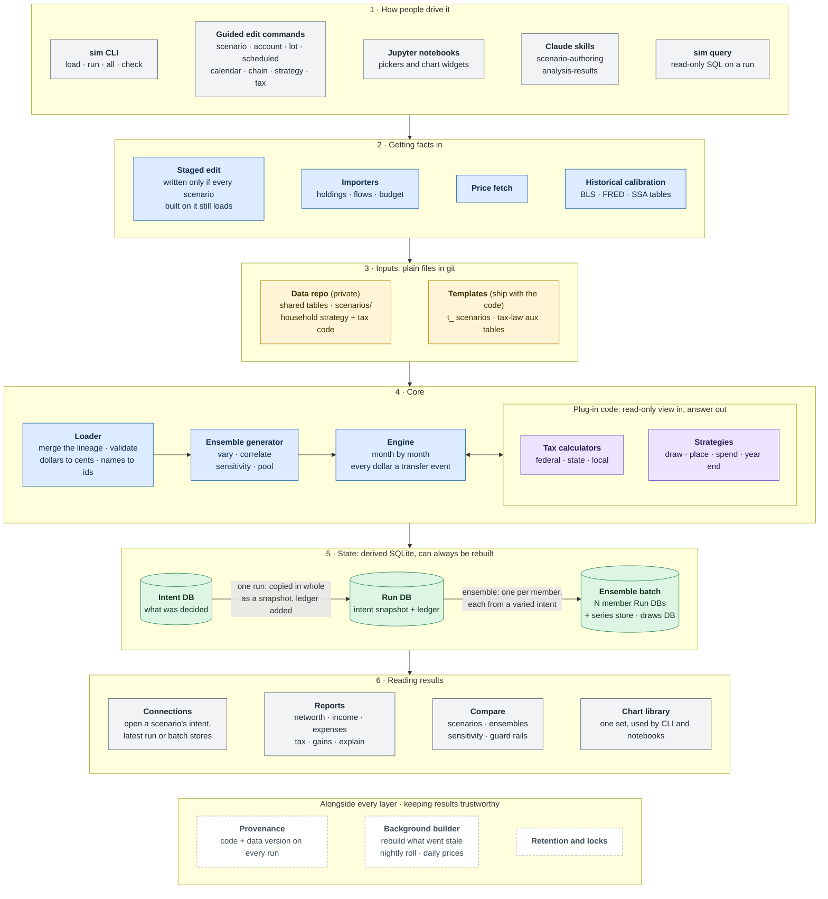

## 2a. Data flow

One path from files to results. An ensemble is not a different engine: the vary step writes ordinary intents, and the same engine runs each. A run file carries its own copy of the intent and the plug-in source, so it stays readable after the data repo moves on. Everything from the intent on lives under the data repo's `state/`, is derived, and is pruned by `.retention.yaml`.

Guides: [Looking at your results](../user-guide.md#5-looking-at-your-results), [the SQLite guide](../sqlite-guide.md) (what is in a run file and how to ask about it), [how the simulator draws random futures](../guides/simulation-basics.md).

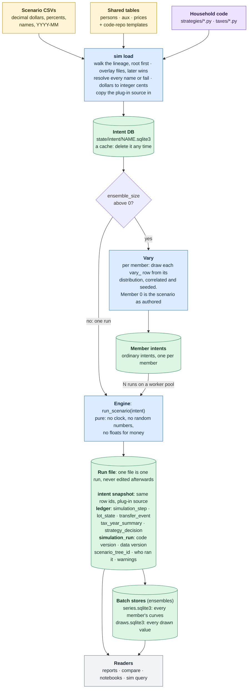

## 2b. Where the inputs come from

What writes to the files diagram 2 starts from. Everything a command writes
to a scenario goes through a staged edit; nothing but the builder's nightly
roll, daily price fetch and morning research writes without a person asking.

Guides: [Importing your data](../guides/importing-data.md), [historical calibration](../guides/historical-calibration.md) (what numbers to put in, and the template scenarios built from them), [finance research](../guides/finance-research.md), [bringing the plan up to date](../user-guide.md#421-bring-the-plan-up-to-date-each-year), [a private remote for the data repo](../guides/data-repo-remote.md).

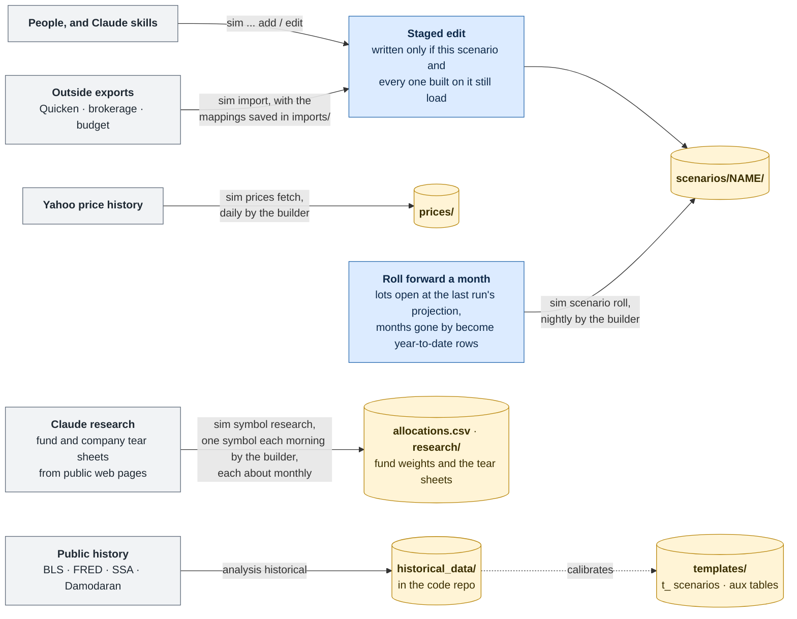

## 2c. Ensembles: three kinds of batch

One recipe, an ordinary scenario whose `vary_` rows give each uncertain
number a distribution, feeds two kinds of run. A pool runs nothing new: it
is a weighted selection of members other ensembles already ran.

Guides: The [ensembles guide](../guides/ensembles.md) explains what the diagram leaves out, with its own diagrams: [correlated parameters](../guides/ensembles.md#correlated-parameters), [factors](../guides/ensembles.md#modeling-a-shared-driver), [pooling](../guides/ensembles.md#pooling-several-kinds-of-trouble) and [sensitivity](../guides/ensembles.md#which-varying-rows-matter-and-when-sensitivity). Also [how the simulator draws random futures](../guides/simulation-basics.md) and [a century of rates](../guides/century-of-rates.md).

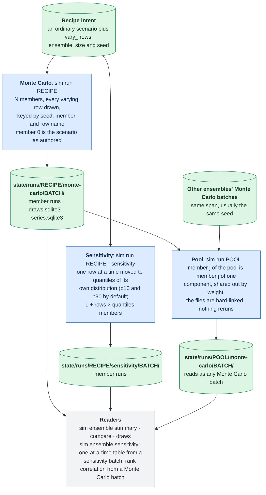

## 3a. One month in the engine

The order things happen in a month. This is where tax and strategies attach, so the two detail diagrams below hang off steps 3 to 9. Purple steps are where household or built-in strategy code is asked.

Guides: [Calendar for more complex changes](../user-guide.md#48-calendar-for-more-complex-changes), [the glossary](../user-guide.md#2-glossary).

```mermaid
flowchart TB
  s0(["last month's lot_state"])
  c1["<b>1 · Calendar events</b> dated this month<br/>set_rate · set_amount · retire_scheduled<br/>one_off_transfer · transfer_balance · swap_aux_table"]
  c2["<b>2 · Inflation indexes</b> advance"]
  c3["<b>3 · Strategy hooks</b><br/>on_breach (January) · year_start (January) · month_start"]
  p1["<b>4 · Phase 'rules'</b>: scheduled rules, by priority<br/>100 growth and interest<br/>200 income: salary · Social Security · RMD · IRMAA<br/>300 expenses · mortgage<br/>500 conversions and one-offs<br/>900 on_death<br/><i>a strategy that owns a rule answers <b>scale</b> before it posts;<br/>every debit goes through a source chain (next diagram)</i>"]
  pc["<b>5 · Phase 'card_interest'</b><br/>interest on what the month's payments left unpaid on a card"]
  p2["<b>6 · Phase 'tax_settlement'</b> (April only)<br/>last year's return: federal, then state, then local"]
  p3["<b>7 · Phase 'fill_bracket'</b><br/>Roth conversion up to a bracket top<br/><i>5 to 7 have no priority number. They follow the rules for a stated<br/>reason: interest is on what the payments left, an RMD cannot be<br/>converted, and the conversion needs the year's whole income</i>"]
  ye["<b>8 · Strategy hook: year_end</b> (December)<br/>harvest gains or losses · gift · sell to rebalance"]
  me["<b>9 · Month end</b><br/>overflow sweep through destination chains<br/><i>a strategy that owns the chain answers <b>place</b></i><br/>basis step-up after a death"]
  s1(["this month's lot_state, one row per lot"])

  s0 --> c1 --> c2 --> c3 --> p1 --> pc --> p2 --> p3 --> ye --> me --> s1

  class c1,c2,p1,pc,p2,p3,me proc
  class c3,ye code
  class s0,s1 store
  classDef input fill:#FFF4D6,stroke:#B8860B,color:#3b2f00
  classDef code fill:#EDE3FF,stroke:#6B46C1,color:#2a1a55
  classDef proc fill:#DCEBFF,stroke:#2B6CB0,color:#0f2a4a
  classDef store fill:#DDF5E3,stroke:#2F855A,color:#123524
  classDef out fill:#F1F3F5,stroke:#5F6B7A,color:#1f2933
  classDef note fill:#ffffff,stroke:#9aa5b1,color:#3e4c59,stroke-dasharray:4 3
```

## 3b. One debit through a chain

Every debit resolves the same way, whoever asked for it. A strategy can choose the lots, but the engine posts the legs, and whatever the strategy leaves undecided falls through to the chain as written.

Guides: [Chains: where money comes from, and where extra money goes](../guides/chains.md), [chains as default policies](../user-guide.md#46-chains-as-default-policies).

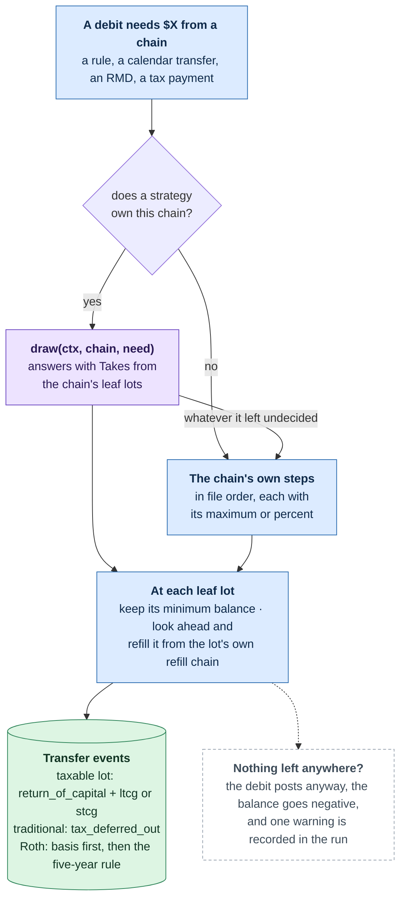

## 4a. Income tax: accumulate, compute, settle

There is no tax accumulator rule (the `tax_accumulator` kind was retired with [#507](https://github.com/BobKerns/analysis/issues/507)). The ledger does the accumulating: each transfer already carries its tax character, and each April the engine sums the year into a read-only TaxYear and asks the calculators. The same prepared year answers every what-if, which is why `fill_bracket`, IRMAA and after-tax net worth agree with the April bill.

Guides: [How tax is handled](../user-guide.md#3-how-tax-is-handled), [state income tax, state by state](../guides/state-income-tax.md), [itemized deductions](../user-guide.md#49-itemized-deductions), [IRMAA](../user-guide.md#414-medicares-income-surcharge-irmaa).

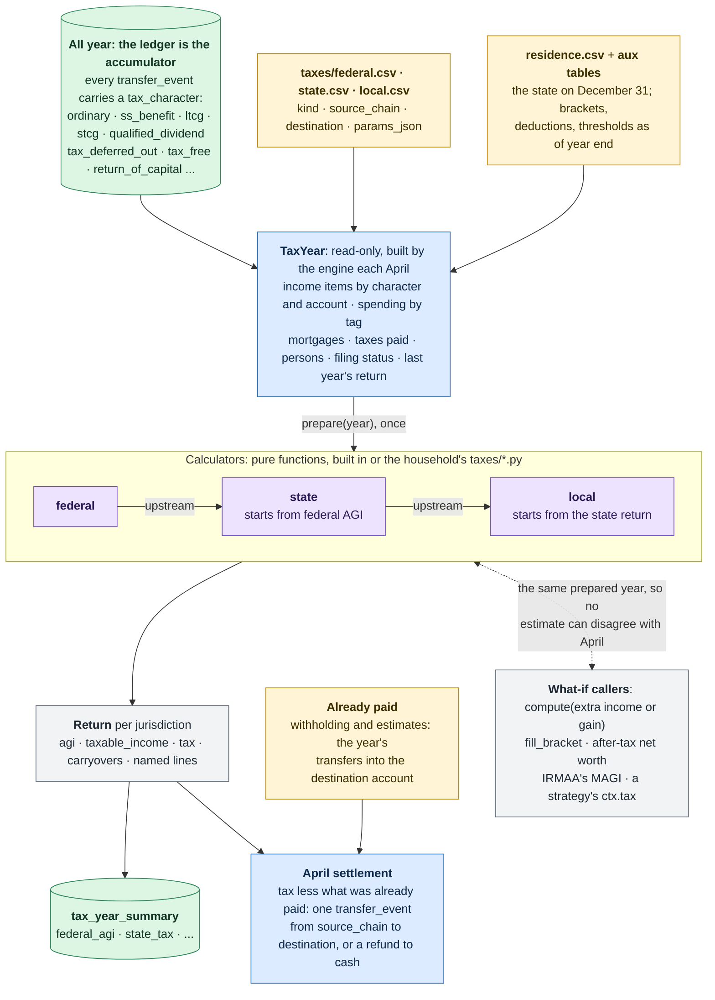

## 4b. Strategies: ask, decide, post

A strategy is a kind (code) bound to something it owns (a chain, tagged rules, or guard rails). The engine asks at fixed moments, the strategy answers with moves, and the engine posts them through its own paths. No answer means the scenario behaves as written.

Guides: User guide: [draw from whatever is overweight](../user-guide.md#416-draw-from-whatever-is-overweight-responsive-strategies), [spend less after bad years](../user-guide.md#417-spend-less-after-bad-years-spending-strategies), [tax-aware moves each December](../user-guide.md#418-tax-aware-moves-each-december-year-end-strategies), [respond when a guard rail is crossed](../user-guide.md#419-respond-when-a-guard-rail-is-crossed-strategy-triggers). Also the [guard rails guide](../guides/guard-rails.md).

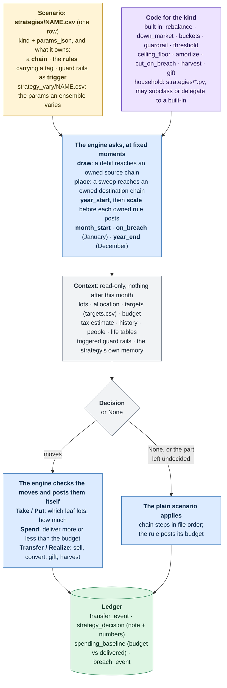

## 4c. Household code: one contract for both

Tax calculators and strategies share the same loading, snapshot and purity rules. This is what keeps a run reproducible even though it ran code from the data repo.

Guides: [Tax calculators: your own state's rules](../guides/tax-calculators.md), a worked example of household code from tag to check.

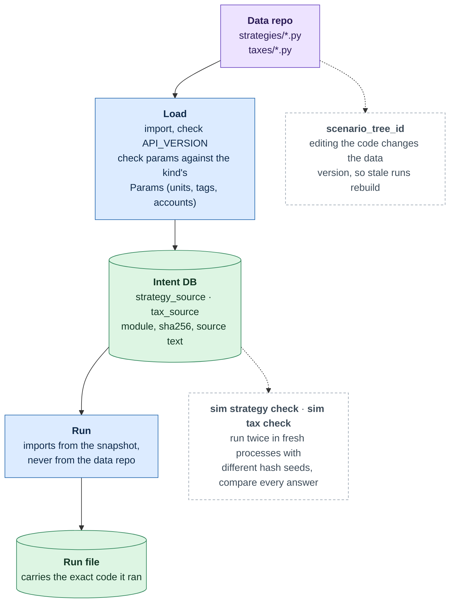

## 5. Input data: three tiers

Where each kind of file lives, and which tier stands in for which. Templates ship with the code; the data repo keeps only what the household changes; a scenario folder holds one scenario's own rows.

Guides: [templates/README.md](../../templates/README.md) (every CSV column), [scenarios build on each other](../user-guide.md#1-scenarios-build-on-each-other), [template scenarios](../guides/historical-calibration.md#template-scenarios).

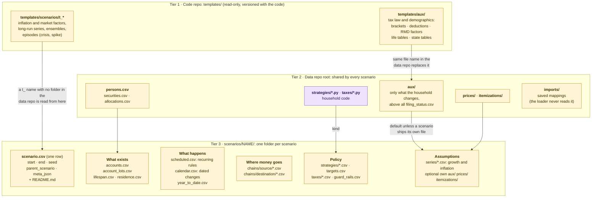

The kinds of scenario folder:

| Kind | What marks it | Runs by itself |
| --- | --- | --- |
| Ordinary | `start` and `end` somewhere in its lineage | yes |
| Mix-in only | no dates anywhere in its lineage | no: it is mixed into others |
| Ensemble recipe | merged `meta_json` has `ensemble_size` above 0; `vary_` rows | yes, as a batch of members |
| Pool | its own `meta_json` has `pool`; the folder holds `scenario.csv` only | yes, from its components' batches; nothing loads it |
| Template | a `t_` name; read from the code repo unless the data repo has the folder | yes; read-only |

What a scenario folder holds, and how each file is overlaid down the lineage
(diagram 6b):

| File | Holds | Overlaid by |
| --- | --- | --- |
| `scenario.csv` | dates, seed, `parent_scenario`, `meta_json` | field (blank inherits); `meta_json` key by key |
| `README.md` | title and description | not inherited |
| `accounts.csv` | accounts: kind, subkind, owner, growth series, chains | row: `name` |
| `account_lots.csv` | lots: symbol, opening balance and basis | row: `account_name` + `lot` |
| `scheduled.csv` | rules: income, expenses, RMD, Social Security, mortgage, IRMAA, `fill_bracket` | row: `name` |
| `calendar.csv` | dated changes, and an ensemble's `vary_` rows | row: `name`, else the row's key columns |
| `lifespan.csv`, `year_to_date.csv`, `guard_rails.csv` | ages at death, the partial first year, rails | row: `person`, `name`, `name` |
| `residence.csv` | where the household lives, by date | row: `effective_date` |
| `targets.csv` | allocation target sets | row: `target_set` + `as_of` + `asset_class` |
| `chains/source/`, `chains/destination/` | where money is drawn from and swept to | whole file, by chain name |
| `taxes/<jurisdiction>.csv` | the income taxes | whole file |
| `strategies/`, `strategy_vary/` | responsive strategies, and what an ensemble varies of them | whole file, by strategy name |
| `series/`, `aux/`, `prices/`, `itemizations/` | rate projections, and overrides of shared tables (`itemizations/` are the `@name` sums) | whole file, by file name |

## 6a. Inheritance: the load order

An example scenario, `bear_2030`, built on the prototype's `base` and `retire_alice` (`hsa_2027` and `bear_2030` are made up for the picture). Solid arrows are parents, dotted ones mix-ins. The numbers are the order the folders are overlaid in.

Guides: [Scenarios build on each other](../user-guide.md#1-scenarios-build-on-each-other).

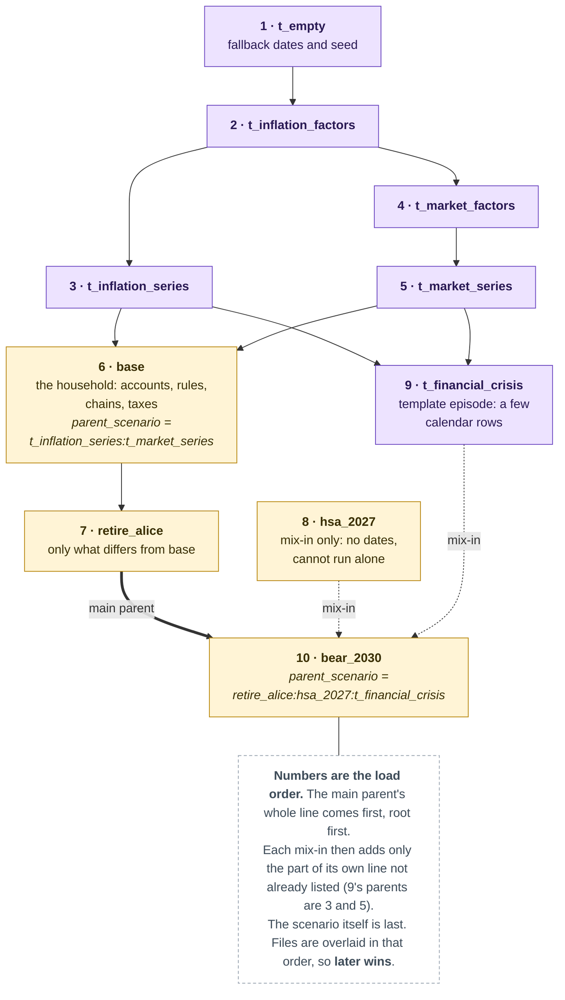

## 6b. Inheritance: how files are overlaid

Each file kind follows one of three rules as the loader walks the load order.

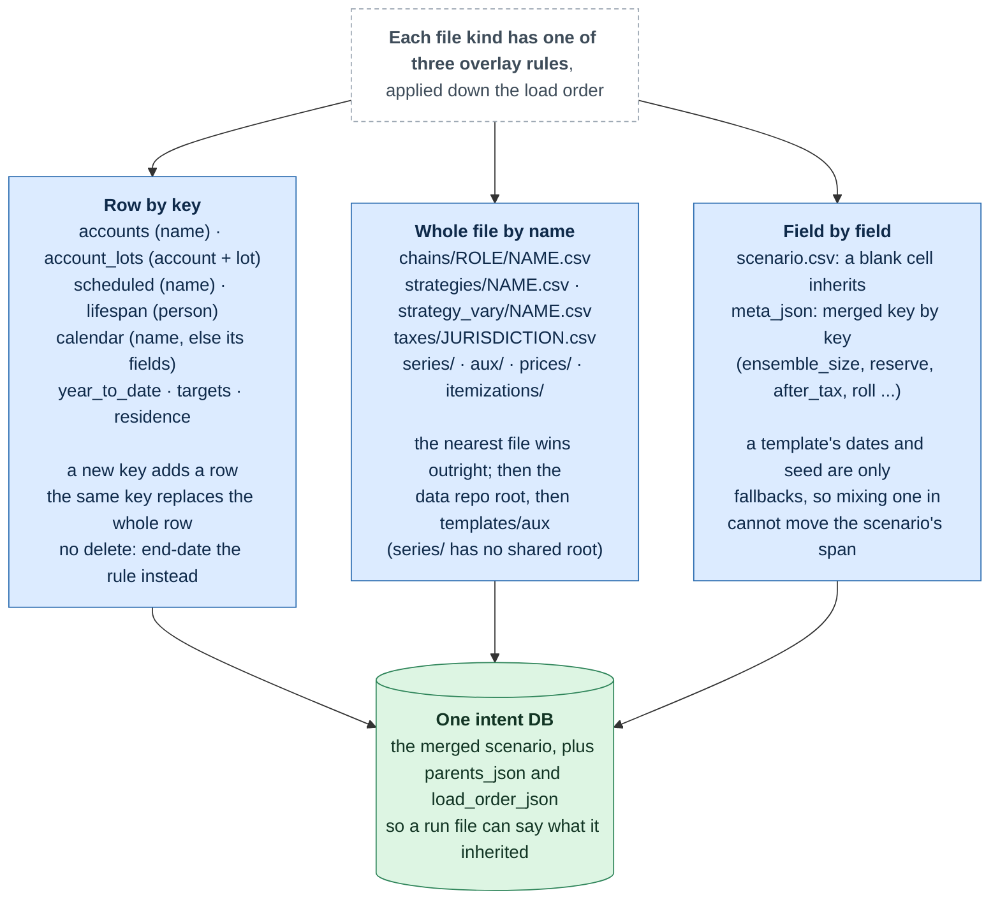

## 6c. Inheritance: a worked example

The two commonest cases, with the prototype's personas: a child's row files,
and a whole-file kind.

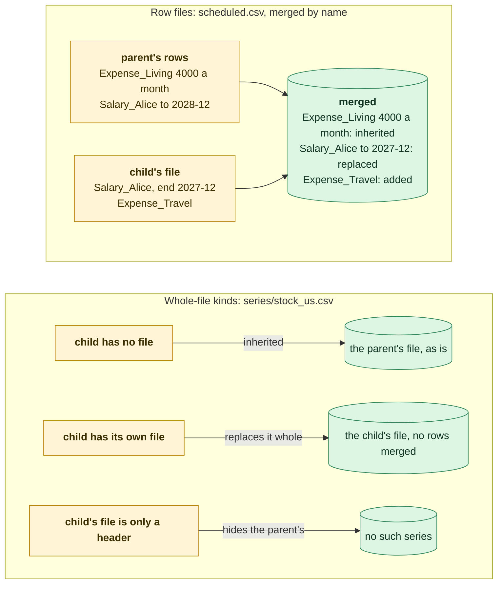

Rules worth knowing ([ADR-003](ADR-003-registries-and-csv-schemas.md) §4.5, §4.5a, §4.1d):

- A matching row replaces every column the child's file has, blanks included;
  a column the child's header leaves out keeps the parent's value.
- There is no delete: end an inherited rule on or before the scenario's
  start, or set a year-to-date row's amount to 0.
- A mix-in loads after the main parent's whole line, so its rows win over the
  parent's. Two mix-ins that set the same thing resolve to the later one.
- A `t_` name with no folder in the data repo is read from the code repo's
  `templates/scenarios/`, so every data repo builds on the same templates
  without a copy. A data repo folder of that name replaces the template whole.

## What the diagrams leave out

- Ensembles: 2c shows the batches, not how values are drawn (distributions, correlation, latent factors, processes).
- The priority bands in 3a are the defaults; a rule can set its own priority.
- 3a leaves out the run's start (opening lot state, year-to-date catch-ups) and its tail (the last tax year is computed after the run, with no transfer posted).
- The background builder appears only as a strip in diagram 1 and two arrows in 2b; retention and locks only in diagram 1.
- The Amazon expense categorizer and the video builder, which share the `analysis` command, are not drawn.
