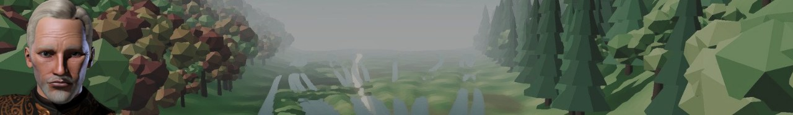

# Brand assets

The images that give the docs one look: Zabob, your host, in front of a 3D
scene of a braided stream, many channels of possible futures flowing through
one valley.

| File | Size | Used for |
| --- | --- | --- |
| [`banner.jpg`](banner.jpg) | 1280 × 186 | The strip at the top of every user-facing doc page |
| [`hero.jpg`](hero.jpg) | 1280 × 640 | The top of the README |
| [`social-card.jpg`](social-card.jpg) | 1280 × 640 | GitHub's social preview (Settings, General), and link cards elsewhere |

The scene is toned down on purpose: it is illustration, there to frame the
page, and must not compete with the text. The scene's light comes from the
right, the same side as the key light on Zabob's portrait; keep the two
matching in any new scene.

## Adding the banner to a page

Put the banner on the first line of the page, above its title, with a path
relative to the page:

```markdown


# The page's title
```

Video scripts don't carry it: they are read by the video pipeline, not as pages.

## Remaking the images

The sources are in [`src/`](src/):

- `stream.html`: the 3D scene (three.js), with views `hero` and `banner`.
- `stream-scene.jpg`, `stream-strip.jpg`: its renders, at full color. These
  are the masters the images are made from.
- `host.png`: Zabob, cut out of his portrait.
- `banner.html`, `hero.html`, `social-card.html`: each image as a page.

From `src/`, with the repository's Python and the pre-installed Playwright:

```sh
node render.js     # optional: re-render the scene to stream-*.png (needs the network for three.js)
python mute.py     # tone the renders down: scene.jpg, strip.jpg
node shot.js       # render the three pages to ../banner.jpg, ../hero.jpg, ../social-card.jpg
```

`render.js` runs WebGL in software, so it needs no GPU. A fresh render of the
`banner` view frames the valley a little differently from the committed
`stream-strip.jpg`.
