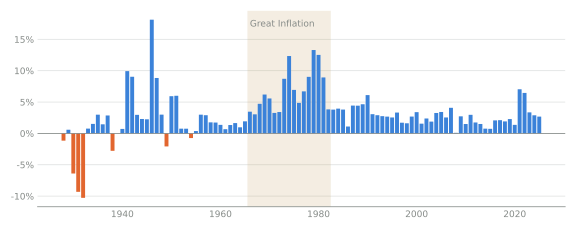
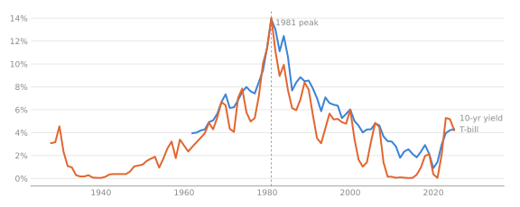
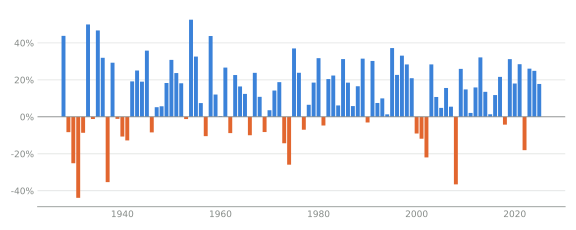
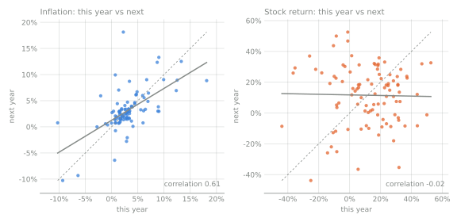
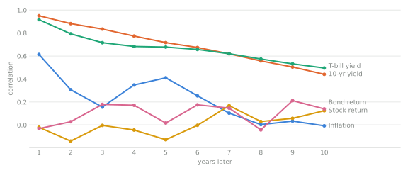
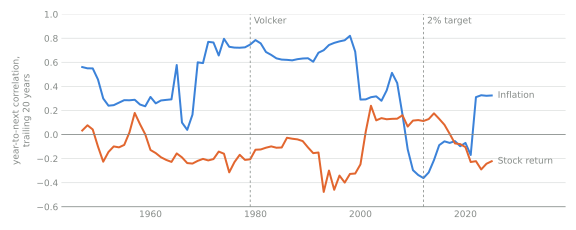
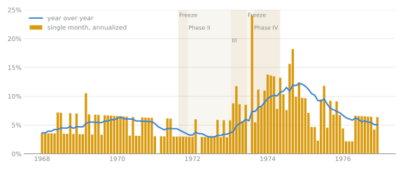

# A century of rates: what carries over from one year to the next

When prices jump or the market falls, it's natural to read it as the start of
a trend. Some numbers do work that way, and some don't. This guide shows a
century of US inflation, interest rates and stock returns, and asks one
question of each: **how much does this year tell you about next year?**

The answer is the main thing to take away. Interest rates move slowly, so this
year's rate is a good guide to next year's. Inflation tends to stay elevated
for a year or two and then settles. Stock and bond returns don't carry over
at all: a bad year says nothing about the next one.

All the data is public and committed to this repository under
[`historical_data/`](../../historical_data/README.md): CPI-U from the Bureau of
Labor Statistics (December over December), the 10-year Treasury yield from
FRED (annual average, from 1962), and Damodaran's annual returns on the S&P
500 (with dividends), 3-month Treasury bills and 10-year Treasury bonds,
1928–2025. `analysis historical-charts` redraws every chart from those files.

## Inflation runs in episodes, then settles



Inflation has three distinct eras:

| Years | Average | SD | Year-to-next correlation |
| --- | --- | --- | --- |
| 1928–1949 | 1.6% | 6.3 | 0.54 |
| 1950–1983 | 4.4% | 3.7 | 0.78 |
| 1984–2025 | 2.8% | 1.5 | 0.33 |

The Depression brought deflation, and the war and its aftermath brought sharp
spikes. The **Great Inflation** of 1966–1982 (shaded) is one long run, and
it's most of where the idea of "rising inflation" comes from. Since the
mid-1980s inflation has averaged 2.8% with no trend. 2021 and 2022 (7.0% and
6.5%) were a spike that faded to 2.7% by 2025.

Another reason "rising inflation" feels true is that the price *level* almost
always rises, even when the *rate* is flat or falling. Prices in 2025 are
higher than in 2022 although inflation fell by more than half, and higher
prices are what people notice.

## Interest rates drift slowly



Yields are the slowest-moving series here. The 10-year yield climbed for
two decades to a peak of 13.9% in 1981, then fell for almost four. A rate
that moves like this really is predictable from one year to the next, and in
the simulator a rate held for many years is a reasonable model of it.

## Stock returns don't drift at all



Stock returns swing much more than inflation or yields, with an SD of about
19 points around an average of 11.9%, and about one year in four was a loss.
But the swings have no memory, as the next charts show.

## How much does this year predict next year?

Put each year's value on the horizontal axis and the next year's value on the
vertical axis, one dot per pair of years:



- **Inflation** (left): the dots lean up and to the right. A high year
  tends to be followed by another high year, though usually a less extreme
  one: the solid fitted line is flatter than the dashed diagonal, where next
  year would equal this year exactly. That flattening is
  [mean reversion](../user-guide.md#g-mean-reversion). The correlation, 0.61,
  measures how strongly the dots line up.
- **Stocks** (right): no lean at all. The fitted line is flat and the
  correlation is −0.02. After a 30% year and after a −30% year, the next
  year's spread of possible returns is the same.

That correlation between a year and the following one is called
[persistence (autocorrelation)](../user-guide.md#g-persistence). Measuring it
between a year and the year 2, 3, … 10 years later shows how long a
series' memory lasts:



- **Yields** (the two top lines) start near 0.9–0.95 and fade slowly: a
  high rate today still says something a decade out.
- **Inflation** starts at 0.61 and drops quickly. Its memory is a year or
  two.
- **Stock and bond returns** start at about zero and stay there, within about the
  ±0.2 band that chance alone produces with this many years.

So a recent stock-market drop or rally is not a forecast. A recent inflation
spike says something about next year, but not much about five years out.
Today's interest rates are the best single guide to next year's.

## Inflation's memory got shorter



This is the same year-to-next correlation, measured over each trailing 20
years. For inflation it ran near 0.8 through the Great Inflation and fell
after the early 1980s, when the Federal Reserve under Paul Volcker made
fighting inflation credible. Economists generally credit expectations that
stayed anchored near the Fed's goal for most of that drop, along with calmer
energy markets and global competition. The Fed adopted a formal 2% target in
2012. Stock returns' line stays near zero throughout.

A 20-year window holds only 19 pairs of years, so these lines wobble by
about ±0.2 from chance alone. Read the levels, not the wiggles.

## Nixon's price controls: a pause, then a rebound



Monthly data shows things annual figures hide. In August 1971 President Nixon
froze wages and prices, and controls of varying strictness lasted until April
1974 (shaded by phase). Inflation was already easing from 1970's 6% when the
freeze came. Under Phase II it held near 3% year over year through 1972.
Then controls loosened, food and oil prices jumped, and inflation broke out.
The clearest fingerprint is the second freeze in mid-1973: prices rose 0% in
July, then 24% annualized in August once it lifted. By late 1974, after the
oil embargo, inflation was over 12%.

The annual figures barely show the controls: 3.3% in 1971 and 3.4% in 1972,
then 8.7% in 1973 and 12.3% in 1974. The controls mostly postponed inflation
rather than removing it.

The index was published to one decimal place then, so single-month rates move
in steps of about 3 points; the year-over-year line is the reliable one.

## What this means for the simulator

By default a varying rate in an ensemble is drawn once per future and then
held ([Turning history into `vary_*`
settings](historical-calibration.md#turning-history-into-vary_-settings)).
That suits yields and, over long spans, inflation. It doesn't capture a stock
or bond return's year-to-year swings, which matter when money is being
withdrawn: selling after a bad year locks in the loss, so the order of good
and bad years changes the outcome even when their average doesn't. For rates
like these, a row can instead [move year by
year](historical-calibration.md#a-rate-that-moves-every-year) around its
drawn level.

## Drawing the charts

```sh
uv run analysis historical-charts            # into docs/guides/century-of-rates/
uv run analysis historical-charts OUT_DIR
```

The charts are drawn from the committed `historical_data/`, so nothing is
downloaded. After `analysis historical --refresh` records a new vintage of
the data, run it again and commit the redrawn charts.
