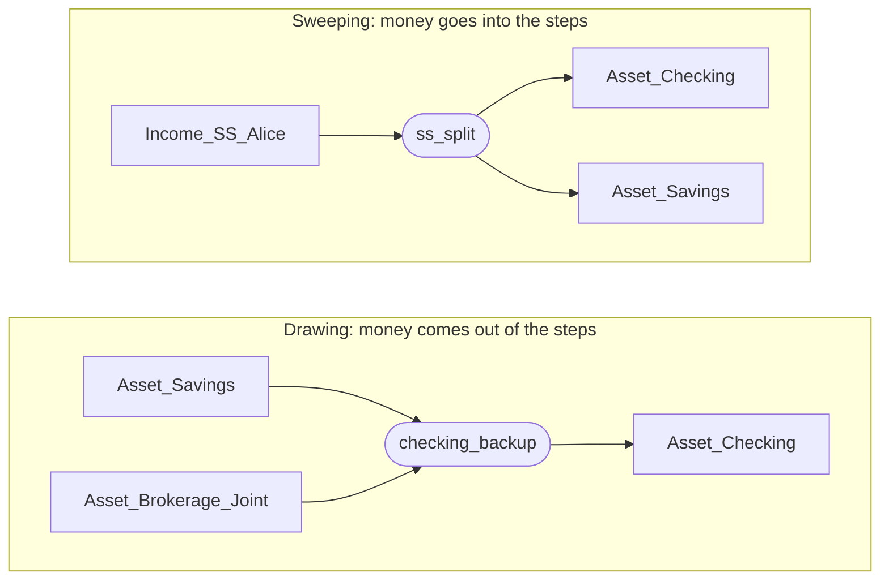
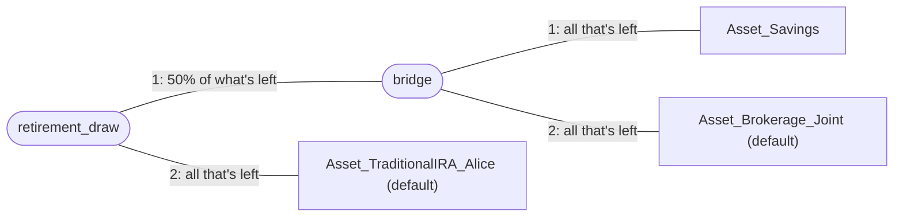
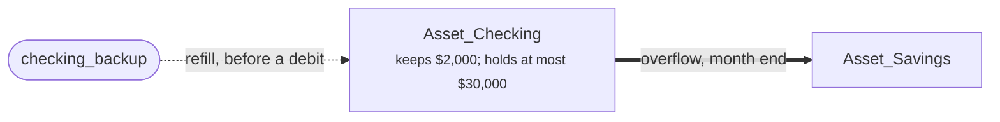

# Chains: where money comes from, and where extra money goes

> To read a formatted `.md` file:
> - In Jupyter: right-click on it and select `Open With / Markdown Preview`
> - In VSCode: Command `Markdown Preview Enhanced: Open Preview` or ⌘⇧V

A **chain** answers one of two questions for the simulator: "where should
this money come from?" or "where should this extra money go?" This guide
builds chains up a piece at a time: what one is, the two directions it can
run, how each step decides its share, how one chain can sit inside another
like a parenthesized expression, and how the balance limits on each lot
(minimum, refill, maximum, overflow) fit around them. It ends with recipes
and with what to do when a chain doesn't do what you expected.

The examples use the prototype scenario's accounts (Alice, Bill,
`Asset_Checking`, `Asset_Savings`, ...). The column-by-column reference is
[ADR-003 §4.3 and §4.7](../architecture/ADR-003-registries-and-csv-schemas.md);
this guide is the explanation.

## Seeing your chains

Before changing anything, look at what the scenario already has:

```sh
sim chain list                  # every chain, its steps, and what uses it
sim chain show                  # each chain as a tree, with each lot's limits
sim chain show Asset_Checking   # just the chains that reach this account
sim chain show --mermaid        # a flowchart to paste into markdown
```

The [scenario overview notebook](../../notebooks/scenario_overview.ipynb)
shows the same chains as a table and as a flowchart.

## Making and changing chains

`sim chain add` with no arguments asks what the chain is for and builds it
a step at a time:

1. Is it where money **comes from** or where extra money **goes**?
2. Should it **drain** the steps in order, **split** the total by shares
   (such as 60% here and 40% there), or take **up to an amount** from each?
3. Its name, then each step: an account (and its lot, when one must be
   named) or another chain.

It works out the `percent` and `maximum` columns from your answers. Shares
of the total become shares of what's left, so 50%, 30% and 20% are written
as `50%`, `60%` and a plain last step (section 3 explains why). It then
prints the equivalent commands and how to put the chain to use.

The same changes as commands, for scripts or a quick fix:

```sh
sim chain add checking_backup Asset_Savings              # a chain and its first step
sim chain step add checking_backup Asset_Brokerage_Joint --lot default --percent 50%
sim chain step add checking_backup Asset_Roth_Alice --lot default --position 1
sim chain step edit checking_backup 2 --maximum 500      # '' clears a column
sim chain step move checking_backup 1 3
sim chain step rm checking_backup 3
sim chain rename checking_backup cash_backup             # and every reference to it
sim chain delete cash_backup                             # refused while anything uses it
```

Every change is checked by loading the scenario, and any scenario built on
it, before anything is written. Changing a chain the scenario inherits
writes the scenario's own copy, which replaces the parent's here. A rename
starts in the scenario the chain comes from and follows it into every
scenario built on that one.

## 1. What a chain is

A chain is a file, `chains/<kind>__<name>.csv`, in a scenario folder. Each
row is a **step**: a place money can come from or go to, tried in the order
the rows are written.

```text
# chains/asset__checking_backup.csv
account_name,lot,maximum,percent,series,cadence
Asset_Savings,,,,,
Asset_Brokerage_Joint,default,,,,
```

That chain says "Savings first, then the brokerage account." Its name,
`checking_backup`, is what you write wherever a chain is accepted.

**Every lot is already a one-step chain.** You never need a file to say
"just Savings": anywhere a chain is accepted, an account (and its lot) is
too. Write a file only when you want two or more steps.

A few rules about names and columns:

- `account_name` names an account or another chain. `lot` says which lot of
  an account; it is required for an investment account (a brokerage, an
  IRA, a 401(k)), may be blank (meaning `default`) for other accounts, and
  must be blank when the step is another chain.
- A chain's name shares one namespace with account names, so it can't be
  the same as an account's. It can't contain a space or a `:`.
- `<kind>` is `asset` or `income`: the kind of accounts the steps name.
  Nearly every chain is `asset`; `income` is for one whose steps are income
  accounts.
- A scenario that builds on another inherits its chains. A file of the same
  name in the child replaces the parent's chain as a whole; steps are not
  merged.

## 2. Two directions: drawing and sweeping

The same chain can be read two ways, depending on where it is used.



**A draw** takes money *out* of the steps, first step first, to cover an
amount. A chain is drawn from when it is:

- a rule's `from_account` in `scheduled.csv` (a monthly withdrawal);
- a calendar transfer's `account_1` (`one_off_transfer`);
- a lot's `refill_chain` in `account_values.csv` (section 5).

**A sweep** puts money *into* the steps, first step first, until it is
placed. A chain is swept into when it is:

- a rule's `to_account` (a benefit split between accounts);
- a calendar transfer's `account_2` (`one_off_transfer`,
  `transfer_balance`);
- a lot's `overflow_chain` (section 5).

A transfer can name a chain on one side only. "From one chain to another"
would need a rule for pairing their steps, and there isn't one.

## 3. How a step decides its share

Each step has two optional columns, `percent` and `maximum`. With neither,
a step takes everything still outstanding. Steps are tried in order, and
each one works on **what is still outstanding when the scan reaches it**,
not on the original amount.

- **Neither column: drain in order.** The step supplies as much as it can.
  Whatever it can't supply moves on to the next step.
- **`percent`: a share of what's left.** `50%` takes half of what is still
  outstanding.
- **`maximum`: a ceiling.** `maximum` `300.00` takes at most $300. With
  `series` (an inflation series such as `cpi`) and `cadence` (`monthly` or
  `annual`), the ceiling grows from the scenario's start.
- **Both: whichever is smaller.** `50%` with `maximum` `300.00` means "half
  of what's left, but never more than $300."

Whatever a step doesn't supply always falls through to the next step,
whether its percent or maximum held it back or the lot ran out.

### A worked example

A rule needs $1,000 from this chain:

| step | account | maximum | percent |
| --- | --- | --- | --- |
| 1 | `Asset_Savings` | `300.00` | |
| 2 | `Asset_Brokerage_Joint` | | `50%` |
| 3 | `Asset_TraditionalIRA_Alice` | | |

| step | outstanding when reached | its share | supplied |
| --- | --- | --- | --- |
| 1 | $1,000 | up to $300 | $300 |
| 2 | $700 | 50% of $700 | $350 |
| 3 | $350 | all of it | $350 |

If Savings had only $100 to spare, step 1 supplies $100. Step 2 then sees
$900 outstanding and supplies $450, and the IRA supplies the other $450.
The split adjusts itself to what is actually there.

### Two traps

- **A last step with a `percent` leaves money behind.** If the IRA in the
  example were `50%`, it would supply only $175 and the rest of the $1,000
  would never be drawn. Make the last step a plain one.
- **Percents apply to what's left, not to the total.** `50%`, then `50%`,
  then a plain step is $500, $250, $250 of $1,000, not thirds. To split
  evenly three ways, write `33.3333%`, `50%`, then a plain step: each takes
  a third of the original.

## 4. A chain inside a chain: parentheses

A step can name another chain. The inner chain is handed that step's share
and works through its own steps on it, as a unit. It works like
parentheses in arithmetic.

Say Alice wants each withdrawal to come half from "Savings, then the
brokerage account," and the rest from her IRA:

```text
# chains/asset__bridge.csv
account_name,lot,maximum,percent,series,cadence
Asset_Savings,,,,,
Asset_Brokerage_Joint,default,,,,

# chains/asset__retirement_draw.csv
account_name,lot,maximum,percent,series,cadence
bridge,,,50%,,
Asset_TraditionalIRA_Alice,default,,,,
```



Read it as `retirement_draw = 50% × (Savings, then Brokerage), then IRA`.
On a $2,000 withdrawal, `bridge` is handed $1,000 and takes it from Savings
until Savings runs out, then from Brokerage. The IRA covers the other
$1,000. If both bridge accounts are empty, `bridge` supplies nothing, and
the IRA, seeing $2,000 still outstanding, covers all of it.

Without the inner chain you couldn't say this. Steps of `Savings 50%`,
`Brokerage`, `IRA` would empty the brokerage account before touching the
IRA.

`sim chain show retirement_draw` prints the same nesting as a tree:

```text
retirement_draw (asset chain)
├── 1. bridge (chain)  50% of what's left
│   ├── 1. Asset_Savings  all that's left
│   └── 2. Asset_Brokerage_Joint (default)  all that's left
└── 2. Asset_TraditionalIRA_Alice (default)  all that's left
```

A chain can't contain itself, directly or through other chains. The loader
rejects that and names the loop.

## 5. The limits on each lot: minimum, refill, maximum, overflow

Chains say where to look. The **lots** say how much they can give or take.
These columns sit on the lot's own row in `account_values.csv` (set them
with `sim account lot edit`), not on the chain, so a lot behaves the same
way whichever chain reaches it.



### `minimum_balance`: a floor, in two ways

1. **It triggers a refill.** Before any payment leaves the lot, the
   simulator checks whether the payment would take the balance below
   `minimum_balance`. If it would, it first draws from the lot's
   `refill_chain`, and only then makes the payment. The check happens for
   every payment, not once a month.
2. **It is what a draw leaves behind.** When a chain draws from a lot, the
   lot gives only what it holds above its own minimum. It counts as empty
   at its minimum, and the draw moves on to the next step. If the lot has
   its own `refill_chain`, that refill runs first, so a lot can top itself
   up before it is drawn on.

### How much a refill draws

| set on the lot | a refill brings the balance to |
| --- | --- |
| neither | exactly `minimum_balance` |
| `refill_target` | `refill_target` (at least `minimum_balance`) |
| `refill_amount` | `refill_amount` is drawn each time, or more if that wouldn't reach the minimum |

With only `minimum_balance`, the refill tops up to the minimum, so the next
payment triggers another refill. `refill_target` (say $3,000 above a $2,000
minimum) leaves headroom, so refills happen less often and in bigger
amounts. Only one of `refill_target` and `refill_amount` may be set.

A refill that comes up short is not an error. The payment still happens,
the balance goes negative, and the run warns you (section 7).

### `maximum_balance` and `overflow_chain`: a ceiling

At the end of each month, after every rule has run, anything a lot holds
above its `maximum_balance` is swept into its `overflow_chain`. Overflow is
a month-end sweep, not a per-payment check, because a balance only climbs
past its ceiling as deposits add up over the month.

`maximum_balance` also limits what a sweep can put into a lot. A sweep step
fills the lot only up to its maximum, and the rest falls through to the
next step. What no step can take stays where it was, so overflowing into a
lot that is already full leaves the extra in the lot it came from. If the
extra must always go somewhere, end the overflow chain with a lot that has
no maximum, such as a brokerage lot.

A lot can't refill from or overflow into a chain that leads back to
itself; the loader rejects that and shows the path. Two lots *may* lean on
each other: Checking overflowing into Savings while Savings refills from
Checking is fine, since each one moves money only when its own limit is
crossed.

## 6. Recipes

### A checking account that never runs dry

Keep $2,000 in checking, and refill it to $3,000 from savings, then the
brokerage account, then Alice's IRA. Anything over $30,000 goes back to
savings at month end.

```text
# chains/asset__checking_backup.csv
account_name,lot,maximum,percent,series,cadence
Asset_Savings,,,,,
Asset_Brokerage_Joint,default,,,,
Asset_TraditionalIRA_Alice,default,,,,
```

Then, on the `Asset_Checking` row of `account_values.csv` (or with
`sim account lot edit Asset_Checking default`):

| column | value |
| --- | --- |
| `minimum_balance` | `2000.00` |
| `refill_chain` | `checking_backup` |
| `refill_target` | `3000.00` |
| `maximum_balance` | `30000.00` |
| `overflow_chain` | `Asset_Savings` |

### A retirement withdrawal order

A monthly rule whose `from_account` is a chain: the `retirement_draw`
chain of section 4, paid into checking.

| column | value |
| --- | --- |
| `name` | `monthly_draw` |
| `from_account` | `retirement_draw` |
| `from_lot` | blank, because `from_account` is a chain |
| `to_account` | `Asset_Checking` |
| `cadence` | `monthly` |
| `amount_rule_kind` | `fixed_amount` |
| `amount` | `4000.00` |

`sim scheduled add` writes the row and asks for anything missing. A rule drawing from
a chain moves only what the chain can supply: if every step is empty, the
rule moves less, and nothing goes negative. Compare a rule that pays from a
single lot, where the payment always happens and can take the lot negative.

### One benefit, several destinations

Send half of Alice's Social Security to checking and the rest to savings.
The `ss_benefit` rule's `to_account` is this chain:

```text
# chains/asset__ss_split.csv
account_name,lot,maximum,percent,series,cadence
Asset_Checking,,,50%,,
Asset_Savings,,,,,
```

For a fixed amount to one place and the rest to another, give the first
step a `maximum` instead of a `percent`.

## 7. When a chain doesn't do what you expected

- **"refill chain 'X' supplied $0.00 of $N".** A lot went negative and its
  refill chain gave nothing. Every step was at or below its own minimum, or
  the chain names the wrong lot. `sim chain show X` shows each step's lot
  and the minimum it keeps. The same record is in the run file under
  `negative_balance_warnings`.
- **Money never drawn.** The last step has a `percent` or a `maximum`
  (section 3). Make the last step a plain one, or add a step after it.
- **A step never used.** An earlier plain step took everything. Steps after
  a plain step are reached only when that step's lot runs out.
- **"is an investment account and needs a lot" at load.** An investment
  account's step needs its lot. The error lists the account's lots.
- **"cycle detected" or "leads back to the lot itself" at load.** A chain
  contains itself, or a lot refills from or overflows into itself. The
  error shows the path.
- **A chain nothing uses.** `sim chain list` shows `nothing` in its
  *Used by* column. Point a rule or a lot at it, or delete the file.

## See also

- [User guide, Part 4.6](../user-guide.md#46-chains-as-default-policies): the short version.
- [ADR-003 §4.3 and §4.7](../architecture/ADR-003-registries-and-csv-schemas.md):
  every column and rule, precisely.
- [ADR-005](../architecture/ADR-005-lots-and-per-lot-state.md): lots, and why
  the limits live on them.
