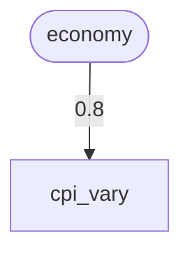
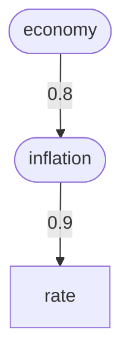
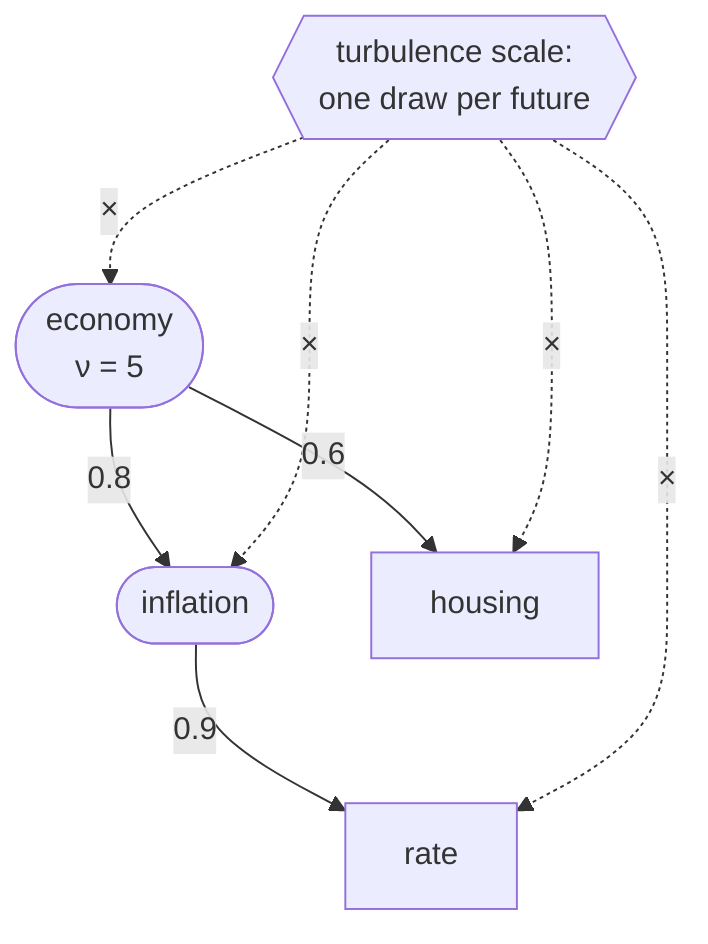
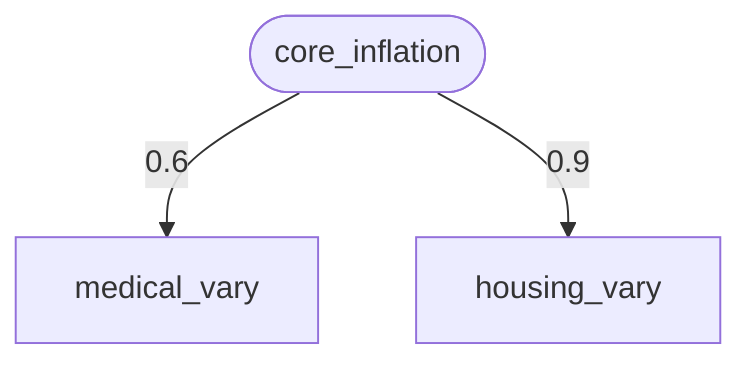
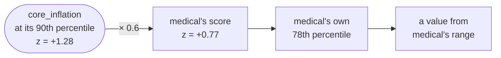
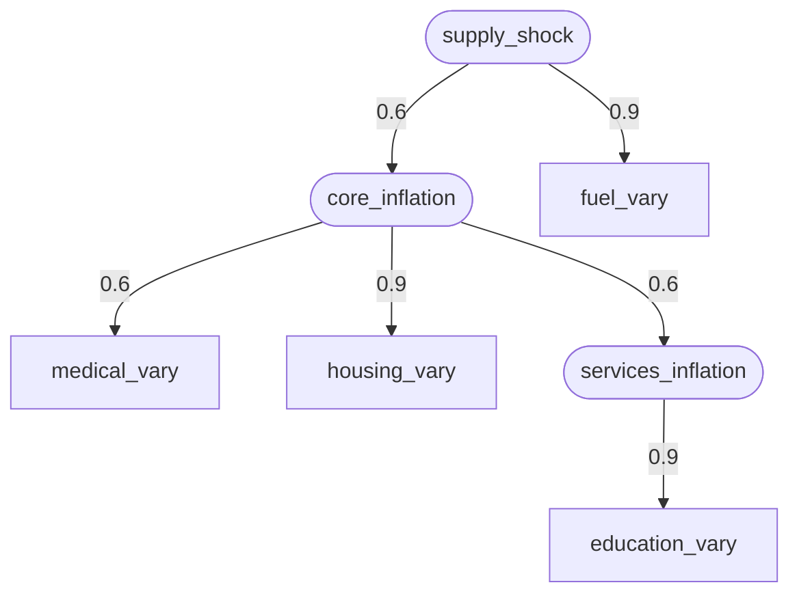
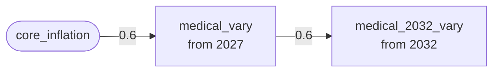
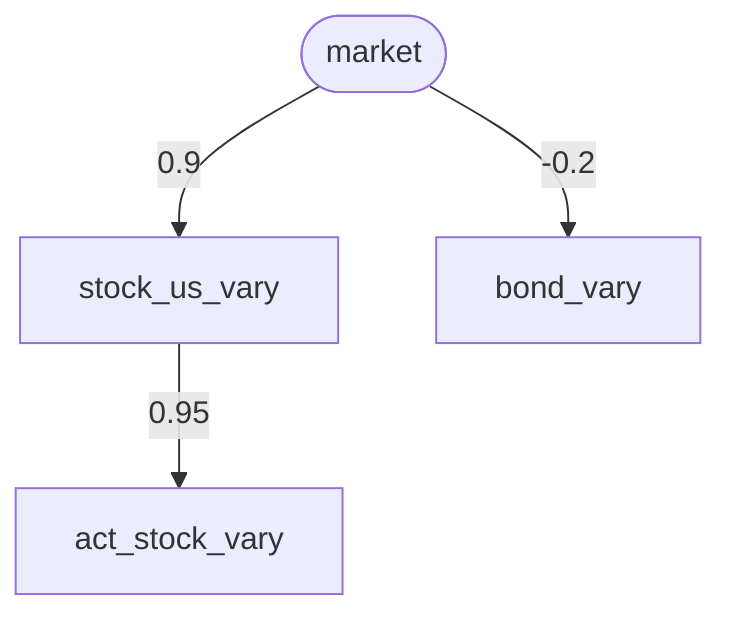

# Ensembles: ranges of outcomes, not one number

> To read a formatted `.md` file:
> - In Jupyter: right-click on it and select `Open With / Markdown Preview`
> - In VSCode: Command `Markdown Preview Enhanced: Open Preview` or ⌘⇧V

An ordinary scenario gives you one prediction: this rate, this date, this
amount, run forward to one result. An **ensemble** asks the question "what
if I'm not sure about that rate/date/amount — what's the *spread* of
outcomes if it's actually somewhere in a range?" It generates many variants
of one scenario, each with a chosen value or two redrawn from a
distribution, runs all of them, and shows the range (mean, median, standard
deviation, percentile bands) instead of a single figure.

This is a practical how-to. For the full design and column reference, see
[ADR-006](../architecture/ADR-006-ensemble-scenarios.md). New to Monte
Carlo simulation? [How the simulator draws random futures](simulation-basics.md)
explains seeds, per-row random streams, copulas and the statistics behind
them first. Any unfamiliar word is in the
[glossary](../user-guide.md#2-glossary).

## Setting one up

**1. Create the recipe**, derived from an existing scenario (usually your
main one):

```sh
sim ensemble create inflation_1 base
```

This prints a seed and a default member count (`30` unless you pass
`--size`) and records both on the new scenario — `sim run`/`sim all` will
use them without you having to repeat `--ensemble-size` every time.

**2. Mark one or more calendar rows as varying.** An ensemble recipe is an
ordinary scenario until at least one `calendar.csv` row has
`--vary-distribution` set. Each varying row is one **dimension** of the
ensemble (more on why that matters below). Two examples:

A growth rate drawn from a range instead of fixed at one value:

```sh
sim calendar add set-rate 2027-01-31 mutual_fund_retirement 4.0 \
  --scenario inflation_1 --name fund_vary \
  --vary-target amount --vary-distribution truncated_normal \
  --vary-low 2.5 --vary-high 5.5
```

A retirement date uncertain within a year:

```sh
sim calendar add retire-scheduled 2029-06-30 salary_bill \
  --scenario inflation_1 --name retire_bill_vary \
  --vary-target date --vary-distribution uniform \
  --vary-low 2029-01-01 --vary-high 2029-12-31
```

`sim calendar add <kind> ...` validates the row by loading the whole
scenario from a staged copy, and writes it only if that load succeeds, so
a bad combination — wrong series name, a range that doesn't make sense —
is caught immediately rather than at `sim run` time. See ADR-006 §2 for
every `vary_*` column and what each distribution needs.

### Guided mode

You don't have to remember the options. Run the command with no kind:

```sh
sim calendar add --scenario inflation_1
```

It asks which kind of row you want, then for each value in turn, and asks
only what your answers so far make relevant: choosing `uniform` asks for a
low and a high, and never mentions a median or a skew. Press Tab to complete
scenario names such as accounts, scheduled rules, series, and lots. An answer
that can't be right (a malformed date, an unknown rule) is asked again.

Before anything is written it shows every answer and the equivalent
one-line command, which you can copy into a script. From there you can write
the row, cancel, or type a field's name to change it. Changing an answer
asks any questions that it newly makes relevant. If the scenario would not
load with the new row, the reason is shown and you are back at the same
review with your answers intact.

A kind given without its arguments asks for just those, so `sim calendar
add set-amount` prompts for the date, the rule, and the amount, and nothing
else.

### Changing a row

To change a row you have already written, such as widening a range or moving
a date:

```sh
sim calendar edit --scenario inflation_1
```

It lists the scenario's own calendar rows and asks which one. Answer with
the row's number or its name, or type any text to narrow the list (`retire`,
`2029`, an account) until one row is left. You can also name the row on the
command line: `sim calendar edit fund_vary`.

You then see the row's fields, as in the review at the end of the guided
mode. Type a field's name to change it, as often as you like, and press
Enter to write. The row keeps its kind and its place in the file; to turn a
row into a different kind, add a new one and delete the old.

Two rows that agree on date, kind, rule, accounts, lots, series and amount
are the same event to the simulator, so an edit that would make this row a
copy of another is refused, and the choice that would cause it is left out
of the completions. So is giving the row a name another row already has.

A row the scenario inherits from its parent is not listed: edit it in the
parent, or add a row here that overrides it.

**Choosing a distribution.** Three are available:

- **`uniform`** (`--vary-low`, `--vary-high`): anything in the range is
  equally plausible. Use it when you really have no idea where in the
  range the value will land.
- **`triangular`** (`--vary-low`, `--vary-mode`, `--vary-high`): the
  three-point estimate, "most likely X, no less than A, possibly as much
  as B". It's the one to reach for with a **date** that will probably land
  on time but could slip: a home sale that most likely closes in June,
  can't close before April, but could drag on to December. It's also the
  only skewed choice for a date. It suits a one-off amount you'd estimate
  the same way, like a roof replacement: "about $25k, at least $18k,
  maybe $40k".
- **`truncated_normal`** (`--vary-median`, `--vary-sd`, optionally
  `--vary-low`/`--vary-high`): values cluster around a center and thin out
  with distance. This suits rates. `--vary-median` is the center, and the
  base case is exactly that value. `--vary-sd` is the scale: the standard
  deviation for the plain (unshaped) normal, but only a scale factor once
  skew or tail weight is set, so check the implied SD the parameters table
  shows. Bounds you leave out default to 3 SDs out for the plain normal
  (the 3-standard-normal-score points of a shaped one). Two optional shape
  controls:
  - `--vary-skew`: positive gives a longer high tail ("usually about 6%,
    but a big year is more likely than a terrible one"), negative a longer
    low tail. 0.3 to 1 is a noticeable but sensible skew.
  - `--vary-tailweight`: below 1 makes extreme values more likely than a
    normal would ("fat tails", like market returns), above 1 less likely.
    0.7 to 0.9 is noticeably fat-tailed.

  With either one set, `--vary-sd` is required. The notebook's
  **Parameters** table and ADR-007's parameters view show the mean, SD,
  skewness and excess kurtosis your settings imply, so you can check that
  they mean what you intended.

`vary_mean` was renamed to `vary_median` (it's the median after the
bounds clip the distribution, so the base case is exactly what you wrote).
A `calendar.csv` that still has a `vary_mean` value fails to load with a
message saying so; rename the column.

**3. Run it:**

```sh
sim run inflation_1
```

`sim run` detects the unresolved varying rows and generates+runs every
member instead of a single run, under `state/runs/inflation_1/<timestamp>/
member_NNNN.sqlite3`. Look at the result with `sim ensemble summary
inflation_1` (a terminal table) or `notebooks/ensemble.ipynb` (the Monte
Carlo "fan chart" — mean/median over quintile bands, shaded darker toward
the middle fifth of members and lightest out at the 5th–95th percentile
envelope). Both show the same year-end table: mean, median, SD, and the
`p05`, `p20`, `p40`, `p60`, `p80` and `p95` percentiles. Neither shows the
min or max: with many members those are one member's extreme luck, far
outside where most members land, and easy to mistake for a likely
outcome.

### Member 0 is always a deterministic base case

Every ensemble's `member_0000` resolves each varying row to its
distribution's central value, its median (a `uniform` row's midpoint, a
`truncated_normal` row's `vary_median`, a `triangular` row's median)
rather than a random draw. Every other
member draws as usual. This gives every ensemble one always-present,
always-in-bounds "what if the uncertain inputs landed right in the
middle" run — useful on its own, and it's what any tool that only knows how
to open one run per scenario (a notebook's scenario picker, for instance)
will show you if you point it at an ensemble recipe instead of an ordinary
scenario.

It's a deliberate, small statistical trade-off: member 0 isn't actually a
random draw, so a statistic computed across *every* member is very
slightly biased toward the center compared to the same number of fully
random draws. At the member counts this guide recommends (tens), that bias
is negligible next to the sampling noise you'd have anyway. See
[ADR-006 §9](../architecture/ADR-006-ensemble-scenarios.md) if you want the
full reasoning.

## Correlated parameters

By default every varying row is drawn independently. Real uncertainties
usually aren't independent: inflation and interest rates move together,
stocks and bonds are related (sometimes oppositely), and a growth rate in
2040 isn't unrelated to the same rate in 2030. Ignoring that understates
the spread when uncertainties compound, and overstates it when they offset
([ADR-008](../architecture/ADR-008-correlated-parameters.md)).

Give a varying row a **parent** and a correlation **ρ** (between -1 and 1):

```sh
sim calendar add latent-factor economy --scenario inflation_1 \
  --description "the broad economy: high inflation, high rates"
sim calendar add set-rate 2027-01-31 cpi 3.0 --aux-kind inflation \
  --scenario inflation_1 --name cpi_vary \
  --vary-target amount --vary-distribution truncated_normal \
  --vary-median 3.0 --vary-sd 1.0 \
  --vary-correlate-with economy --vary-correlation 0.8
```

That makes a two-node tree. Rounded boxes are latent factors, square boxes
are varying rows, and each arrow carries the ρ written on the child:



A parent is another varying row, or a **latent factor**: a named shared
influence that isn't itself a modeled value. Factors can depend on other
factors too. Each row has at most one parent, and the chain of parents
can't loop.

What to expect:

- **Each row keeps exactly its own distribution.** Correlation only changes
  how rows move *together*. A row's range still means "over all futures,
  this value is in here", and a correlated draw never leaves it.
- **ρ is roughly the rank correlation you'll see** between the two rows'
  values (within 0.02), for any pair of distributions. A date range of only
  a few days is the exception, because tied dates correlate less. With tail
  dependence (below) the rank correlation shifts a little, but ρ still
  sets how often two rows land on the same side of each other's medians.
- **Siblings correlate at the product.** Two rows under one factor at 0.8
  and 0.6 correlate with each other at about 0.48. To make two siblings
  correlate at 0.6, give each about 0.77.
- **Use coarse values.** ±0.3 (weakly), ±0.6 (clearly) and ±0.9 (nearly
  lockstep) are about as precise as anyone can justify. Even the sign of
  some historical correlations has changed over the decades.
- **Member 0 is unchanged.** It's still every row at its median.
- **Sensitivity runs can move a whole family.** A sensitivity run moves an
  ordinary row alone, without dragging its dependents along. It also moves
  each latent factor, and that carries every row under the factor to where
  it would most likely be given the factor's value (see "Which varying
  rows matter, and when?" below).
- **The Monte Carlo correlation report handles a correlated batch.** A
  row's plain correlation with the outcome includes its correlates'
  effects, so the report ranks and pins rows by their regression weight
  instead, and checks the correlations the batch achieved (see "Which
  varying rows can I drop?" below).
- **Joint extremes are rarer than in reality, unless you ask for them.** By
  default (a Gaussian copula) extremes in correlated rows rarely coincide,
  so a stretch where every inflation rate runs hot at once comes out rarer
  than it happens. Give a tree tail dependence to change that (see "Joint
  extremes" below).

For what ρ to use, [Historical calibration](historical-calibration.md)
tabulates the correlations, medians and spreads of inflation categories and
returns over the past century and in named episodes, and has a script to
compute them for other series and years.

A factor nothing depends on yet loads with a `WARN:` line rather than an
error. That's fine for work in progress, or for a factor defined in a
parent scenario for its child scenarios to use.

### Joint extremes (tail dependence)

It helps to think of a correlation tree as a set of independent
**dimensions** of noise. Every node, factor or rate, adds one, and a rate's
score is a weighted sum of the dimensions on its path up to the root. Take a
rate under an `inflation` sub-factor (ρ = 0.9) under an `economy` root
factor (ρ = 0.8):



```text
rate = 0.9 · inflation              + 0.44 · own noise
     = 0.9 · (0.8 · economy + 0.6 · inflation's noise) + 0.44 · own noise
     = 0.72 · economy + 0.54 · inflation's noise + 0.44 · own noise
```

Squaring the weights splits the rate's variance between the three: about
52% from `economy`, 29% from what `inflation` adds, and 19% of its own.

Those dimensions are added, and added normal noise rarely puts everything
at an extreme at once. **Tail dependence** adds one more dimension per
tree, a **turbulence scale**, which multiplies all the others instead of
adding to them. In each future it's usually near 1, sometimes large; when
it's large, every row in the tree is far from center at once. That's a
1970s-style stretch where every inflation rate runs hot together.



Set it on the tree's **root**, with `--vary-tail-dependence` (the
`vary_tail_dependence` column), a number called ν:

```sh
sim calendar add latent-factor economy --scenario inflation_1 \
  --description "the broad economy: high inflation, high rates" \
  --vary-tail-dependence 5
```

- **It applies to every row in the tree.** All of them share the one
  turbulence scale, so the tree's depth and shape don't change it.
- **It has to sit at the root**, because it multiplies everything below
  it. On a row with a parent it's a load error naming the tree's root. On a
  final rate with no parent and nothing under it, it would only stretch
  that one rate's score, which is mapped straight back to the rate's own
  range, so it does nothing (and loads with a `WARN:` line).
- **Each row still keeps exactly its own distribution.** Only how often
  the rows' extremes coincide changes.
- **Lower ν means more tail dependence.** About 3 (strong) to 30 (barely
  different from none) is a sensible range, and 1 is the lowest allowed.
  Blank means none, as before.
- **It composes over the tree.** ρ multiplies along paths as before, and
  the tree's one ν applies to the resulting correlation. The chance that
  one row is in its top few percent given that the other is, in the limit,
  for two rows correlated at ρ:

  | ν | ρ = 0 | 0.3 | 0.6 | 0.9 |
  | --- | --- | --- | --- | --- |
  | 3 | 0.12 | 0.22 | 0.37 | 0.67 |
  | 5 | 0.05 | 0.12 | 0.27 | 0.59 |
  | 10 | 0.01 | 0.03 | 0.13 | 0.46 |
  | 30 | 0.00 | 0.00 | 0.01 | 0.21 |

  Without tail dependence every entry is 0. So it fades more slowly with
  distance in the tree than ρ does, and even rows with ρ = 0 between them
  share some extremes, as long as they're in the same tree. Rows in
  different trees stay independent.
- **Tail weight is a different thing.** `--vary-tailweight` makes one
  rate's own extremes bigger; ν makes extremes in a tree coincide. They
  combine.

How strongly the categories moved together in a real stretch of joint
extremes, the Great Inflation of 1966–1982, is in [Historical
calibration](historical-calibration.md#historical-episodes), along with how
to model such a stretch as an episode on top of a long-run rate.

## Modeling a shared driver

The section above explains the mechanics. This one is about using them for
a real situation: several specific inflation rates (medical, housing,
education, fuel) that each have their own range but tend to follow an
underlying inflation trend. It works through building that recipe, then the
choices you have for its structure, then shocks and persistence.

### The example recipe

Every command in this section runs against the prototype data. Its root
scenario, `base`, holds only generic defaults: an inflation series and a
factor for each
([The prototype's defaults](historical-calibration.md#the-prototypes-defaults)).
The household (accounts, salaries, expenses) is in `retire_alice`, which
derives from `base`, so the recipe derives from `retire_alice` and inherits
both; with your own data, derive from your main scenario. The recipe
inherits the default series, but writes its own anyway, to show each step:
its series files replace the defaults of the same name, and its
factors replace the same-named default factors. The trees drawn below show
only what the recipe adds; the defaults' other factors still load beside
them, which is why `sim check` warns that they affect nothing. The first
step gives the recipe four inflation series of its own and a monthly
expense that reads each one:

```sh
sim ensemble create inflation_drivers retire_alice
for s in medical housing education fuel; do
  printf 'effective_date,annual_rate\n2026-01-31,3%%\n' \
    > "$ANALYSIS_DATA_DIR/scenarios/inflation_drivers/series/inflation__$s.csv"
done
sim scheduled add 2026-05-31 Asset_Checking Expense_Healthcare 400 \
  --scenario inflation_drivers --name medical_care --series medical
sim scheduled add 2026-05-31 Asset_Checking Expense_Housing 300 \
  --scenario inflation_drivers --name home_upkeep --series housing
sim scheduled add 2026-05-31 Asset_Checking Expense_Living 500 \
  --scenario inflation_drivers --name tuition --series education
sim scheduled add 2026-05-31 Asset_Checking Expense_Living 250 \
  --scenario inflation_drivers --name fuel_costs --series fuel
```

Then the driver, and two rates that follow it:

```sh
sim calendar add latent-factor core_inflation --scenario inflation_drivers \
  --description "how hot prices run generally"
sim calendar add set-rate 2027-01-31 medical 5.0 --aux-kind inflation \
  --scenario inflation_drivers --name medical_vary \
  --vary-target amount --vary-distribution truncated_normal \
  --vary-median 5.0 --vary-sd 1.5 \
  --vary-correlate-with core_inflation --vary-correlation 0.6
sim calendar add set-rate 2027-01-31 housing 3.5 --aux-kind inflation \
  --scenario inflation_drivers --name housing_vary \
  --vary-target amount --vary-distribution truncated_normal \
  --vary-median 3.5 --vary-sd 1.0 \
  --vary-correlate-with core_inflation --vary-correlation 0.9
```

That gives this tree, drawn the same way as above:



### What a latent factor is, and isn't

- **A factor has no units.** `core_inflation` isn't a rate, and it has no
  range of its own. In each future it says only how hot things run
  generally, as a percentile: "this is a 90th-percentile year for
  inflation". Each rate under it turns that percentile into its own value,
  from its own range. There's no "core rate is 2–4%" to write anywhere.
  It can't have a unit, because no unit would mean the same thing for
  every row under it: a point of fuel inflation isn't the same surprise as
  a point of medical inflation, and a factor's dependents needn't even be
  the same kind of value. One factor can drive a rate, a dollar amount and
  a date at once. The factor feeds a unitless calculation, and each row
  turns the result back into its own units.
- **The correlation goes on the child.** `--vary-correlation 0.6` on
  `medical_vary` describes medical's link up to `core_inflation`. A root
  factor carries no correlation, because it has nothing above it.
- **A rate's range is its total range.** `medical_vary`'s distribution
  (median 5%, SD 1.5%, so 0.5% to 9.5% at its default bounds) is where
  medical inflation lands over all futures, including the part the factor
  drives. It isn't extra spread added on top of a factor value. A
  correlated draw never leaves the range, so a stronger link doesn't widen
  anything; it only makes medical land high in the same futures where the
  other rates do.
- **ρ² is roughly the share of a rate's movement that comes from the
  driver.** At ρ = 0.9 (housing) about 80% of where it lands is set by the
  factor and 20% is its own. At ρ = 0.6 (medical) it's about 35% factor and
  65% its own. Two rates under one factor correlate with each other at the
  product, ρ₁·ρ₂: housing and medical at about 0.54.
- **A worked number.** In a future where the factor is at its 90th
  percentile, a ρ = 0.6 rate most likely lands at about its own 78th
  percentile, and a ρ = 0.9 rate at about its 87th. The weaker link pulls
  less of the way. This is what a sensitivity sweep of the factor shows.
- **Coupling is by percentile, not by percentage points.** "Medical is
  core plus 1.5%" can't be written. To say medical usually runs higher than
  inflation in general, give it a higher median (5% here against housing's
  3.5%), and to say it tracks the trend, give it a link to the factor. A
  hot year for the factor is a hot year for each rate *by that rate's own
  standard*.

Here is the worked number as a chain, for the most likely case. Medical's
own wobble then spreads the result around that 78th percentile:



### Choosing a structure

Start with the structure that assumes least, and add only what you believe
and can roughly justify. In order:

1. **Independent rates.** No parents at all. Use this when you have no view
   on how the rates move together. It understates the spread of outcomes
   if they really do move together, since highs and lows tend to cancel
   across independent rates.
2. **One factor, every rate a child.** The recipe above. This is the
   default when data is thin: one shared trend plus each rate's own
   wobble, and one number per rate to choose.
3. **A real rate as the parent.** Instead of a factor, make one of the
   rates the root and correlate the others with it:

   ```sh
   sim calendar add set-rate 2027-01-31 cpi 2.5 --aux-kind inflation \
     --scenario inflation_drivers --name cpi_vary \
     --vary-target amount --vary-distribution truncated_normal \
     --vary-median 2.5 --vary-sd 1.0
   ```

   and name `cpi_vary` in the other rates' `--vary-correlate-with`. This is
   the same model as option 2 with `cpi` under the factor at ρ = 1: it claims
   that `cpi` *is* the driver, with no wobble of its own. That's a
   stronger claim than a factor makes, so prefer a factor unless you
   believe it.

   ```mermaid
   flowchart TB
       cpi["cpi_vary"] -->|0.6| medical["medical_vary"]
       cpi -->|0.9| housing["housing_vary"]
   ```
4. **A hierarchy of factors.** When a cluster of rates moves together
   beyond what the core explains (care and schooling both being labor-heavy
   services, say), give the cluster a sub-factor under the core:

   ```sh
   sim calendar add latent-factor services_inflation \
     --scenario inflation_drivers \
     --description "services beyond the core: care, schooling" \
     --vary-correlate-with core_inflation --vary-correlation 0.6
   sim calendar add set-rate 2027-01-31 education 4.5 --aux-kind inflation \
     --scenario inflation_drivers --name education_vary \
     --vary-target amount --vary-distribution truncated_normal \
     --vary-median 4.5 --vary-sd 1.5 \
     --vary-correlate-with services_inflation --vary-correlation 0.9
   ```

   To move medical into the cluster, `sim calendar edit medical_vary` and
   change its `vary_correlate_with` to `services_inflation`. Correlations
   multiply along paths, so education follows the core at 0.9 × 0.6 =
   0.54, and follows housing at 0.54 × 0.9, about 0.49.

   ```mermaid
   flowchart TB
       core(["core_inflation"]) -->|0.6| services(["services_inflation"])
       core -->|0.9| housing["housing_vary"]
       services -->|0.6| medical["medical_vary"]
       services -->|0.9| education["education_vary"]
   ```
5. **Several independent drivers per rate** (fuel following both general
   inflation and an energy factor, each separately) **isn't supported**.
   Each row has at most one parent, which is what guarantees every recipe
   describes a valid joint distribution; a full correlation matrix is
   deferred ([ADR-008 §2](../architecture/ADR-008-correlated-parameters.md)).
   The usual way around it is to put one driver under the other, as the
   shock factor below does.

Whatever the structure, coarse values (±0.3, ±0.6, ±0.9) are about as
precise as the data allows. Rates that look tightly linked over one decade
can drift apart in the next.

### Shocks and regimes

**A deliberate what-if** (tariffs, a fuel spike) is a child scenario that
overrides only the affected rates, compared side by side with the base:

```sh
sim calendar add set-rate 2027-01-31 fuel 3.0 --aux-kind inflation \
  --scenario inflation_drivers --name fuel_vary \
  --vary-target amount --vary-distribution truncated_normal \
  --vary-median 3.0 --vary-sd 2.0 --vary-skew 0.6 \
  --vary-correlate-with core_inflation --vary-correlation 0.3
sim scenario create inflation_tariffs inflation_drivers
sim calendar add set-rate 2027-01-31 fuel 3.0 --aux-kind inflation \
  --scenario inflation_tariffs --name fuel_vary \
  --vary-target amount --vary-distribution truncated_normal \
  --vary-median 6.0 --vary-sd 2.0 --vary-skew 0.6 \
  --vary-correlate-with core_inflation --vary-correlation 0.3
sim run inflation_drivers
sim run inflation_tariffs
```

The child's row keeps the parent row's date, series and amount, which is
what makes it replace that row rather than add a second one; only its
`vary_*` settings change. The child inherits the recipe's seed and member
count, so member N of each ensemble draws the same future for every other
row, and the difference between the two runs is the fuel change alone.

**A shock factor** makes the shock part of the uncertainty instead of a
separate case. Put it at the root, above the core factor, with fuel
directly under the shock at a high ρ:

```sh
sim scenario create inflation_shock inflation_drivers
sim calendar add latent-factor supply_shock --scenario inflation_shock \
  --description "an energy or supply shock"
sim calendar add latent-factor core_inflation --scenario inflation_shock \
  --description "how hot prices run generally" \
  --vary-correlate-with supply_shock --vary-correlation 0.6
sim calendar add set-rate 2027-01-31 fuel 3.0 --aux-kind inflation \
  --scenario inflation_shock --name fuel_vary \
  --vary-target amount --vary-distribution truncated_normal \
  --vary-median 3.0 --vary-sd 2.0 --vary-skew 0.6 \
  --vary-correlate-with supply_shock --vary-correlation 0.9
```



A factor is replaced by name, so the child's `core_inflation` (now under
the shock) replaces the parent's. This is one damped round of
shock → core → rates: fuel feels the shock almost fully, the core at 0.6,
and medical only at 0.6 × 0.6 = 0.36. To ask "what if the shock lands at
its 90th percentile?", sweep it:

```sh
sim run inflation_shock --sensitivity --only supply_shock
sim ensemble sensitivity inflation_shock
```

At the shock's 90th percentile (`z=+1.28`), fuel most likely lands near
its 87th percentile, the core near its 78th, and medical near its 68th.

**Persistence over time.** A rate set once applies from that date on. To
let it change later while a hot start tends to stay hot, add a later row
for the same series, correlated with the earlier one:

```sh
sim calendar add set-rate 2032-01-31 medical 5.0 --aux-kind inflation \
  --scenario inflation_drivers --name medical_2032_vary \
  --vary-target amount --vary-distribution truncated_normal \
  --vary-median 5.0 --vary-sd 1.5 \
  --vary-correlate-with medical_vary --vary-correlation 0.6
```



The later row's only parent is the earlier row, so it follows the core
through it, at 0.6 × 0.6 = 0.36.

**A rate that moves every year.** A return, unlike an inflation rate, has
almost no persistence, and holding one draw for decades hides the
year-to-year swings that matter while money is being withdrawn. A
`set-rate` row with `--vary-process ar1` keeps its draw as a level and
moves around it each year; [A rate that moves every
year](historical-calibration.md#a-rate-that-moves-every-year) shows how to
set one from history.

**A high end that can run much higher.** Inflation surprises are lopsided:
a year far above the usual is likelier than one far below. Give such a
rate a right skew (`--vary-skew`, as on `fuel_vary` above) or heavier
tails (`--vary-tailweight` below 1). That shapes each rate's own range;
the correlations decide which futures its extremes fall in.

### Limits

- **No feedback loops.** Each future is drawn in one pass, from the root
  down. Fuel can follow the shock, but a fuel spike can't then push the
  core up a second time; any such knock-on has to be built into the ρ
  values.
- **Joint extremes need tail dependence.** By default, even strongly
  linked rates rarely all reach their extremes in the same future, so a
  1970s-style stretch where every rate runs hot at once is
  under-represented. To make it as common as it should be, give the tree
  tail dependence: set `vary_tail_dependence` (ν) on its root, which is
  `core_inflation` in the base recipe and `supply_shock` in the shock
  scenario. It goes on the root because it scales every row in the tree at
  once (see "Joint extremes (tail dependence)" above). It composes with the
  skew on `fuel_vary`: skew makes fuel's own extremes bigger, and ν makes
  them land in the same futures as the other rates'.

## Funds that hold several asset classes

A balanced fund holds stocks and bonds, so its growth depends on both a
stock rate and a bond rate. A row in a correlation tree has only one
parent, so don't try to vary the fund's rate directly. Split it by its
allocation, and each slice follows one rate.

A fund whose symbol has rows in `allocations.csv` grows at the blend of
its slices' rates, weighted by that file. A 60/40 fund with stocks at 8%
and bonds at 4% grows at 0.6 × 8% + 0.4 × 4% = 6.4%. Each slice reads a
rate series in the scenario's `series/` folder:

- **the class's own series**, `rate__stock_us.csv`, `rate__bond.csv` and
  so on, shared by every fund that holds that class; or
- **the fund's own slice series**, `rate__<symbol>.<class>.csv`, for a
  fund that doesn't track its class closely (an active or sector fund).

The prototype's root scenario ships a default series for every class, and
a factor for each to hang a varying row off
([The prototype's defaults](historical-calibration.md#the-prototypes-defaults)).

A fund with its own `rate__<symbol>.csv`, or a lot with its own `series`,
keeps using that. The blend applies only when every class the fund holds
has a series; when some do and some don't, `sim check` warns and the fund
grows at its account's series, as before. A target-date fund's dated
allocation sets move its blend along its glide path.

With the class series in place, vary them as any other rate, under a
factor for the market as a whole. Every fund's stock slice then moves with
`stock_us_vary`, and a balanced fund's link to stocks comes from its
weights, with no ρ of its own:

```sh
sim calendar add latent-factor market --scenario fund_recipe \
  --description "how well markets do generally"
sim calendar add set-rate 2027-01-31 stock_us 7.0 --scenario fund_recipe \
  --name stock_us_vary --vary-target amount \
  --vary-distribution truncated_normal --vary-median 7.0 --vary-sd 2.0 \
  --vary-correlate-with market --vary-correlation 0.9
sim calendar add set-rate 2027-01-31 bond 4.0 --scenario fund_recipe \
  --name bond_vary --vary-target amount \
  --vary-distribution truncated_normal --vary-median 4.0 --vary-sd 1.0 \
  --vary-correlate-with market --vary-correlation -0.2
```

A loosely tracking fund's own slice is a child of its class's row, with its
own range:

```sh
sim calendar add set-rate 2027-01-31 ACT.stock_us 7.5 --scenario fund_recipe \
  --name act_stock_vary --vary-target amount \
  --vary-distribution truncated_normal --vary-median 7.5 --vary-sd 3.0 \
  --vary-correlate-with stock_us_vary --vary-correlation 0.95
```



Expense ratios aren't modeled separately: give a fund with a noticeable fee
its own slice series, a little lower than its class.

## How many members?

There's no single right answer — it depends on what you're trying to learn
and how much you're willing to wait — but one thing matters more than
anything else:

**The number of varying rows (dimensions) matters more than the number of
members alone.** One varying row sampled 30 times covers that range
reasonably densely. Five *independent* varying rows sampled 30 times each
cover a five-dimensional space far more thinly — the same member count
spreads across a much bigger combined set of possibilities, so your mean/
SD/percentile bands get noisier for the same effort. If a recipe has
several independent varying rows, lean toward a bigger `--size` than you
would for just one.

Rough starting points:

| Varying rows | Reasonable member count |
| --- | --- |
| 1 | 30 (the default) is fine for a first look |
| 2–4 | 50–100, especially if you care about the percentile bands rather than just the mean |
| 5+, or you need a stable tail estimate | 100+, and expect it to cost proportionally more wall-clock time |

**Cost scales linearly with member count** — each member is a full,
independent simulation, with its own intent file and run file (ADR-006's
own "Consequences" section). Time one ordinary run of the parent scenario
(`sim explain <runfile>` after an ordinary `sim run`, or just watch `sim
run` itself) and multiply by the member count you're considering to gauge
what an ensemble run will cost.

Members run in parallel, by default one per CPU available to the
process; `--jobs N` sets the count, and `--jobs 1` runs them one at a
time. The members are independent, so the results are identical to a
sequential run; only the order of the progress lines changes. Divide the
estimate above by roughly the number of cores in use.

**A quick way to tell if you need more:** run the ensemble, look at
`notebooks/ensemble.ipynb`'s fan chart, then rerun it with a bigger
`--ensemble-size`. If the bands move noticeably, the first count wasn't
enough yet to settle down; if they barely change, you've already got
enough members for what you're looking at. For a fast exploratory check
where you mainly want "is this even in the right ballpark," the default of
30 is usually enough; save a bigger, slower run for when you're ready to
report a specific number (a percentile, a probability of running out of
money by some date) rather than just eyeballing a chart.

## Comparing two ensembles on risk

Comparing two recipes in `scenario_compare.ipynb` compares their member 0s,
the central case. That's the right check that a recipe is set up as
intended, but it says nothing about risk: two plans can have the same
center and very different bad years. The comparison in
`notebooks/ensemble.ipynb`, and `sim ensemble compare`, compare the whole
ensembles:

```sh
sim run retire_alice
sim run conservative          # a child that changes only the return row
sim ensemble compare retire_alice conservative
sim ensemble compare retire_alice conservative --account Asset_Brokerage_Joint
```

It reads in three parts.

**Percentile deltas.** Each breakpoint of the variant minus the same
breakpoint of the baseline, `Δp05` up to `Δp95`, by year (a line each in
the notebook). `Δp05` above zero with `Δp95` below it means the variant
raises the floor and gives up the top; lines spreading apart mean the
variant widens the range of outcomes, lines closing in that it narrows
it. The members at a breakpoint are different futures on each side, so
this compares the two distributions, not what happens to any one future.

**Future by future.** When the two recipes share a seed, which a child
inherits from its parent, member *i* of each drew the same value for
every row they share, so the variant's member *i* minus the baseline's is
what the change did in that one future. The notebook draws a fan of those
differences, and `P(ahead)` is the share of futures where the variant
comes out ahead. A plan can lose in most futures and still be the safer
one, if the futures it wins are the bad ones: compare the low end of the
fan with the high end. Recipes with their own seeds don't pair, and the
comparison says so.

**Tail means.** `cvar05` and `cvar20` are the mean of the worst 5% and the
worst 20% of members, and `Δcvar05`, `Δcvar20` the variant's change in
them. A tail's mean moves less from run to run than a single percentile,
and it measures how bad the bad futures are, not just where they begin.
The two levels are fixed on purpose: with one standard pair there's no
choosing a level until the comparison looks good.

**A reserve.** Put the net worth you never want to fall below in the
recipe's `scenario.csv`, in today's (CPI-constant) dollars:

```csv
name,description,account_model,start,end,seed,parent_scenario,created_by,meta_json
base,...,...,...,...,42,,alice,"{""reserve"":250000}"
```

Every scenario that inherits from it gets the same reserve. The tables
then add `below_reserve`, the share of members below it at each year end,
and `ever_below_reserve`, the share that have been below it at any month
so far, which counts a dip that later recovered. The recipe's reserve
applies to net worth only; the notebook's Reserve field and `--reserve`
set one for a single report, for whatever is shown.

With a few dozen members, the low percentiles and their differences are
noisy. Rerun with more members rather than reading a small difference:
about 80 is enough for a quick comparison, and 400 to confirm one.

## Which varying rows matter, and when? (sensitivity)

Before you run a big Monte Carlo, it's worth asking which of your
uncertain inputs actually move the outcome. A one-at-a-time sensitivity
run answers that cheaply, using the same recipe and the same varying rows
([ADR-007](../architecture/ADR-007-sensitivity-analysis.md)):

```sh
sim run inflation_1 --sensitivity
sim ensemble sensitivity inflation_1
```

`--sensitivity` runs one base member (every varying row at its central
value, the same as an ensemble's member 0) plus one member per row per
quantile. Each row is moved to the 10th and 90th percentile of its own
distribution by default. That's `1 + 2 × rows` runs, and no randomness.
Moving every row by an *equally plausible* amount, rather than a fixed
±10% or ±6 months, is what makes the rows' effects comparable.

The report shows, for a few years across the horizon (`--years` to pick
your own):

- each row's change in net worth at its low and high quantile; its
  **swing** (high minus low, for direction); its **impact** (how far its
  outcomes spread, counting the base, so a row that moves things the
  same way at both ends still counts); and its **share** of the total
  impact;
- a **rank-by-year** grid, because importance changes over time. A
  retirement date matters from that date on; a growth rate compounds, so it
  matters little early and a lot late; a fund's return stops mattering when
  the fund runs out;
- **pin candidates**: rows whose share stays under 5% (`--negligible`) in
  every year. They're candidates to turn back into ordinary literal rows
  before your Monte Carlo run.

Useful options:

- `--relative` reports changes as a percentage of the base. `--dollars
  nominal` switches from today's (CPI-constant) dollars.
- `--measure min_net_worth` looks at the lowest net worth up to each year
  ("how close do I get to running out") instead of net worth at year-end.
- `--attribute NAME` breaks one row's effect down exactly: by income/expense
  category (the default, e.g. salary vs. taxes vs. growth), by individual
  income/expense account (`--by flow_account`), or by where the money ends up
  (`--by holding_account`, which shows a fund running dry sooner).
- `--quantiles 0.1,0.25,0.4,0.6,0.75,0.9` gives a response curve instead of
  two points, for spotting a threshold *inside* a range (a date crossing a
  tax year, an amount that exhausts an account). Use it with `--only NAME`
  on the rows that look interesting; it costs 6 runs per row instead of 2.
  The report flags `asymmetric` (low and high effects very different) and,
  with a ladder, `bend` (a sharp change of slope between steps).

**Latent factors are swept too.** If the recipe has correlated rows under
a latent factor, `--sensitivity` also moves each factor that at least one
varying row depends on, at the same quantiles. Moving a factor asks "what
if the whole family moves?" (say, "what if inflation runs hot
generally?"): every row under it goes to its most likely value given the
factor, scaled by the correlations along the way, while rows outside the
family stay central. Each factor adds one run per quantile (2 by
default), and `--only` can name a factor as well as a row.

The report labels these rows `(factor)`, and shows the factor's value as a
standard score (`z=+1.28` is its 90th percentile). A factor's share is
measured against the ordinary rows' total and isn't added to it, since its
effect *is* its rows' effect. It can be bigger than any one row's share,
which is the point. A factor is never a pin candidate; to drop one, remove
its rows' correlations. `--attribute` works on a factor too.

One-at-a-time can't see two rows that only matter *together*. The Monte
Carlo report below can, partly.

## Which varying rows can I drop? (Monte Carlo correlation)

`sim ensemble sensitivity` on a Monte Carlo batch (`--mode monte_carlo`,
or `--batch` naming one) reports, per year and per varying row, the rank
correlation between the row's draws and net worth, with a 95% confidence
interval, plus each row's regression weight and the year's **R²**:

- R² near 1 means the rows' individual effects explain the outcome, and the
  ranking can be trusted. Below 0.7, interactions or thresholds matter, and
  per-row numbers understate them. Look at those rows one at a time with a
  quantile ladder.
- A row is marked **pin candidate** only when even the *top* of its
  confidence interval is negligible in every year. A row that's small but
  too noisy to be sure about is **inconclusive**, not negligible.

**This needs many more members than a fan chart.** The interval is wide
at small member counts, so a 30-member ensemble can't call anything
negligible:

| Members | Smallest share you can call negligible |
| --- | --- |
| 30 | none in practice |
| 100 | about 5% (the default threshold) |
| 200 | about 2% |
| 400 | about 1% |

So for pruning, plan on about 100 members, and 200 or more with five or
more varying rows, where each row's share is naturally smaller. The report
warns when the batch is too small for the threshold you asked for (except
with correlated rows, below).

**With correlated rows**, a row's plain correlation with the outcome
includes its correlates' effects: a row tied to an important one looks
important even if it does nothing itself. So the report ranks rows and
judges pin candidates by **srrc**, the row's regression weight with the
other rows held fixed, using its own confidence interval. That interval
narrows as R² rises, so there's no fixed member count to warn about: read
the intervals and statuses instead. It also shows:

- **prcc**, the partial rank correlation, as another view of the same
  "holding the others fixed" effect. It grows with R², so it isn't used for
  pinning.
- A line for each **latent factor**, labeled "(factor)": the correlation of
  the factor with the outcome, which is how much its whole family matters.
  A factor never gets a status, since you can't pin one.
- **Correlations achieved**: for each correlated pair, the correlation the
  batch actually drew, with its interval, next to the one you specified
  (**link**) or the one your tree implies (**implied**). One flagged as
  outside its interval means the batch is too small to reproduce your
  structure.

Rows correlated very strongly are hard to tell apart, so they often come
out inconclusive. If that happens, pin them together, or sweep their factor
one at a time (above) to see what the family does.
