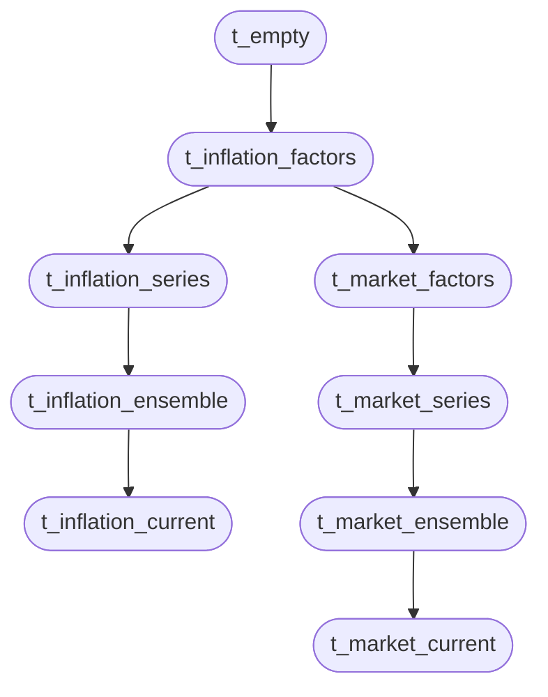
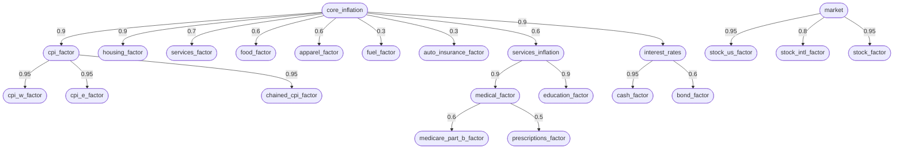

# Historical calibration: what numbers to put in

> To read a formatted `.md` file:
> - In Jupyter: right-click on it and select `Open With / Markdown Preview`
> - In VSCode: Command `Markdown Preview Enhanced: Open Preview` or ⌘⇧V

<!-- cspell:ignore CPIAUCSL PMMS CUUR CWUR SUUR SEEB DPCCRG DPCERG DPCERGM PCEPI histret Asize SASLE SEMF SETE -->

The [ensembles guide](ensembles.md) explains how a varying rate, a
correlation and tail dependence work. This guide is about the numbers:
what history says a rate's median, spread and correlation should be, and
where to get the data to check or redo it.

All of it comes from public statistics, through `analysis historical`
([source](../../src/analysis/historical/calibration.py)), which downloads
the series and computes every table below. The command
that produced each table is printed under it, so you can run the same thing
on other series or years.

## Reading the tables

Every rate here is an **annual rate**: for a price index, December over the
previous December, the way BLS reports annual inflation. Returns from
Damodaran are calendar-year returns. A table's year range counts the years
those rates end in, so "1966–1982" starts with the change from December 1965
to December 1966.

| Column | Meaning |
| --- | --- |
| Compound % | The single rate that compounds to the same total over the years shown (the geometric mean of the growth factors). |
| Median %, SD, Min %, Max % | Of the single-year rates, or with `--window N`, of the rolling N-year compound rates. |
| Persistence | Correlation of one year's rate with the next year's (single years only). |
| Shock SD | The spread of one year's surprise: the SD of `log(1 + rate)`, in points, times √(1 − Persistence²), with a negative persistence counted as 0 (single years only). |
| ρ (from τ) | Copula correlation with the reference series, from Kendall's τ by ρ = sin(πτ/2). |
| Pearson | Ordinary correlation with the reference, for comparison. |
| Gap vs ref | Compound rate minus the reference's, over the years both have. |

Correlations are left blank for fewer than eight years in common, and
persistence for fewer than eight pairs of consecutive years, where they're
noise.

### Suggested row values

Under each period's table, `analysis historical` prints what that history
suggests for a varying `set_rate` row, headed by the `calendar.csv` column
each value goes in and written the way the CSV takes it (`18.9%`). Every
series gets two rows: one for a **held** rate (one draw kept for
`--hold-years`, 30 by default) and one for a **process** (`vary_process`
`ar1`, a path that moves every year; see [A rate that moves every
year](#a-rate-that-moves-every-year)). The suggestions always come from
single years, whatever `--window` the table above them uses.

For example, stocks and CPI-U over their whole history:

```sh
analysis historical --period "All=1900-" Stocks=damodaran:sp500 CPI-U=CUUR0000SA0
```

| Series | Row           | amount, vary_median | vary_sd      | vary_persistence | vary_shock_sd |
| ------ | ------------- | ------------------- | ------------ | ---------------: | ------------- |
| Stocks | held 30 yr    | 10.0%               | 1.3%         |                — | —             |
| Stocks | process (ar1) | 10.0%               | 2.0% to 5.5% |             0.00 | 18.9%         |
| CPI-U  | held 30 yr    | 3.2%                | 1.3%         |                — | —             |
| CPI-U  | process (ar1) | 3.2%                | 0.4% to 2.6% |             0.65 | 3.5%          |

The stock row as a process, taking the low end of the level's range, is
then this `calendar.csv` row (with its `vary_correlate_with` and the rest
as the recipe needs):

```csv
date,kind,name,series,amount,vary_target,vary_distribution,vary_median,vary_sd,vary_process,vary_persistence,vary_shock_sd
2026-10,set_rate,vary_stock,stock,10.0%,amount,truncated_normal,10.0%,2.0%,ar1,0,18.9%
```

and CPI-U, held, is
`2026-10,set_rate,vary_cpi,cpi,3.2%,amount,truncated_normal,3.2%,1.3%,,,`.

Things that are easy to get wrong:

- **A process row's `vary_sd` is a range.** It's the uncertainty about the
  long-run rate only, since the path adds every year's spread itself. The
  low end is the standard error of the historical mean (single-year SD /
  √N), which assumes the future draws from the same history; the high end
  is the SD of rolling 10-year rates. How far the future's long-run rate
  may stray from the past's is your judgment.
- **The single-year SD goes in no column.** On a held row it would make
  every member keep one year's worth of luck for decades; on a process row
  it counts the yearly spread twice.
- **Negative persistence is entered as 0.** Returns' persistence is near 0
  and sometimes slightly negative, which a process row can't take.
- **A rolling SD needs two whole windows.** It's left blank (`—`) when the
  period is shorter than that, since overlapping windows over too few years
  share most of their years and understate the spread.

After the tables comes a legend, one line per name a value goes by:

| calendar.csv column | sim calendar add flag | Plain name | From these tables | Meaning |
| --- | --- | --- | --- | --- |
| `amount` | RATE_PERCENT argument | the rate | Compound % | The row's rate; on a varying row, a placeholder the draw replaces. |
| `vary_median` | `--vary-median` | long-run rate (L) | Compound % | The median draw: the rate a held row keeps, or the rate a process path compounds to in the median future. |
| `vary_sd` (held row) | `--vary-sd` | spread of the held rate | held row's `vary_sd` | SD of rolling compound rates over the years the row holds (`--hold-years`). |
| `vary_sd` (process row) | `--vary-sd` | uncertainty about the long-run rate | process row's `vary_sd` | SD of the level only; from the standard error of the mean up to the 10-year rolling SD. |
| `vary_process` | `--vary-process` | year-by-year path | — | `ar1` for a path that moves every year around L; blank to hold one draw. |
| `vary_persistence` | `--vary-persistence` | persistence (φ) | Persistence | How much of one year's deviation carries into the next; a negative value is entered as 0. |
| `vary_shock_sd` | `--vary-shock-sd` | yearly shock size (σ) | Shock SD | SD of one year's surprise in log growth, as a percent. In a tree with tail dependence ν, divide by √(ν / (ν − 2)). |
| `vary_low`, `vary_high` | `--vary-low`, `--vary-high` | bounds on the draw | — | Bound the drawn rate, or a process's level, not its yearly path. Min % and Max % are single years' extremes. |
| — | — | single-year spread | SD, Median %, Min %, Max % | For reading history; no column takes the single-year SD directly. |

## Turning history into `vary_*` settings

A varying `set-rate` row is drawn once per member and then holds until the
next row for that series. So the uncertainty it needs is the uncertainty of
a **multi-year average rate**, not of a single year. Single years scatter
much more than decades do: since 1984, CPI-U's single-year rates have an SD
of 1.5 points, but its rolling 10-year compound rates have an SD of 0.6.
Using the single-year SD for a rate held 20 years would make the spread of
outcomes far too wide. Match the window to how long the row holds.

- **`vary_median`:** the median of the rolling N-year compound rates. The
  full period's compound rate is close to it, and is the better choice when
  the window covers most of the period. Use the compound rate rather than
  the average of single years: an average of annual rates runs above the
  rate that actually compounds, by about half the variance.
- **`vary_sd`:** the SD of the rolling N-year compound rates. Overlapping
  windows share most of their years, so a period of 40 years holds only
  four independent decades; treat the SD as a rough guide, not a
  measurement.
- **`vary_low`/`vary_high`:** for a truncated normal these clip the draw,
  and default to 3 SDs out; for uniform and triangular they are the
  distribution's required bounds. The historical min and max are a check
  on that range, not good bounds: stopping at them rules out anything worse
  than what happened.
- **`vary_skew`:** when Max sits much further above the median than Min
  sits below it, as for energy and for CPI-U across the postwar period,
  the high side needs a longer tail.
- **`vary_correlation`:** ρ (from τ), from a table with the same window.
  The simulator's correlations are copula correlations, and ρ from τ is
  their direct estimate. Pearson is pulled around by a few extreme years.
  The ρ for 10-year windows can be higher or lower than for single years
  (since 1984, energy's and apparel's fall), so take it from the horizon the row
  holds for.
- **A later row correlated with an earlier one:** Persistence, the
  correlation of one year's rate with the next, is the estimate for rows a
  year apart. The script doesn't measure longer gaps, and the correlation
  across them needn't shrink steadily, so don't read it off persistence.

### A rate that moves every year

A held rate removes the year-to-year swings of a return, and with them
sequence-of-returns risk: a bad year early in retirement, while money is
being withdrawn, does more harm than the same year later. Stock and bond
returns have almost no persistence (about −0.1 to 0.1 in the tables
below), so each year is close to a fresh draw. A `set-rate` row with
`--vary-process ar1` keeps its draw as the path's **level** and moves
around it year by year ([ADR-006
§4a](../architecture/ADR-006-ensemble-scenarios.md#4a-processes-a-year-by-year-path-from-one-row)).

- **`vary_persistence`:** Persistence, or 0 when it's negative. Near 0 for
  returns; a yield or an inflation rate is better held than given a process.
- **`vary_shock_sd`:** [Shock SD](../user-guide.md#g-shock). Since 1948, stocks' is 15.9 and
  T-bonds' 8.2.
- **The level's `vary_sd`:** only the uncertainty about the long-run rate
  the path compounds to, since the path supplies the yearly spread itself.
  Using the single-year SD here as well would count the spread twice. The
  SD of rolling compound rates over a long window (stocks' 10-year SD is
  about 5) is an upper bound; how much less depends on how far the future
  may differ from the past.
- **In a tree with tail dependence** (`vary_tail_dependence` ν), each
  year's shock is heavier-tailed, and its SD is the shock size times
  √(ν / (ν − 2)), so divide the Shock SD by that to keep the same spread.
  Such a tree needs ν above 2.

Each year's shock goes through the row's correlation tree, so two return
paths under one market factor have correlated years. Member 0's path is
flat at its level, unless it starts at today's rate (next section).

```sh
sim ensemble create stock_paths retire_alice
sim calendar add set-rate 2027-01-31 brokerage_growth 6 --scenario stock_paths \
  --name brokerage_path --vary-target amount \
  --vary-distribution truncated_normal --vary-median 6 --vary-sd 2 \
  --vary-process ar1 --vary-persistence 0 --vary-shock-sd 16 \
  --vary-correlate-with stock_us_factor --vary-correlation 1.0
```

### Today's rate, returning to the long run

A process row normally starts with a year already drawn around its level,
as if today were an ordinary year. When today isn't (inflation running
above its long-run rate, say), `--vary-process-start current` starts the
path at the rate in effect instead, and lets it return to the level at the
row's persistence ([ADR-006
§4a](../architecture/ADR-006-ensemble-scenarios.md#4a-processes-a-year-by-year-path-from-one-row)).
The rate in effect is the series file's latest entry before the row's date,
or an earlier `set-rate` row's value if one comes later, so "now" lives in
the series file with the rest of the history:

```sh
sim ensemble create inflation_now retire_alice
printf 'effective_date,annual_rate\n2025-01-31,2.5%%\n2026-09-30,3.6%%\n' \
  > "$ANALYSIS_DATA_DIR/scenarios/inflation_now/series/inflation__cpi.csv"
sim calendar add set-rate 2026-10-31 cpi 3.2 --aux-kind inflation \
  --scenario inflation_now --name cpi_now \
  --vary-target amount --vary-distribution truncated_normal \
  --vary-median 3.2 --vary-sd 1.0 \
  --vary-process ar1 --vary-persistence 0.65 --vary-shock-sd 3.5 \
  --vary-process-start current \
  --vary-correlate-with cpi_factor --vary-correlation 1.0
```

- **Year 0 is September's 3.6%**, exactly, in every member. From the next
  year on, each year keeps 0.65 of the last one's gap from the level, plus
  that year's shock. Member 0 has no shocks, so its path closes in on 3.2%:
  3.46%, 3.37%, 3.31% and so on. The other members spread out around that
  path as the shocks add up.
- **Persistence sets how long the return takes.** There is no return date
  to choose. With persistence near 0 (fuel) the rate is back near its level
  within a year; at 0.7 (shelter, medical care) the gap takes several years
  to fade. The extra inflation along the way adds to the price level about
  as much as the gap held for 1/(1 − persistence) years would: about three
  years at 0.65.
- **The row's own date doesn't count.** A series entry dated on the row's
  date is replaced by the row, so the start is the entry before it. An
  earlier `set-rate` row for the same series counts, and if it varies, its
  drawn value counts (for a ramp or a process, its last step).
- **Something must be in effect before the row.** With no series entry and
  no fixed-date `set-rate` row before it, the load fails. A row whose date
  varies doesn't count at load, since it could land after the process row.
- **`ensemble_draw` still records the level**, 3.2% in member 0, so
  sensitivity reports read the long-run rate as before.

The numbers here are CPI-U's process row from [Suggested row
values](#suggested-row-values), over all of history. A postwar period
gives a smaller shock; run `analysis historical` for the period you trust.

## A long-run rate with episodes on top

History doesn't look like one rate drawn from one range. It looks like a
long-run rate, interrupted by episodes of a few years far above it, that
end and give way to the long-run rate again. The table below lists every
stretch since 1914 of consecutive years above 5%:

| Series  | Years     | Length | Compound % |
| ------- | --------- | -----: | ---------: |
| CPI-U   | 1916–1919 |      4 |       16.4 |
| CPI-U   | 1941–1942 |      2 |        9.5 |
| CPI-U   | 1946–1947 |      2 |       13.4 |
| CPI-U   | 1950–1951 |      2 |        6.0 |
| CPI-U   | 1969–1970 |      2 |        5.9 |
| CPI-U   | 1973–1975 |      3 |        9.3 |
| CPI-U   | 1977–1981 |      5 |       10.1 |
| CPI-U   | 1990      |      1 |        6.1 |
| CPI-U   | 2021–2022 |      2 |        6.7 |
| Core    | 1968–1970 |      3 |        5.9 |
| Core    | 1974–1981 |      8 |        9.0 |
| Core    | 1990      |      1 |        5.2 |
| Core    | 2021–2022 |      2 |        5.6 |
| Medical | 1946–1948 |      3 |        7.0 |
| Medical | 1951      |      1 |        5.8 |
| Medical | 1966–1970 |      5 |        6.5 |
| Medical | 1973–1993 |     21 |        8.4 |
| Medical | 2002      |      1 |        5.0 |
| Medical | 2007      |      1 |        5.2 |
| Shelter | 1968–1970 |      3 |        8.0 |
| Shelter | 1973–1975 |      3 |        8.6 |
| Shelter | 1977–1981 |      5 |       12.5 |
| Shelter | 1984–1985 |      2 |        5.6 |
| Shelter | 1990      |      1 |        5.2 |
| Shelter | 2022–2023 |      2 |        6.8 |

```sh
uv run analysis historical --period "Postwar=1948-" --runs-above 5 \
  CPI-U=CUUR0000SA0 Core=CUUR0000SA0L1E Medical=CUUR0000SAM Shelter=CUUR0000SAH1
```

Since 1948 CPI-U had six such stretches in 78 years, each one to five years
long, at compound rates of about 6% to 10%. The Great Inflation was three
bursts (1969–1970, 1973–1975 and 1977–1981) with years of 3% to 5% in
between, not 17 years at one rate. Medical care was the exception: above 5%
for 21 straight years, from 1973 to 1993.

A scenario can model that as a date marker for the episode's start, an
episode row dated from it, and a return row a fixed number of years later.
This continues the `inflation_drivers` recipe from the ensembles guide, as
a separate scenario so it can be compared with the recipe, or used as a
mix-in:

```sh
sim ensemble create great_inflation inflation_drivers
sim calendar add date-marker medical_episode_start 2032-01 \
  --scenario great_inflation \
  --vary-distribution uniform --vary-low 2028-01 --vary-high 2036-01
sim calendar add set-rate medical_episode_start medical 8.2 --aux-kind inflation \
  --scenario great_inflation --name medical_episode
sim calendar add set-rate medical_episode_start+5y medical 4.2 --aux-kind inflation \
  --scenario great_inflation --name medical_return \
  --vary-target amount --vary-distribution truncated_normal \
  --vary-median 4.2 --vary-sd 0.5 --vary-process ar1 \
  --vary-persistence 0.6 --vary-shock-sd 2 --vary-process-start current
```

- The episode rate, 8.2%, is medical care's compound rate over the Great
  Inflation; the return level, 4.2%, is its long-run rate since 1984.
- Both rows are dated from one marker, so the episode lasts exactly five
  years in every member and only its start varies. Moving the episode is a
  one-row edit of the marker; `sim calendar rename` of the marker carries
  the rows with it.
- The return row starts at the episode's rate and reverts to its level at
  medical care's persistence, with yearly shocks on top
  ([Today's rate, returning to the long run](#todays-rate-returning-to-the-long-run)).
  The marker is what varies, so the return's level can vary too.
- A marker range that runs past the scenario's end makes the episode
  optional. With `--vary-high 2048-01` on a scenario ending in 2040, about
  13 of the range's 20 years fall inside the scenario, so the episode
  starts in about 65% of members; in the rest, every row dated from the
  marker falls after the end and does nothing. Member 0, the base case,
  uses the middle of the range, so it has an episode when the middle falls
  inside the scenario.
- A row's own date range can be relative to the marker too
  (`--vary-low medical_episode_start+4y --vary-high medical_episode_start+7y`
  on a return row whose date varies), for an episode whose length is
  uncertain as well.

Separate episode scenarios, one per historical pattern (a Great
Inflation-style stretch, a short post-pandemic spike), can each be a mix-in
on the same base, so `base:great_inflation` and `base:pandemic_spike` share
everything else.

## Inflation metrics compared

Different indexes price different baskets. A plan should grow each expense
with the index whose basket matches it, and its income with whatever it's
legally tied to.

- **CPI-U:** all urban consumers. The headline index.
- **CPI-W:** urban wage earner and clerical worker households, about 30% of
  the CPI-U population, excluding retirees. It's the index Social Security
  COLAs follow, so it's what benefits grow with.
- **R-CPI-E:** BLS's research index reweighted to the spending of
  households 62 and older, from December 1982. BLS cautions that its
  weights rest on a small sample and that it prices the same outlets and
  items as CPI-U, so treat conclusions from it as tentative.
- **C-CPI-U (chained CPI):** accounts for substitution between items, from
  December 1999. It has indexed federal tax brackets since tax year 2018,
  so it's what bracket thresholds grow with.
- **PCE price index:** BEA's measure, with broader coverage than CPI,
  including spending made on households' behalf, such as by employers and
  Medicare. From 1959; core PCE excludes food and energy.
- **Medical care**, and its services and commodities parts.

Against CPI-U, since R-CPI-E began and since C-CPI-U began:

| Series              | Years     |   N | Compound % | Median % |  SD | Min % | Max % | Persistence | Shock SD | ρ (from τ) | Pearson | Gap vs ref |
| ------------------- | --------- | --: | ---------: | -------: | --: | ----: | ----: | ----------: | -------: | ---------: | ------: | ---------: |
| CPI-U               | 1983–2025 |  43 |        2.8 |      2.7 | 1.5 |   0.1 |   7.0 |        0.34 |      1.3 |       1.00 |    1.00 |       0.00 |
| CPI-W               | 1983–2025 |  43 |        2.8 |      2.7 | 1.6 |  -0.5 |   7.8 |        0.24 |      1.5 |       0.99 |    0.99 |      -0.06 |
| R-CPI-E             | 1983–2025 |  43 |        3.0 |      2.8 | 1.4 |   0.5 |   6.7 |        0.44 |      1.2 |       0.99 |    0.99 |       0.16 |
| C-CPI-U             | 2000–2025 |  26 |        2.3 |      1.9 | 1.5 |   0.2 |   6.5 |        0.37 |      1.3 |       0.98 |    0.99 |      -0.27 |
| PCE                 | 1983–2025 |  43 |        2.4 |      2.2 | 1.3 |   0.1 |   6.0 |        0.46 |      1.1 |       0.97 |    0.98 |      -0.40 |
| Core                | 1983–2025 |  43 |        2.9 |      2.6 | 1.2 |   0.8 |   5.7 |        0.75 |      0.8 |       0.77 |    0.79 |       0.06 |
| Core-PCE            | 1983–2025 |  43 |        2.5 |      2.1 | 1.1 |   1.1 |   5.1 |        0.76 |      0.7 |       0.85 |    0.83 |      -0.38 |
| Medical             | 1983–2025 |  43 |        4.3 |      3.9 | 2.0 |   0.5 |   9.6 |        0.76 |      1.2 |       0.54 |    0.39 |       1.45 |
| Medical-services    | 1983–2025 |  43 |        4.5 |      4.1 | 2.0 |  -0.5 |   9.9 |        0.71 |      1.4 |       0.52 |    0.37 |       1.66 |
| Medical-commodities | 1983–2025 |  43 |        3.5 |      3.1 | 2.5 |  -2.5 |   8.4 |        0.67 |      1.8 |       0.49 |    0.36 |       0.66 |
| R-CPI-E-medical     | 1983–2025 |  43 |        4.3 |      3.8 | 2.2 |   1.2 |  11.3 |        0.80 |      1.3 |       0.51 |    0.40 |       1.48 |

| Series              | Years     |   N | Compound % | Median % |  SD | Min % | Max % | Persistence | Shock SD | ρ (from τ) | Pearson | Gap vs ref |
| ------------------- | --------- | --: | ---------: | -------: | --: | ----: | ----: | ----------: | -------: | ---------: | ------: | ---------: |
| CPI-U               | 2000–2025 |  26 |        2.6 |      2.3 | 1.5 |   0.1 |   7.0 |        0.30 |      1.4 |       1.00 |    1.00 |       0.00 |
| CPI-W               | 2000–2025 |  26 |        2.5 |      2.3 | 1.7 |  -0.5 |   7.8 |        0.22 |      1.6 |       0.99 |    0.99 |      -0.01 |
| R-CPI-E             | 2000–2025 |  26 |        2.7 |      2.3 | 1.4 |   0.5 |   6.7 |        0.38 |      1.3 |       0.99 |    0.99 |       0.12 |
| C-CPI-U             | 2000–2025 |  26 |        2.3 |      1.9 | 1.5 |   0.2 |   6.5 |        0.37 |      1.3 |       0.98 |    0.99 |      -0.27 |
| PCE                 | 2000–2025 |  26 |        2.2 |      2.1 | 1.3 |   0.1 |   6.0 |        0.38 |      1.2 |       0.97 |    0.99 |      -0.34 |
| Core                | 2000–2025 |  26 |        2.4 |      2.2 | 1.1 |   0.8 |   5.7 |        0.59 |      0.9 |       0.74 |    0.84 |      -0.15 |
| Core-PCE            | 2000–2025 |  26 |        2.1 |      1.8 | 1.0 |   1.1 |   5.1 |        0.61 |      0.8 |       0.87 |    0.91 |      -0.44 |
| Medical             | 2000–2025 |  26 |        3.3 |      3.3 | 1.1 |   0.5 |   5.2 |        0.10 |      1.1 |       0.35 |    0.13 |       0.72 |
| Medical-services    | 2000–2025 |  26 |        3.6 |      3.6 | 1.3 |  -0.5 |   5.9 |        0.15 |      1.3 |       0.34 |    0.12 |       1.01 |
| Medical-commodities | 2000–2025 |  26 |        2.3 |      2.4 | 1.7 |  -2.5 |   4.8 |       -0.02 |      1.7 |       0.24 |    0.06 |      -0.30 |
| R-CPI-E-medical     | 2000–2025 |  26 |        3.2 |      3.3 | 1.1 |   1.2 |   5.0 |        0.27 |      1.0 |       0.35 |    0.15 |       0.63 |

```sh
uv run analysis historical --reference CPI-U=CUUR0000SA0 \
  --period "Since 1983=1983-" --period "Since 2000=2000-" \
  CPI-U=CUUR0000SA0 CPI-W=CWUR0000SA0 "R-CPI-E=rcpie:All items" \
  C-CPI-U=SUUR0000SA0 PCE=bea:DPCERG Core=CUUR0000SA0L1E Core-PCE=bea:DPCCRG \
  Medical=CUUR0000SAM Medical-services=CUUR0000SAM2 \
  Medical-commodities=CUUR0000SAM1 "R-CPI-E-medical=rcpie:Medical care"
```

The gap between R-CPI-E and CPI-W is the drift of a retiree's costs against
their COLA. Since 1983 it's been 0.22 points a year, at ρ 0.97 (from the
same command with `--reference CPI-W=CWUR0000SA0`). Small, but it compounds:
over 30 years, a COLA-indexed benefit buys about 6% less of a retiree's
basket.

Medical care's gap above CPI-U has narrowed: 1.45 points a year since 1983,
0.72 since 2000. Its correlation with CPI-U is moderate and weakening too
(ρ 0.54, then 0.35), so medical inflation is largely its own uncertainty,
not just the general rate. A medical rate belongs under a core factor at a
low ρ, or under a factor of its own. The R-CPI-E medical index tracks the
CPI-U one closely; the older basket's extra medical weight shows up in
R-CPI-E's all-items index, not in a different medical rate.

The Medicare Part B standard premium grew 5.5% a year from 1990 to 2025
(5.8% since 2000), against 2.6% for CPI-U and 3.7% for medical care. The
premium is set to cover about a quarter of Part B's cost per enrollee, so
it follows how much care is used as well as its price, and it moves in
jumps: it fell in 2012 and 2023 and rose 16% in 2016 and 15% in 2022. A
Part B premium row wants a rate of its own, about three points above
CPI-U, rather than medical CPI.

C-CPI-U runs about 0.3 points a year below CPI-U, and PCE about 0.4 below.
Tax brackets indexed to C-CPI-U creep down against expenses that follow
CPI-U.

## Long-run rates

Single years, then rolling 10-year compound rates, since 1984 and since
1948. The reference is core CPI (less food and energy), the usual choice
for a core-inflation factor.

| Series           | Years     |   N | Compound % | Median % |   SD | Min % | Max % | Persistence | Shock SD | ρ (from τ) | Pearson | Gap vs ref |
| ---------------- | --------- | --: | ---------: | -------: | ---: | ----: | ----: | ----------: | -------: | ---------: | ------: | ---------: |
| CPI-U            | 1984–2025 |  42 |        2.8 |      2.7 |  1.5 |   0.1 |   7.0 |        0.33 |      1.3 |       0.77 |    0.80 |      -0.03 |
| Core             | 1984–2025 |  42 |        2.8 |      2.5 |  1.2 |   0.8 |   5.7 |        0.74 |      0.8 |       1.00 |    1.00 |       0.00 |
| Food             | 1984–2025 |  42 |        3.0 |      2.7 |  1.9 |  -0.5 |  10.4 |        0.30 |      1.8 |       0.52 |    0.58 |       0.14 |
| Energy           | 1984–2025 |  42 |        2.4 |      2.3 | 10.5 | -21.3 |  29.3 |       -0.18 |     10.3 |      -0.02 |    0.13 |      -0.40 |
| Shelter          | 1984–2025 |  42 |        3.4 |      3.2 |  1.4 |   0.3 |   7.5 |        0.71 |      1.0 |       0.82 |    0.83 |       0.61 |
| Medical          | 1984–2025 |  42 |        4.2 |      3.8 |  2.0 |   0.5 |   9.6 |        0.76 |      1.2 |       0.60 |    0.54 |       1.39 |
| Medical-services | 1984–2025 |  42 |        4.4 |      4.1 |  2.0 |  -0.5 |   9.9 |        0.70 |      1.4 |       0.59 |    0.49 |       1.61 |
| Apparel          | 1984–2025 |  42 |        0.6 |      0.3 |  2.3 |  -3.9 |   5.8 |        0.35 |      2.1 |       0.73 |    0.73 |      -2.29 |
| Tuition          | 1984–2025 |  42 |        5.2 |      5.2 |  2.2 |   1.4 |  10.0 |        0.93 |      0.7 |       0.49 |    0.40 |       2.40 |
| T-bill           | 1984–2025 |  42 |        3.4 |      3.5 |  2.7 |   0.0 |   9.9 |        0.88 |      1.3 |       0.75 |    0.61 |       0.59 |
| T-bond           | 1984–2025 |  42 |        6.0 |      7.0 |  9.9 | -17.8 |  25.7 |       -0.09 |      9.5 |       0.14 |    0.02 |       3.17 |
| Stocks           | 1984–2025 |  42 |       11.7 |     15.8 | 16.5 | -36.5 |  37.2 |       -0.06 |     16.1 |       0.03 |    0.02 |       8.85 |

| Series           | Years     |   N | Compound % | Median % |  SD | Min % | Max % | Persistence | Shock SD | ρ (from τ) | Pearson | Gap vs ref |
| ---------------- | --------- | --: | ---------: | -------: | --: | ----: | ----: | ----------: | -------: | ---------: | ------: | ---------: |
| CPI-U            | 1984–2025 |  33 |        2.8 |      2.5 | 0.6 |   1.6 |   3.7 |           — |        — |       0.93 |    0.93 |      -0.03 |
| Core             | 1984–2025 |  33 |        2.8 |      2.3 | 0.7 |   1.8 |   4.2 |           — |        — |       1.00 |    1.00 |       0.00 |
| Food             | 1984–2025 |  33 |        3.0 |      2.7 | 0.5 |   1.6 |   3.6 |           — |        — |       0.71 |    0.77 |       0.14 |
| Energy           | 1984–2025 |  33 |        2.4 |      1.9 | 2.4 |  -0.9 |   7.6 |           — |        — |      -0.23 |   -0.33 |      -0.40 |
| Shelter          | 1984–2025 |  33 |        3.4 |      3.1 | 0.7 |   2.2 |   4.5 |           — |        — |       0.95 |    0.91 |       0.61 |
| Medical          | 1984–2025 |  33 |        4.2 |      3.9 | 1.3 |   2.6 |   7.1 |           — |        — |       0.65 |    0.77 |       1.39 |
| Medical-services | 1984–2025 |  33 |        4.4 |      4.2 | 1.3 |   2.7 |   7.2 |           — |        — |       0.65 |    0.75 |       1.61 |
| Apparel          | 1984–2025 |  33 |        0.6 |      0.2 | 1.0 |  -1.1 |   2.7 |           — |        — |       0.45 |    0.74 |      -2.29 |
| Tuition          | 1984–2025 |  33 |        5.2 |      5.6 | 1.6 |   2.6 |   8.3 |           — |        — |       0.57 |    0.53 |       2.40 |
| T-bill           | 1984–2025 |  33 |        3.4 |      2.7 | 1.9 |   0.3 |   6.5 |           — |        — |       0.89 |    0.77 |       0.59 |
| T-bond           | 1984–2025 |  33 |        6.0 |      6.1 | 3.0 |   0.1 |  12.6 |           — |        — |       0.65 |    0.52 |       3.17 |
| Stocks           | 1984–2025 |  33 |       11.7 |     11.9 | 5.3 |  -1.4 |  19.0 |           — |        — |       0.69 |    0.62 |       8.85 |

| Series           | Years     |   N | Compound % | Median % |   SD | Min % | Max % | Persistence | Shock SD | ρ (from τ) | Pearson | Gap vs ref |
| ---------------- | --------- | --: | ---------: | -------: | ---: | ----: | ----: | ----------: | -------: | ---------: | ------: | ---------: |
| CPI-U            | 1948–2025 |  78 |        3.4 |      2.9 |  2.8 |  -2.1 |  13.3 |        0.67 |      2.0 |       0.90 |    0.94 |       0.02 |
| Core             | 1958–2025 |  68 |        3.6 |      2.7 |  2.5 |   0.8 |  12.2 |        0.81 |      1.4 |       1.00 |    1.00 |       0.00 |
| Food             | 1948–2025 |  78 |        3.4 |      2.8 |  3.6 |  -3.9 |  20.3 |        0.45 |      3.0 |       0.61 |    0.63 |       0.08 |
| Energy           | 1958–2025 |  68 |        3.8 |      2.4 |  9.9 | -21.3 |  37.5 |        0.06 |      9.5 |       0.31 |    0.47 |       0.18 |
| Shelter          | 1953–2025 |  73 |        4.1 |      3.2 |  3.1 |   0.3 |  17.5 |        0.76 |      1.9 |       0.90 |    0.94 |       0.66 |
| Medical          | 1948–2025 |  78 |        4.9 |      4.2 |  2.7 |   0.5 |  12.6 |        0.78 |      1.6 |       0.79 |    0.80 |       1.47 |
| Medical-services | 1948–2025 |  78 |        5.3 |      4.6 |  2.7 |  -0.5 |  13.2 |        0.75 |      1.7 |       0.78 |    0.79 |       1.83 |
| Apparel          | 1948–2025 |  78 |        1.5 |      1.1 |  2.8 |  -7.4 |   8.7 |        0.31 |      2.6 |       0.73 |    0.74 |      -2.07 |
| Tuition          | 1978–2025 |  48 |        5.9 |      5.6 |  2.8 |   1.4 |  12.7 |        0.94 |      0.9 |       0.64 |    0.63 |       2.37 |
| T-bill           | 1948–2025 |  78 |        4.0 |      3.8 |  3.0 |   0.0 |  14.0 |        0.90 |      1.3 |       0.78 |    0.72 |       0.73 |
| T-bond           | 1948–2025 |  78 |        4.9 |      3.3 |  8.7 | -17.8 |  32.8 |       -0.04 |      8.2 |       0.02 |   -0.07 |       1.71 |
| Stocks           | 1948–2025 |  78 |       11.6 |     15.8 | 16.8 | -36.5 |  52.6 |       -0.08 |     15.9 |      -0.08 |   -0.10 |       7.31 |

| Series           | Years     |   N | Compound % | Median % |  SD | Min % | Max % | Persistence | Shock SD | ρ (from τ) | Pearson | Gap vs ref |
| ---------------- | --------- | --: | ---------: | -------: | --: | ----: | ----: | ----------: | -------: | ---------: | ------: | ---------: |
| CPI-U            | 1948–2025 |  69 |        3.4 |      2.7 | 2.0 |   1.2 |   8.7 |           — |        — |       0.98 |    0.98 |       0.02 |
| Core             | 1958–2025 |  59 |        3.6 |      3.1 | 2.0 |   1.8 |   8.1 |           — |        — |       1.00 |    1.00 |       0.00 |
| Food             | 1948–2025 |  69 |        3.4 |      2.8 | 2.0 |   0.5 |   8.7 |           — |        — |       0.91 |    0.92 |       0.08 |
| Energy           | 1958–2025 |  59 |        3.8 |      2.6 | 3.8 |  -0.9 |  13.9 |           — |        — |       0.48 |    0.68 |       0.18 |
| Shelter          | 1953–2025 |  64 |        4.1 |      3.6 | 2.3 |   1.6 |   9.6 |           — |        — |       0.98 |    0.99 |       0.66 |
| Medical          | 1948–2025 |  69 |        4.9 |      4.1 | 2.2 |   2.6 |  10.0 |           — |        — |       0.92 |    0.94 |       1.47 |
| Medical-services | 1948–2025 |  69 |        5.3 |      4.5 | 2.2 |   2.7 |  10.3 |           — |        — |       0.94 |    0.94 |       1.83 |
| Apparel          | 1948–2025 |  69 |        1.5 |      1.0 | 1.8 |  -1.1 |   4.6 |           — |        — |       0.83 |    0.86 |      -2.07 |
| Tuition          | 1978–2025 |  39 |        5.9 |      5.7 | 2.1 |   2.6 |   9.7 |           — |        — |       0.77 |    0.78 |       2.37 |
| T-bill           | 1948–2025 |  69 |        4.0 |      4.0 | 2.6 |   0.3 |   9.2 |           — |        — |       0.94 |    0.86 |       0.73 |
| T-bond           | 1948–2025 |  69 |        4.9 |      4.9 | 3.3 |   0.1 |  13.7 |           — |        — |       0.37 |    0.28 |       1.71 |
| Stocks           | 1948–2025 |  69 |       11.6 |     11.9 | 5.1 |  -1.4 |  20.1 |           — |        — |       0.21 |    0.08 |       7.31 |

```sh
uv run analysis historical --reference Core=CUUR0000SA0L1E \
  --period "Since 1984=1984-" --period "Postwar=1948-" \
  CPI-U=CUUR0000SA0 Core=CUUR0000SA0L1E Food=CUUR0000SAF1 Energy=CUUR0000SA0E \
  Shelter=CUUR0000SAH1 Medical=CUUR0000SAM Medical-services=CUUR0000SAM2 \
  Apparel=CUUR0000SAA Tuition=CUUR0000SEEB \
  T-bill=damodaran:tbill T-bond=damodaran:tbond Stocks=damodaran:sp500
```

The 10-year tables come from the same command with `--window 10` added.

Which period to use is a judgment. Since 1984 is one regime: low, stable
inflation, plus 2021–2022. The postwar period includes the Great Inflation,
so its 10-year SD (2.0 points for CPI-U) is more than three times the
recent one (0.6). A long-run row calibrated to the recent period, with the
1970s added as an episode, keeps the two apart.

## Template scenarios

The analysis repository ships a set of **template scenarios** in
`templates/scenarios/`, a vetted inflation and market structure to build
on. They hold no household data. Any data repo can name them as parents or
mix-ins without a copy: a scenario named `t_...` that isn't in the data
repo's own `scenarios/` is read from the analysis repository instead
([ADR-003 §4.5a](../architecture/ADR-003-registries-and-csv-schemas.md#45a-template-scenarios-t_-names)).
They change only with the code, so a fix to one reaches every data repo
that builds on it.



`t_empty` at the root is what its name says: no accounts, rules, rates or
factors, only a start and end date and a seed, so every template loads on
its own. A template's dates and seed are fallbacks that any data repo
scenario in the lineage overrides, so having `t_empty` in a lineage or not
changes nothing. It is also a starting point for a scenario built from
nothing. Each layer below it adds one thing to the one
above:

- **`_factors`**: the latent factors and their correlations, and nothing
  else.
- **`_series`**: one long-run rate per series. These are the values for a
  30-year projection. Recent decades weigh more, and past episodes aren't
  averaged in, so they're a defensible default and a calm background for
  episodes to play out against. That's a judgment, explained below.
- **`_ensemble`**: a year-by-year process row per series, so each member
  draws a long-run level and moves around it every year. An ensemble of 80
  members.
- **`_current`**: a thin layer that starts the persistent series at
  today's rates, holds them, and then lets each return to its long-run
  level.

**The market factors sit under the inflation factors.** `t_market_factors`
inherits `t_inflation_factors`, so markets and inflation share one
correlation tree. Over a decade, short-term interest rates follow core
inflation (ρ 0.89) and bond yields follow short rates, so
`interest_rates` hangs under `core_inflation`, with cash and bonds under
it. Stocks barely follow either, so they get a root of their own,
`market`. A scenario that inherits both groups, as most useful ensembles
do, therefore gets correlated inflation, yields and bond returns, with
stocks drawn independently.

The prototype's root scenario, `base`, builds on `t_inflation_series` and
`t_market_series` (one parent and one mix-in): the long-run rates and
the factor tree, with no varying rows, so every future runs at these rates
until a scenario says otherwise. A scenario that wants the year-by-year
paths or today's rates adds `t_inflation_current` and `t_market_current`
(or the `_ensemble` layers) as mix-ins:

```sh
sim ensemble create alice_now retire_alice t_inflation_current t_market_current
```

To change a template, derive a scenario from it and override the rows or
series files there; the templates themselves are read-only from a data
repo, and an edit or a rename that would change one is refused. A data
repo folder with a template's name replaces the template whole.

### Long-run rates (`_series`)

CPI-U itself stays in the shared `aux/inflation__cpi.csv`, so a scenario
replaces it with its own `aux/inflation__cpi.csv`, not a `series/` file.

The rates in `t_inflation_series` and `t_market_series` are 10-year
compound medians from the tables above, leaning toward the recent period
where it differs, rounded to half a point or so:

| Series | Rate % | Basis |
| --- | --: | --- |
| `inflation__cpi` | 2.5 | CPI-U, 10-year median since 1984 (in shared `aux/`) |
| `inflation__cpi_w` | 2.5 | CPI-W, 0.06 below CPI-U since 1983: Social Security COLAs |
| `inflation__cpi_e` | 2.7 | R-CPI-E, 0.16 above CPI-U since 1983: a retiree's basket |
| `inflation__chained_cpi` | 2.2 | C-CPI-U, 0.27 below CPI-U since 2000: tax brackets |
| `inflation__medical` | 3.5 | Medical care: 4.2 since 1984, 3.3 since 2000, 2.8 since 2010 |
| `inflation__medicare_part_b` | 5.5 | The Part B premium, 1990–2025 |
| `inflation__prescriptions` | 3.0 | Prescription drugs: 4.1 since 1984, 2.8 since 2000; Medicare's price negotiation pulls down, new drugs push up |
| `inflation__services` | 3.2 | Services less energy: 3.5 since 1984, 3.1 since 2000. About half is shelter, so use `housing` for rent |
| `inflation__housing` | 3.2 | Shelter, 10-year median since 1984 |
| `inflation__education` | 4.0 | Tuition: 5.2 since 1984, 3.0 since 2010 |
| `inflation__auto_insurance` | 4.5 | Motor vehicle insurance: 5.2 since 1984, 4.9 since 2000, 5.7 since 2010 |
| `inflation__food` | 2.8 | Food, between the 10-year median and the compound rate |
| `inflation__fuel` | 2.5 | Energy: 1.9 to 2.4 since 1984, with a 10-point single-year SD |
| `inflation__apparel` | 0.5 | Apparel, 0.6 since 1984 |
| `rate__stock_us` | 7.0 | Well below the S&P 500's 11.7 since 1984; see below |
| `rate__stock_intl` | 7.0 | The same as US: no history here supports a different number |
| `rate__stock` | 7.0 | Stock with an unknown US/international split |
| `rate__bond` | 4.0 | Below the 10-year Treasury's 6.0 since 1984, a falling-rate era |
| `rate__cash` | 3.0 | T-bills: 3.4 since 1984, 4.0 postwar; money market follows them |

```sh
uv run scripts/historical_calibration.py --reference CPI-U=CUUR0000SA0 \
  --period "Since 2010=2010-" CPI-U=CUUR0000SA0 Tuition=CUUR0000SEEB Medical=CUUR0000SAM
```

The investment rates are deliberately below their history. Since 1984
stocks and bonds both rode falling interest rates and rising valuations,
which can't repeat from today's starting point, and a plan that comes out
fine at lower returns is the safer one to act on. A scenario that wants
history can set `rate__stock_us` to 10 or 11.

### The factor tree (`_factors`)

Each series has a factor of its own, `<series>_factor`, linked into a tree
by the 10-year ρ (from τ) against core CPI, rounded to the coarse values
the ensembles guide recommends. Factors are drawn rounded, with each
child's ρ on its arrow:



- **Inflation:** CPI-U follows core at 0.93, shelter at 0.95, food at 0.71
  and apparel at 0.45 (0.83 postwar). Energy's link is the weakest and
  least stable (−0.23 since 1984, 0.48 postwar), hence 0.3. Auto
  insurance, priced from repair costs, claims and litigation, barely
  follows CPI-U either (0.24 since 1984, 0.31 since 2010): 0.3 too. Rates
  also need regulators' approval, filed by each company about once a year.
  The filings are staggered, which smooths the index somewhat, but they
  arrive late and in steps rather than tracking costs, hence its large
  shock and its persistence. CPI-W, R-CPI-E
  and chained CPI track CPI-U at 0.97 to 0.99.
- **Services:** medical care and tuition follow core at about 0.6 over a
  decade, and share labor-heavy costs, so they sit under the ensembles
  guide's `services_inflation` sub-factor: 0.6 × 0.9 = 0.54 to core. The
  Part B premium follows medical prices and also how much care is used;
  its 0.6 is a judgment, not a measurement. Prescription drugs barely
  follow CPI-U (ρ 0.36 since 1984, 0.06 since 2000), so they hang under
  medical care at 0.5, another judgment. Services less energy, a broad
  aggregate rather than the labor-heavy cluster, follows CPI-U at 0.67
  since 1984 and sits under core at 0.7.
- **Interest rates:** T-bill returns follow core at 0.89 over a decade
  (0.94 postwar), and the 10-year Treasury follows T-bills at 0.91 (0.68
  postwar), so both hang off an `interest_rates` factor under core.
- **Stocks:** a separate root. Stocks' 10-year returns barely follow core
  (0.21 postwar) or bonds (0.06 postwar, 0.21 since 1984). The US and
  international ρ values are judgments: this guide's sources have no
  international series.

```sh
uv run scripts/historical_calibration.py --reference T-bill=damodaran:tbill --window 10 \
  --period "Since 1984=1984-" --period "Postwar=1948-" \
  T-bill=damodaran:tbill T-bond=damodaran:tbond Core=CUUR0000SA0L1E
uv run scripts/historical_calibration.py --reference Stocks=damodaran:sp500 --window 10 \
  --period "Since 1984=1984-" --period "Postwar=1948-" \
  Stocks=damodaran:sp500 T-bond=damodaran:tbond T-bill=damodaran:tbill
```

To vary a series, hang its row off the series' factor at ρ = 1.0. The row
then follows the tree exactly as drawn, with its own range from the tables
above:

```sh
sim calendar add set-rate 2027-01-31 medical 3.5 --aux-kind inflation \
  --scenario my_mixin --name medical_vary \
  --vary-target amount --vary-distribution truncated_normal \
  --vary-median 3.5 --vary-sd 1.3 \
  --vary-correlate-with medical_factor --vary-correlation 1.0
```

A ρ below 1.0 adds wobble of the row's own on top of the series'. To
change a link rather than a rate, redefine the factor in the mix-in: a
factor is replaced by name, so `sim calendar add latent-factor
medical_factor --vary-correlate-with core_inflation --vary-correlation
0.6` moves medical out of the services cluster.

Until a scenario varies something, `sim check` warns once that the
factors no row depends on yet affect nothing.

### Year-by-year paths (`_ensemble`)

`t_inflation_ensemble` and `t_market_ensemble` add one `ar1` process row
per series, dated 2027-01, each at ρ 1.0 to its factor ([A rate that
moves every year](#a-rate-that-moves-every-year)). The level is drawn
around the `_series` rate; the persistence (φ) and the shock size come
from `analysis historical` over 1984 on, the postwar years and 2000 on,
leaning on the years since 1984. The postwar figures include the Great
Inflation, which belongs in an episode instead. Every number is a
judgment from the history beside it:

| Series | Level % | Level SD | φ | Shock SD | φ / shock since 1984 | Postwar | Since 2000 |
| --- | --: | --: | --: | --: | --- | --- | --- |
| `cpi` | 2.5 | 0.5 | 0.4 | 1.4 | 0.33 / 1.3 | 0.67 / 2.0 | 0.30 / 1.4 |
| `cpi_w` | 2.5 | 0.5 | 0.3 | 1.5 | 0.24 / 1.5 | 0.66 / 2.0 | 0.22 / 1.6 |
| `cpi_e` | 2.7 | 0.5 | 0.4 | 1.2 | 0.44 / 1.2 | from 1983 | 0.38 / 1.3 |
| `chained_cpi` | 2.2 | 0.5 | 0.35 | 1.3 | 0.37 / 1.3 | from 2000 | same |
| `housing` | 3.2 | 0.5 | 0.7 | 1.0 | 0.71 / 1.0 | 0.76 / 1.9 | 0.66 / 1.1 |
| `food` | 2.8 | 0.4 | 0.3 | 1.8 | 0.30 / 1.8 | 0.45 / 3.0 | 0.27 / 2.1 |
| `apparel` | 0.5 | 0.6 | 0.3 | 2.1 | 0.35 / 2.1 | 0.31 / 2.6 | 0.16 / 2.2 |
| `auto_insurance` | 4.5 | 1.0 | 0.6 | 3.5 | 0.61 / 3.2 | 0.55 / 4.4 since 2010 | 0.57 / 3.7 |
| `fuel` | 2.5 | 2.0 | 0 | 10 | 0.00 / 10.3 | 0.06 / 9.5 | 0.00 / 11.1 |
| `medical` | 3.5 | 0.8 | 0.6 | 1.2 | 0.76 / 1.2 | 0.78 / 1.6 | 0.10 / 1.1 |
| `education` | 4.0 | 1.0 | 0.9 | 0.7 | 0.93 / 0.7 | 0.94 / 0.9 | 0.90 / 0.7 |
| `medicare_part_b` | 5.5 | 1.5 | 0.1 | 6.5 | 0.12 / 6.5 | from 1990 | 0.08 / 6.6 |
| `prescriptions` | 3.0 | 0.8 | 0.4 | 2.0 | 0.67 / 2.1 | 0.81 / 2.1 | 0.13 / 2.0 |
| `services` | 3.2 | 0.5 | 0.65 | 0.9 | 0.73 / 0.8 | 0.78 / 1.6 (from 1958) | 0.59 / 0.9 |
| `cash` | 3.0 | 1.0 | 0.85 | 1.3 | 0.88 / 1.3 | 0.90 / 1.3 | 0.73 / 1.3 |
| `bond` | 4.0 | 1.5 | 0 | 8.5 | 0.00 / 9.5 | 0.00 / 8.2 | 0.00 / 8.7 |
| `stock_us` | 7.0 | 2.5 | 0 | 16 | 0.00 / 16.1 | 0.00 / 15.9 | 0.00 / 18.0 |
| `stock_intl` | 7.0 | 3.0 | 0 | 17 | no data | | |
| `stock` | 7.0 | 2.5 | 0 | 16 | as US | | |

```sh
analysis historical --period "Since 1984=1984-" --period "Postwar=1948-" \
  --period "Since 2000=2000-" CPI-U=CUUR0000SA0 Medical=CUUR0000SAM \
  Rx=CUUR0000SEMF01 Services=CUUR0000SASLE AutoIns=CUUR0000SETE \
  T-bill=damodaran:tbill T-bond=damodaran:tbond Stocks=damodaran:sp500
```

The level is a truncated normal at its default 3-SD bounds, with no tail
dependence; a mix-in can add ν to a root factor. Medical care's φ is the
one with the widest range, 0.76 since 1984 against 0.10 since 2000. Its
components explain the gap: hospital services kept a persistence near 0.6
since 2000, while health insurance, which BLS infers from insurers'
premiums less the claims they paid, swings by up to 27 points a year with
none, and entered the index only in 2005. The template takes 0.6.

### Today's rates (`_current`)

`t_inflation_current` and `t_market_current` start the persistent series at
their latest 12-month rates, from the committed data (to August 2026), as
`series/` files (CPI-U as `aux/inflation__cpi.csv`). They re-date the
`_ensemble` rows to a `normalization_start` date marker with
`vary_process_start` `current`, so each rate holds until then and returns
to its level at its own persistence after ([Today's rate, returning to the
long run](#todays-rate-returning-to-the-long-run)):

| Series | Today | Source |
| --- | --: | --- |
| `cpi` | 3.4% | CPI-U, 12 months to August 2026 |
| `cpi_w` | 3.5% | CPI-W, the same |
| `cpi_e` | 3.4% | CPI-U: R-CPI-E isn't monthly here |
| `chained_cpi` | 3.4% | CPI-U: C-CPI-U's recent months are preliminary |
| `housing` | 3.0% | Shelter |
| `education` | 3.4% | Tuition |
| `services` | 3.0% | Services less energy |
| `cash` | 4.0% | T-bills averaged 4.2% in 2025; a placeholder until a monthly T-bill series is here ([#287](https://github.com/BobKerns/analysis/issues/287)) |

- **The hold is political, not statistical.** Rates hold for about three
  years, on the judgment that no effective policy change comes before
  then. The budget and the fiscal calendar are the only fixed cues, so the
  hold ends with federal fiscal year 2030, which starts in October 2029,
  give or take a few months: `normalization_start` is triangular from
  June 2029 to March 2030, most likely September 2029 (a rate change at
  the end of September takes effect in October). The base case, member 0,
  takes the triangle's median, at the end of October 2029. A different
  view is a one-row override of the marker, or a sibling `_current`
  scenario with other rates; a series with less federal influence can be
  dated earlier, at `normalization_start-3m`.
- **Medical care isn't held.** Its 1.6% is taken as a short-lived
  correction (falling drug prices and the insurance measure), not a new
  trend. An aging population, new treatments and the continuing vertical
  integration of care keep pushing costs up, and a rate below core
  inflation isn't sustainable without structural change, so it runs at its
  3.5% level from 2027. Prescription drugs (−2.9% over the latest 12
  months, as Medicare's negotiated prices take effect) likewise start at
  their level, and so does auto insurance, whose 5.1% fall over the
  latest 12 months follows a 16.5% rise two years earlier.
- **Series with little persistence keep the ensemble's rows.** Food,
  apparel, energy and the Part B premium would be back near their levels
  within a year, and energy's latest 12 months (16%) are a one-year spike
  that holding for three years would turn into a trend. Bonds and stocks
  likewise have no current start.

## Historical episodes

The same series in each episode, against core CPI. Short episodes (two or
three years) have no correlation or persistence; use their compound rates
and ranges as the levels an episode row runs at.

### The Great Inflation, 1966–1982

| Series           | Years     |   N | Compound % | Median % |   SD | Min % | Max % | Persistence | Shock SD | ρ (from τ) | Pearson | Gap vs ref |
| ---------------- | --------- | --: | ---------: | -------: | ---: | ----: | ----: | ----------: | -------: | ---------: | ------: | ---------: |
| CPI-U            | 1966–1982 |  17 |        6.8 |      6.2 |  3.4 |   3.0 |  13.3 |        0.57 |      2.6 |       0.95 |    0.93 |       0.26 |
| Core             | 1966–1982 |  17 |        6.6 |      6.2 |  3.0 |   3.0 |  12.2 |        0.53 |      2.3 |       1.00 |    1.00 |       0.00 |
| Food             | 1966–1982 |  17 |        6.6 |      4.6 |  5.0 |   0.5 |  20.3 |        0.30 |      4.3 |       0.47 |    0.38 |       0.08 |
| Energy           | 1966–1982 |  17 |        9.0 |      7.1 |  9.6 |   1.3 |  37.5 |        0.38 |      7.7 |       0.80 |    0.77 |       2.45 |
| Shelter          | 1966–1982 |  17 |        7.7 |      7.2 |  4.4 |   2.4 |  17.5 |        0.52 |      3.4 |       0.93 |    0.91 |       1.16 |
| Medical          | 1966–1982 |  17 |        8.2 |      8.8 |  2.7 |   3.3 |  12.6 |        0.62 |      2.0 |       0.74 |    0.74 |       1.61 |
| Medical-services | 1966–1982 |  17 |        8.8 |      9.0 |  2.5 |   3.7 |  13.2 |        0.55 |      2.0 |       0.72 |    0.70 |       2.28 |
| Apparel          | 1966–1982 |  17 |        4.3 |      4.2 |  1.8 |   1.6 |   8.7 |       -0.03 |      1.7 |       0.49 |    0.60 |      -2.27 |
| Tuition          | 1978–1982 |   5 |       10.8 |     12.0 |  2.0 |   8.5 |  12.7 |           — |        — |          — |       — |       1.68 |
| T-bill           | 1966–1982 |  17 |        7.1 |      6.4 |  2.9 |   4.1 |  14.0 |        0.80 |      1.6 |       0.81 |    0.68 |       0.50 |
| T-bond           | 1966–1982 |  17 |        5.1 |      2.9 |  9.2 |  -5.0 |  32.8 |        0.09 |      8.2 |      -0.32 |   -0.27 |      -1.42 |
| Stocks           | 1966–1982 |  17 |        6.8 |     10.8 | 17.6 | -25.9 |  37.0 |       -0.13 |     16.9 |       0.02 |   -0.05 |       0.21 |

- Every price category ran hot together: shelter at ρ 0.93 with core,
  energy 0.80, medical 0.74. This is the joint extreme that tail
  dependence (`vary_tail_dependence`) exists to produce.
- Energy's single-year SD was 9.6 points, with a 37.5% year; it needs a
  right skew.
- Nominal stock returns compounded at 6.8%, the same as CPI-U: no real
  return over 17 years. T-bonds compounded at 5.1%, below inflation.
- Apparel ran below core, and tuition's series starts only in 1978.

### Calm baseline, 1984–2007

| Series           | Years     |   N | Compound % | Median % |   SD | Min % | Max % | Persistence | Shock SD | ρ (from τ) | Pearson | Gap vs ref |
| ---------------- | --------- | --: | ---------: | -------: | ---: | ----: | ----: | ----------: | -------: | ---------: | ------: | ---------: |
| CPI-U            | 1984–2007 |  24 |        3.1 |      3.0 |  1.2 |   1.1 |   6.1 |        0.27 |      1.1 |       0.55 |    0.63 |      -0.02 |
| Core             | 1984–2007 |  24 |        3.1 |      2.7 |  1.1 |   1.1 |   5.2 |        0.86 |      0.5 |       1.00 |    1.00 |       0.00 |
| Food             | 1984–2007 |  24 |        3.1 |      2.8 |  1.3 |   1.5 |   5.6 |        0.28 |      1.2 |       0.47 |    0.49 |      -0.04 |
| Energy           | 1984–2007 |  24 |        3.3 |      2.6 | 10.0 | -19.7 |  18.1 |       -0.11 |      9.9 |      -0.32 |   -0.21 |       0.20 |
| Shelter          | 1984–2007 |  24 |        3.7 |      3.4 |  1.0 |   2.2 |   6.0 |        0.69 |      0.7 |       0.79 |    0.84 |       0.60 |
| Medical          | 1984–2007 |  24 |        5.3 |      5.0 |  1.8 |   2.8 |   9.6 |        0.84 |      0.9 |       0.78 |    0.84 |       2.21 |
| Medical-services | 1984–2007 |  24 |        5.6 |      5.5 |  1.8 |   2.9 |   9.9 |        0.80 |      1.0 |       0.72 |    0.77 |       2.44 |
| Apparel          | 1984–2007 |  24 |        0.6 |      0.5 |  2.3 |  -3.2 |   5.1 |        0.63 |      1.7 |       0.82 |    0.83 |      -2.47 |
| Tuition          | 1984–2007 |  24 |        6.8 |      6.5 |  1.5 |   4.6 |  10.0 |        0.84 |      0.8 |       0.67 |    0.71 |       3.67 |
| T-bill           | 1984–2007 |  24 |        5.0 |      5.0 |  2.2 |   1.0 |   9.9 |        0.80 |      1.3 |       0.79 |    0.80 |       1.92 |
| T-bond           | 1984–2007 |  24 |        8.8 |      9.6 |  9.5 |  -8.2 |  25.7 |       -0.29 |      8.8 |       0.35 |    0.34 |       5.67 |
| Stocks           | 1984–2007 |  24 |       12.2 |     13.2 | 15.6 | -22.0 |  37.2 |        0.10 |     14.4 |       0.03 |    0.08 |       9.14 |

- Inflation averaged about 3%, with an SD of 1.2 points.
- Medical care ran 2.2 points a year above core, and tuition 3.7.
- Energy moved against core (ρ −0.32): an energy price swing in a calm
  period was its own event.

### The financial crisis and its aftermath, 2008–2019

| Series           | Years     |   N | Compound % | Median % |   SD | Min % | Max % | Persistence | Shock SD | ρ (from τ) | Pearson | Gap vs ref |
| ---------------- | --------- | --: | ---------: | -------: | ---: | ----: | ----: | ----------: | -------: | ---------: | ------: | ---------: |
| CPI-U            | 2008–2019 |  12 |        1.7 |      1.8 |  0.8 |   0.1 |   3.0 |       -0.14 |      0.8 |       0.65 |    0.33 |      -0.17 |
| Core             | 2008–2019 |  12 |        1.9 |      1.9 |  0.4 |   0.8 |   2.3 |       -0.12 |      0.4 |       1.00 |    1.00 |       0.00 |
| Food             | 2008–2019 |  12 |        1.9 |      1.6 |  1.9 |  -0.5 |   5.9 |       -0.33 |      1.8 |       0.00 |   -0.03 |       0.06 |
| Energy           | 2008–2019 |  12 |       -0.2 |      2.0 | 10.6 | -21.3 |  18.2 |       -0.11 |     11.0 |       0.10 |   -0.05 |      -2.04 |
| Shelter          | 2008–2019 |  12 |        2.4 |      2.7 |  1.1 |   0.3 |   3.6 |        0.78 |      0.7 |       0.50 |    0.62 |       0.53 |
| Medical          | 2008–2019 |  12 |        3.0 |      3.1 |  0.8 |   1.8 |   4.6 |       -0.32 |      0.8 |       0.42 |    0.20 |       1.14 |
| Medical-services | 2008–2019 |  12 |        3.2 |      3.2 |  0.9 |   1.6 |   5.1 |       -0.13 |      0.8 |       0.65 |    0.29 |       1.32 |
| Apparel          | 2008–2019 |  12 |        0.1 |     -0.5 |  1.9 |  -2.0 |   4.6 |        0.03 |      1.9 |       0.37 |    0.32 |      -1.80 |
| Tuition          | 2008–2019 |  12 |        3.5 |      3.5 |  1.0 |   2.2 |   5.5 |        0.78 |      0.6 |      -0.28 |   -0.25 |       1.65 |
| T-bill           | 2008–2019 |  12 |        0.6 |      0.1 |  0.8 |   0.0 |   2.1 |        0.72 |      0.5 |       0.31 |    0.35 |      -1.25 |
| T-bond           | 2008–2019 |  12 |        4.0 |      2.9 |  9.2 | -11.1 |  20.1 |       -0.47 |      8.9 |      -0.05 |   -0.04 |       2.14 |
| Stocks           | 2008–2019 |  12 |        9.0 |     14.2 | 18.8 | -36.5 |  32.1 |       -0.43 |     19.8 |      -0.14 |   -0.08 |       7.16 |

- Low inflation (1.7% a year) and near-zero T-bill returns, 0.6% a year
  compounded: cash lost about 1 point a year to inflation for 12 years.
- Single-year persistence turned negative for most price series (not
  shelter or tuition): years alternated rather than trending.

### Post-pandemic inflation, 2021–2023

| Series           | Years     |   N | Compound % | Median % |   SD | Min % | Max % | Persistence | Shock SD | ρ (from τ) | Pearson | Gap vs ref |
| ---------------- | --------- | --: | ---------: | -------: | ---: | ----: | ----: | ----------: | -------: | ---------: | ------: | ---------: |
| CPI-U            | 2021–2023 |   3 |        5.6 |      6.5 |  2.0 |   3.4 |   7.0 |           — |        — |          — |       — |       0.57 |
| Core             | 2021–2023 |   3 |        5.0 |      5.5 |  1.0 |   3.9 |   5.7 |           — |        — |          — |       — |       0.00 |
| Food             | 2021–2023 |   3 |        6.4 |      6.3 |  3.9 |   2.7 |  10.4 |           — |        — |          — |       — |       1.39 |
| Energy           | 2021–2023 |   3 |       10.8 |      7.3 | 16.1 |  -2.0 |  29.3 |           — |        — |          — |       — |       5.75 |
| Shelter          | 2021–2023 |   3 |        5.9 |      6.2 |  1.7 |   4.1 |   7.5 |           — |        — |          — |       — |       0.89 |
| Medical          | 2021–2023 |   3 |        2.2 |      2.2 |  1.8 |   0.5 |   4.0 |           — |        — |          — |       — |      -2.84 |
| Medical-services | 2021–2023 |   3 |        2.0 |      2.5 |  2.3 |  -0.5 |   4.1 |           — |        — |          — |       — |      -2.99 |
| Apparel          | 2021–2023 |   3 |        3.2 |      2.9 |  2.4 |   1.0 |   5.8 |           — |        — |          — |       — |      -1.82 |
| Tuition          | 2021–2023 |   3 |        2.7 |      2.7 |  0.6 |   2.1 |   3.3 |           — |        — |          — |       — |      -2.35 |
| T-bill           | 2021–2023 |   3 |        2.4 |      2.1 |  2.6 |   0.0 |   5.3 |           — |        — |          — |       — |      -2.58 |
| T-bond           | 2021–2023 |   3 |       -6.6 |     -4.4 | 11.0 | -17.8 |   3.9 |           — |        — |          — |       — |     -11.59 |
| Stocks           | 2021–2023 |   3 |        9.9 |     26.1 | 26.2 | -18.0 |  28.5 |           — |        — |          — |       — |       4.87 |

- CPI-U peaked at 7.0% in 2021 and compounded 5.6% a year over three years.
- Medical care ran below core (2.2% against 5.0%), the opposite of its
  usual gap; it isn't safe to assume medical costs lead every inflation.
- T-bonds lost 6.6% a year.

### Tariff episodes, 2018–2019 and 2025

| Series           | Years     |   N | Compound % | Median % |   SD | Min % | Max % | Persistence | Shock SD | ρ (from τ) | Pearson | Gap vs ref |
| ---------------- | --------- | --: | ---------: | -------: | ---: | ----: | ----: | ----------: | -------: | ---------: | ------: | ---------: |
| CPI-U            | 2018–2019 |   2 |        2.1 |      2.1 |  0.3 |   1.9 |   2.3 |           — |        — |          — |       — |      -0.12 |
| Core             | 2018–2019 |   2 |        2.2 |      2.2 |  0.1 |   2.2 |   2.3 |           — |        — |          — |       — |       0.00 |
| Food             | 2018–2019 |   2 |        1.7 |      1.7 |  0.2 |   1.6 |   1.8 |           — |        — |          — |       — |      -0.52 |
| Energy           | 2018–2019 |   2 |        1.5 |      1.6 |  2.7 |  -0.3 |   3.4 |           — |        — |          — |       — |      -0.69 |
| Shelter          | 2018–2019 |   2 |        3.2 |      3.2 |  0.0 |   3.2 |   3.2 |           — |        — |          — |       — |       1.00 |
| Medical          | 2018–2019 |   2 |        3.3 |      3.3 |  1.8 |   2.0 |   4.6 |           — |        — |          — |       — |       1.06 |
| Medical-services | 2018–2019 |   2 |        3.9 |      3.9 |  1.7 |   2.6 |   5.1 |           — |        — |          — |       — |       1.64 |
| Apparel          | 2018–2019 |   2 |       -0.6 |     -0.6 |  0.8 |  -1.2 |  -0.1 |           — |        — |          — |       — |      -2.84 |
| Tuition          | 2018–2019 |   2 |        2.5 |      2.5 |  0.3 |   2.3 |   2.7 |           — |        — |          — |       — |       0.26 |
| T-bill           | 2018–2019 |   2 |        2.0 |      2.0 |  0.1 |   2.0 |   2.1 |           — |        — |          — |       — |      -0.18 |
| T-bond           | 2018–2019 |   2 |        4.7 |      4.8 |  6.8 |  -0.0 |   9.6 |           — |        — |          — |       — |       2.48 |
| Stocks           | 2018–2019 |   2 |       12.1 |     13.5 | 25.1 |  -4.2 |  31.2 |           — |        — |          — |       — |       9.88 |

| Series           | Years     |   N | Compound % | Median % |  SD | Min % | Max % | Persistence | Shock SD | ρ (from τ) | Pearson | Gap vs ref |
| ---------------- | --------- | --: | ---------: | -------: | --: | ----: | ----: | ----------: | -------: | ---------: | ------: | ---------: |
| CPI-U            | 2025–2025 |   1 |        2.7 |      2.7 |   — |   2.7 |   2.7 |           — |        — |          — |       — |       0.04 |
| Core             | 2025–2025 |   1 |        2.6 |      2.6 |   — |   2.6 |   2.6 |           — |        — |          — |       — |       0.00 |
| Food             | 2025–2025 |   1 |        3.1 |      3.1 |   — |   3.1 |   3.1 |           — |        — |          — |       — |       0.43 |
| Energy           | 2025–2025 |   1 |        2.3 |      2.3 |   — |   2.3 |   2.3 |           — |        — |          — |       — |      -0.34 |
| Shelter          | 2025–2025 |   1 |        3.2 |      3.2 |   — |   3.2 |   3.2 |           — |        — |          — |       — |       0.53 |
| Medical          | 2025–2025 |   1 |        3.2 |      3.2 |   — |   3.2 |   3.2 |           — |        — |          — |       — |       0.52 |
| Medical-services | 2025–2025 |   1 |        3.5 |      3.5 |   — |   3.5 |   3.5 |           — |        — |          — |       — |       0.89 |
| Apparel          | 2025–2025 |   1 |        0.6 |      0.6 |   — |   0.6 |   0.6 |           — |        — |          — |       — |      -2.04 |
| Tuition          | 2025–2025 |   1 |        2.9 |      2.9 |   — |   2.9 |   2.9 |           — |        — |          — |       — |       0.26 |
| T-bill           | 2025–2025 |   1 |        4.2 |      4.2 |   — |   4.2 |   4.2 |           — |        — |          — |       — |       1.57 |
| T-bond           | 2025–2025 |   1 |        7.8 |      7.8 |   — |   7.8 |   7.8 |           — |        — |          — |       — |       5.16 |
| Stocks           | 2025–2025 |   1 |       17.8 |     17.8 |   — |  17.8 |  17.8 |           — |        — |          — |       — |      15.14 |

At the level of these broad categories the tariff years were unremarkable:
CPI-U was 2.1% a year in 2018–2019 and 2.7% in 2025. Tariffs land on
particular imported goods, which these aggregates average away, and 2025 is
a single year. For a supply-shock row, run `analysis historical` on the specific BLS
series that match the goods a plan buys.

```sh
uv run analysis historical --reference Core=CUUR0000SA0L1E \
  CPI-U=CUUR0000SA0 Core=CUUR0000SA0L1E Food=CUUR0000SAF1 Energy=CUUR0000SA0E \
  Shelter=CUUR0000SAH1 Medical=CUUR0000SAM Medical-services=CUUR0000SAM2 \
  Apparel=CUUR0000SAA Tuition=CUUR0000SEEB \
  T-bill=damodaran:tbill T-bond=damodaran:tbond Stocks=damodaran:sp500
```

With no `--period`, `analysis historical` prints the episodes above and the full
history.

## Where history is a weak guide

- **Short samples.** The Great Inflation is 17 annual rates; the
  post-pandemic episode is three. An SD from 17 points is uncertain by about
  ±17%, and ρ more so.
- **Regime changes.** The Fed's focus on low, stable inflation since the
  early 1980s, and the growing share of services in spending, both make the
  1970s an imperfect template.
- **Measurement changes.** CPI-U switched owners' housing costs to rental
  equivalence in January 1983 (CPI-W in January 1985), so shelter and
  all-items rates before 1983 measured something different; the calm
  baseline starts in 1984 so that no year straddles the switch. BLS also
  moved most basic indexes to geometric means in 1999. Its R-CPI-U-RS
  research series restates CPI-U from 1978 with current methods.
- **Missing months.** BLS didn't collect October 2025 prices during the
  lapse in appropriations. December-over-December rates don't need that
  month; annual averages computed from monthly data skip 2025 unless BLS
  published its own average.
- **Different horizons.** Every correlation here is between calendar-year
  rates, or between 10-year windows. A correlation measured over one
  horizon doesn't carry over to another.

## Sources

Verified and retrieved on 2026-10-05:

| Source | Covers | Frequency | Script |
| --- | --- | --- | --- |
| [BLS CPI flat files](https://download.bls.gov/pub/time.series/cu/) (`cu` CPI-U, [`cw`](https://download.bls.gov/pub/time.series/cw/) CPI-W, [`su`](https://download.bls.gov/pub/time.series/su/) C-CPI-U) | All CPI series by item and area. CPI-U and CPI-W all items from 1913, core from 1957, medical care from 1935, shelter from 1952, tuition from 1977, C-CPI-U from December 1999. | Monthly, plus annual averages | `bls:ID`, e.g. `bls:CUUR0000SAM`; ids are in each survey's `.series` file |
| [BLS R-CPI-E](https://www.bls.gov/cpi/research-series/r-cpi-e-home.htm) | CPI for Americans 62 and older: all items and eight major groups, from December 1982 | Monthly | `rcpie:COLUMN`, e.g. `rcpie:Medical care` |
| [BEA NIPA flat files](https://apps.bea.gov/national/Release/TXT/) | PCE price index (`DPCERG`) and core PCE (`DPCCRG`), from 1959, and every other monthly NIPA series | Monthly | `bea:CODE`; codes are in `SeriesRegister.txt` |
| [Damodaran, historical returns](https://pages.stern.nyu.edu/~adamodar/New_Home_Page/datafile/histretSP.html) | Annual returns on the S&P 500, small caps, 3-month T-bills (average yield over the year), 10-year T-bonds, Baa corporate bonds, real estate and gold, 1928–2025 (updated January 5, 2026) | Annual | `damodaran:COLUMN` (`sp500`, `small_cap`, `tbill`, `tbond`, `baa_corp`, `real_estate`, `gold`) |
| [Federal Reserve H.15](https://www.federalreserve.gov/releases/h15/) | Interest rates and Treasury yields, with daily, weekly, monthly and annual averages through the Data Download Program | Daily to annual | `csv:FILE` (reduce to `date,rate`) |
| [CMS National Health Expenditure data](https://www.cms.gov/data-research/statistics-trends-and-reports/national-health-expenditure-data/historical) | Health spending since 1960 | Annual | `csv:FILE` |
| [Freddie Mac PMMS](https://www.freddiemac.com/pmms) | Average 30-year fixed mortgage rate (and others), with a historical weekly spreadsheet | Weekly | `csv:FILE` (reduce to `date,rate`) |
| [Philadelphia Fed, Survey of Professional Forecasters](https://www.philadelphiafed.org/surveys-and-data/real-time-data-research/survey-of-professional-forecasters) | Forecasts of inflation, rates and output, since 1968 | Quarterly | `csv:FILE` (reduce to one row per year) |
| [Cleveland Fed, inflation expectations](https://www.clevelandfed.org/indicators-and-data/inflation-expectations) | Model expectations of inflation for horizons of 1 to 30 years, back to 1982 | Monthly | `csv:FILE` |
| [Shiller's long-run data](https://shillerdata.com/) | Monthly stock prices, dividends, earnings, interest rates and CPI, from January 1871 (`ie_data.xls`, an Excel file to save as CSV) | Monthly | `csv:FILE` |
| [FRED](https://fred.stlouisfed.org/) | Most of the series above under one interface, by FRED id (e.g. `PCEPI`, `CPIAUCSL`); its PCE matches the BEA download | Varies by series | `fred:ID` |
| [SSA COLA history](https://www.ssa.gov/oact/cola/colaseries.html) | Social Security cost-of-living adjustments, 1975–2025. Since 1984 each is the rise in CPI-W's third-quarter average over the previous year's, rounded to 0.1 and never negative; after a zero COLA the base stays at the last COLA's quarter (so 2011 and 2016 are measured over two years). The site refuses scripted downloads, so save the page from a browser | Annual | `csv:FILE` (reduce to `date,rate`) |
| [Medicare Trustees Report, Table III.C2](https://www.cms.gov/oact/tr/2025) and the [2026 premium fact sheet](https://www.cms.gov/newsroom/fact-sheets/2026-medicare-parts-b-premiums-deductibles) | Standard Part B monthly premium, 1966–2025 (every year from 1990), and $202.90 for 2026. Hold-harmless years (2010, 2011, 2016, 2017) left most enrollees paying less than the standard premium | Annual | `csv:FILE` (`date,value`) |

Any source without its own `SOURCE:` prefix can be read as a
two-column CSV: `date,value` for an index level, or `date,rate` for a rate
already in percent.

## Running `analysis historical`

`analysis historical-charts` draws the charts in [A century of
rates](century-of-rates.md), which shows what persistence looks like across
the main series.

```sh
uv run analysis historical [--reference SERIES] [--period NAME=FIRST-LAST ...] \
  [--window N] [--hold-years N] [--basis dec|average] [--runs-above PCT] \
  [--format markdown|csv] SERIES ...
```

- A series is `[LABEL=]SOURCE:ID`, with sources `bls`, `bea`, `rcpie`,
  `damodaran`, `fred` and `csv`; a bare id is a BLS series. Add `@rate` or
  `@index` to override whether values are rates or levels.
- A period's years may be open-ended (`Recent=2021-`). Without `--period`
  it uses the episodes in this guide and the full history.
- Downloads are cached under the repository's
  [`historical_data/`](../../historical_data/README.md), which holds the
  committed downloads behind this guide, so its tables recompute offline.
  Each file's retrieval date is beside it; `--refresh` downloads again, and
  `--cache DIR` uses another directory. BLS refuses requests without a
  contact email in the User-Agent, so it sends `--contact`,
  `$HISTORICAL_CALIBRATION_CONTACT` or `git config user.email`.
- HTTPS certificates are checked against the operating system's trust
  store, as `sim prices fetch` does, so a corporate or proxy root CA installed
  there is trusted.
- `--runs-above` lists stretches over every year a series has, whatever
  `--period` says.
- `--hold-years` (default 30) is how long a held row keeps its draw, which
  sets the held row's suggested `vary_sd` (see [Suggested row
  values](#suggested-row-values)). The suggestions and the legend are printed
  only with `--format markdown`.
