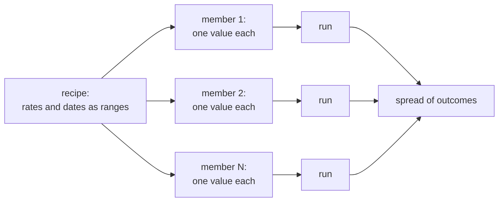
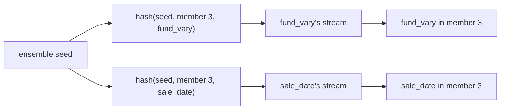

# How the simulator draws random futures

> To read a formatted `.md` file:
> - In Jupyter: right-click on it and select `Open With / Markdown Preview`
> - In VSCode: Command `Markdown Preview Enhanced: Open Preview` or ⌘⇧V

This is background for the ensemble features: what the randomness is, where
it comes from, and why it's arranged the way it is. It's written for someone
who knows deterministic simulation (stepping equations forward in time) but
hasn't worked with statistical, or Monte Carlo, simulation. The how-to is
in [Ensembles](ensembles.md).

## The statistics this relies on

If mean, median and standard deviation are familiar, this section covers
the rest of what the guides assume. Each linked word goes to its entry in
the [glossary](../user-guide.md#2-glossary), and each entry links to a
fuller but still gentle explanation.

**A distribution describes an uncertain quantity.** A
[distribution](../user-guide.md#g-distribution) says which values can happen and how likely
each is. Drawn as a curve, its [probability density](../user-guide.md#g-density) is high
where values are common and low where they're rare, and the chance of
landing between two values is the area under the curve between them. The
value has to land somewhere, so the total area is always exactly 1. That
one rule explains a lot: a distribution can't get wider without getting
lower, and making extremes likelier has to take probability away from the
middle.

**Percentiles measure position.** The [cumulative
probability](../user-guide.md#g-cdf) at a value is the area to its left: the chance of
landing at or below it. Run backwards, it gives the
[percentile](../user-guide.md#g-percentile), or quantile: the value with a given share of
outcomes below it. The median is the 50th percentile. Percentiles let the
simulator compare rows with completely different units: a
90th-percentile inflation rate and a 90th-percentile sale date are equally
surprising.

**The bell curve comes from adding up small effects.** Flip 100 coins and
count the heads. The count follows a [binomial
distribution](../user-guide.md#g-binomial): usually near 50, rarely below 40 or above 60.
Repeat that many times and plot the counts, and they pile up into a bell
shape. That shape is the [normal (Gaussian) distribution](../user-guide.md#g-normal), and
it turns up whenever many small independent effects add together (the
[central limit theorem](../user-guide.md#g-clt)), which is why it's everywhere. About 68%
of its values lie within 1 standard deviation of the center, 95% within 2
and 99.7% within 3. Its tails thin out very fast: a value beyond 4
standard deviations is about a 1-in-16,000 event. A position on the
standard normal, counted in standard deviations, is a [score](../user-guide.md#g-score):
0 is the median and +1.28 the 90th percentile.

**Heavy tails make extremes likelier.** Real surprises (a market crash, an
inflation spike) come more often than a normal curve allows. The
[Student-t distribution](../user-guide.md#g-student-t) is a bell curve with heavier
[tails](../user-guide.md#g-tails). One way to picture it: a normal whose spread is itself
uncertain, drawn wider in some cases and narrower in others. Its degrees of
freedom, ν, set how heavy the tails are: ν = 1 is very heavy, and by ν = 30
it's nearly normal.

**Correlation measures moving together.** A [correlation](../user-guide.md#g-correlation)
ρ runs from −1 (opposite) through 0 (no tendency) to 1 (lockstep). ρ² is
roughly the share of one quantity's variation that the other accounts for:
81% at ρ = 0.9, but only 25% at ρ = 0.5. A [rank
correlation](../user-guide.md#g-rank-correlation) looks only at the order of values, not
their size. [Kendall's τ](../user-guide.md#g-kendall-tau) is one: for every pair of
members, do both rows put the two in the same order? The simulator checks
the correlations it achieved this way, because the shape of each row's
range can't throw it off.

**Results from a limited sample wobble.** An ensemble of 100 members
estimates everything from 100 draws, and a different seed would give
slightly different numbers. That wobble is [sampling error](../user-guide.md#g-standard-error),
and its typical size, the standard error, shrinks with the square root of
the count: four times the members halves it. A 95% [confidence
interval](../user-guide.md#g-confidence-interval) is a range built so that, across many
batches, 95% of such ranges contain the true value.

## One scenario is deterministic; an ensemble is many of them

The engine steps a scenario forward one month at a time. Nothing in it is
random: the same inputs always give the same result, as a physics
integrator with fixed initial conditions does.

Uncertainty comes in only through the **inputs**. An ensemble marks some
inputs as uncertain (a rate somewhere from 2% to 4%, a sale date somewhere
in 2030) and builds many copies of the scenario, called **members**. Each
member draws one value for each uncertain input, and is then run forward as
an ordinary deterministic scenario. The answer is the spread of results
across members: median, percentile bands, how often the money runs out.

Weather forecasters do the same thing with an ensemble forecast: perturb
what isn't known, run each version forward, and read the spread.

## Random numbers come from a seed

Computers make random numbers with a **pseudo-random number generator**: a
deterministic algorithm that, started from a number called the **seed**,
produces a long sequence that behaves like random draws. The same seed
always gives the same sequence. That's what makes an ensemble
reproducible: `sim ensemble create` records a seed on the recipe, and
re-running it gives exactly the same members, value for value.

## Why every row gets its own stream

The obvious design is one generator for the whole ensemble, handing out
numbers to the uncertain rows in order. It has a serious flaw. Add one new
uncertain row near the top, and every row after it receives a different
number from the sequence, so every member's future changes, everywhere.
Compare the ensemble before and after the change, and the difference mixes
the change you made with a completely fresh set of random futures. In
physics terms, it's like comparing two runs that differ both in the
parameter you changed and in their random initial conditions: the
difference you see is mostly noise.

So the simulator gives each uncertain row its own **stream**: a separate
generator, seeded from a hash of three things, the ensemble's seed, the
member's number, and the row's name.

Consequences worth knowing:

- **Adding, removing or reordering a row doesn't disturb any other row's
  draws.** Each row's numbers depend only on the seed, the member and its
  own name.
- **Comparisons are fair.** A child scenario inherits its parent's seed, so
  member 3 of the child draws the same future as member 3 of the parent for
  every row they share. The difference between the two ensembles is the
  change you made, not fresh noise. Statisticians call this **common random
  numbers**; it lets a comparison show a real difference with far fewer
  members than independent runs would need.
- **Renaming a row gives it a new stream**, since the name is part of the
  key. Its draws change; nothing else's do.
- **Correlated rows keep this property.** In a correlation tree each row
  and factor draws its own noise from its own stream, and the tree combines
  them. A tree with tail dependence draws its shared turbulence scale from
  one more stream, keyed by the tree's root and kept separate from every
  row's own, so turning tail dependence on shifts no other draw.

## From a random number to a value

Each stream supplies a number `u` that is equally likely to be anywhere
between 0 and 1. A row's value is the point that fraction of the way
through its distribution: its **quantile** at `u` (also called its inverse
CDF). `u = 0.5` is the median, `u = 0.9` the 90th percentile. Every
distribution family works the same way, so a skewed rate and a date range
are drawn by the same rule.

Two kinds of member use no randomness at all:

- **Member 0** puts every row at `u = 0.5`, its median. Every ensemble
  therefore has one plausible base case.
- **A sensitivity run** moves one row (or one factor) to a chosen
  percentile and holds the rest at their medians, to see what that one
  input does.

## Tying rows together: copulas

Drawn independently, two rows' `u` values have nothing to do with each
other. Real uncertainties are often linked: inflation rates tend to run hot
together. A [**copula**](../user-guide.md#g-copula) is a way to link the `u` values of several rows
without changing any one row's own distribution. Each row still lands
anywhere in its own range as often as before; the copula only decides which
futures its highs and lows fall in, relative to the other rows.

The simulator builds its copulas from trees of correlated rows:

- The **Gaussian copula** (the default) links rows through correlated
  normal scores. Linked rows tend to move together, but extremes rarely
  coincide.
- The **Student-t copula** (opt-in, per tree) adds a turbulence scale that
  every row in the tree shares, so extremes tend to arrive together, as
  they do in a bad decade.

[Ensembles](ensembles.md) covers both: "Correlated parameters" and "Joint
extremes (tail dependence)".

## How many members?

More members narrow the uncertainty in the results themselves (the
[standard error](../user-guide.md#g-standard-error)), roughly as one over the square root of
the count. "How many members?" in
[Ensembles](ensembles.md) has the practical guidance.

## Learning more

- The [glossary](../user-guide.md#2-glossary) defines every word these
  guides use, each with a link to a fuller explanation.
- [A century of rates](century-of-rates.md) shows what a century of US
  inflation, interest rates and stock returns looks like, and which of them
  carry over from one year to the next.
- OpenStax's free [*Introductory
  Statistics*](https://openstax.org/books/introductory-statistics-2e/pages/1-introduction)
  is a complete first course, with worked examples.
- [Seeing Theory](https://seeing-theory.brown.edu/) shows the same ideas as
  interactive pictures.
- An AI assistant is a quick, patient way in. Say what you already know
  ("I've done physics simulation but not statistics") and ask it to explain
  a word, or paste a paragraph from these guides and ask what it means.
