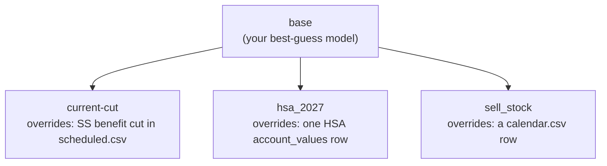
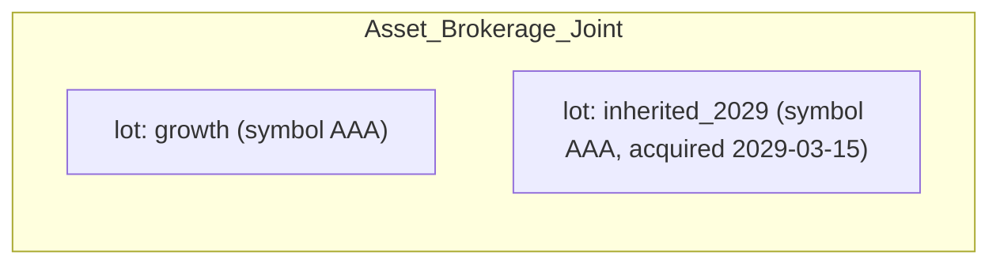
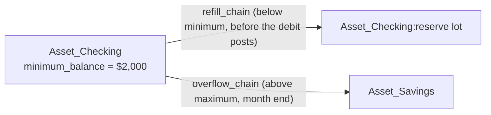

# User Guide: Building and Editing Scenarios

This is a practical, task-based walkthrough for editing your data repo: adding
accounts, changing numbers, modeling a sale, and reaching for the more powerful
tools (chains, calendar events) only when you actually need them. It assumes
you already have a data repo (see `templates/README.md` if you don't) and
answers "how do I actually do X," gradually, with real examples.

For *why* things are built this way, see the ADRs in `docs/architecture/`
(especially ADR-003 for the exact CSV column reference). This guide won't
repeat every column; it points at ADR-003 sections where you'll want the full
detail.

## 1. Hierarchical scenarios

A **scenario** is one full household model: accounts, balances, income,
expenses, and the rules that move money between them, from a start date to an
end date. You don't build every what-if from scratch. Instead, one scenario —
by convention named `base` — is your best-guess model of reality, and every
other scenario **derives** from it (or from another derived scenario) by
setting `parent_scenario` in its own `scenario.csv`.

A derived scenario only needs to state what's *different*. Its
`accounts.csv`/`account_values.csv`/`scheduled.csv`/`calendar.csv`/etc. rows
are **overlaid onto its parent's by key** (matching on name, or account+lot):
a row you add is added, a row with a key that already exists in the parent
replaces it, and anything you don't mention is inherited unchanged. Update
`base`, and every scenario that doesn't override the thing you changed picks
up the update automatically the next time it loads.



Each box above only contains what it *changes*; everything else is `base`'s,
read live, so a fix to `base` reaches every child the next time it loads.

Create a derived scenario with:

```sh
sim scenario create <name> <parent>
```

This scaffolds empty (header-only) `accounts.csv`, `account_values.csv`,
`scheduled.csv` and `calendar.csv` for the new scenario, verifies it loads, and
makes it your current scenario. You then edit only the rows that need to
differ — the rest of this guide is about what to put in them.

Everything below applies the same way whether you're editing `base` directly
or a derived scenario's own overlay files.

## 2. Glossary

Two lists: words this project uses in a specific, sometimes narrower sense,
and general finance/tax words the project relies on but doesn't redefine.
Where a project term could be confused with a general one, that's called out.

### Terms specific to this simulator

| Term | Meaning here |
| --- | --- |
| **Scenario** | One full household model: a folder under `scenarios/<name>/`. |
| **Derived scenario** | A scenario with `parent_scenario` set; inherits everything and overlays only what it changes (§1). |
| **Lot** | A position inside one account — a brokerage account can hold several (different funds, different purchase dates). Every account has at least one lot, named `default` unless you split it. See ADR-005. |
| **Chain** | A named, ordered list of places money comes from or goes to ("try this, then that"). Every account/lot has an automatic one-line **leaf chain**; you write a `chains/*.csv` file only for a real multi-step ordering. See §4.6. |
| **Series** | A named projection a scenario references by name: a growth/interest rate (`rate__*`), a security price history (`security_price__*`), or a state's tax brackets (`state_brackets__*`). Lives in `series/`, distinct from *asset class* below. |
| **`aux/`** | Shared tax-law facts (brackets, RMD tables, filing status) every scenario uses by default. |
| **`series/`** | Shared growth-rate/price assumptions every scenario uses by default (see *series* above) — separate from `aux/` because these are projections you're more likely to want to change per scenario. |
| **Itemization** | A CSV under `itemizations/<name>.csv` that sums a `Value` column into one dollar figure, referenced elsewhere as `@name` (e.g. `opening_cost_basis = @home_basis`). **Not the same as an *itemized deduction*** — see the general-terms table. |
| **`tax_character`** | The tax treatment tag on a money movement: `ordinary`, `ltcg`, `stcg`, `tax_free`, `tax_deferred_out`, `return_of_capital`, `none`, and a few more. Determines which bucket the retrospective tax scan counts it in. |
| **Asset class** | For the portfolio overview only (`sim allocation`): `stock_us`, `stock_intl`, `stock` (unknown split), `bond`, `cd`, `cash`, `real_estate`, `other`. Set per symbol in `allocations.csv`. Unrelated to `tax_character`. |
| **Calendar event** | One dated patch in `calendar.csv`: change a rate, change an amount, retire a rule, or fire a one-time transfer. See §4.8. |
| **Scheduled transaction / rule** | One row of `scheduled.csv`: a recurring (or one-off) rule that moves money on a cadence. |
| **Refill / overflow** | A lot's own policy: draw from `refill_chain` before a debit would drop it below `minimum_balance`; sweep excess above `maximum_balance` into `overflow_chain` at month end. Per lot since ADR-005 phase 7. |
| **RMD subject account** | The IRA/401(k) a Required Minimum Distribution is computed against; if it has several lots, `params_json` names it and `from_account` must be an explicit chain over just its lots. |

### General finance/tax terms this tool uses

| Term | What it means, and how this tool applies it |
| --- | --- |
| **Cost basis** | What you paid for an asset (plus improvements, for a home). The simulator tracks it per lot (`opening_cost_basis`) for taxable non-cash assets, and updates it as money moves in or out. |
| **Capital gain/loss** | Sale proceeds minus cost basis. **Long-term** (`ltcg`, held over a year) usually gets preferential rates; **short-term** (`stcg`, held a year or less) is taxed as ordinary income. See §3. |
| **RMD (Required Minimum Distribution)** | The IRS-mandated minimum withdrawal from a pre-tax retirement account each year past a certain age. A real tax concept; also a specific rule kind here (`rmd`). |
| **Traditional vs. Roth** | Traditional accounts defer tax to withdrawal (`tax_deferred_out`); Roth accounts are already-taxed and withdraw tax-free (`tax_free`). Set via `tax_treatment` on `accounts.csv`. |
| **Filing status** | `MFJ` (married filing jointly), `Single`, or `MFS` (married filing separately) — this project doesn't model Head of Household. Derived automatically from `lifespan.csv` after a primary person's death; see §4.7. |
| **Standard deduction** | The flat deduction the IRS lets you subtract before computing tax. This simulator **always uses it** — it does not model choosing to itemize deductions instead. |
| **Itemized deduction** | The IRS alternative to the standard deduction (mortgage interest, large medical expenses, etc.), chosen when it's bigger. **Not modeled**, and not the same thing as this tool's *itemization* files above, which are just a way to total up a dollar figure from several line items — the naming collision is unfortunate but predates this guide. |
| **Marginal tax bracket** | The rate on your *next* dollar of ordinary income, from `federal_brackets.csv`/`state_brackets__CA.csv`. |
| **Provisional income** | The IRS's combined-income measure that decides how much of Social Security is taxable (`ss_taxation_thresholds.csv`). |

## 3. How tax is handled

Tax is computed **retrospectively**, once per tax year, from the
`transfer_event` ledger — not by the rules themselves as they fire.

- **Ordinary income** buckets: salary, pension, interest, the taxable portion
  of Social Security, taxable Traditional-account withdrawals
  (`tax_deferred_out`), and short-term gains (`stcg`).
- **Long-term gains** (`ltcg`) are taxed at the rates in `aux/ltcg_brackets.csv`
  if that file exists (stacked on top of ordinary taxable income); without it,
  they're taxed as ordinary income too.
- **Filing status** comes from the `filing_status` aux table for the tax year,
  *except* that MFJ/MFS automatically becomes Single the year after a primary
  person's `lifespan.csv` `final_month` — you don't add a matching
  `filing_status.csv` row yourself; see §4.7.
- **Deductions**: always the standard deduction (`standard_deduction.csv`);
  itemizing isn't modeled (see the glossary above for why that word means two
  different things here).
- **State tax**: same shape as federal, from `state_brackets__CA.csv` (or your
  state's equivalent under `series/`).
- **RMDs**: computed from the subject account's lots' balances on the prior
  Dec 31, divided by the IRS factor for that age (`rmd_factors.csv`,
  `rmd_start_age.csv`).

**The one gotcha worth knowing before you model a sale (§4.5):** the automatic
cost-basis split (turning a withdrawal into `return_of_capital` +
`ltcg`/`stcg` legs) only happens when the withdrawal is drawn **through a
chain** — including a lot's own automatic one-line leaf chain used by a
refill/overflow policy, or a named chain you wrote. A plain account-to-account
transfer (a `scheduled.csv` row or a `one_off_transfer` calendar event naming
the account directly, not a chain) uses whatever `tax_character` you write on
that row, literally, with **no automatic split**. This only matters for
taxable non-cash lots (brokerage-type accounts); cash, tax-deferred, and
tax-free accounts already have a fixed, correct `tax_character` regardless.

## 4. Common tasks

### 4.1 Add a new account

```sh
sim account add "Asset_Savings_Emergency" asset cash --owner joint
```

This appends a row to `accounts.csv` (and, with `--opening-balance`, a
matching `account_values.csv` row). Run with no arguments and it prompts you
through the valid `kind`/`subkind`/`owner` choices. Follow up with
`sim account check` to catch anything referencing the new account that still
needs attention, and `sim account sync` to scaffold any missing
`account_values.csv` rows at a zero balance.

### 4.2 Add a new lot to a brokerage account

There's no dedicated command for this; edit `account_values.csv` directly.
Every account is a set of **lots** — positions that can differ in symbol,
purchase date, and cost basis. An account you haven't split has one lot named
`default`.



To add a lot, add a row:

```csv
account_name,lot,symbol,acquired,quantity,series,opening_balance,opening_cost_basis
Asset_Brokerage_Joint,inherited_2029,AAA,2029-03-15,500,,,50000.00
```

- **Investment accounts must always name their lot**, everywhere they're
  referenced — `chains/*.csv`, `scheduled.csv`'s `from_lot`/`to_lot`,
  `calendar.csv`'s `lot_1`/`lot_2`. A blank lot on one of these is a load
  error listing the account's actual lots.
- Leave `opening_balance` blank and give `symbol`+`quantity` to have it
  derived from a price (`sim prices fetch` populates `series/security_price__<SYMBOL>.csv`);
  `sim prices check` compares a stated balance against quantity × price.
- `sim account holdings <account>` shows every lot's balance, basis and
  unrealized gain, once you have a run.

### 4.3 Change an estimated expense for the whole simulation

If you're editing `base` (or don't need the old value anywhere), just change
the number on the existing `scheduled.csv` row — for instance its `amount`
column. Every scenario that doesn't override that row picks up the change
automatically.

If you're in a derived scenario and want the change *only there*, add a row
with the **same `name`** as the parent's; the overlay replaces the whole row
(matched by `name`), so you can copy the parent's row and change just the
`amount`.

### 4.4 Change an estimated expense starting at a later date

Don't add a second `scheduled.csv` row for this — use a `calendar.csv`
`set_amount` event instead, which changes the rule's amount from that date
forward without touching history:

```csv
date,kind,scheduled_name,amount
2032-01-31,set_amount,groceries_monthly,650.00
```

This is exactly the case the calendar layer is for: dated, one-time patches to
an otherwise-steady rule, so you don't have to reason about `start`/`end`
dates on a second competing row.

### 4.5 Selling an asset

Two real paths today, depending on what's being sold:

**Selling a home** (or anything using the `home_sale` rule kind): add a
one-off `scheduled.csv` row naming the account **directly**, not a chain. It
applies the IRC §121 exclusion automatically (from `home_sale_exclusion.csv`
or a `filing_status`-keyed cap you set in `params_json`) and splits the sale
into `return_of_capital` + `excluded_gain` + `ltcg` for you. Its `tax_character`
column must be `none` — the real split is computed by the rule, not read off
the row.

**Selling a brokerage lot** (or anything else non-cash and taxable): there's
no dedicated "sell" rule yet. Model it as a one-off transfer out of that lot,
**routed through a named chain that lists that lot**, even a one-line chain
file, rather than naming the account directly:

```csv
# chains/asset__sell_the_2029_lot.csv
account_name,lot
Asset_Brokerage_Joint,inherited_2029
```

```csv
# scheduled.csv — a one-off row, not a calendar.csv event (below)
name,from_account,from_lot,to_account,to_lot,cadence,amount_rule_kind,amount,tax_character,start,end,priority
sell_2029_lot,sell the 2029 lot,,Asset_Checking,,one_off,fixed_amount,75000.00,none,2030-06-30,2030-06-30,500
```

This has to be a `scheduled.csv` row rather than a `calendar.csv`
`one_off_transfer` event: today, only `scheduled.csv`'s `from_account`/
`to_account` can name a chain — a calendar event's `account_1`/`account_2`
must be a bare account. The chain's name (in `from_account`) is its filename's
`<name>` part with underscores read as spaces — `asset__sell_the_2029_lot.csv`
becomes `sell the 2029 lot` — the same rule `series`/`aux` filenames use
(underscores stay filename-safe while the name itself can have spaces). Leave
`from_lot` blank (naming a chain already says which lot) and set
`tax_character='none'` — the value is ignored once the draw is routed through
a chain, but the column is still required and checked against the registry,
so it can't be blank. Routing through the
chain, not the literal `tax_character`, is what makes the engine apply the
automatic return-of-capital/gain split (§3); naming the lot directly on a
plain transfer would instead use whatever `tax_character` you wrote, unsplit.

**Calendar's `sell_asset`/`buy_asset` event kinds are not implemented yet** —
the CSV format accepts them, but the engine silently skips a calendar event of
either kind. Don't use them; use the pattern above instead.

### 4.6 Chains as default policies

A chain is a named, reusable answer to "where does the money for this come
from" (or "where does excess money go"), so every rule that needs the same
waterfall doesn't have to repeat it. There are two places you'll use one:

1. **As a rule's source or destination** — a `scheduled.csv` row's
   `from_account`/`to_account` can name a chain instead of a bare account
   (§4.5). A `calendar.csv` event's `account_1`/`account_2` cannot — those
   must always be bare accounts.
2. **As a lot's own refill/overflow policy** — set on the lot's
   `account_values.csv` row, not authored as a separate rule:



A debit that would drop a lot below `minimum_balance` triggers a look-ahead
draw on `refill_chain` *before* the debit posts; excess above `maximum_balance`
sweeps into `overflow_chain` at month end. `refill_chain`/`overflow_chain` can
each name either a chain, or an account directly — in which case
`refill_lot`/`overflow_lot` says which of that account's lots, the same
account+lot pairing used everywhere else. Every account/lot already has an implicit
one-line "leaf chain" (itself), so you only need to write a
`chains/<kind>__<name>.csv` file when the ordering is genuinely multi-step —
"try savings first, then this brokerage lot, then that one" — with each step
taking a `percent` or `maximum` before falling through to the next.

### 4.7 Lifespan assumptions

`lifespan.csv` has one optional row per person: `person`, `final_month`. Past
that month, every `scheduled_transaction` tied to that person (its own
`person` column, or as the owner of `from_account`/`to_account`) stops firing
— salary, their share of expenses, and so on. Growth rules
(`percent_of_balance`) are exempt: a balance keeps earning/appreciating after
its owner's death.

Setting `final_month` is also **the only thing you need to do** to make
filing status transition correctly after a spouse's death — MFJ/MFS becomes
Single starting the following year automatically (§3). You don't need a
matching `filing_status.csv` entry.

### 4.8 Calendar for more complex changes

`calendar.csv` is the escape hatch for anything that isn't a steady recurring
rule: a dated, one-time patch. Four kinds are actually implemented today —
use only these:

| Kind | Columns used | Use it for |
| --- | --- | --- |
| `set_rate` | `series`, `amount` (micros) | "checking starts earning 4% in 2027" |
| `set_amount` | `scheduled_name`, `amount`, optional `param_date` | "spending drops to $4,500/mo on retirement" (§4.4) |
| `retire_scheduled` | `scheduled_name` | "salary stops on retirement" |
| `one_off_transfer` | `account_1`/`lot_1`, `account_2`/`lot_2`, `amount`, `tax_character` | a windfall, a gift, a settlement between two bare accounts (not a chain — see §4.5) |

**Not implemented yet, even though the CSV format accepts them** —
`add_scheduled`, `swap_aux_table`, `sell_asset`, `buy_asset`,
`life_transition`. A calendar row with one of these kinds loads without
error, but the engine silently skips it at run time (no error, no effect).
For what you'd reach for `add_scheduled` for — "this rule doesn't start until
a later date" — just add the row directly to `scheduled.csv` with the future
`start` date; no calendar event is needed for that at all.

## See also

- `templates/README.md` — full CSV column reference and conventions.
- `docs/architecture/ADR-003-registries-and-csv-schemas.md` — authoritative
  schema, including the aux/series/itemizations override mechanism (§4.1d)
  and the data-repo structure diagrams (§4.0).
- `docs/architecture/ADR-005-lots-and-per-lot-state.md` — lots in depth.
- `notebooks/README.md` — the same information as interactive widgets.
