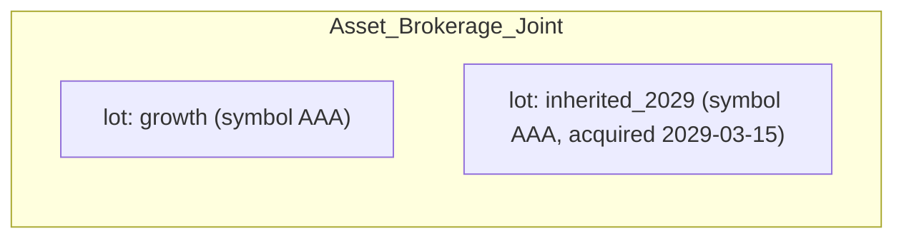
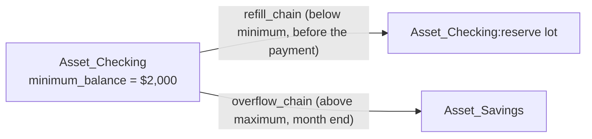

# User Guide: Building and Editing Scenarios

This guide shows how to make common changes to a scenario, step by step, with
real examples, and how to look at what a run produced. It assumes you already
have a data repo. If you don't, see [templates/README.md](../templates/README.md) first.

For the reasons behind these designs, see the documents in
`docs/architecture/`. [ADR-003](architecture/ADR-003-registries-and-csv-schemas.md) lists every CSV column in detail. This guide
does not repeat all of that; it points to [ADR-003](architecture/ADR-003-registries-and-csv-schemas.md) when you need the full list.

## 1. Scenarios build on each other

A **scenario** is one full model of your household finances. It has accounts,
balances, income, expenses, and rules that move money between accounts. It
runs from a start date to an end date.

You do not build every what-if scenario from scratch. One scenario is your
main model. By convention, it is named `base`. Every other scenario is
**derived** from `base`, or from another derived scenario. A scenario says
which one it derives from in its own `scenario.csv`, using the
`parent_scenario` column.

A derived scenario only needs to list what is different. Its CSV files
(`accounts.csv`, `account_values.csv`, `scheduled.csv`, `calendar.csv`, and
others) are combined with its parent's files. Each row has a key, such as a
name, or an account plus a lot. If you add a row with a new key, it is added.
If you add a row with a key that already exists in the parent, it replaces
the parent's row. Anything you do not mention stays the same as the parent's.
If you later change `base`, every scenario that does not override that part
picks up the change automatically, the next time it loads.


Each box above only shows what it changes. Everything else comes from `base`.
A fix to `base` reaches every scenario below it, the next time that scenario
loads.

Create a derived scenario with:

```sh
sim scenario create <name> <parent>
```

This creates the new scenario's folder, with empty CSV files ready for you to
add rows to. It checks that the scenario loads, and makes it your current
scenario. You then add only the rows that need to be different — the rest of
this guide shows what to put in them.

Add a `README.md` in the scenario's own folder to describe what it's for —
its title and first paragraph show up wherever a scenario's description
does (the scenario picker, `scenario_overview.ipynb`), and travel with every
run file, so "what was this scenario for again" is answered without going
back to the data repo. Without a `README.md`, `scenario.csv`'s own
`description` column is used instead.

Everything below works the same way, whether you are editing `base` directly,
or editing a derived scenario's own files.

## 2. Glossary

Two lists follow: words this project uses in its own specific way, and
general finance/tax words this project relies on but does not change the
meaning of. Where a project word could be confused with a general word, that
is pointed out.

### Words this simulator uses in its own way

| Word | What it means here |
| --- | --- |
| **Scenario** | One full model of your household finances. Stored as a folder under `scenarios/<name>/`. |
| **Derived scenario** | A scenario that has `parent_scenario` set. It starts from its parent and only lists what is different. See Part 1. |
| **Lot** | One holding inside an account. A brokerage account can have several lots: different funds, or shares bought on different dates. Every account has at least one lot. It is named `default` unless you split the account into more than one lot. |
| **Chain** | A named, ordered list of places money can come from, or go to. Think: try this place first, then that place. Every account (and every lot) already has its own one-step chain, automatically. You only write a `chains/*.csv` file when you want more than one step. See Part 4.6. |
| **Series** | A named set of numbers a scenario can refer to by name: a growth or interest rate (`rate__*`), or an inflation projection (`inflation__*`). These files live in that scenario's own `series/` folder. This is a different idea from *asset class*, below. |
| **`aux/`** | Shared tax-law facts every scenario uses unless it says otherwise: tax brackets, RMD tables, filing status. |
| **`series/`** | A scenario's own growth-rate and inflation assumptions. Unlike `aux/`, there is no shared copy at the top of the data repo — each scenario has its own, inherited from its parent the same way `accounts.csv` is. |
| **`prices/`** | Shared security price histories every scenario uses unless it says otherwise. |
| **Itemization** | A CSV file under `itemizations/<name>.csv`. It lists dollar amounts in a `Value` column, and the loader adds them up into one total. Other files can use that total by writing `@name` instead of a plain number (for example `opening_cost_basis = @home_basis`). **This is a different thing from an *itemized deduction*, a tax term — see the next table.** |
| **`tax_character`** | A label on a money movement that says how it is taxed: `ordinary`, `ltcg`, `stcg`, `tax_free`, `tax_deferred_out`, `return_of_capital`, `none`, and a few others. This label decides which tax bucket the movement is counted in. |
| **Asset class** | Used only for the portfolio overview (`sim allocation`): `stock_us`, `stock_intl`, `stock` (when the US/international split is not known), `bond`, `cd`, `cash`, `real_estate`, `other`. Set for each symbol in `allocations.csv`. Not related to `tax_character`. |
| **Calendar event** | One dated change in `calendar.csv`. It can change a rate, change an amount, end a rule, or make a one-time transfer. See Part 4.8. |
| **Scheduled transaction / rule** | One row in `scheduled.csv`. It is a rule that moves money, either on a regular schedule or just once. |
| **Refill / overflow** | A lot's own rule for keeping its balance in a range. If a payment would drop it below `minimum_balance`, money is drawn from `refill_chain` first. If it goes above `maximum_balance`, the extra is swept into `overflow_chain` at the end of the month. Each lot can have its own setting. |
| **RMD subject account** | The IRA or 401(k) account a Required Minimum Distribution is calculated from. If that account has more than one lot, you must name the account in `params_json`, and `from_account` must be a chain that lists only that account's lots. |

### General finance/tax words this tool uses

| Word | What it means, and how this tool uses it |
| --- | --- |
| **Cost basis** | What you originally paid for something (plus the cost of home improvements, for a house). The simulator tracks this per lot, in `opening_cost_basis`, for taxable assets other than cash. It updates this number as money moves in or out. |
| **Capital gain/loss** | The sale price minus the cost basis. **Long-term** gains (`ltcg`, held more than a year) usually get a lower tax rate. **Short-term** gains (`stcg`, held a year or less) are taxed as ordinary income. See Part 3. |
| **RMD (Required Minimum Distribution)** | The smallest amount the IRS requires you to withdraw each year from a pre-tax retirement account, once you reach a certain age. A real tax rule; also the name of a rule kind in this tool (`rmd`). |
| **Traditional vs. Roth** | A Traditional account delays tax until you withdraw money (`tax_deferred_out`). A Roth account is already taxed, so withdrawals come out tax-free (`tax_free`). Set with `tax_treatment` in `accounts.csv`. |
| **Filing status** | `MFJ` (married filing jointly), `Single`, or `MFS` (married filing separately). This tool does not model Head of Household. Filing status changes automatically after a spouse's death, based on `lifespan.csv`; see Part 4.7. |
| **Standard deduction** | A flat amount the IRS lets you subtract from income before tax is calculated. This simulator always uses the standard deduction; it does not yet model choosing to itemize deductions instead. |
| **Itemized deduction** | An IRS alternative to the standard deduction: instead of the flat amount, you add up specific expenses (mortgage interest, large medical bills, and so on) and use that total if it's bigger. See Part 4.9 for how to add one for a given year. This is a different idea from this tool's *itemization* files, above, which just add up a list of dollar amounts for any purpose — the similar name is confusing, but it predates this guide. |
| **Marginal tax bracket** | The tax rate on your *next* dollar of ordinary income. From `federal_brackets.csv` / `state_brackets__CA.csv`. |
| **Provisional income** | The IRS's combined-income number that decides how much of your Social Security is taxable. From `ss_taxation_thresholds.csv`. |

## 3. How tax is handled

Tax is not calculated as each rule fires. Instead, it is calculated once per
tax year, by looking back over everything that happened that year (the
`transfer_event` ledger).

- **Ordinary income** includes: salary, pension, interest, the taxable part of
  Social Security, taxable withdrawals from Traditional accounts
  (`tax_deferred_out`), and short-term gains (`stcg`).
- **Long-term gains** (`ltcg`) use the rates in `aux/ltcg_brackets.csv`, if
  that file exists. These rates apply on top of your ordinary taxable income.
  If the file does not exist, long-term gains are taxed the same as ordinary
  income.
- **Filing status** comes from the `filing_status` aux table for that tax
  year. One exception: MFJ or MFS automatically changes to Single, starting
  the year after a primary person's `final_month` in `lifespan.csv`. You do
  not need to add a matching row to `filing_status.csv` yourself; see Part 4.7.
- **Deductions**: the standard deduction, from `standard_deduction.csv`,
  unless you add itemized deductions for that year — see §4.9. The simulator
  then uses whichever is greater. (See the glossary above — *itemization* and
  *itemized deduction* mean two different things in this guide.)
- **State tax** works the same way as federal tax, using
  `state_brackets__CA.csv` (or your own state's file, in `aux/`).
- **RMDs** are calculated from the account's lot balances on the previous
  December 31, divided by the IRS factor for that age. The factor comes from
  `rmd_factors.csv` and `rmd_start_age.csv`.

**One important thing to know before you model a sale (Part 4.5):** the
simulator can automatically split a withdrawal into "return of capital" and
"gain" (`ltcg` or `stcg`). But it only does this when the withdrawal is drawn
**through a chain**. This includes a lot's own one-step chain, used by a
refill or overflow rule, or a chain file you write yourself. A plain transfer
straight from one account to another — a row in `scheduled.csv`, or a
`one_off_transfer` calendar event that names the account directly, not a
chain — uses whatever `tax_character` you write on that row, exactly as
written. It does not calculate the split for you. This only matters for
taxable, non-cash lots, such as a brokerage account. For cash accounts,
tax-deferred accounts, and tax-free accounts, the correct `tax_character` is
already fixed, so this does not matter.

## 4. Common tasks

### 4.1 Add a new account

```sh
sim account add "Asset_Savings_Emergency" asset cash --owner joint
```

This adds a row to `accounts.csv`. If you add `--opening-balance`, it also
adds a matching row to `account_values.csv`. If you run the command with no
arguments, it asks you questions and shows the valid choices for kind,
subkind, and owner. Afterward, run `sim account check` — it tells you about
anything that still needs your attention. Run `sim account sync` to add any
missing `account_values.csv` rows, with a balance of zero, ready for you to
fill in.

### 4.2 Add a new lot to a brokerage account

There is no command for this yet; edit `account_values.csv` directly. Every
account is really a set of **lots**. Lots can differ in symbol, purchase
date, and cost basis. An account you have not split has one lot, named
`default`.



To add a lot, add a row:

```csv
account_name,lot,symbol,acquired,quantity,series,opening_balance,opening_cost_basis
Asset_Brokerage_Joint,inherited_2029,AAA,2029-03-15,500,,,50000.00
```

- For an **investment account**, you must always name the lot, everywhere
  the account is used: in `chains/*.csv`, in `scheduled.csv`'s
  `from_lot`/`to_lot` columns, and in `calendar.csv`'s `lot_1`/`lot_2`
  columns. If you leave the lot blank, the scenario will fail to load, and
  the error message will list the account's real lots.
- You can leave `opening_balance` blank if you give `symbol` and `quantity`
  instead. The balance is then calculated from a price. Run
  `sim prices fetch` to get prices; it saves them to
  `prices/security_price__<SYMBOL>.csv`. Run `sim prices check` to compare a
  balance you typed in against quantity times price.
- Once you have a run, `sim account holdings <account>` shows every lot's
  balance, cost basis, and unrealized gain.

### 4.3 Change an estimated expense for the whole simulation

If you are editing `base`, or you do not need the old number anywhere else,
just change the number in the existing `scheduled.csv` row — for example, its
`amount` column. Every scenario that does not override that row picks up the
change automatically.

If you are in a derived scenario and want the change to apply only there, add
a row with the **same `name`** as the parent's row. The new row replaces the
whole parent row (rows are matched by `name`). The easiest way is to copy the
parent's row and change just the amount.

### 4.4 Change an estimated expense starting at a later date

Do not add a second row to `scheduled.csv` for this. Instead, add a
`set_amount` event to `calendar.csv`. It changes the rule's amount from that
date onward, without changing anything before that date:

```csv
date,kind,scheduled_name,amount
2032-01-31,set_amount,groceries_monthly,650.00
```

This is exactly what `calendar.csv` is for: a dated, one-time change to a
rule that is otherwise steady. You do not need to work out start and end
dates for a second, competing row.

### 4.5 Selling an asset

There are two real ways to do this today, depending on what you are selling.

**Selling a home** (or anything using the `home_sale` rule kind): add a
one-time row to `scheduled.csv`. Name the account directly; do not use a
chain. This automatically applies the IRS home-sale tax exclusion (from
`home_sale_exclusion.csv`, or a cap you set yourself in `params_json`, based
on filing status). It splits the sale into three parts for you:
`return_of_capital`, `excluded_gain`, and `ltcg`. Set the row's
`tax_character` column to `none` — the rule calculates the real split itself;
it does not read `tax_character` from the row.

**Selling a brokerage lot** (or anything else that is taxable and not cash):
there is no dedicated "sell" rule for this yet. Model it as a one-time
transfer out of that lot. Route the transfer through a named chain that
lists that lot — even a chain file with just one line — instead of naming
the account directly:

```csv
# chains/asset__sell_the_2029_lot.csv
account_name,lot
Asset_Brokerage_Joint,inherited_2029
```

```csv
# scheduled.csv — a one-off row, not a calendar.csv event (see below)
name,from_account,from_lot,to_account,to_lot,cadence,amount_rule_kind,amount,tax_character,start,end,priority
sell_2029_lot,sell the 2029 lot,,Asset_Checking,,one_off,fixed_amount,75000.00,none,2030-06-30,2030-06-30,500
```

This must be a row in `scheduled.csv`, not a `one_off_transfer` event in
`calendar.csv`. Today, only `scheduled.csv`'s `from_account`/`to_account`
columns can name a chain; a calendar event's `account_1`/`account_2` columns
must name a plain account. The chain's name, used in `from_account`, comes
from its filename: take the part after the double underscore, and change
every underscore to a space. So `asset__sell_the_2029_lot.csv` becomes the
name `sell the 2029 lot` — the same rule used for `series`/`aux` filenames
(underscores are needed in the filename, but the name itself can have
spaces). Leave `from_lot` blank — naming a chain already says which lot to
use. Set `tax_character` to `none`: this value is ignored once the money is
drawn through a chain, but the column must still have some value the loader
recognizes; it cannot be left empty. What actually triggers the automatic
return-of-capital/gain split (Part 3) is drawing the money through a chain,
not the `tax_character` value you write. Naming the lot directly, on a plain
transfer, would instead use whatever `tax_character` you wrote, with no
automatic split.

**The `sell_asset` and `buy_asset` event kinds in `calendar.csv` are not built
yet.** The file format will accept them, but the simulator quietly ignores a
calendar event of either kind: no error, no effect. Do not use them; use the
method above instead.

### 4.6 Chains as default policies

A chain is a named, reusable answer to the question "where does this money
come from" (or "where does extra money go"). This means a rule does not need
to repeat the same list of accounts every time. There are two places you will
use a chain:

1. **As the source or destination of a rule.** In `scheduled.csv`,
   `from_account`/`to_account` can name a chain instead of a plain account
   (Part 4.5). In `calendar.csv`, `account_1`/`account_2` cannot — they must
   always name a plain account.
2. **As a lot's own rule for refilling or overflowing.** This is set
   directly on the lot's row in `account_values.csv`, not as a separate rule:



If a payment would drop a lot below `minimum_balance`, the simulator draws
money from `refill_chain` first, before the payment happens. If a lot goes
above `maximum_balance`, the extra is swept into `overflow_chain` at the end
of the month. `refill_chain`/`overflow_chain` can each name a chain, or name
an account directly. If you name an account directly, use
`refill_lot`/`overflow_lot` to say which of that account's lots to use — the
same account-plus-lot pairing used everywhere else in this tool. Every
account and lot already has its own automatic one-step chain, so you only
need to write a `chains/<kind>__<name>.csv` file when you want more than one
step — for example, "try savings first, then this brokerage lot, then that
one" — with each step taking a `percent` or a `maximum` amount before
whatever is left moves on to the next step.

### 4.7 Lifespan assumptions

`lifespan.csv` has one optional row for each person: `person` and
`final_month`. After that month, every scheduled rule tied to that person
stops firing — this includes rules where the person is set directly, and
rules for accounts that person owns (salary, their share of expenses, and so
on). Growth rules (`percent_of_balance`) are an exception: a balance keeps
earning interest, or growing in value, after its owner dies.

Setting `final_month` is also all you need to do for filing status to change
correctly after a spouse's death: MFJ or MFS automatically becomes Single,
starting the following year (Part 3). You do not need to add a matching row
to `filing_status.csv`.

### 4.8 Calendar for more complex changes

`calendar.csv` is for anything that is not a steady, recurring rule: a
dated, one-time change. Only four kinds are actually built today. Use only
these:

| Kind | Columns used | Use it for |
| --- | --- | --- |
| `set_rate` | `series`, `amount` (micros) | "checking starts earning 4% in 2027" |
| `set_amount` | `scheduled_name`, `amount`, optional `param_date` | "spending drops to $4,500/mo on retirement" (Part 4.4) |
| `retire_scheduled` | `scheduled_name` | "salary stops on retirement" |
| `one_off_transfer` | `account_1`/`lot_1`, `account_2`/`lot_2`, `amount`, `tax_character` | a windfall, a gift, a settlement between two plain accounts (not a chain — see Part 4.5) |

**Not built yet, even though the file format accepts them:**
`add_scheduled`, `swap_aux_table`, `sell_asset`, `buy_asset`,
`life_transition`. A calendar row with one of these kinds will load without
an error, but the simulator quietly does nothing with it when it runs. If you
want a new rule to start on a future date — which is what `add_scheduled`
sounds like it is for — just add the row directly to `scheduled.csv` with
that future `start` date. You do not need a calendar event for this at all.

### 4.9 Modeling itemized deductions (for example, a big medical year)

By default, tax is calculated using the standard deduction — a flat amount
that depends only on filing status (Part 3). If a year has enough deductible
expenses (a large medical bill is the usual case), you can add a
`federal_deductions.csv` file to `aux/`. It has one dated row per year:

```csv
# aux/federal_deductions.csv
effective_date,amount
2029-01-31,42000.00
```

For that tax year, the simulator uses whichever is greater: this amount, or
the standard deduction. You do not need to compare them yourself. This file
is shared by every scenario by default; add your own copy under a scenario's
own `aux/` folder if only that scenario should have it (Part 2, `aux/`).

Instead of a plain number, `amount` can be `@name`, pointing at an
`itemizations/<name>.csv` file that lists the actual expenses and adds them
up for you:

```csv
# itemizations/medical_2029.csv
Item,Value
surgery,32000.00
prescriptions,3000.00
```

```csv
# aux/federal_deductions.csv
effective_date,amount
2029-01-31,@medical_2029
```

State tax uses the same idea, in `state_deductions.csv`. If you don't add
one, the state figure automatically uses whatever is in
`federal_deductions.csv` — most states don't need their own file.

This is a simple, whole-dollar comparison. It does not model anything more
detailed, such as medical expenses only counting above a share of your
income.

### 4.10 Running an ensemble (a range of outcomes, not one number)

Every scenario so far gives you one prediction. If you're not sure about a
rate, a date, or a one-off amount, an **ensemble** generates many variants
of a scenario — each with that value redrawn from a range you choose — and
shows you the *spread* of outcomes instead of a single number:

```sh
sim ensemble create inflation_1 base
sim calendar add set-rate 2027-01-31 mutual_fund_retirement 4.0 \
  --scenario inflation_1 --name fund_vary \
  --vary-target amount --vary-distribution truncated_normal \
  --vary-low 2.5 --vary-high 5.5
sim run inflation_1
```

See [docs/guides/ensembles.md](guides/ensembles.md) for the full
how-to, including how many members is reasonable for your case (it depends
mainly on how many things you're varying at once).

## 5. Looking at your results

A **run** is what happens when the simulator plays a scenario forward, month
by month, from its start date to its end date. The result is a single, dated
file under `state/runs/`. It holds every account balance, every money
movement, and every year's tax figures for the whole run. You can look at it
in a notebook, from the command line, or by asking an AI to read it for you.
Every notebook, and most commands (including the ones in the next table),
default to a scenario's latest run, so you rarely need to name the file
yourself. A few, like `sim explain` below, need the exact file — look in
`state/runs/` for the newest one with that scenario's name in it.

Run a scenario with:

```sh
sim run <scenario>
```

or run every scenario in the data repo at once with `sim all`. If you added
the VS Code tasks (see below), you don't need to type either command: use the
**Run All Scenarios** task.

### A quick first look

After a run, `sim explain <runfile>` prints a short summary: which scenario it
is, whether it finished successfully, and the balance of every account and
lot at the end of the run. This is the fastest way to check "did this do
roughly what I expected" before opening a notebook.

### The notebooks

Each notebook opens with a scenario picker, then shows one topic at a time.
None of them need you to write any code.

| Notebook | What it shows |
| --- | --- |
| `scenario_overview.ipynb` | The scenario's setup, without needing a run: people, accounts, chains, scheduled rules, calendar events. Good for checking a scenario is set up the way you intended, before running it. |
| `accounts.ipynb` | Balance history for any account over time, account setup details, the lots and holdings inside an account, which accounts hold a symbol, and the portfolio by asset class. |
| `net_worth.ipynb` | Net worth over time, income by category, expenses by category, realized vs. unrealized gains, and after-tax income. |
| `scenario_compare.ipynb` | Puts two or more scenarios side by side: what differs between them, net worth over time for each, and where they cross over (break-even). |
| `events.ipynb` | Every dollar movement in a run, filterable by reason (which rule fired, a refill/overflow, a catch-up fact), tax character, account, and date range — good for auditing "why did this happen." |
| `ensemble.ipynb` | For an ensemble recipe (Part 4.10): net worth's mean/median with the min–max range shaded behind it, plus a year-end mean/median/SD/range table. |

Open one with `analysis jupyter` (or the **Jupyter** VS Code task, below), or
in VS Code directly if it runs well enough there for your machine
([notebooks/README.md](../notebooks/README.md) has notes on this).

### The same views from the terminal

Several of the same views also work as a plain command, with no notebook or
kernel needed. This is the better choice over SSH, in a script, or on a
machine too small for a notebook comfortably.

| To see | Run |
| --- | --- |
| accounts and their opening balances | `sim account list` |
| the lots in one account | `sim account holdings <account>` |
| the accounts holding a symbol | `sim account holders <symbol>` |
| the portfolio by asset class | `sim allocation` |
| scheduled transactions | `sim scheduled list` |
| one-time transfers | `sim transfer list` |
| a run's year-end net worth, and its lots | `sim explain <runfile>` |

[notebooks/README.md](../notebooks/README.md) keeps the full, up-to-date list, including which
notebook views don't have a terminal command yet.

### VS Code tasks

If your workspace has these set up (Command Palette → "Tasks: Run Task"),
three common jobs are one click instead of a typed command:

- **Jupyter** — opens JupyterLab (same as `analysis jupyter`).
- **Fetch Prices** — runs `sim prices fetch` (Part 4.2).
- **Run All Scenarios** — runs every scenario in the data repo (`sim all`).

### Asking an AI about your results

A run file is a real database (SQLite), and you can ask an AI assistant to
read it for you in plain English — you do not need to know any SQL, or even
that SQL is what's happening underneath. This works the same way as
[docs/sqlite-guide.md](sqlite-guide.md) describes for the separate Amazon spending data.

Questions that work well are specific, and name what you're asking about:

- "In the `sell_stock` scenario's latest run, what was net worth at the end
  of each year?"
- "Show every lot in `Asset_Brokerage_Joint` and its balance at the end of
  the run."
- "Compare federal tax due for 2030 between the `base` and `current-cut`
  scenarios."
- "Why did `Asset_Checking` go negative in March 2031?"

Naming the scenario (and the run file, if you have more than one run for it)
helps the most. A vague question like "how's my retirement looking?" forces
the AI to guess what you mean; a specific one gets a specific, checkable
answer.

## See also

- [templates/README.md](../templates/README.md) — full CSV column reference and conventions.
- [`docs/architecture/ADR-003-registries-and-csv-schemas.md`](architecture/ADR-003-registries-and-csv-schemas.md) — authoritative
  schema, including the aux/prices/series/itemizations override mechanism (§4.1d)
  and the data-repo structure diagrams (§4.0).
- [`docs/architecture/ADR-005-lots-and-per-lot-state.md`](architecture/ADR-005-lots-and-per-lot-state.md) — lots in depth.
- [notebooks/README.md](../notebooks/README.md) — the same information as interactive widgets.
- [`docs/guides/ensembles.md`](guides/ensembles.md) — ranges of outcomes instead of one number (Part 4.10); [ADR-006](architecture/ADR-006-ensemble-scenarios.md) has the full design.
