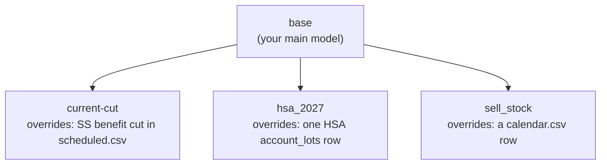
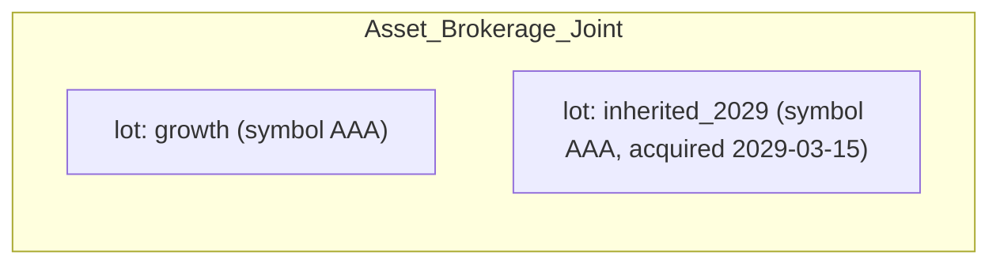
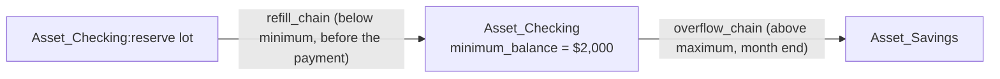

# User Guide: Building and Editing Scenarios

> To read a formatted `.md` file:
> - In Jupyter: right-click on it and select `Open With / Markdown Preview`
> - In VSCode: Command `Markdown Preview Enhanced: Open Preview` or ⌘⇧V

This guide shows how to make common changes to a scenario, step by step, with
real examples, and how to look at what a run produced. It assumes you already
have a data repo. If you don't, see [templates/README.md](../templates/README.md) first.

For the reasons behind these designs, see the documents in
`docs/architecture/`. [ADR-003](architecture/ADR-003-registries-and-csv-schemas.md) lists every CSV column in detail. This guide
does not repeat all of that; it points to [ADR-003](architecture/ADR-003-registries-and-csv-schemas.md) when you need the full list.

## 1. Scenarios build on each other

A **scenario** is one full model of your household finances. It has accounts,
balances, income, expenses, and rules that move money between accounts. It
runs from a start date to an end date.

You do not build every what-if scenario from scratch. One scenario is your
main model. By convention, it is named `base`. Every other scenario is
**derived** from `base`, or from another derived scenario. A scenario says
which one it derives from in its own `scenario.csv`, using the
`parent_scenario` column.

A derived scenario only needs to list what is different. Its CSV files
(`accounts.csv`, `account_lots.csv`, `scheduled.csv`, `calendar.csv`, and
others) are combined with its parent's files. Each row has a key, such as a
name, or an account plus a lot. If you add a row with a new key, it is added.
If you add a row with a key that already exists in the parent, it replaces
the parent's row. Anything you do not mention stays the same as the parent's.
If you later change `base`, every scenario that does not override that part
picks up the change automatically, the next time it loads.



Each box above only shows what it changes. Everything else comes from `base`.
A fix to `base` reaches every scenario below it, the next time that scenario
loads.

A scenario can also combine several others. List more than one parent in
`parent_scenario`, separated by colons: the main parent first, then
**mix-ins**, such as `base:current-cut:hsa_2027`. The main parent is loaded in full.
Each mix-in then adds its own changes on top, stopping at the first scenario
already included (here, `base`), so a mix-in derived from `base` contributes
just what it changes. When two mix-ins change the same row, the later one
wins. Making the combination sensible is up to you.

Create a derived scenario with:

```sh
sim scenario create <name> <parent> [<mixin> ...]
```

This creates the new scenario's folder, with empty CSV files ready for you to
add rows to, and a `series/` folder (with a short `README.md`) for any growth
or inflation series it changes. It checks that the scenario loads, and makes it your current
scenario. You then add only the rows that need to be different — the rest of
this guide shows what to put in them. The parent and mix-ins may be `t_`
template scenarios too. Leave the parent off and the command asks for what
the scenario builds on, one name at a time with tab completion: the parent,
then any mix-ins, until you press Enter on a blank line.

A scenario meant only for mixing into others needs no parent:

```sh
sim scenario create <name> --no-parent
```

Answering the parent question with a blank line does the same, once you
confirm it. Such a **mix-in only** scenario has no start or end of its own,
since a mix-in's dates would replace those of the scenario it's mixed into,
so it can't run by itself: `sim run` refuses it, `sim all` skips it, and
`sim scenario list --verbose` shows `(mix-in only)` for its parents.
`sim check` still checks it, on top of the empty `t_empty` template. Give
it a start and end (`sim scenario edit`) and it's an ordinary scenario that
runs alone.

You can also start from what the scenario inherits: `sim account edit`,
`sim account lot edit`, `sim scheduled edit`, `sim calendar edit` and
`sim ytd edit` (and `sim calendar tag add|rm`) on an inherited item write the edited row into
the derived scenario as an override, and leave the parent alone. A derived
scenario can't remove what it inherits, so `sim account delete`,
`sim calendar delete` and `sim person lifespan clear` refuse an inherited
account, row or lifespan (delete it in the scenario that defines it). `sim scheduled delete` on an inherited rule ends
it instead, with an override whose end is the month before the scenario
starts, and `sim ytd delete` on an inherited row sets its amount to zero
with an override. Deleting the derived scenario's override brings back the inherited
row. Renames always reach every scenario sharing the name.

A scenario made this way is never an ensemble, even when its parent is
one: it runs once, with each varying row at its central value. Use
`sim ensemble create` (§4.10) for an ensemble.

`sim scenario create` writes a `README.md` in the scenario's own folder;
edit it to say what the scenario is for. Its title and first paragraph show up wherever a scenario's description
does (the scenario picker, `scenario_overview.ipynb`), and travel with every
run file, so "what was this scenario for again" is answered without going
back to the data repo. Without a `README.md`, `scenario.csv`'s own
`description` column is used instead.

To see which scenarios the data repo has:

```sh
sim scenario list            # names only, one per line, for scripts
sim scenario list --verbose  # a table with each one's parents, dates, seed, size and description
sim ensemble list            # just the ensembles (also takes --verbose)
sim scenario list --all      # also the t_ template scenarios (ensemble list takes --all too)
```

The verbose table marks your current scenario with `*`, and shows each
scenario's start and end months, seed and ensemble size, in `[brackets]`
when the scenario inherits the value rather than setting it itself. A blank
size means the scenario is not an ensemble.

Your current scenario is the one `sim` commands work on when you don't name
one. Naming a scenario on any command that lets you leave it out (as an
argument or `--scenario`) makes it current, and the command says so
(`Current scenario is now <name> (was <old>)`), as `sim scenario create` and
`sim ensemble create` do for the new scenario. When you leave it out, the command
first prints `Using scenario <name>`; with no current scenario (a fresh data
repo, or after deleting it) the command asks you to name one.
To look at a scenario without making it current (in a script, or for an AI
assistant answering questions for you), set `ANALYSIS_KEEP_SCENARIO=1`:
commands then use the scenario they name and leave your current one as it is.
`sim switch` prints your current scenario, and `sim switch <name>` makes
`<name>` current, printing the one it replaces. The shell
prompt that `activate-analysis` sets shows it, as
`[analysis:<data repo>:<you>:<scenario>]`.

To rename a scenario (or an ensemble; the two commands are the same):

```sh
sim scenario rename <old> <new>
```

This moves its folder and repoints everything that names it: the scenarios
built on it (as parent or mix-in), your current scenario, and links to it
in the data repo's `README.md` files. Runs you already made keep the old
name.

To try an alternative next to a scenario rather than on top of it, copy it
(`sim ensemble copy` is the same, but offers only ensembles):

```sh
sim scenario copy <old> <new>
sim scenario edit <new> --parents base:high_inflation   # say, a different parent
```

The copy gets every file in the old scenario's folder, so it has the same
parents and rows, and the two change independently from then on. Only the
copy's own name changes: its `scenario.csv` name and `created_by`, its
`README.md` title, and its links to itself. A copied ensemble keeps the
seed and size, so it pairs with the original member by member. The old
scenario may be a `t_` template. Runs aren't copied, and the copy becomes
your current scenario.

To change a scenario's own settings (`sim ensemble edit` is the same
command), run `sim scenario edit <name>` with no options: it shows the
fields, and you name one to change it, with tab completion, then write.
Changing `parents` asks for each in turn, offering the current one: press
Enter to keep it, type `-` to remove it, `+<name>` to insert `<name>` before
it, or another name to replace it; then add mix-ins at the end until you
press Enter on a blank line. Removing them all asks you to confirm that the
scenario builds on nothing. Options make the change at once instead (tab
completes each name in `--parents`):

```sh
sim scenario edit <name> --description "Bill works two more years"
sim scenario edit <name> --description ''           # back to "Derived from <parents>"
sim scenario edit <name> --start 2027-01 --end ''   # '' inherits the value again
sim scenario edit <name> --parents base:high_inflation
sim scenario edit <name> --size 200 --new-seed --reserve 250000
```

The change is written only if the scenario, and every scenario built on
it, still loads. If its `README.md` is still the one `scenario create`
wrote, its first paragraph follows a new description and parents;
otherwise you're reminded to update it yourself. A scenario made before
`scenario create` wrote a `README.md` gets one the first time you edit it.

To delete a scenario (or `sim ensemble delete`):

```sh
sim scenario delete <name>   # asks first; --yes doesn't
```

It refuses while another scenario builds on it, as its parent or a mix-in,
and names them. If it was your current scenario, none is current
afterwards. Runs you already made of it are kept, and any markdown file
that still mentions it is listed.

A scenario that only exists to be built on, such as a mix-in or an
abstract base, can be disabled (or `sim ensemble disable`):

```sh
sim scenario disable <name>   # sim scenario enable <name> undoes it
```

`sim all` and the background builder then skip it, and the notebooks'
pickers leave it out. It still works as a parent or mix-in, and
`sim run <name>` still builds it. The command writes a `.disable` file in
the scenario's folder; commit it like any other change. It isn't
inherited, and it isn't part of any scenario's data, so disabling a base
doesn't make the scenarios built on it rebuild. `sim scenario list -v`
shows `no` under build for a disabled scenario.

Renaming anything else a scenario can share works the same way: the
`rename` commands for accounts, chains, scheduled rules, calendar rows,
series and lots change the name in every scenario that shares it, not just
the one you name, so a scenario built on another never ends up naming
something that is no longer there:

```sh
sim account rename <old> <new>
sim account lot rename <account> <old> <new>
sim chain rename <old> <new>
sim scheduled rename <old> <new>
sim calendar rename <old> <new>      # a row's name, and rows correlated with it
sim series rename <old> <new>        # its series/ files too
```

Everything below works the same way, whether you are editing `base` directly,
or editing a derived scenario's own files.

## 2. Glossary

This is the place to look up any word the guides use. The lists cover the
words this project uses in its own specific way, the simulation and
statistics words the ensemble features rely on, and the general finance/tax
words this project relies on but does not change the meaning of. Where a
project word could be confused with a general word, that is pointed out.

### Words this simulator uses in its own way

| Word | What it means here |
| --- | --- |
| **Scenario** | One full model of your household finances. Stored as a folder under `scenarios/<name>/`. |
| **Derived scenario** | A scenario that has `parent_scenario` set. It starts from its parent (and any mix-ins) and only lists what is different. See Part 1. |
| **Lot** | One holding inside an account. A brokerage account can have several lots: different funds, or shares bought on different dates. Every account has at least one lot. It is named `default` unless you split the account into more than one lot. |
| **Chain** | A named, ordered list of places money can come from, or go to. Think: try this place first, then that place. Every account (and every lot) already has its own one-step chain, automatically. You only write a chain file, `chains/source/<name>.csv` or `chains/destination/<name>.csv`, when you want more than one step. See Part 4.6 and [the chains guide](guides/chains.md). |
| **Series** | A named set of numbers a scenario can refer to by name: a growth or interest rate (`rate__*`), or an inflation projection (`inflation__*`). These files live in that scenario's own `series/` folder. This is a different idea from *asset class*, below. |
| **`aux/`** | Shared tax-law facts every scenario uses unless it says otherwise: tax brackets, RMD tables, filing status. |
| **`series/`** | A scenario's own growth-rate and inflation assumptions. Unlike `aux/`, there is no shared copy at the top of the data repo — each scenario has its own, inherited from its parent the same way `accounts.csv` is. |
| **`prices/`** | Shared security price histories every scenario uses unless it says otherwise. |
| **Itemization** | A CSV file under `itemizations/<name>.csv`. It lists dollar amounts in a `Value` column, and the loader adds them up into one total. Other files can use that total by writing `@name` instead of a plain number (for example `opening_cost_basis = @home_basis`). **This is a different thing from an *itemized deduction*, a tax term — see the next table.** |
| **`tax_character`** | A label on a money movement that says how it is taxed: `ordinary`, `ltcg`, `stcg`, `tax_free`, `tax_deferred_out`, `return_of_capital`, `none`, and a few others. This label decides which tax bucket the movement is counted in. |
| **Asset class** | Used only for the portfolio overview (`sim allocation`): `stock_us`, `stock_intl`, `stock` (when the US/international split is not known), `bond`, `cd`, `cash`, `real_estate`, `other`. Set for each symbol in `allocations.csv`. Not related to `tax_character`. |
| **Calendar event** | One dated change in `calendar.csv`. It can change a rate, change an amount, end a rule, or make a one-time transfer. See Part 4.8. |
| **Scheduled transaction / rule** | One row in `scheduled.csv`. It is a rule that moves money, either on a regular schedule or just once. |
| **Debit / credit** | The two sides of one money movement. A **debit** takes money out of a lot: a payment, a withdrawal, or the "from" side of any transfer. A **credit** puts money into a lot: the "to" side. For an asset lot, a debit lowers the balance and a credit raises it. For a liability (a loan or a card), a debit is borrowing more, so what you owe goes up, and a credit is paying it down. The refill check runs before each debit, which is why the chain flowcharts label refill "before a debit". These are everyday banking senses, not the bookkeeping ones, where debiting an asset account *raises* it. |
| **Refill / overflow** | A lot's own rule for keeping its balance in a range. If a payment would drop it below `minimum_balance`, money is drawn from `refill_chain` first. If it goes above `maximum_balance`, the extra is swept into `overflow_chain` at the end of the month. Each lot can have its own setting. |
| **Guard rail** | A line a scenario's spending, or its withdrawals from the portfolio, should stay on one side of, such as the 4% rule. A row of `guard_rails.csv`; reports show how far inside or past it each year was, and over the years. It doesn't change the run. See Part 4.15 and [the guard rails guide](guides/guard-rails.md). |
| **RMD subject account** | The IRA or 401(k) account a Required Minimum Distribution is calculated from. If that account has more than one lot, you must name the account in `params_json`, and `from_account` must be a chain that lists only that account's lots. |

### Simulation words used by ensembles

These come up in [Ensembles](guides/ensembles.md); [How the simulator draws
random futures](guides/simulation-basics.md) explains them from the
beginning.

| Word | What it means here | Learn more |
| --- | --- | --- |
| <a id="g-monte-carlo"></a>**Monte Carlo** | Answering a question about uncertainty by drawing many random cases, working each one out, and looking at the spread of results. Named after the casino. | [Wikipedia](https://en.wikipedia.org/wiki/Monte_Carlo_method) |
| <a id="g-ensemble"></a>**Ensemble** | Many copies (**members**) of one scenario, each with its uncertain inputs drawn differently, run to show the spread of outcomes. The scenario that defines the ranges is the **recipe**. | [Ensembles](guides/ensembles.md) |
| <a id="g-member-0"></a>**Member 0** | The member with every uncertain input at its median: the ensemble's one deterministic base case. | [Ensembles](guides/ensembles.md#member-0-is-always-a-deterministic-base-case) |
| <a id="g-sensitivity-run"></a>**Sensitivity run** | A batch that moves one uncertain row (or factor) at a time to chosen percentiles while every other row stays at its median, to see what that one input does. | [Ensembles](guides/ensembles.md#which-varying-rows-matter-and-when-sensitivity) |
| <a id="g-prng"></a>**Pseudo-random number generator** | A deterministic algorithm whose output behaves like random draws. Started from the same seed, it produces the same sequence every time. | [Wikipedia](https://en.wikipedia.org/wiki/Pseudorandom_number_generator) |
| <a id="g-seed"></a>**Seed** | The number a recipe's random draws all start from. The same seed reproduces the same members exactly. | [Random numbers come from a seed](guides/simulation-basics.md#random-numbers-come-from-a-seed) |
| <a id="g-rng-stream"></a>**RNG stream** | The separate random-number sequence each uncertain row gets, keyed by the seed, the member and the row's name. Adding or changing one row never shifts another row's draws, so comparisons between scenarios show the change, not fresh noise. | [Why every row gets its own stream](guides/simulation-basics.md#why-every-row-gets-its-own-stream) |
| <a id="g-common-random-numbers"></a>**Common random numbers** | Giving two scenarios being compared the same random draws, so the difference between them is the change you made rather than luck. Streams and a shared seed provide it. | [Why every row gets its own stream](guides/simulation-basics.md#why-every-row-gets-its-own-stream) |
| <a id="g-date-marker"></a>**Date marker** | A named date (`crash_start`) that other rows' dates are written relative to, as `crash_start+2y`. Varying the marker moves the whole event together. | [Ensembles](guides/ensembles.md#events-with-an-uncertain-start-date-markers) |
| <a id="g-latent-factor"></a>**Latent factor** | A named shared influence ("core inflation") that rows correlate with, but that isn't itself a value in the model. It has no units: in each future it says only how high or low things run, as a percentile. | [Ensembles](guides/ensembles.md#correlated-parameters) |
| <a id="g-correlation-tree"></a>**Correlation tree** | Rows and factors linked by `vary_correlate_with`, each with one parent and a correlation ρ to it. The top of a tree is its **root**. | [Ensembles](guides/ensembles.md#correlated-parameters) |
| <a id="g-copula"></a>**Copula** | The rule that ties correlated rows' random draws together without changing any one row's own range or shape. The default **Gaussian copula** makes linked rows move together; the **Student-t copula** also makes their extremes coincide. | [A visual introduction](https://twiecki.io/blog/2018/05/03/copulas/) |
| <a id="g-tail-dependence"></a>**Tail dependence (ν)** | How strongly extremes coincide in a tree using the Student-t copula. Set as `vary_tail_dependence` on the tree's root; lower ν means stronger. | [Ensembles](guides/ensembles.md#joint-extremes-tail-dependence) |

### Statistics words used by ensembles

Mean, median and standard deviation are here too, for completeness. Most
entries link to a section of one of OpenStax's free online statistics
textbooks, which explain each idea with worked examples; [*Introductory
Statistics*](https://openstax.org/books/introductory-statistics-2e/pages/1-introduction)
is the place to start.
Asking an AI assistant is another quick way in: "explain Kendall's tau to
someone new to statistics" works well, and pasting the paragraph where you
met a word gets an answer about how it's used here.

| Word | What it means here | Learn more |
| --- | --- | --- |
| <a id="g-distribution"></a>**Distribution** | The full description of an uncertain quantity: which values can happen, and how likely each is. Every varying row has one, chosen with `vary_distribution`. | [OpenStax ch. 5](https://openstax.org/books/introductory-statistics-2e/pages/5-introduction) |
| <a id="g-density"></a>**Probability density** | The curve drawn over a distribution's range: high where values are common, low where they're rare. The chance of landing between two values is the area under the curve between them, so the total area is always exactly 1 (something has to happen). A wider curve must therefore be a lower one. | [OpenStax §5.1](https://openstax.org/books/introductory-business-statistics-2e/pages/5-1-properties-of-continuous-probability-density-functions) |
| <a id="g-cdf"></a>**Cumulative probability (CDF)** | For a value x, the chance of landing at or below x: the area under the density to the left of x. It climbs from 0 at the bottom of the range to 1 at the top. | [OpenStax §5.1](https://openstax.org/books/introductory-business-statistics-2e/pages/5-1-properties-of-continuous-probability-density-functions) |
| <a id="g-percentile"></a>**Percentile, quantile** | The value with a given share of outcomes below it: 90% of outcomes fall below the 90th percentile. A quantile is the same thing written as a fraction (0.9). Finding a quantile is the CDF run backwards, and it's how the simulator turns a random fraction into a value. | [OpenStax §2.3](https://openstax.org/books/introductory-statistics-2e/pages/2-3-measures-of-the-location-of-the-data) |
| <a id="g-median"></a>**Median** | The 50th percentile: half the outcomes fall below it and half above. | [OpenStax §2.3](https://openstax.org/books/introductory-statistics-2e/pages/2-3-measures-of-the-location-of-the-data) |
| <a id="g-mean"></a>**Mean** | The average. For a lopsided (skewed) distribution it sits away from the median, toward the long tail. | [OpenStax ch. 2](https://openstax.org/books/introductory-statistics-2e/pages/2-introduction) |
| <a id="g-sd"></a>**Standard deviation (SD), variance** | The typical distance of values from their mean. Variance is the SD squared; the variances of independent pieces add up, which is why shares of variation are written as squares (ρ², R²). | [OpenStax §2.7](https://openstax.org/books/statistics/pages/2-7-measures-of-the-spread-of-the-data) |
| <a id="g-uniform"></a>**Uniform distribution** | Every value in a range equally likely: a flat density. The raw random fraction each stream supplies is uniform between 0 and 1. | [OpenStax ch. 5](https://openstax.org/books/introductory-statistics-2e/pages/5-introduction) |
| <a id="g-triangular"></a>**Triangular distribution** | A density shaped like a triangle: zero at the low and high ends, peaking at the most likely value (the **mode**). | [Ensembles](guides/ensembles.md#setting-one-up) |
| <a id="g-binomial"></a>**Binomial distribution** | The number of successes in a fixed number of independent yes-or-no tries, such as heads in 100 coin flips. | [OpenStax §4.2](https://openstax.org/books/introductory-business-statistics-2e/pages/4-2-binomial-distribution) |
| <a id="g-normal"></a>**Normal (Gaussian) distribution** | The bell curve. It appears whenever many small independent effects add up: count the heads in 100 coin flips, repeat many times, and the counts pile into a bell shape (a [Galton board](https://en.wikipedia.org/wiki/Galton_board) shows this with falling beads). About 68% of values lie within 1 SD of the center, 95% within 2 and 99.7% within 3. Its tails thin out very fast: beyond 4 SD is about 1 in 16,000. | [OpenStax ch. 6](https://openstax.org/books/introductory-statistics-2e/pages/6-introduction), [binomial to normal](https://openstax.org/books/introductory-business-statistics-2e/pages/6-3-estimating-the-binomial-with-the-normal-distribution) |
| <a id="g-clt"></a>**Central limit theorem** | Sums and averages of many independent pieces come out close to normal, whatever shape the pieces have. It's why the bell curve is everywhere. | [OpenStax ch. 7](https://openstax.org/books/introductory-statistics-2e/pages/7-introduction) |
| <a id="g-truncated-normal"></a>**Truncated normal** | A normal cut off at a low and a high bound, with the curve raised so its area is still 1. | [Ensembles](guides/ensembles.md#setting-one-up) |
| <a id="g-score"></a>**Score (z)** | A position measured in standard deviations of the standard normal: z = 0 is the median, z = +1.28 the 90th percentile. The simulator links rows by working on their scores, then turns each score back into a value from that row's own range. | [OpenStax ch. 6](https://openstax.org/books/introductory-statistics-2e/pages/6-introduction) |
| <a id="g-skew"></a>**Skew** | Lopsidedness: one tail longer than the other. Positive skew means a longer high tail. | [Ensembles](guides/ensembles.md#setting-one-up) |
| <a id="g-tails"></a>**Tails, heavy tails** | A distribution's far ends, where the extremes live. A heavy-tailed distribution makes extremes more likely than a normal does. | [Ensembles](guides/ensembles.md#setting-one-up) |
| <a id="g-student-t"></a>**Student-t distribution, degrees of freedom (ν)** | A bell curve with heavier tails: what you get from a normal whose spread is itself uncertain, scaled up or down at random. ν sets how heavy the tails are: ν = 1 very heavy, ν = 5 noticeably heavier than normal, above about 30 nearly normal. (Textbooks meet it for small samples; the simulator uses the same curve for joint extremes.) | [OpenStax §8.2](https://openstax.org/books/introductory-statistics-2e/pages/8-2-a-single-population-mean-using-the-student-t-distribution) |
| <a id="g-correlation"></a>**Correlation (ρ)** | A number from −1 to 1 for how strongly two quantities move together: 1 in lockstep, 0 no tendency, −1 opposite. ρ² is roughly the share of one's variation the other accounts for. | [OpenStax §13.1](https://openstax.org/books/introductory-business-statistics-2e/pages/13-1-the-correlation-coefficient-r) |
| <a id="g-persistence"></a>**Persistence, autocorrelation** | The correlation between a quantity and its own value some time later, usually the next year. Near 1, this year's value carries over (interest rates); near 0, each year is a fresh draw (stock returns). | [A century of rates](guides/century-of-rates.md#how-much-does-this-year-predict-next-year) |
| <a id="g-mean-reversion"></a>**Mean reversion** | A tendency for an unusually high or low value to be followed by one closer to the long-run average. An inflation spike is usually followed by a smaller one, then by ordinary years. | [A century of rates](guides/century-of-rates.md#how-much-does-this-year-predict-next-year) |
| <a id="g-shock"></a>**Shock, shock SD** | The part of one year's value that the past doesn't predict: the surprise. A process row (`vary_process ar1`) builds its yearly path from the level, the share of last year's gap from it that carries over (persistence), and a new random shock each year. The shock SD (`vary_shock_sd`, and Shock SD in `analysis historical`) is the typical size of one year's shock, in growth terms, as a percent. It is smaller than the single-year SD whenever persistence carries part of the spread from year to year. Rows under one factor get correlated shocks each year; in a tree with tail dependence a whole year's shocks can be extreme together. Also called an innovation. | [A rate that moves every year](guides/historical-calibration.md#a-rate-that-moves-every-year) |
| <a id="g-rank-correlation"></a>**Rank correlation** | Correlation computed on the values' order rather than the values themselves, so it's unchanged by stretching or reshaping either quantity's range. | [Kendall's τ](https://www.socscistatistics.com/tutorials/kendall-tau/) |
| <a id="g-kendall-tau"></a>**Kendall's τ** | A rank correlation. Take every pair of members: the pair agrees if both rows put the two members in the same order, and disagrees otherwise. τ is the share that agree minus the share that disagree. For the simulator's copulas τ = (2/π)·asin(ρ), so the correlation check reads ρ back from τ. | [Tutorial](https://www.socscistatistics.com/tutorials/kendall-tau/) |
| <a id="g-r2"></a>**R²** | The share of the outcome's variation that a regression on the inputs explains, from 0 to 1. | [OpenStax §12.3](https://openstax.org/books/introductory-statistics-2e/pages/12-3-the-regression-equation) |
| <a id="g-srrc"></a>**SRRC, PRCC** | Two measures of one input's effect on an outcome with the other inputs held fixed, both on ranks. SRRC (standardized rank regression coefficient) is the input's regression weight; PRCC (partial rank correlation) is its correlation with the outcome after removing what the other inputs explain. | [Ensembles](guides/ensembles.md#which-varying-rows-can-i-drop-monte-carlo-correlation) |
| <a id="g-standard-error"></a>**Sampling error, standard error** | A result computed from a limited number of members wobbles from batch to batch. The standard error is the typical size of that wobble. It shrinks with the square root of the count: four times the members halves it. | [OpenStax ch. 7](https://openstax.org/books/introductory-statistics-2e/pages/7-introduction) |
| <a id="g-confidence-interval"></a>**Confidence interval** | A range around a result, built so that across many batches, 95% of such ranges (for a 95% interval) contain the true value. | [OpenStax ch. 8](https://openstax.org/books/introductory-business-statistics-2e/pages/8-introduction) |

### General finance/tax words this tool uses

| Word | What it means, and how this tool uses it |
| --- | --- |
| **Cost basis** | What you originally paid for something (plus the cost of home improvements, for a house). The simulator tracks this per lot, in `opening_cost_basis`, for taxable assets other than cash. It updates this number as money moves in or out. |
| **Capital gain/loss** | The sale price minus the cost basis. **Long-term** gains (`ltcg`, held more than a year) usually get a lower tax rate. **Short-term** gains (`stcg`, held a year or less) are taxed as ordinary income. See Part 3. |
| **RMD (Required Minimum Distribution)** | The smallest amount the IRS requires you to withdraw each year from a pre-tax retirement account, once you reach a certain age. A real tax rule; also the name of a rule kind in this tool (`rmd`). |
| **Traditional vs. Roth** | Traditional money delays tax until you withdraw it (`tax_deferred_out`). Roth money is already taxed, so withdrawals come out tax-free (`tax_free`). An IRA or 401k is an account of subkind `retirement`, and each of its lots says which it is, with `subkind` in `account_lots.csv` (`traditional_ira`, `roth_ira`, `traditional_401k`, `roth_401k`). Traditional money moved into a Roth lot is a conversion, taxed as ordinary income; moved into another traditional lot it is an untaxed rollover. |
| **Roth five-year rule** | Roth earnings come out tax-free only once you are 59½ and five tax years have passed since January 1 of the year of your first Roth contribution or conversion. Until then the simulator taxes the earnings as ordinary income (`roth_nonqualified`), and a chain skips a Roth step that would pay them unless it is the chain's last. Contributions and conversions (the lot's `opening_cost_basis`) always come out tax-free. Give each conversion its own Roth lot with its `acquired` date. After a death, a surviving spouse who takes the decedent's Roth IRA as their own (`"roth_survivor": "own"` in `scenario.csv` `meta_json`, the default) gets the earlier of the two clocks for all their Roth IRAs, and the 59½ test becomes the survivor's. With `"beneficiary"`, with no surviving spouse, or for a Roth 401k, the decedent's account keeps its own clock and has no age test. |
| **Filing status** | `MFJ` (married filing jointly), `Single`, or `MFS` (married filing separately). This tool does not model Head of Household. Filing status changes automatically after a spouse's death, based on `lifespan.csv`; see Part 4.7. |
| **Standard deduction** | A flat amount the IRS lets you subtract from income before tax is calculated. This simulator always uses the standard deduction; it does not yet model choosing to itemize deductions instead. |
| **Itemized deduction** | An IRS alternative to the standard deduction: instead of the flat amount, you add up specific expenses (mortgage interest, large medical bills, and so on) and use that total if it's bigger. See Part 4.9 for how to add one for a given year. This is a different idea from this tool's *itemization* files, above, which just add up a list of dollar amounts for any purpose — the similar name is confusing, but it predates this guide. |
| **Marginal tax bracket** | The tax rate on your *next* dollar of ordinary income. From `federal_brackets.csv` / `state_brackets__CA.csv`. |
| **Provisional income** | The IRS's combined-income number that decides how much of your Social Security is taxable. From `ss_taxation_thresholds.csv`. |

## 3. How tax is handled

Tax is not calculated as each rule fires. Instead, it is calculated once per
tax year, by looking back over everything that happened that year (the
`transfer_event` ledger).

- **Ordinary income** includes: salary, pension, interest, the taxable part of
  Social Security, taxable withdrawals from Traditional accounts
  (`tax_deferred_out`), and short-term gains (`stcg`).
- **Long-term gains** (`ltcg`) use the rates in `aux/ltcg_brackets.csv`, if
  that file exists. These rates apply on top of your ordinary taxable income.
  If the file does not exist, long-term gains are taxed the same as ordinary
  income.
- **Filing status** comes from the `filing_status` aux table for that tax
  year: your data repo's `aux/filing_status.csv`, one row per date such as
  `2026-01-31,MFJ`. The templates leave it empty, and a scenario that
  computes tax fails to load without a row. One exception: MFJ or MFS automatically changes to Single, starting
  the year after a primary person's final month in `lifespan.csv`. You do
  not need to add a matching row to `filing_status.csv` yourself; see Part 4.7.
- **Deductions**: the standard deduction, from `standard_deduction.csv`,
  unless you add itemized deductions for that year — see §4.9. The simulator
  then uses whichever is greater. (See the glossary above — *itemization* and
  *itemized deduction* mean two different things in this guide.)
- **State tax** works the same way as federal tax, using
  `state_brackets__CA.csv` (or your own state's file, in `aux/`) and the
  state's standard deduction from `state_standard_deduction__CA.csv` (named
  for the same state as the brackets). Without
  that file the federal standard deduction is used, and loading warns,
  since most states' deduction is much smaller. State taxable income
  leaves out Social Security, and long-term gains are taxed as ordinary
  income.
- **MAGI**, for Medicare's income surcharge (Part 4.14), is the federal AGI
  each year.
- **RMDs** are calculated from the account's lot balances on the previous
  December 31, divided by the IRS factor for that age. The factor comes from
  `rmd_factors.csv` and `rmd_start_age.csv`.

**One important thing to know before you model a sale (Part 4.5):** the
simulator can automatically split a withdrawal into "return of capital" and
"gain" (`ltcg` or `stcg`). But it only does this when the withdrawal is drawn
**through a chain**. This includes a lot's own one-step chain, used by a
refill or overflow rule, or a chain file you write yourself. A plain transfer
straight from one account to another — a row in `scheduled.csv`, or a
`one_off_transfer` calendar event that names the account directly, not a
chain — uses whatever `tax_character` you write on that row, exactly as
written. It does not calculate the split for you. This only matters for
taxable, non-cash lots, such as a brokerage account. For cash accounts,
tax-deferred accounts, and tax-free accounts, the correct `tax_character` is
already fixed, so this does not matter.

## 4. Common tasks

### 4.1 Add a new account

```sh
sim account add "Asset_Savings_Emergency" asset cash --owner joint
```

This adds a row to `accounts.csv`. If you add `--opening-balance`, it also
adds a matching row to `account_lots.csv`. If you run the command with no
arguments, it asks you questions and shows the valid choices for kind,
subkind, and owner. With `--series` (a growth rate) but no `--tax-character`,
it asks how the growth is taxed, offering the usual one for the subkind
(`ordinary` interest for cash). Afterward, run `sim account check` — it tells you about
anything that still needs your attention. Run `sim account sync` to add any
missing `account_lots.csv` rows, with a balance of zero, ready for you to
fill in with `sim account lot edit` (Part 4.2).

### 4.2 Add, change or delete a lot

Every account is really a set of **lots**. Lots can differ in symbol, purchase
date, and cost basis. An account you have not split has one lot, named
`default`.



Each lot is one row of `account_lots.csv`. The `sim account lot` commands
add, change, delete and list them, so you don't have to edit that file by
hand (though you still can):

```sh
sim account lot list Asset_Brokerage_Joint
sim account lot add Asset_Brokerage_Joint inherited_2029 \
    --symbol AAA --acquired 2029-03-15 --quantity 500 --opening-cost-basis 50000
sim account lot edit Asset_Brokerage_Joint inherited_2029 --opening-cost-basis 52000
sim account lot delete Asset_Brokerage_Joint inherited_2029
```

Given a price for `AAA` (see below; otherwise add `--opening-balance`), the
`add` above writes this row:

```csv
account_name,lot,subkind,symbol,acquired,quantity,series,opening_balance,opening_cost_basis
Asset_Brokerage_Joint,inherited_2029,,AAA,2029-03-15,500,,,50000.00
```

- Run `add` or `edit` without the account and lot to be asked instead. `add`
  asks only what applies to the account: a lot `--subkind` (Roth or
  traditional, IRA or 401k) only for a `retirement` account, a cost basis
  only for a taxable account, and the refill and overflow settings (Part 4.6) only if you want
  them. `edit` lists the lots to pick from, then shows the lot's fields; name
  one to change it, and `write` when you are done. `add` prints the
  equivalent command, to reuse in a script.
- A lot that grows (it has a `--series`, or its symbol has a rate series or
  weights) in an account with no `tax_character` yet is the account's first
  lot to grow, so it sets the account's tax character too: asked, with the
  usual one for the account's subkind offered, or `--tax-character`. Given
  options without it, the usual one is used, and the command says so.
- Renaming a lot (`edit --new-lot`, or its `lot` field) also renames it
  everywhere the scenario, and any scenario built on it, names it. `edit`
  won't rename a lot the scenario inherits; `sim account lot rename`
  renames one wherever it is defined. Deleting
  one lists the rows that move money in or out of it, and removes them if you
  say yes. If the lot is a chain's only step, change or delete the chain
  first.
- In a scenario that builds on another (Part 1), `edit` on an inherited lot
  writes a copy of the whole lot, changed, into this scenario, and leaves
  the parent alone. A scenario can't remove a row it inherits, so `delete`
  on an inherited lot sets it to zero here instead. These commands treat
  that zeroed lot as deleted: `list` says so, and `add` can bring the lot
  back. `list` also says which lots are inherited and which this scenario
  changed.

- For an **investment account**, you must always name the lot, everywhere
  the account is used: in the chain files, in `scheduled.csv`'s
  `from_lot`/`to_lot` columns, and in `calendar.csv`'s `lot_1`/`lot_2`
  columns. If you leave the lot blank, the scenario will fail to load, and
  the error message will list the account's real lots.
- You can leave `opening_balance` blank if you give `symbol` and `quantity`
  instead. The balance is then calculated from a price. Run
  `sim prices fetch` to get prices; it saves them to
  `prices/security_price__<SYMBOL>.csv`, and `sim prices show` lists what
  it saved. Run `sim prices check` to compare a
  balance you typed in against quantity times price. Part 4.11 covers
  adding a symbol the data repo doesn't have yet.
- Once you have a run, `sim account holdings <account>` shows every lot's
  balance, cost basis, and unrealized gain.

### 4.3 Change an estimated expense for the whole simulation

If you are editing `base`, or you do not need the old number anywhere else,
just change the number in the existing `scheduled.csv` row — for example, its
`amount` column. Every scenario that does not override that row picks up the
change automatically.

If you are in a derived scenario and want the change to apply only there, add
a row with the **same `name`** as the parent's row. The new row replaces the
whole parent row (rows are matched by `name`). The easiest way is
`sim scheduled edit`, which writes that row for you:

```sh
sim scheduled edit groceries_monthly --amount 650.00   # change one field
sim scheduled edit groceries_monthly                   # or pick fields to change
```

`sim scheduled add --kind <kind>` adds a rule of any kind (a Social Security
benefit, an RMD, a mortgage, ...), asking for what that kind needs, and
`sim scheduled delete` removes one.

### 4.4 Change an estimated expense starting at a later date

Do not add a second row to `scheduled.csv` for this. Instead, add a
`set_amount` event to `calendar.csv`. It changes the rule's amount from that
date onward, without changing anything before that date:

```csv
date,kind,scheduled_name,amount
2032-01-31,set_amount,groceries_monthly,650.00
```

This is exactly what `calendar.csv` is for: a dated, one-time change to a
rule that is otherwise steady. You do not need to work out start and end
dates for a second, competing row.

### 4.5 Selling an asset

There are two real ways to do this today, depending on what you are selling.

**Selling a home**: move the home's whole balance, on the sale date, into
a destination chain whose steps say how each part of the price is taxed.
The first step recovers the home's cost basis, the second takes the IRS
home-sale exclusion, and the third takes the taxable gain. A step only needs
a `tax_character` where the character changes:

```csv
# chains/destination/home_sale.csv
account_name,maximum,tax_character,basis_of
sale_proceeds,,home_sale,Asset_Home
sale_proceeds,500000.00,excluded_gain,
sale_proceeds,,ltcg,
```

```csv
# chains/destination/sale_proceeds.csv: pay off the mortgage, then checking
account_name
Liability_Mortgage
Asset_Checking
```

```csv
# calendar.csv
date,kind,account_1,account_2,description
2030-06-30,transfer_balance,Asset_Home,home_sale,sell the home
```

The basis step (`basis_of` the home, `tax_character` `home_sale`) takes as
much of the price as the home's basis, which needs an `opening_cost_basis` in
`account_lots.csv`. Leave its `maximum` and `percent` blank. The exclusion
is the `excluded_gain` step's `maximum`: $500,000 married filing jointly,
$250,000 single, if you meet the IRS ownership and use tests. A mortgage
step takes only what is still owed. If the home sells for less than its
basis, the loss isn't deductible, and nothing more happens. With
`sim chain add` and `sim chain step add`, the columns are `--tax-character`
and `--basis-of`.

The same shape sells an investment through a destination chain: give the
basis step `tax_character` `return_of_capital` and `basis_of` the lot. A sale
below its basis then records a capital loss. The yearly tax calculation nets
it against that year's gains, deducts up to $3,000 from ordinary income
(`aux/capital_loss_limit.csv`), and carries the rest into later years.

A remodel adds to the home's basis: pay it through a destination chain whose
step has `tax_character` `capital_improvement` and `basis_of` the home.

**Selling a brokerage lot** (or anything else that is taxable and not cash):
there is no dedicated "sell" rule for this yet. Model it as a one-time
transfer out of that lot. Route the transfer through a named chain that
lists that lot — even a chain file with just one line — instead of naming
the account directly:

```csv
# chains/source/sell_the_2029_lot.csv
account_name,lot
Asset_Brokerage_Joint,inherited_2029
```

```csv
# scheduled.csv — a one-off row (a calendar.csv one_off_transfer works too)
name,from_account,from_lot,to_account,to_lot,cadence,amount_rule_kind,amount,tax_character,start,end,priority
sell_2029_lot,sell_the_2029_lot,,Asset_Checking,,one_off,fixed_amount,75000.00,none,2030-06-30,2030-06-30,500
```

A `one_off_transfer` event in `calendar.csv` can do the same: its
`account_1`/`account_2` columns may name a chain just as `scheduled.csv`'s
`from_account`/`to_account` can. The chain's name, used in `from_account`, is
its filename without `.csv`, exactly as written: so
`chains/source/sell_the_2029_lot.csv` is the chain `sell_the_2029_lot`. It is
in `source/` because money is drawn from it. A chain name has no spaces. Leave `from_lot` blank — naming a chain already says which lot to
use. Set `tax_character` to `none`: this value is ignored once the money is
drawn through a chain, but the column must still have some value the loader
recognizes; it cannot be left empty. What actually triggers the automatic
return-of-capital/gain split (Part 3) is drawing the money through a chain,
not the `tax_character` value you write. Naming the lot directly, on a plain
transfer, would instead use whatever `tax_character` you wrote, with no
automatic split.

### 4.6 Chains as default policies

A chain is a named, reusable answer to the question "where does this money
come from" (or "where does extra money go"). This means a rule does not need
to repeat the same list of accounts every time. There are two places you will
use a chain:

1. **As the source or destination of a rule.** In `scheduled.csv`,
   `from_account`/`to_account` can name a chain instead of a plain account
   (Part 4.5), and so can a calendar transfer's `account_1`/`account_2`,
   except a `transfer_balance`'s source. A transfer names a chain on one
   side at most.
2. **As a lot's own rule for refilling or overflowing.** This is set
   directly on the lot's row in `account_lots.csv` (with
   `sim account lot edit`, or by hand), not as a separate rule:



If a payment would drop a lot below `minimum_balance`, the simulator draws
money from `refill_chain` first, before the payment happens. If a lot goes
above `maximum_balance`, the extra is swept into `overflow_chain` at the end
of the month. `refill_chain`/`overflow_chain` can each name a chain, or name
an account directly. If you name an account directly, use
`refill_lot`/`overflow_lot` to say which of that account's lots to use — the
same account-plus-lot pairing used everywhere else in this tool. Every
account and lot already has its own automatic one-step chain, so you only
need to write a chain file when you want more than one step — for example,
"try savings first, then this brokerage lot, then that one" — with each step taking a `percent` or a `maximum` amount before
whatever is left moves on to the next step.

A chain drawn from (a `from_account`, a `refill_chain`) goes in
`chains/source/<name>.csv`; a chain paid into (a `to_account`, an
`overflow_chain`) goes in `chains/destination/<name>.csv`.

`sim chain list` shows the scenario's chains and what uses each one, and
`sim chain show` draws them as trees; `--graph` draws one chain's flowchart in
the terminal, and `--mermaid` prints the flowchart's Mermaid source for a
README. To show the chart in place, `--graph` needs a terminal that shows
images; iTerm2, kitty, Ghostty, WezTerm or VS Code's integrated terminal are
recommended. Anywhere else it writes the chart to a PNG and prints its path
([Setup](SETUP.md#drawing-chain-flowcharts-in-the-terminal) says why and how).
`sim chain add` with no arguments builds a chain by asking what it is for;
`sim chain step add|edit|move|rm`, `rename` and `delete` change one.
[The chains guide](guides/chains.md) explains how steps, percents and
maximums, chains inside chains, and the refill and overflow limits work
together, with worked examples and recipes.

### 4.7 Lifespan assumptions

`lifespan.csv` has one optional row for each person: `person` and
`age_at_death`, a decimal age in years such as `84.5`. The person's final
month is their birth month plus that many months (`84` is the month of the
84th birthday). After that month, every scheduled rule whose `person`
column names them stops firing: their Social Security, RMDs, salary, their
share of expenses, and so on. Who owns an account doesn't matter, so a
survivor keeps paying from, and into, the decedent's accounts. Give a rule a
`person` (`sim scheduled add --person`, on any kind of rule) when it should
end at that death. Growth rules (`percent_of_balance`) never stop: a balance
keeps earning interest, or growing in value, after its owner dies.

Setting `age_at_death` is also all you need to do for filing status to change
correctly after a spouse's death: MFJ or MFS automatically becomes Single,
starting the following year (Part 3). You do not need to add a matching row
to `filing_status.csv`.

In an ensemble the age can vary from member to member. Give
`vary_distribution` (`uniform` or `triangular`) and the lowest and highest
age, `vary_low` and `vary_high`; a triangular peaks at `vary_mode`, or at
`age_at_death` when that's blank. Alice, most likely 84, no earlier than 75,
possibly as late as 95:

```csv
person,age_at_death,vary_distribution,vary_low,vary_high,vary_mode,vary_correlate_with,vary_correlation
alice,84,triangular,75,95,,,
bill,86,triangular,78,97,,lifespan:alice,0.5
```

Each member draws an age (in whole months), and everything that depends on
death follows it. The base case, member 0, dies at `age_at_death` exactly.
`vary_correlate_with` and `vary_correlation` tie one person's draw to
another's (`lifespan:<person>`), as in `calendar.csv`; here Bill's age moves
partly with Alice's. `vary_low` can't fall before the scenario starts.

#### Drawing the age from a life table

A triangular range assumes little, but real mortality has a particular
shape. Deaths are spread over many years before the median and bunched
into fewer years after it. `vary_distribution` `life_table` gives that shape. The
age comes from a period life table, by default SSA's (`aux/life_table.csv`),
for someone of the person's sex who is alive when the scenario starts.
`age_at_death` is the median you believe, and the base case:

```csv
person,age_at_death,vary_distribution,vary_low,vary_high,vary_mode,vary_correlate_with,vary_correlation
alice,80,life_table,,,,,
```

A median below the table's means worse health than average, and one above it
means better. The table is read as if Alice were a few years older or
younger (an age set-forward or set-back), however much puts its median at 80.
The table supplies the spread. `vary_low`, `vary_high` and `vary_mode` stay
blank. The person needs a `sex` (`f` or `m`) in `persons.csv`, which `sim
person edit <id> --sex f` sets.

A lifespan can read another country's table: `lifespan.csv`'s optional
`life_table` column names an aux `life_table__<name>.csv`, and blank reads
`life_table.csv`. The templates ship `jp`, Japan's 2023 table, which `sim
person lifespan set <id> 90 --vary life_table --life-table jp` picks. It is
per scenario, like the age, so one scenario (or a mix-in) can try another
table and another median, to compare. `scripts/blend_life_tables.py` builds
a table between two, such as one for someone who has lived in both
countries. Use a country's own table rather than a later
`age_at_death` on the US one. The set-forward moves the table's median but
keeps its spread, and the US tail is fatter: for a woman alive at 60, with
the median put at Japan's (about 90), the shifted US table gives about a
12% chance of reaching 100 and 2.5% of reaching 105, while Japan's own
gives 6.5% and 0.5%.

`sim person lifespan set alice 80 --vary life_table` prints what the median
means: how many years older or younger the table is read, the mortality
multiplier that would give the same median (an insurer's "table rating",
e.g. about 200% of the table's death rates), and the ages at the 10th, 25th,
50th, 75th and 90th percentiles. For a man 70 at the start with a median of
80, the 2023 table gives about 72 at the 10th percentile and 88 at the 90th.

`sim person show [person]` shows the whole distribution for each person with
a sex: the ages at death by percentile and, every five years, the chance of
having died by then. Each is centered on the scenario's age at death: the
table read older or younger so its median is that age, as a `life_table`
lifespan's ensemble draws it, and for a fixed age the same shift, to show
what the age implies; the plain table's median is shown beside it. To see
the plain table itself, set the age at death to that median. With
no person it ends with the household: the year the last of them dies, by
percentile, taking the lifespans as independent, since a plan has to last
until then. `--graph` (or `--graph-file lifespans.png`) draws each person's
chance of dying at each age and of having died by it, shaded like the
ensemble fan chart, and the chance that someone in the household is still
alive each year. In a terminal that reports its size, `--graph` fills its
width and height, less three lines for the prompt. `notebooks/lifespan.ipynb`
shows the same chart, shrunk to fit the window.

There's deliberately no separate multiplier to set. With the median held
fixed, multiplying the death rates changes the spread by a year or two at
most, because the table's shape dominates. To weigh a different median,
compare scenarios, or run a sensitivity sweep, which moves the age to the
percentiles you ask for.

#### When to correlate a lifespan

Correlating a lifespan with something else is worth it when the two really
share a cause. The values below are illustrative, not measured; pick your
own.

- **Spouses.** Couples' ages at death are modestly correlated: they share
  habits, income and surroundings, and the survivor's risk rises after one
  dies. What matters financially is the gap between the deaths, which sets
  how long the survivor lives on one Social Security check and files as
  single. Independent draws make long, lopsided gaps a little too common.
  Bill's row above might use `vary_correlate_with` `lifespan:alice` and
  `vary_correlation` `0.3`.
- **Health costs.** Poor health means both an earlier death and higher medical
  or long-term-care costs before it. Give a varying `set_amount` row for those
  costs `vary_correlate_with` `lifespan:alice` and a negative
  `vary_correlation` such as `-0.5`, so the costly members tend to be the
  ones who die sooner. Independent draws would mix up "expensive years, then
  an early death" with "cheap years, then a long life".

Markets and inflation have no real link to a lifespan, so leave those
uncorrelated.

`sim person lifespan set <person> <age>` writes a person's row into the
scenario's own `lifespan.csv`; `--vary`, `--low`, `--high`, `--mode`,
`--correlate-with` and `--correlation` set how it varies (`--vary none`
drops it; `--vary life_table` takes no bounds), and with no age and no options it asks for each field. `sim
person lifespan clear <person>` removes the row. `sim person list` shows
each person's age at death, final month, how it varies, and which scenario
sets it.

The people themselves are in `persons.csv`, at the top of the data repo:
`id`, `display` name, `birthdate`, an optional `sex` (`f` or `m`, needed only
for a life-table lifespan) and an optional `role` (`primary` for a
spouse whose death changes the filing status). `sim person add <id>` and
`sim person edit <id>` change it, asking for any field you don't give as an
option. The file is shared, so a change there reaches every scenario, and is
written only if every scenario still loads.

### 4.8 Calendar for more complex changes

`calendar.csv` is for anything that is not a steady, recurring rule: a
dated, one-time change. These are the kinds (plus `latent_factor`, which is
only for ensembles, Part 4.10):

| Kind | Columns used | Use it for |
| --- | --- | --- |
| `set_rate` | `series`, `amount` (a percent with its sign, e.g. `4%`) | "checking starts earning 4% in 2027" |
| `set_amount` | `scheduled_name`, `amount` (dollars), optional `param_date` | "spending drops to $4,500/mo on retirement" (Part 4.4) |
| `retire_scheduled` | `scheduled_name` | "salary stops on retirement" |
| `one_off_transfer` | `account_1`/`lot_1`, `account_2`/`lot_2`, `amount`, `tax_character` | a windfall, a gift, a settlement; either side may be a chain (Part 4.5) |
| `transfer_balance` | `account_1`/`lot_1`, `account_2`/`lot_2`, `tax_character`; `amount` left blank | rolling a 401(k) into an IRA: moves everything the lot holds at the start of that month |
| `swap_aux_table` | `series` (the table replaced; blank for one without a series), `params_json` naming the kind and the replacement | moving to another state: from that month, the state tax brackets are another state's |

Leave `tax_character` blank on a `one_off_transfer` or `transfer_balance` out
of a brokerage lot and the move is a sale: the lot's share of basis comes out
as `return_of_capital`, the rest as a capital gain, and the lot's basis drops.
Out of a traditional IRA or 401k lot, a blank is taxed as ordinary income
(`tax_deferred_out`) wherever the money lands, a Roth lot included (a
conversion), except in another traditional lot, which is an untaxed rollover.
Into a chain, each step's money is decided this way. From other accounts a
blank means `none`. Set `tax_character` to override any of these.

A rule that should start on a future date needs no calendar event: give its
`scheduled.csv` row that `start` date.

For a move, put the new state's brackets beside the old ones, as
`aux/state_brackets__WA.csv` say, and swap them in on the moving date:

```csv
date,kind,series,params_json
2031-07,swap_aux_table,CA,"{""aux_kind"": ""state_brackets"", ""source_series"": ""WA""}"
```

From July 2031 on, everything that read the `CA` brackets reads the `WA`
ones instead, including their later dated changes. With two states'
brackets in `aux/`, the state `tax_accumulator` rule must say which it reads:
`"bracket_series": "CA"` in its `params_json`. Do the same for
`state_deductions` if you use it. Any aux table works the same way: a new
federal bracket table on the date a law takes effect, or another inflation
series.

### 4.9 Modeling itemized deductions (for example, a big medical year)

By default, tax is calculated using the standard deduction — a flat amount
that depends only on filing status (Part 3). If a year has enough deductible
expenses (a large medical bill is the usual case), you can add a
`federal_deductions.csv` file to `aux/`. It has one dated row per year:

```csv
# aux/federal_deductions.csv
effective_date,amount
2029-01-31,42000.00
```

For that tax year, the simulator uses whichever is greater: this amount, or
the standard deduction. You do not need to compare them yourself. This file
is shared by every scenario by default; add your own copy under a scenario's
own `aux/` folder if only that scenario should have it (Part 2, `aux/`).

Instead of a plain number, `amount` can be `@name`, pointing at an
`itemizations/<name>.csv` file that lists the actual expenses and adds them
up for you:

```csv
# itemizations/medical_2029.csv
Item,Value
surgery,32000.00
prescriptions,3000.00
```

```csv
# aux/federal_deductions.csv
effective_date,amount
2029-01-31,@medical_2029
```

State tax uses the same idea, in `state_deductions.csv`. If you don't add
one, the state figure automatically uses whatever is in
`federal_deductions.csv` — most states don't need their own file.

This is a simple, whole-dollar comparison. It does not model anything more
detailed, such as medical expenses only counting above a share of your
income.

### 4.10 Running an ensemble (a range of outcomes, not one number)

Every scenario so far gives you one prediction. If you're not sure about a
rate, a date, or a one-off amount, an **ensemble** generates many variants
of a scenario — each with that value redrawn from a range you choose — and
shows you the *spread* of outcomes instead of a single number:

```sh
sim ensemble create inflation_1 base
sim calendar add set-rate 2027-01-31 mutual_fund_retirement 4.0 \
  --scenario inflation_1 --name fund_vary \
  --vary-target amount --vary-distribution truncated_normal \
  --vary-low 2.5 --vary-high 5.5
sim run inflation_1
```

Run `sim calendar add` with no kind to be asked for each of these a question
at a time instead; see [the guided mode](guides/ensembles.md#guided-mode).
`sim calendar edit` changes a row you have already written; see
[changing a row](guides/ensembles.md#changing-a-row).

See [docs/guides/ensembles.md](guides/ensembles.md) for the full
how-to, including how many members is reasonable for your case (it depends
mainly on how many things you're varying at once).

### 4.11 Add a stock or fund

A symbol (a ticker such as `ABCDX`) can have three things recorded about it
at the data repo root, shared by every scenario:

- **its name**, in `securities.csv`. Holdings views show it beside the
  symbol.
- **what it holds**, in `allocations.csv`: its share in each asset class.
  These drive `sim allocation` and how a fund lot grows (at the blend of its
  classes' rate series). Without them the symbol shows as `unclassified`.
- **its prices**, in `prices/security_price__ABCDX.csv`. A price is needed
  only when a lot gives `quantity` instead of `opening_balance`.

One command records all three:

```sh
sim symbol add ABCDX --name "A Balanced Fund" \
  --weight stock_us=60% --weight bond=40%
```

It writes the name and the weights, then fetches the prices (as
`sim prices fetch ABCDX` would). Run `sim symbol add` with no symbol to be
asked for each instead. The weights must add up to 100%; `--as-of 2027-01`
dates a set, and adding another set with a later date follows a fund whose
mix changes over time, such as a target-date fund. Leave out `--weight` if
you don't know the mix yet, and add it later; an AI can look it up (below).
To change a name or a set of weights already written, edit the file.

If the price provider has no prices for the symbol (a 401(k)'s collective
trust fund often has no public ticker), the name and weights are still
written, and you can type the prices into
`prices/security_price__ABCDX.csv` yourself: `effective_date,price`, one row
per month-end, the date as `YYYY-MM-DD` and the price in dollars, such as
`2026-09-30,41.275`.

Then put it in an account: a lot with `symbol` and `quantity`, which
`sim account lot add` asks for (Part 4.2). You don't have to do that right
away: `sim prices fetch` with no symbol keeps the prices of every symbol in
`securities.csv` or `allocations.csv` up to date, whether or not a lot holds
it yet, so you can add one ahead of time and watch its price.

Symbols are upper case, like the tickers they are. The commands upper-case
whatever you type, and the loader rejects a lower-case symbol written into a
file by hand.

To check it:

- `sim symbol list` shows every symbol, its latest weights, its prices and
  the lots holding it, with a missing allocation or price marked.
- `sim prices show` lists the stored prices of every symbol, with the
  latest price and how far it has moved since the last month-end and
  year-end; `sim prices show ABCDX` lists one symbol's prices.
- `sim prices check` compares each lot's stated balance with quantity times
  price.
- `sim allocation --by security` shows how the symbol's lots split.

#### Asking an AI to fill it in

An AI assistant can look up a fund's published breakdown for you, and a
price history the fetch can't get. With Claude Code, the finance-research
plugin does the whole job: ask it for a tear sheet on the fund, and its
Allocations section ends with rows in `allocations.csv`'s format, with
sources and dates ([the finance research guide](guides/finance-research.md)).
`sim symbol research` runs it for you (below).
Otherwise, give the assistant the formats, because the loader rejects
anything else. To get the weights as a command you can run:

```text
Look up the most recent published asset breakdown of the fund ABCDX and
write it as one command:
  sim symbol add ABCDX --name "<its name>" --weight CLASS=PERCENT ...
- CLASS is one of: stock_us, stock_intl, stock, bond, cd, cash,
  real_estate, other. Use stock only when the US/international split is
  not published.
- PERCENT has its % sign, such as 62.5%, at most four decimal places. The
  weights must add up to exactly 100%.
- Add --as-of YYYY-MM, the month the breakdown describes. For a
  target-date fund, give one command per year of its published glide path,
  each with its own --as-of, and --name only on the first.
Tell me the source and date of the breakdown you used.
```

For prices, ask for "month-end closing prices of ABCDX from YYYY-MM to
YYYY-MM as `effective_date,price` rows, the date as YYYY-MM-DD and the price
in dollars with no `$` sign."

Check the answer against the fund's own fact sheet before you save it. An
AI's figures can be out of date or simply wrong, and nothing in the
simulator can tell.

#### Research a fund or company with `sim symbol research`

With Claude Code and the finance-research plugin's files in this repo, one
command researches a fund, records its weights and shows you the tear sheet:

```sh
sim symbol research ABCDX
```

1. It runs the plugin's `fund-tear-sheet` skill, or `public-tear-sheet`
   for a company, without a chat, configured
   by the data repo's `research.yaml` ([the finance research
   guide](guides/finance-research.md)). A run takes several minutes and
   about 150k tokens on Claude Code's own login: your claude.ai plan's usage
   limits, or real money per token if `ANTHROPIC_API_KEY` is set.
2. It keeps what the skill wrote, a *bundle*, in the data repo under
   `research/ABCDX/<today>/`: the tabs as Markdown, the allocation export
   and a `report.html` page. A second run the same day gets its own folder.
   `research/` is outside what a run's provenance covers, so a bundle never
   makes the data dirty; commit the bundles as the record of where a set of
   weights came from, or list `research/` in `.gitignore`.
3. It opens `report.html`: the Overview, Tear sheet, Price chart, Detail
   and Glossary as tabs, and a language switch when the tabs are also in
   another language (switching keeps the tab you're on). Links between tabs
   switch tabs. `--no-open` prints its path instead.
4. It shows the proposed weights beside the fund's current set, with the
   method behind them (issuer-reported, look-through, computed from
   holdings), the as-of month and any warnings, and asks before writing them
   to `allocations.csv`. For a symbol not yet in `securities.csv` it also
   asks for a name, offering the tear sheet's title.

If the fund already has a set for the same month, answering yes replaces
it. `--yes` writes without asking, but refuses to replace a set unless you
add `--replace`. `--as-of 2026-10` dates the set by another month. If the
research left part of the fund unclassified, or wrote no rows for another
reason (its weights added up to more than 100%, say), nothing is written;
the command prints the reason and the skill's warnings, and keeps the
bundle.

A bundle made elsewhere, such as a tear sheet made in claude.ai and
downloaded, or an earlier run, is imported without a run:

```sh
sim symbol research ABCDX --from-bundle ~/Downloads/abcdx-tear-sheet
```

The run decides from what it finds whether the subject is a fund or a
company; `--fund` or `--company` decides for it. A company's tear sheet has
no weights, so nothing is written to `allocations.csv`. For a single stock
you hold, `sim symbol add ABCDX --weight stock_us=100%` (or `stock_intl`)
is all it needs.

The subject can be a name instead of a ticker: a private company has no
ticker, and a name settles which company or fund you mean when a ticker
might not. Quote it:

```sh
sim symbol research "Acme Robotics"
```

The bundle goes under the name's words joined by `-`
(`research/ACME-ROBOTICS/<today>/`), or under `--symbol TICKER` if you give
one. If the name turns out to be a fund with weights, the command asks
which ticker to write them under (blank writes nothing); `--symbol` answers
in advance, and with `--yes` and no `--symbol` nothing is written.

### 4.12 Make a new investment, or a Roth conversion

`sim invest` sets up a purchase the scenario makes later in one command. It
writes a new lot, holding the symbol you name and acquired on the date, and a
calendar `one_off_transfer` that moves the money into it. If the account or
the symbol is new, it adds that too.

```sh
sim invest Asset_Savings Asset_Brokerage_Joint bonds --symbol ABCDX --amount 10000 --date 2027-03
```

The source can be an account (with `--source-lot` if it has several lots) or
a source chain. The date defaults to the scenario's first month and can't be
earlier; a day within the month still buys at its end. If the lot's symbol
grows and the account has no `tax_character` yet, the command sets one, as it
does for a new account. A new account takes `--account-subkind` and
`--owner` (`joint` unless you say otherwise, but a retirement account needs a
person). A new symbol takes `--symbol-name` and `--weight`, as for
`sim symbol add`, and its prices are fetched unless you pass `--no-fetch`; if
the fetch fails, the symbol is added and nothing else is written. Run it with
nothing after `invest` to be asked for each
part; it then prints the equivalent command. A holding you already own when
the scenario starts is a `sim account lot add` instead (Part 4.2).

A Roth conversion is an investment from a traditional lot into a new Roth lot
of its own. The money leaving the traditional lot is taxed as ordinary
income, and the new lot's basis is the amount converted:

```sh
sim invest Asset_TraditionalIRA_Alice Asset_Roth_Alice conv_2027 \
    --subkind roth_ira --amount 20000 --date 2027-01
```

#### Converting up to a bracket, every year

A fixed amount is rarely the conversion you want. The usual plan is "convert
each year up to the top of the 22% bracket": fill the low brackets in the
years between retiring and the RMDs, before Social Security and the RMDs push
income up for good. A `fill_bracket` rule works that amount out each December
from the year's own income:

```sh
sim scheduled add 2029-01 Asset_TraditionalIRA_Alice Asset_Roth_Alice \
    --from-lot default --to-lot default --kind fill_bracket --rate 22% --end 2037-12
```

The scenario needs a `tax_accumulator` rule, since the conversion is measured
with that rule's brackets, deduction and filing status. The engine finds the
amount that brings the year's ordinary taxable income to the top of the
bracket. It counts every effect the extra income has: more of a Social
Security benefit becomes taxable as income rises, so a $10,000 conversion can
add more than $10,000 of taxable income. After a death, the survivor files
Single from the next year, and the bracket top drops to the Single one.

Instead of `--rate`, `--amount 150000` aims at a taxable income of $150,000 in
today's dollars; add `--series cpi` to keep it at that real value. In
`params_json`, `max_amount` caps a year's conversion, `max_marginal_rate`
(say `"25%"`) stops before the next $100 would be taxed at more than that,
counting the Social Security it makes taxable, and `scope` `state` measures
with the state's brackets instead.

The rule has no `priority`. It runs after everything else in its month, so
the year's RMD comes out first: an RMD can't be converted, and the first
money out of the IRA in an RMD year counts toward it. Converting this year
lowers next year's RMD, which is figured from this year's December 31
balance. Its tax is paid the next April by the `tax_accumulator` rule, from
wherever that rule draws; paying it from a taxable account rather than the
IRA is what makes a conversion pay off. Over 59½, converting year after year
into one Roth lot is fine; younger than that, give each year its own lot, as
the five-year rule (Part 2) counts from each conversion.

### 4.13 Record what already happened this year

A scenario rarely starts in January, but the tax for its first year depends
on the whole year. `year_to_date.csv` records what happened before the
scenario's first month: wages already paid, tax already withheld, a loss
carried in from last year. These rows show up in income, expense and tax
reports, but they don't change any balance, since the opening balances
already include them.

```sh
sim ytd add prior_wages Income_Salary_Alice Asset_Checking 62000 --tax-character ordinary
sim ytd add loss_2025 Income_CapitalGain Income_CapitalGain \
    --tax-character ltcg --year 2025 -- -1500
```

Leave out anything and you are asked for it. A negative amount goes after
`--`, so it isn't read as an option. Using the same account on both sides
changes only a tax total, as a loss carried forward does. `--year` is for a
fact from a whole earlier tax year; leave it out for the scenario's first
year. `sim ytd edit` changes a row and `sim ytd delete` removes one, and
`sim ytd list` shows them all. A payment that one scheduled rule already
describes is better given as that rule's `ytd_amount` or `ytd_preroll`
(`sim scheduled edit`).

### 4.14 Medicare's income surcharge (IRMAA)

Medicare charges more for Part B and Part D when your income is high. The
surcharge, the income-related monthly adjustment amount (IRMAA), is set by
your modified adjusted gross income (MAGI) on the tax return from **two
years earlier**: 2026 premiums use the 2024 return. The tiers are cliffs.
One dollar over a tier's floor costs that tier's whole surcharge for the
whole year, for each person on the return who is on Medicare. A Roth
conversion or a big sale can push you over one, and the bill arrives two
years later.

Add one `irmaa` rule per person on Medicare, beside that person's premium
rows, from the same account:

```text
name,from_account,to_account,cadence,amount_rule_kind,person,tax_character,start
irmaa_alice,Income_SS_Alice,Expense_Healthcare,monthly,irmaa,alice,ss_benefit,2030-03
```

Each month it charges the surcharge for that year: Part B and Part D both,
unless `params_json` says `{"parts": "B"}` (no drug coverage). The
scenario also needs a federal `tax_accumulator` rule, which works out MAGI.
For the first two years of a scenario, MAGI comes from years before the
scenario starts. Give those in `scenario.csv`'s `meta_json`:

```json
{"irmaa": {"magi": {"2024": "212000.00", "2025": "198000.00"}}}
```

Without them those two years charge no surcharge, and loading warns.

The tiers are in `aux/irmaa_tiers.csv`, with CMS's figures for the year
(CMS publishes the next year's each November). Each row names three
optional growth series, one each for its income floor and its Part B and
Part D surcharges. Each series is an `inflation__<name>.csv` file in your
scenario's `series/` folder, so a `set_rate` calendar row can change one of
them, or let it vary in an ensemble. A blank series holds that figure flat.
The prototype's series grow the floors with inflation, keep the top tier's
floor flat until 2028 as the law does, and grow the surcharges with the
premiums.

When a spouse dies, the survivor still files jointly for that year, so two
years later the survivor alone pays the surcharge on the couple's income,
with the joint floors. After that the single floors apply. `sim report tax`
shows each year's `fed_magi` and the `irmaa_tier` it sets, 0 below the first
tier.

A `fill_bracket` conversion (Part 4.12) can watch the tiers too. In its
`params_json`, `"irmaa_tier": 0` keeps the year's MAGI at or under the first
tier's floor (`1` under the second's, and so on), so the conversion stops
short of a cliff. With `max_marginal_rate`, a cliff counts as a cost: a
year's surcharge for everyone on Medicare two years later. The rule crosses a
floor only when the money converted past it, up to the next floor, costs no
more than that rate on average, surcharge included; otherwise it stops at the
floor. Both use this year's tiers, which is all you know in December; the
floors usually rise, so this errs safe.

### 4.15 Guard rails: watch spending against a line

A guard rail is a line spending, or the withdrawals from your savings,
should stay on one side of: "take no more than 4% a year", "cut back if the
withdrawal rate climbs past 6%", a budget in today's dollars. Rails don't
change the run; they are a way to read it. Each rail is a row of the
scenario's `guard_rails.csv`:

```text
name,measure,side,threshold,basis,sense,start
four_percent,withdrawals,above,4%,initial_portfolio,negative,2031-01
gk_lower,withdrawals,below,4%,portfolio,positive,2031-01
budget,spending,above,85000.00,cpi_constant,negative,2031-01
```

`sim guard-rail add` writes one, asking for each field. `sim report
guard-rails` then shows each year's **margin**, the room left before the
rail (negative is past it), and the **cumulative margin**, those added up
since the rail began: room banked, or overdrawn. A `positive` rail is one
where past it is good news, such as room to spend more. Since rails aren't
part of the run, changing one needs no new run. On an ensemble (Part 4.10),
`sim ensemble guard-rails` shows, for each rail and year, the share of
members past it, the share that have been past it so far, and how far past
they are (the RMS overshoot), and `sim ensemble compare` shows how a variant
changes them. [The guard rails guide](guides/guard-rails.md) explains the
usual rails, how to write them and how to read the results.

### 4.16 Draw from whatever is overweight (responsive strategies)

A chain draws its steps in the order you wrote them, whatever your
portfolio looks like. A **strategy** decides instead, from the month's
balances. The built-in `rebalance` keeps a portfolio near a target
allocation with the money that moves anyway: when stocks have run up, the
next refill of checking comes from stocks; after a crash, from bonds.

1. Tag the accounts that make up the portfolio
   (`sim account tag add Asset_Brokerage_Joint portfolio:invest`, and the
   same for each). Every lot in them needs an asset class: a symbol with
   `allocations.csv` rows (Part 4.11), or, for a lot with no symbol, a row
   whose symbol is `<account>:<lot>`, such as `Asset_IRA_Alice:stable`.
2. Say what you're aiming for:
   `sim target set main stock_us=60% bond=40%`. Add `--as-of 2035-01` for
   a set that starts later, so a glide path is more sets.
3. Give the strategy the chain checking refills from:
   `sim strategy add` asks for the kind (`rebalance`), the chain, and its
   parameters: `portfolio` (the tag), `targets` (the set), `band` (how far
   a class may drift before it matters, 5% unless you say) and `step`.

While every class is within the band, the chain's own order decides, so
your usual tax-driven order still applies most of the time. Past the band,
each slice of a draw comes from whichever lot brings the mix closest to the
targets; whatever the strategy doesn't pay, the chain's steps do.

`sim strategy log` shows each decision with a note such as
`bond 53.6% vs 40.0% target (band 5%): took $961 from Asset_TraditionalIRA_Alice:default`,
`sim allocation --drift` shows how far the portfolio strayed at each
year-end, and `sim explain` totals what each strategy moved. In the
notebooks, `accounts.ipynb` charts the drift month by month, with the
band shaded and a tick for each month the strategy stepped in.

To see what the strategy is worth, make a scenario built on this one and
switch the strategy off there:

```sh
sim scenario create alice_no_rebalance alice_rebalance
sim strategy edit draw_by_allocation --disable --scenario alice_no_rebalance
sim run alice_rebalance && sim run alice_no_rebalance
sim compare alice_rebalance alice_no_rebalance
```

`sim compare` then adds a strategies section: what the strategy moved,
and each run's largest drift by year end, side by side, while the net
worth and break-even sections say what it cost or gained.
`scenario_compare.ipynb` draws the two runs' drift together. For an
ensemble, `sim ensemble drift` (and the drift chart in `ensemble.ipynb`)
shows how far the members stray and how many end up past the band.

The same strategy can own a destination chain: an overflow then goes to
whatever is underweight.

You can write your own in Python, in your data repo's `strategies/` folder.
`sim strategy kinds` lists what's available, with each parameter, and
`sim strategy check` runs a scenario twice to make sure your strategy
decides the same way each time. The code is copied into each run, so a run
always shows exactly what decided it. The design, and the API a strategy is
written against, are in
[ADR-010](architecture/ADR-010-responsive-strategies.md).

## 5. Looking at your results

A **run** is what happens when the simulator plays a scenario forward, month
by month, from its start date to its end date. The result is a single, dated
file under `state/runs/`. It holds every account balance, every money
movement, and every year's tax figures for the whole run. You can look at it
in a notebook, from the command line, or by asking an AI to read it for you.
Every notebook, and most commands (including the ones in the next table),
default to a scenario's latest run, so you rarely need to name the file
yourself. When you do want an older run, pass its file (from `state/runs/`)
with `--runfile`, or in place of the scenario for `sim explain`.

Old runs don't pile up forever. After each `sim load` and `sim run`, the
simulator deletes runs that `.retention.yaml`, in the data dir, no longer
keeps: by default it keeps each scenario's five newest runs and anything from
the last seven days, and always its newest and newest successful run. The
first `sim load` or `sim run` writes the file if it's missing. To keep a
particular run for good, add its path under `pins:` in that file. The file's
comments explain the rules, and
[ADR-004 §10](architecture/ADR-004-reproducibility-and-activation.md) has
the details.

Run a scenario with:

```sh
sim run <scenario>
```

or run every scenario in the data repo at once with `sim all`. It skips a
scenario whose latest run can't have changed (the code and the scenario's
data are committed and the same as when it ran) and says so; `sim all
--force` reruns everything. If you added
the VS Code tasks (see below), you don't need to type either command: use the
**Run All Scenarios** task.

### A quick first look

After a run, `sim explain [scenario]` prints a short summary of the
scenario's latest run: whether it finished successfully, the lots at the end
of the run, net worth at each year end, and every time an account went
negative (with what its refill chain did about it), and each stretch of
years past a guard rail (Part 4.15). This is the fastest way
to check "did this do roughly what I expected" before opening a notebook.
`sim networth [scenario]` shows net worth by year (`--monthly` for every
month) with inflation taken out, so decades compare at a glance;
`--dollars nominal` shows the inflated figures instead.

Net worth is shown after the tax still owed on it. Traditional IRA and
401(k) balances, and unrealized gains in a brokerage account, owe tax when
they're spent. The run prices that tax as if the money were drawn down
evenly over ten years, on top of that year's other income, at that year's
brackets. Tax due for a finished year but not yet paid comes off too, until
the April payment. The table shows both deductions; `--pre-tax` shows the
plain balance total instead. To change the ten years, or to leave gains out
(a basis step-up at death would erase them), set `after_tax` in the
scenario's `meta_json`, for example
`{"after_tax": {"drawdown_years": 15, "step_up": true}}`. `sim compare`,
`sim ensemble summary` and `sim ensemble compare` report after-tax net
worth too, with the same `--pre-tax`, and the notebooks' net worth widgets
have a Pre-tax/After-tax toggle. An account's balance is always before tax.
After tax is what shows a Roth conversion's or a taxable sale's real effect.
Before tax, tax paid now looks like a loss, while the tax a traditional
balance still owes doesn't show at all.

`sim compare BASELINE VARIANT` puts two or more scenarios' latest runs side
by side, as `scenario_compare.ipynb` does: whether the runs came from the same
code and data, the rules, calendar events, accounts and lots each defines
differently, net worth at each year end with each variant's difference, and
the month after which each variant stays ahead (break-even), and each
scenario's guard rail margins when any has rails. `--account NAME`
adds that account's balance, `--section` prints only the parts you name, and
`--graph` draws net worth (or the account) over time in the terminal. Leave
out BASELINE to start from the current scenario.

### The notebooks

Each notebook opens with a scenario picker, then shows one topic at a time.
None of them need you to write any code.

| Notebook | What it shows |
| --- | --- |
| `scenario_overview.ipynb` | The scenario's setup, without needing a run: people, accounts, chains, scheduled rules, calendar events. Good for checking a scenario is set up the way you intended, before running it. |
| `accounts.ipynb` | Balance history for any account over time, account setup details, the lots and holdings inside an account, which accounts hold a symbol, and the portfolio by asset class. |
| `net_worth.ipynb` | Net worth over time, income by category, expenses by category, realized vs. unrealized gains, economic income down to the change in net worth, tax by year with its effective rate, and where the run stands against its guard rails. |
| `scenario_compare.ipynb` | Puts two or more scenarios side by side: what differs between them, net worth over time for each, and where they cross over (break-even). |
| `events.ipynb` | Every dollar movement in a run, filterable by reason (which rule fired, a refill/overflow, a catch-up fact), tax character, account, and date range, with a running balance for one account and each refill linked to the debit that triggered it — good for auditing "why did this happen." |
| `ensemble.ipynb` | For an ensemble recipe (Part 4.10): net worth's mean/median over quintile bands shaded out to the 5th–95th percentiles, plus a year-end table of mean/median/SD and the 5th, 20th, ... 95th percentiles, and the share of members past each guard rail. |

Open one with `analysis jupyter` (or the **Jupyter** VS Code task, below), or
in VS Code directly if it runs well enough there for your machine
([notebooks/README.md](../notebooks/README.md) has notes on this).

### The same views from the terminal

Several of the same views also work as a plain command, with no notebook or
kernel needed. This is the better choice over SSH, in a script, or on a
machine too small for a notebook comfortably.

| To see | Run |
| --- | --- |
| accounts and their opening balances | `sim account list` |
| the lots in one account | `sim account holdings <account>` (balances from a run), `sim account lot list <account>` (as entered) |
| the accounts holding a symbol | `sim account holders <symbol>` |
| the portfolio by asset class | `sim allocation [--graph]` |
| scheduled transactions | `sim scheduled list` |
| one-time transfers | `sim transfer list` |
| a scenario's description, lineage, dates, seed, ensemble size, reserve and latest run | `sim scenario show [scenario]` |
| persons and their lifespans | `sim person list` |
| each person's age-at-death distribution, and the household's last death | `sim person show [person] [--graph]` |
| calendar rows of every kind, with where each is defined | `sim calendar list [--kind KIND] [--tag TAG]` |
| year-to-date rows | `sim ytd list` |
| itemizations and their totals | `sim itemization list`, `sim itemization show <name>` |
| a run's year-end net worth, its lots, and its negative-balance warnings | `sim explain [scenario]` |
| net worth by year or month, after tax, CPI-constant or nominal | `sim networth [scenario] [--monthly] [--dollars nominal] [--pre-tax] [--graph]` |
| one account's or lot's balance over time (a lot adds basis, unrealized gain and quantity) | `sim account history <account> [--lot LOT] [--start MONTH] [--end MONTH] [--yearly] [--graph]` |
| income or expenses by year, by category, account or tag (income adds cash income and cash flow; by tag, untagged flows are left out unless `--untagged`) | `sim report income`, `sim report expenses [--year YEAR] [--by category\|account\|tag:ROLE] [--untagged] [--graph]` |
| economic income (income plus paper gains, net of losses) carried down through tax, spending and inflation to the change in net worth, after tax or pre-tax | `sim report income [--pre-tax] [--graph]` |
| realized vs. unrealized gains by year | `sim report gains [--graph]` |
| federal and state tax by year, each with its AGI, deduction and taxable income, and the effective rate | `sim report tax [--reconciliation] [--graph]` |
| where a run stands against the scenario's guard rails, each year and cumulatively | `sim report guard-rails [--rail NAME] [--carried] [--graph]` |
| a scenario's guard rails | `sim guard-rail list` |
| an ensemble's members against its guard rails: the share past each rail, ever past, and the RMS overshoot | `sim ensemble guard-rails [recipe] [--rail NAME] [--graph]` |

The result views read the scenario's latest run (or `--runfile`) and show
CPI-constant (today's) dollars unless you pass `--dollars nominal`.

`--graph` adds the notebook's chart of the view after its table: drawn in the
terminal when it shows images (iTerm2, kitty, Ghostty and others), else
written to a temporary PNG whose name it prints. `--graph-file NAME.png` (or
`.svg`) writes it to that file instead. The chart follows the command's
options: `--dollars`, `--pre-tax`, `--by`, `--year`, `--lot`, `--exclude` and
the rest. `sim networth --graph` draws every month, after-tax net worth with
the pre-tax total dashed above it, so the gap is the tax still owed.
`sim report income --graph` stacks the income by group above economic income
carried down to the change in net worth; with `--year`, it draws a bar per
group. `sim report tax --graph` stacks federal and state tax with the
effective rate on its own axis (with `--reconciliation`, each April's balance
due and refund). `sim allocation --graph` draws a pie of the asset classes, a
bar per class split by the group with `--by`, and a line per class with
`--drift`.

`sim report income` tells the whole story of each year. Its total,
`economic_income`, is income plus paper gains, net of losses: what the year
added before spending (economists call it Haig-Simons income). Its
`investment` column counts the growth of everything invested, a house
included, less market drops and a vehicle's depreciation; its `business`
column is the business's income less its expenses, so business costs are not
spending. The columns
after it carry it down to the change in net worth, and each row adds up:

```text
economic_income - tax - Δdeferred_tax = after_tax_income
after_tax_income - spending - inflation = Δnet_worth
```

`tax` is the year's tax liability, whenever it is paid, and
`Δdeferred_tax` the change in tax still owed on IRA and 401(k)
balances and unsold gains, so `Δnet_worth` is the change in after-tax
net worth, as `sim networth` shows it. `inflation` (CPI-constant dollars
only) is what inflation took from the real value of what you held. With `--pre-tax`,
the tax line is what was paid in the year, and net worth is the plain total
of the balances.

[notebooks/README.md](../notebooks/README.md) keeps the full, up-to-date list, including which
notebook views don't have a terminal command yet.

### VS Code tasks

If your workspace has these set up (Command Palette → "Tasks: Run Task"),
three common jobs are one click instead of a typed command:

- **Jupyter** — opens JupyterLab (same as `analysis jupyter`).
- **Fetch Prices** — runs `sim prices fetch` (Part 4.2).
- **Run All Scenarios** — runs every scenario in the data repo (`sim all`).

### Asking an AI about your results

A run file is a real database (SQLite), and you can ask an AI assistant to
read it for you in plain English — you do not need to know any SQL, or even
that SQL is what's happening underneath. This works the same way as
[docs/sqlite-guide.md](sqlite-guide.md) describes for the separate Amazon spending data.

Questions that work well are specific, and name what you're asking about:

- "In the `sell_stock` scenario's latest run, what was net worth at the end
  of each year?"
- "Show every lot in `Asset_Brokerage_Joint` and its balance at the end of
  the run."
- "Compare federal tax due for 2030 between the `base` and `current-cut`
  scenarios."
- "Why did `Asset_Checking` go negative in March 2031?"

Naming the scenario (and the run file, if you have more than one run for it)
helps the most. A vague question like "how's my retirement looking?" forces
the AI to guess what you mean; a specific one gets a specific, checkable
answer.

An AI can also fill in data files for you, such as a new fund's
asset-class mix; see Part 4.11.

## See also

- [templates/README.md](../templates/README.md) — full CSV column reference and conventions.
- [`docs/architecture/ADR-003-registries-and-csv-schemas.md`](architecture/ADR-003-registries-and-csv-schemas.md) — authoritative
  schema, including the aux/prices/series/itemizations override mechanism (§4.1d)
  and the data-repo structure diagrams (§4.0).
- [`docs/architecture/ADR-005-lots-and-per-lot-state.md`](architecture/ADR-005-lots-and-per-lot-state.md) — lots in depth.
- [notebooks/README.md](../notebooks/README.md) — the same information as interactive widgets.
- [`docs/guides/century-of-rates.md`](guides/century-of-rates.md) — a century of inflation, interest rates and stock returns: what carries over from one year to the next.
- [`docs/guides/chains.md`](guides/chains.md) — chains step by step: drawing and sweeping, shares, chains inside chains, refill and overflow.
- [`docs/guides/guard-rails.md`](guides/guard-rails.md) — guard rails: the 4% rule, Guyton-Klinger's rails and budgets, and reading their margins (Part 4.15).
- [`docs/guides/ensembles.md`](guides/ensembles.md) — ranges of outcomes instead of one number (Part 4.10); [ADR-006](architecture/ADR-006-ensemble-scenarios.md) has the full design.
