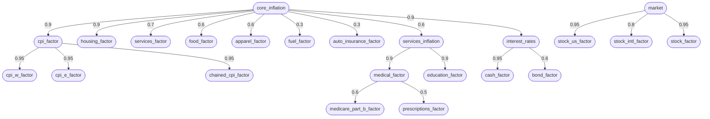

# t_inflation_factors

Inflation's latent factors and their correlations, and nothing else.

## Purpose

A latent factor for each inflation series, linked into one tree under `core_inflation`, with each link's ρ from history. No rates and no varying rows: scenarios that vary an inflation series hang their rows off these factors, so they share one correlation structure. The market factors ([`t_market_factors`](../t_market_factors/README.md)) hang under this tree too.

A template scenario: data repos read it from the analysis code repository's `templates/scenarios/` unless they have a scenario of the same name, which replaces it whole. See [Template scenarios](../../../docs/guides/historical-calibration.md#template-scenarios) in the historical calibration guide.

## The factor tree

Each arrow carries the child's ρ to its parent. The market factors, from [`t_market_factors`](../t_market_factors/README.md), are included: `interest_rates` hangs under `core_inflation`, and `market` is a root of its own. Where each ρ comes from is in [The factor tree](../../../docs/guides/historical-calibration.md#the-factor-tree-_factors) in the historical calibration guide.

## The templates

- [`t_empty`](../t_empty/README.md): nothing; the root
  - **`t_inflation_factors`** (this one): inflation's latent factors
    - [`t_inflation_series`](../t_inflation_series/README.md): long-run inflation rates
      - [`t_inflation_ensemble`](../t_inflation_ensemble/README.md): year-by-year inflation paths
        - [`t_inflation_current`](../t_inflation_current/README.md): today's inflation rates, held, then returning
    - [`t_market_factors`](../t_market_factors/README.md): interest-rate and stock factors
      - [`t_market_series`](../t_market_series/README.md): long-run cash, bond and stock rates
        - [`t_market_ensemble`](../t_market_ensemble/README.md): year-by-year market paths
          - [`t_market_current`](../t_market_current/README.md): today's cash yield, held, then returning

Episodes, each a mix-in building on `t_inflation_series` and `t_market_series`:

- [`t_great_inflation`](../t_great_inflation/README.md): a dysfunction: inflation runs for years (1966–1982)
- [`t_financial_crisis`](../t_financial_crisis/README.md): a fiscal shock: a crash, then years of near-zero rates (2008–2019)
- [`t_pandemic_spike`](../t_pandemic_spike/README.md): an external shock: a short price spike, then rate hikes (2021–2023)

And one that puts two of them in one lifetime:

- [`t_crisis_then_spike`](../t_crisis_then_spike/README.md): a crisis, then a spike 1 to 10 years after its near-zero rates end (2008–2023)
